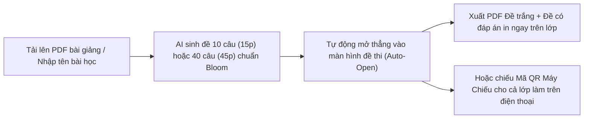

> **Tóm tắt nhanh (TL;DR):** Việc soạn các bài kiểm tra thường xuyên (15 phút) và kiểm tra định kỳ (45 phút / 1 tiết) theo đúng tỷ lệ nhận thức của **Thông tư 22/2021/TT-BGDĐT** và **Công văn 7991/BGDĐT-GDTrH** tiêu tốn của giáo viên hàng chục giờ mỗi tháng. Với **Top 5 website tạo đề kiểm tra 15 phút & 1 tiết in ngay** năm 2026 gồm **QuizKen**, **Azota**, **Violet.vn**, **Tuyensinh247** và **Conker AI**, thầy cô có thể tạo xong một bộ đề 10–40 câu từ tài liệu bài giảng, tự động mở vào trang kiểm duyệt và xuất file PDF A4 in ngay chỉ trong 60 giây.

---

# Top 5 Web Tạo Đề Kiểm Tra 15 Phút & 1 Tiết In Ngay Cho Giáo Viên 2026

Theo quy định tại **Thông tư 22/2021/TT-BGDĐT** về đánh giá học sinh THCS và THPT, bên cạnh bài kiểm tra giữa kỳ và cuối kỳ, mỗi môn học đều có từ 2 đến 4 đầu điểm **đánh giá thường xuyên (kiểm tra 15 phút, kiểm tra miệng, bài thực hành)**. Đặc biệt, theo hướng dẫn mới nhất tại **Công văn 7991/BGDĐT-GDTrH**, các câu hỏi kiểm tra cần phân bổ rõ ràng theo các mức độ nhận thức (*Nhận biết ~40%, Thông hiểu ~30%, Vận dụng ~30%*).

Nỗi vất vả lớn nhất của giáo viên đứng lớp là:
* Mỗi tuần phải ra nhiều đề kiểm tra 15 phút cho các lớp khác nhau (ví dụ dạy 6 lớp khối 11 thì cần 6 đề khác nhau để lớp kiểm tra sau không biết trước đề của lớp kiểm tra trước).
* Khi tìm đề trên mạng thường gặp file ảnh mờ, file Word bị khóa mật khẩu, hoặc đề cũ chưa cập nhật theo sách giáo khoa mới (*Kết nối tri thức, Chân trời sáng tạo, Cánh diều*).

Dưới đây là đánh giá khách quan **Top 5 website tạo đề kiểm tra 15 phút và 1 tiết hỗ trợ in ngay trên giấy A4 hoặc thi trực tuyến tốt nhất năm 2026**.

---

## Bảng So Sánh 5 Web Tạo Đề Kiểm Tra 15 Phút & 1 Tiết (2026)

| Nền tảng | Tạo đề mới 100% từ bài giảng của giáo viên | Phân loại mức độ nhận thức Bloom | Xuất PDF A4 in ngay (Đề trắng + Đáp án) | Chiếu QR làm bài trực tiếp | Chi phí |
| :--- | :--- | :--- | :--- | :--- | :--- |
| **1. QuizKen** | **Có (AI tạo trong 30 giây)** | **Tự động gắn nhãn L1–L4** | **4 chế độ PDF chuẩn A4** | **Có (Classroom Projector QR)** | **Miễn phí 100%** |
| **2. Azota** | Tải đề có sẵn lên trộn mã | Thủ công theo cấu trúc file | Có xuất file đề và đáp án | Có gửi link / QR cơ bản | Miễn phí / VIP |
| **3. Thư viện Violet.vn** | Kho đề cộng đồng chia sẻ | Có trong một số file Word | Tải file Word về tự chỉnh in | Không | Miễn phí / Điểm thưởng |
| **4. Tuyensinh247 / VietJack** | Ngân hàng đề tham khảo | Theo chuyên đề có sẵn | Nhiều đề yêu cầu tài khoản VIP | Không (Dành cho học sinh tự ôn) | Xem miễn phí / Tải trả phí |
| **5. Conker AI** | Có tạo đề ngắn bằng AI | Cơ bản | Chỉ xuất qua Google Forms | Chia sẻ link | Giới hạn 5 đề ở bản Free |

---

## Đánh Giá Chi Tiết Top 5 Web Tạo Đề Kiểm Tra 15 Phút & 1 Tiết Cho Giáo Viên

### 1. QuizKen — Tạo đề AI từ giáo án, tự động mở đề và xuất bản in A4 chỉ trong 1 phút

**QuizKen** được thiết kế tối ưu cho nhịp độ làm việc bận rộn của giáo viên phổ thông và giảng viên đại học tại Việt Nam.

* **Quy trình liền mạch không thao tác thừa:**
  * **Tự động mở thẳng vào đề vừa tạo (`Auto-Navigate`):** Ngay khi AI hoàn tất biên soạn câu hỏi cuối cùng từ tài liệu PDF/Word hoặc chủ đề bài giảng, hệ thống tự động chuyển thầy cô vào thẳng giao diện đề thi (`/quiz/play/:id`) để xem lại, xuất file hoặc trình chiếu ngay mà không cần quay lại thư viện tìm kiếm.
  * **Linh hoạt số lượng câu hỏi:** Dễ dàng chọn **10–15 câu** cho bài kiểm tra 15 phút đầu giờ, hoặc **30–50 câu** cho bài kiểm tra 1 tiết (45 phút) và thi thử học kỳ.
  * **In ngay với 2 bản PDF đồng bộ:** Từ nút Split Button **PDF**, thầy cô tải ngay 1 bản **`Đề thi trắng (In cho học sinh)`** (có sẵn khung điền *Họ tên, Lớp, Mã đề, Điểm*) và 1 bản **`Đề thi + Bảng đáp án cuối trang`** để chấm bài trong tích tắc.
  * **Tích hợp bộ công cụ lớp học:** Nếu lớp học có máy chiếu và cho phép dùng smartphone, thầy cô chỉ cần bấm **"Phóng to QR Máy Chiếu"** hoặc chọn chế độ **"Phòng Thi Thử"** (tự động đặt đồng hồ 15 phút / 45 phút và đảo câu hỏi + đáp án A/B/C/D chống nhìn bài nhau).
* **Ưu điểm:** Tạo được vô số đề kiểm tra 15 phút tương đương nhau cho 5–6 lớp khác nhau chỉ trong vài phút, bám sát tuyệt đối tài liệu giảng dạy của chính giáo viên nhờ công nghệ RAG (Retrieval-Augmented Generation).
* **Nhược điểm:** Cần kết nối Internet khi khởi tạo đề bằng AI (sau khi tải PDF về máy có thể in và sử dụng hoàn toàn offline).
* **Chi phí:** Miễn phí.

👉 **Soạn đề kiểm tra 15 phút ngay:** [Tạo đề kiểm tra AI và xuất PDF A4 miễn phí trên QuizKen](https://app.quizken.com).

---

### 2. Azota — Công cụ giao bài kiểm tra 15 phút từ file đề có sẵn

Nếu thầy cô đã soạn sẵn một file đề 15 phút trên Microsoft Word, **Azota** là công cụ rất tiện lợi để chuyển file đó thành bài kiểm tra cho học sinh.

* **Ưu điểm:**
  * Xử lý nhanh file Word/PDF có sẵn, cho phép trộn ra nhiều mã đề để in hoặc giao bài tập về nhà qua nhóm Zalo lớp.
* **Nhược điểm:**
  * Khi giáo viên chưa có sẵn đề và cần AI tự đọc bài giảng trong sách giáo khoa để đặt câu hỏi mới kèm lời giải chi tiết cho 6 lớp khác nhau thì vẫn phải tự soạn câu hỏi thủ công trước.
* **Chi phí:** Miễn phí cơ bản / Gói VIP giáo viên.

---

### 3. Thư viện bài giảng Violet.vn — Kho đề kiểm tra truyền thống của giáo viên Việt

**Violet.vn** là cộng đồng chia sẻ giáo án và đề kiểm tra lâu đời của giáo viên trên khắp các tỉnh thành.

* **Ưu điểm:**
  * Có nhiều đề kiểm tra định kỳ kèm ma trận và bản đặc tả do các thầy cô đồng nghiệp tải lên chia sẻ dưới định dạng `.doc` / `.docx`.
* **Nhược điểm:**
  * Chất lượng đề không đồng đều, nhiều đề thuộc chương trình cũ hoặc bị lỗi font VNI/ABC cổ điển; học sinh cũng có thể lên mạng tìm thấy đúng đề đó nếu giáo viên tải về in nguyên xi.
* **Chi phí:** Tải miễn phí bằng điểm thành viên hoặc nạp điểm.

---

### 4. Tuyensinh247 & VietJack — Nguồn tham khảo câu hỏi theo từng bài học

Các trang học tập trực tuyến như **Tuyensinh247** hay **VietJack** phân chia hệ thống câu hỏi trắc nghiệm rất chi tiết theo từng bài học của cả 3 bộ sách giáo khoa GDPT 2018.

* **Ưu điểm:**
  * Nguồn câu hỏi tham khảo phong phú, bám sát từng chương mục của chương trình phổ thông.
* **Nhược điểm:**
  * Không cho phép giáo viên xuất nhanh ra một file PDF đề thi trắng sạch sẽ có khung tên trường/lớp theo ý muốn nếu không mua gói tải tài liệu hoặc tự copy từng câu sang Word.
* **Chi phí:** Xem web miễn phí, tải file Word/PDF thường yêu cầu trả phí.

---

### 5. Conker AI — Công cụ tạo quiz ngắn cho giáo viên quốc tế

**Conker AI** (từ đội ngũ Book Creator) là website tạo nhanh các bài quiz ngắn từ 5–10 câu hỏi.

* **Ưu điểm:**
  * Giao diện tối giản, hỗ trợ xuất đề sang Google Forms chỉ với 1 nút bấm.
* **Nhược điểm:**
  * Không được huấn luyện chuyên sâu cho chương trình GDPT 2018 của Việt Nam, không hỗ trợ xuất PDF A4 4 chế độ hay vẽ hình minh họa `VisualScene` Toán – Lý.
* **Chi phí:** Bản miễn phí giới hạn chỉ 5 đề và tối đa 10 câu/đề.

---

## Kịch Bản Ứng Dụng Thực Tế Cho Giáo Viên Đứng Lớp 2026

* **Trường hợp 1 (Kiểm tra 15 phút trên giấy không báo trước):** Mở [QuizKen](https://app.quizken.com), nhập tên bài vừa dạy hôm trước ➔ Chọn 10 câu ➔ Bấm xuất **PDF Đề thi trắng** (nhờ bố cục lưới đáp án `2×2`, 10 câu chỉ gói gọn trong đúng **1 mặt giấy A4**) ➔ Photo cho cả lớp làm trong 15 phút.
* **Trường hợp 2 (Kiểm tra 15 phút không tốn giấy qua Máy chiếu):** Mở đề trên Dashboard QuizKen ➔ Nhấn **"QR Lớp học"** ➔ Chọn tab **"Phòng Thi Thử"** ➔ Học sinh quét QR trên màn chiếu, bật chế độ **15 phút + Trộn câu hỏi & Đáp án A/B/C/D** và nhận điểm ngay khi hết giờ!

---

## Câu hỏi thường gặp (FAQ)

### 1. Một đề kiểm tra 15 phút (10 câu) khi xuất PDF trên QuizKen chiếm bao nhiêu trang giấy A4?
Nhờ thuật toán dàn lưới `2×2` cho các phương án ngắn và bố cục thẻ câu hỏi tối ưu, một đề kiểm tra 10–12 câu trên QuizKen thường chỉ gói gọn trong **1 đến 1,5 mặt giấy A4**, giúp giáo viên in 2 mặt trên 1 tờ giấy duy nhất cho mỗi học sinh.

### 2. Làm sao để tạo 4 đề kiểm tra 15 phút khác nhau cho 4 lớp cùng khối mà không bị lộ đề?
Thầy cô có thể dùng nút **"Tạo lại / Biến thể đề mới"** trên cùng tài liệu bài giảng trong QuizKen để AI sinh bộ câu hỏi kiểm tra cùng một đơn vị kiến thức nhưng với số liệu và tình huống hoàn toàn mới cho từng lớp.

### 3. Đề kiểm tra tạo trên QuizKen có thể chuyển thành chế độ riêng tư để học sinh lớp khác không tìm thấy trước giờ kiểm tra không?
Có. Ngay trong mục **Đề đã tạo (Created Quizzes)** trên Dashboard của QuizKen, mỗi thẻ đề đều có nút chuyển đổi 1-click giữa **`Công khai (Public)`** và **`Riêng tư (Private)`**. Thầy cô chỉ cần để ở chế độ **Riêng tư** và chỉ mở **Mã QR Lớp học** khi bước vào tiết kiểm tra.
