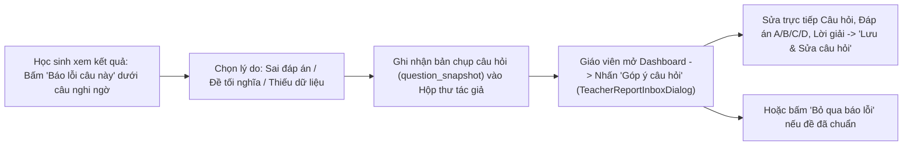

> **Tóm tắt nhanh (TL;DR):** Dù đề thi được soạn thủ công hay tạo bằng AI, đôi khi vẫn không tránh khỏi một vài câu bị gõ nhầm đáp án đúng, đề bài đa nghĩa hoặc thiếu dữ liệu. Thay vì để học sinh phải chụp màn hình gửi rải rác vào nhóm Zalo khiến giáo viên quên mất khi hết tiết, **Top 5 hệ thống trắc nghiệm có Hộp thư học sinh báo lỗi câu hỏi trực tiếp** năm 2026 gồm **QuizKen**, **Moodle LMS**, **Canvas Quizzes**, **Formative** và **Piazza / Coursera** đã thiết lập quy trình phản hồi – chỉnh sửa khép kín chỉ trong 1 cú nhấp chuột.

---

# Top 5 Web Trắc Nghiệm Có Hộp Thư Học Sinh Báo Lỗi Câu Hỏi Cho Giáo Viên

Trong quá trình xây dựng ngân hàng hàng trăm câu hỏi trắc nghiệm, việc có 1–2 câu hỏi gặp sai sót kỹ thuật (ví dụ: đáp án đúng là `A` nhưng khi nhập liệu lại chọn nhầm `B`, hoặc câu hỏi trích xuất từ file PDF gốc bị thiếu một vế điều kiện) là điều rất thường gặp.

Ở các trang web làm trắc nghiệm thông thường, khi học sinh phát hiện một câu hỏi bị lỗi:
* Học sinh không có nút nào ngay tại câu hỏi đó để báo cho tác giả đề thi.
* Nếu học sinh nhắn tin vào nhóm lớp *"Thầy ơi đề Hóa câu 14 bị sai đáp án ạ"*, đến tối giáo viên mở máy ra xem thì đề đã bị trộn thứ tự nên không biết "câu 14" của học sinh đó là câu nào trong đề gốc, rồi lại phải mở trình soạn thảo lật tìm từng câu rất vất vả.

Năm 2026, quy chuẩn **Cộng tác kiểm định chất lượng học liệu (Crowdsourced Question Quality Loop)** cho phép học sinh gắn nhãn báo lỗi ngay dưới câu hỏi và đẩy thẳng vào **Hộp thư góp ý trên Dashboard của giáo viên** để sửa trực tiếp tại chỗ. Dưới đây là **Top 5 nền tảng sở hữu cơ chế này tốt nhất hiện nay**.

---

## Bảng So Sánh 5 Hệ Thống Trắc Nghiệm Có Hộp Thư Báo Lỗi Câu Hỏi (2026)

| Hệ thống | Nút "Báo lỗi câu này" ngay dưới từng câu hỏi | Phân loại lý do báo lỗi chuẩn | Hộp thoại sửa trực tiếp Câu hỏi + Đáp án + Lời giải trên Dashboard | Chống xung đột phiên bản (`PT409`) | Chi phí |
| :--- | :--- | :--- | :--- | :--- | :--- |
| **1. QuizKen (`TeacherReportInboxDialog`)** | **Có (`QuestionFeedback`)** | **3 nhóm (*Sai đáp án / Đề tối nghĩa / Thiếu dữ liệu*)** | **Có (Sửa & Lưu 1-Click ngay trên Dashboard)** | **Có (`question_revision` RPC)** | **Miễn phí 100%** |
| **2. Moodle LMS (Plugin)** | Cần cài thêm plugin *Question Flag* | Bình luận tự do | Phải vào Question Bank phức tạp | Cơ bản | Miễn phí (Tự thuê Server) |
| **3. Canvas Quizzes** | Qua hộp bình luận bài nộp | Tự gõ tin nhắn | Mở trình Regrade trong khóa học | Có | Bản quyền trường đại học |
| **4. Coursera / edX** | Có cờ *Report an issue* | Chọn loại lỗi cơ bản | Chỉ dành cho đội ngũ vận hành khóa học | Nội bộ | Thu phí khóa học |
| **5. Formative** | Học sinh nhắn tin dưới câu hỏi | Tin nhắn chat | Giáo viên mở lại trang thiết kế đề | Không | Trả phí gói Teacher Pro |

---

## Đánh Giá Chi Tiết Top 5 Hệ Thống Cho Phép Báo Lỗi & Sửa Câu Hỏi Trực Tiếp

### 1. QuizKen — Quy trình khép kín từ `QuestionFeedback` của học sinh đến `TeacherReportInboxDialog` trên Dashboard

Trong bản cập nhật **Hướng C (Task 3)** năm 2026, **QuizKen** đã hoàn thiện vòng lặp kiểm định chất lượng đề thi giữa người học và người tạo đề thông qua dịch vụ `practiceReview` kết hợp hộp thoại **`TeacherReportInboxDialog.tsx`** ngay trên Dashboard.

* **Trải nghiệm từ phía Học sinh làm bài (`QuestionFeedback`):**
  * Khi xem lại kết quả bài làm, dưới mỗi câu hỏi đều có mục gọn gàng **`"Báo lỗi câu này"`**.
  * Học sinh chỉ cần chọn 1 trong 3 lý do chuẩn xác từ menu thả xuống:
    1. **`Sai đáp án` (`answer`)**
    2. **`Đề tối nghĩa / Khó hiểu` (`ambiguous`)**
    3. **`Thiếu dữ liệu / Hình ảnh` (`missing`)**
  * Nhấn **"Gửi báo lỗi"** ➔ Hệ thống tự động đính kèm chỉ số câu hỏi gốc (`question_index`) và bản chụp nguyên trạng câu hỏi đó (`question_snapshot`) gửi thẳng tới hộp thư của tác giả đề thi.
* **Trải nghiệm từ phía Giáo viên trên Dashboard (`TeacherReportInboxDialog`):**
  * Giáo viên không cần phải mở trang làm bài của từng đề rồi cuộn xuống cuối trang nữa: ngay trên danh sách **Đề đã tạo (`CreatedQuizzes`)** ở Dashboard, mỗi đề đều có nút màu hồng đỏ **`"Góp ý câu hỏi"`** (`MessageSquareWarning` icon).
  * Khi nhấn vào, hộp thoại **`Hộp thư báo lỗi câu hỏi`** hiện ra liệt kê toàn bộ các báo lỗi đang chờ xử lý của đề đó (hoặc thông báo xanh *"Không có báo lỗi nào đang mở — Tất cả câu hỏi trong đề này đều đang hoạt động tốt"*).
  * Ngay bên trong thẻ báo lỗi, giáo viên được cung cấp sẵn **ô sửa Nội dung câu hỏi**, **menu chọn lại Đáp án đúng (`A / B / C / D`)** và **ô sửa Lời giải chi tiết**.
  * Nhấn **`"Lưu & Sửa câu hỏi"`** (`practiceReview.correct`) ➔ Cơ sở dữ liệu cập nhật ngay câu hỏi trong đề và tự động đóng báo lỗi! Nếu học sinh báo nhầm (đề vốn đã đúng), giáo viên chỉ cần nhấn **`"Bỏ qua báo lỗi"`** (`practiceReview.dismiss`).
* **Ưu điểm:** Tiết kiệm 95% thời gian rà soát đề cho giáo viên; có cơ chế kiểm tra xung đột phiên bản (`PT409`) nếu câu hỏi đã được sửa trước đó.
* **Nhược điểm:** Chỉ những học sinh đã thực hiện lượt làm bài thật (`attemptId`) mới được gửi báo lỗi câu hỏi nhằm chống spam phá hoại từ người lạ.
* **Chi phí:** Hoàn toàn miễn phí.

👉 **Trải nghiệm ngay:** [Kiểm tra Hộp thư góp ý câu hỏi trên Dashboard QuizKen](https://app.quizken.com/user/dashboard).

---

### 2. Moodle LMS (với Plugin StudentQuiz / Question Issue Reporting)

**Moodle** là hệ thống quản lý học tập mã nguồn mở phổ biến tại các trường đại học kỹ thuật.

* **Ưu điểm:**
  * Khi quản trị viên cài đặt thêm mô-đun *StudentQuiz*, sinh viên có thể chấm sao độ khó và để lại bình luận góp ý dưới từng câu hỏi trong ngân hàng đề.
* **Nhược điểm:**
  * Giao diện quản trị Question Bank của Moodle rất đồ sộ và nhiều tầng menu; giáo viên phổ thông bình thường không thể tự thuê máy chủ cài đặt Moodle chỉ để dạy học hàng ngày.
* **Chi phí:** Phần mềm mã nguồn mở nhưng tốn chi phí thuê máy chủ và kỹ thuật viên vận hành.

---

### 3. Canvas LMS (New Quizzes & SpeedGrader)

**Canvas** được sử dụng tại nhiều trường đại học quốc tế với tính năng *Quiz Regrade*.

* **Ưu điểm:**
  * Khi giảng viên phát hiện một câu hỏi trong bài kiểm tra bị sai đáp án và chỉnh lại đáp án đúng trong Canvas, hệ thống hỗ trợ tính lại điểm (Regrade) cho các sinh viên đã nộp bài.
* **Nhược điểm:**
  * Sinh viên muốn báo lỗi vẫn phải gửi tin nhắn qua hộp thư *Submission Comments* chung của cả bài thi chứ không có nút báo lỗi gắn theo từng câu hỏi với 3 nhãn phân loại chuẩn như trên QuizKen.
* **Chi phí:** Bản quyền doanh nghiệp/đại học.

---

### 4. Coursera & edX — Nút "Report an Issue" trong các khóa học MOOC

Khi làm bài quiz trên **Coursera** hoặc **edX**, người học luôn thấy một lá cờ nhỏ *"Report an issue"* ở góc dưới câu hỏi.

* **Ưu điểm:**
  * Giao diện chọn lý do báo lỗi rất chuẩn mực, là nguồn cảm hứng cho các nền tảng EdTech hiện đại.
* **Nhược điểm:**
  * Đây là nền tảng đóng của các trường đại học lớn trên thế giới; giáo viên Việt Nam không thể tự đăng ký tạo đề kiểm tra hàng ngày và mở hộp thư duyệt lỗi trên Coursera được.
* **Chi phí:** Thu phí theo chứng chỉ khóa học.

---

### 5. Formative — Trao đổi qua khung tin nhắn câu hỏi

**Formative** cho phép học sinh gửi tin nhắn phản hồi riêng tư cho giáo viên ở từng mục bài tập.

* **Ưu điểm:**
  * Thuận tiện cho việc hỏi đáp giữa học sinh và giáo viên trong giờ tự học.
* **Nhược điểm:**
  * Không có hộp thoại `TeacherReportInboxDialog` gom toàn bộ các câu bị báo lỗi kèm form sửa trực tiếp *Câu hỏi – Đáp án A/B/C/D – Lời giải* ngay trên một màn hình duy nhất như QuizKen.
* **Chi phí:** Tính năng nâng cao thuộc gói trả phí.

---

## Tại Sao Tính Năng "Hộp Thư Báo Lỗi Câu Hỏi" Lại Cực Kỳ Quan Trọng Trong Kỷ Nguyên Tạo Đề AI?

Khi giáo viên dùng AI để tạo nhanh 50–100 câu hỏi từ một tập tài liệu dài, việc tự mình đọc dò từng chữ của cả 100 câu đôi khi mất nhiều thời gian. Thay vào đó:
1. Giáo viên kiểm tra lướt các câu trọng tâm rồi giao đề cho lớp làm bài ôn tập.
2. Với **40 cặp mắt của học sinh trong lớp**, bất kỳ câu hỏi nào có cách diễn đạt hơi tối nghĩa hoặc đáp án chưa sát đều sẽ được học sinh bấm **"Báo lỗi câu này"** ngay lập tức.
3. Cuối buổi, giáo viên chỉ mất **30 giây** mở nút **"Góp ý câu hỏi"** trên Dashboard [QuizKen](https://app.quizken.com/user/dashboard) để duyệt và bấm **"Lưu & Sửa câu hỏi"** — bộ đề của thầy cô sẽ đạt độ chuẩn xác hoàn hảo 100% trước khi đưa vào kỳ thi chính thức hoặc xuất ra PDF A4!

---

## Câu hỏi thường gặp (FAQ)

### 1. Người lạ chưa từng làm đề thi của tôi có thể bấm spam báo lỗi câu hỏi được không?
Không. Hàm `practiceReview.report(attemptId, index, reason)` của QuizKen yêu cầu phải có mã lượt làm bài hợp lệ (`p_attempt`) được xác thực trên cơ sở dữ liệu Supabase, đồng thời chỉ chủ sở hữu đề thi (`ownerId`) mới có quyền truy cập hộp thư `practice_report_inbox` và thực hiện lệnh chỉnh sửa.

### 2. Khi tôi sửa câu hỏi trong Hộp thư góp ý trên Dashboard và bấm "Lưu & Sửa câu hỏi", đề thi gốc có được cập nhật ngay không?
Có. Ngay khi thầy cô bấm **"Lưu & Sửa câu hỏi"**, thủ tục `correct_reported_question` trên cơ sở dữ liệu sẽ cập nhật trực tiếp nội dung câu hỏi, đáp án đúng và lời giải mới vào đề thi gốc, tăng chỉ số phiên bản câu hỏi (`question_revision`) và tự động xóa báo lỗi đó khỏi danh sách chờ xử lý.

### 3. Có những nhãn lý do báo lỗi nào được hiển thị trong Hộp thư của giáo viên?
Hàm `formatReportReasonLabel` trong `TeacherReportInboxDialog.tsx` hiển thị rõ huy hiệu màu đỏ hồng tương ứng với 3 nhóm lỗi: **`Sai đáp án`** (`answer`), **`Đề tối nghĩa / Khó hiểu`** (`ambiguous`), và **`Thiếu dữ liệu / Hình ảnh`** (`missing`).
