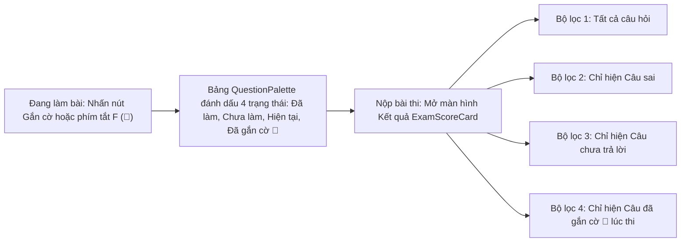

> **Tóm tắt nhanh (TL;DR):** Trong các kỳ thi chuẩn hóa trên máy tính năm 2026 (như Đánh giá năng lực ĐHQG, Đánh giá tư duy TSA, VSTEP, IELTS Computer-delivered hay Digital SAT), hai kỹ năng sống còn là **Gắn cờ đánh dấu câu phân vân (`Flag for Review 🚩`)** trong lúc thi và **Lọc riêng câu sai / câu gắn cờ** để phân tích sau khi nộp bài. Dưới đây là **Top 5 website sở hữu hệ thống gắn cờ xem lại và bộ lọc chữa bài thông minh nhất năm 2026**: **QuizKen**, **Bluebook (College Board)**, **Study4**, **Prep.vn** và **Exam.net**.

---

# Top 5 Web Thi Trắc Nghiệm Có Gắn Cờ Xem Lại 🚩 & Bộ Lọc Câu Sai 2026

Khi làm một bài thi trắc nghiệm từ 40 đến 120 câu hỏi trên màn hình máy tính, thí sinh thường gặp hai vấn đề lớn nếu giao diện trang web quá sơ sài:
1. **Trong lúc làm bài:** Khi gặp một câu tính toán dài hoặc đang phân vân giữa hai đáp án B và C, nếu dừng lại suy nghĩ quá lâu sẽ hết giờ làm các câu dễ phía sau; nhưng nếu bỏ qua đi tiếp thì lúc quay lại không tài nào nhớ nổi câu phân vân đó là câu số mấy trong 50 câu!
2. **Sau khi nộp bài:** Khi nhận kết quả đạt `36/50 câu đúng`, thí sinh muốn xem ngay **14 câu mình làm sai** và **5 câu mình đã gắn cờ `🚩` lúc thi** (vì câu gắn cờ dù khoanh mò trúng đáp án đúng vẫn là kiến thức chưa chắc chắn!). Nếu trang web bắt phải cuộn chuột qua toàn bộ 50 câu từ đầu đến cuối thì việc ôn tập rất mệt mỏi và kém hiệu quả.

Dưới đây là đánh giá chi tiết **Top 5 nền tảng thi trắc nghiệm trang bị tính năng Gắn cờ xem lại `🚩` kết hợp Bộ lọc kết quả thông minh tốt nhất năm 2026**.

---

## Bảng So Sánh 5 Web Thi Trắc Nghiệm Có Gắn Cờ 🚩 & Bộ Lọc Câu Sai (2026)

| Nền tảng | Gắn cờ `🚩` bằng nút bấm & phím tắt `F` | Bảng điều hướng `QuestionPalette` 4 trạng thái | Bộ lọc sau khi thi (Tất cả / Câu sai / Bỏ trống / Đã gắn cờ 🚩) | Lưu câu sai vào Sổ tay 1-Click | Chi phí |
| :--- | :--- | :--- | :--- | :--- | :--- |
| **1. QuizKen (`ExamModePage`)** | **Có (Nút bấm + Phím `F`)** | **Có (Sidebar máy tính + Drawer di động)** | **Có đủ 4 bộ lọc chuyên biệt** | **Có (Tự động hoặc 1-Click)** | **Miễn phí 100%** |
| **2. Bluebook (Digital SAT)** | Có (Mark for Review) | Có bảng chuyển câu nhanh | Chỉ xem tổng quan trên web | Không có sổ tay tiếng Việt | Miễn phí cho đề mẫu SAT |
| **3. Study4** | Có đánh dấu câu hỏi | Có bảng câu hỏi | Có lọc câu sai / chưa làm | Có tạo flashcard từ vựng | Miễn phí / Khóa trả phí |
| **4. Prep.vn** | Có trong phòng thi ảo | Có bảng điều hướng | Có lọc đúng / sai | Trong lộ trình khóa học | Thu phí theo khóa học |
| **5. Exam.net** | Có đánh dấu cơ bản | Có danh sách câu | Phục vụ giám thị chấm bài | Không | Dùng thử / Thu phí trường |

---

## Đánh Giá Chi Tiết Top 5 Web Thi Trắc Nghiệm Có Gắn Cờ Xem Lại & Bộ Lọc Câu Sai

### 1. QuizKen — Hệ thống `QuestionPalette` 4 trạng thái & Bộ lọc kết quả 4 chế độ

Trong bản nâng cấp **Phòng Thi Thử (`ExamModePage.tsx`)** năm 2026, **QuizKen** mang trải nghiệm phần mềm khảo thí quốc tế lên trình duyệt web hoàn toàn miễn phí cho học sinh Việt Nam.

* **Trong quá trình làm bài thi:**
  * **Gắn cờ siêu tốc bằng chuột hoặc phím tắt `F`:** Tại bất kỳ câu hỏi nào đang phân vân, thí sinh chỉ cần nhấn phím **`F`** trên bàn phím (hoặc bấm nút *"Đánh dấu xem lại"* ở góc trên thẻ câu hỏi).
  * **Bảng điều hướng câu hỏi (`QuestionPalette`) trực quan:** Hiển thị cố định ở cột bên phải trên màn hình máy tính (và mở nhanh qua hộp thoại trên điện thoại). Mỗi ô số thứ tự câu hỏi thể hiện rõ 4 trạng thái bằng màu sắc và ký hiệu:
    * `Chưa trả lời (unanswered)`: Ô viền nét đứt.
    * `Đã trả lời (answered)`: Ô tô màu đầy đặn.
    * `Câu hiện tại (current)`: Ô có vòng sáng nổi bật.
    * `Đã gắn cờ (flagged 🚩)`: Đính kèm biểu tượng **lá cờ đỏ `🚩`** nổi bật ở góc ô số để thí sinh bấm nhảy tới xem lại chỉ trong 1 giây trước khi nộp bài.
* **Sau khi nộp bài (`ExamScoreCard` Review Filters):**
  * Ngay phía trên danh sách **Chi Tiết & Giải Thích Đáp Án**, QuizKen trang bị **4 nút bộ lọc thông minh (`filterExamReviewQuestions`)** kèm số lượng thống kê:
    1. **`Tất cả (N)`**: Xem toàn bộ đề thi từ Câu 1 đến hết.
    2. **`Câu sai (X)`**: Lọc riêng những câu bạn chọn sai phương án để đọc kỹ hộp giải thích AI.
    3. **`Chưa trả lời (Y)`**: Lọc riêng những câu bạn bỏ trống do không kịp giờ.
    4. **`🚩 Đã gắn cờ (Z)`**: Lọc riêng những câu bạn đã đánh dấu phân vân trong lúc thi (trên mỗi thẻ câu hỏi này cũng hiển thị nhãn vàng **`🚩 Đã đánh dấu`**), giúp bạn kiểm tra lại cả những câu *"khoanh lụi may mắn trúng"* để học thật chắc bản chất!
* **Ưu điểm:** Áp dụng được cho mọi môn học từ Toán, Lý, Hóa, Sinh, Anh đến đề thi Đánh giá năng lực tự tạo từ file PDF.
* **Nhược điểm:** Chưa có công cụ gạch bỏ từng phương án nhiễu (cross-out option) bằng chuột phải (đang được nghiên cứu cho các bản cập nhật tiếp theo).
* **Chi phí:** Hoàn toàn miễn phí.

👉 **Luyện kỹ năng phòng thi ngay:** [Trải nghiệm Gắn cờ 🚩 và Bộ lọc câu sai trong Phòng Thi Thử QuizKen](https://app.quizken.com).

---

### 2. Bluebook (College Board) — Phần mềm thi Digital SAT chuẩn quốc tế

**Bluebook** là ứng dụng thi trên máy tính chính thức của kỳ thi SAT quốc tế, nổi tiếng với công cụ *Mark for Review*.

* **Ưu điểm:**
  * Giao diện bảng câu hỏi và cờ đánh dấu cực kỳ chuẩn mực, giúp thí sinh làm quen với áp lực thi Digital SAT thực tế.
* **Nhược điểm:**
  * Là phần mềm đóng chỉ chứa vài đề thi mẫu SAT tiếng Anh của College Board; học sinh Việt Nam không thể nạp đề thi tốt nghiệp THPT hay đề Đánh giá năng lực tiếng Việt vào Bluebook để luyện tập.
* **Chi phí:** Miễn phí cho các đề mẫu SAT có sẵn.

---

### 3. Study4 — Giao diện luyện đề ngoại ngữ có bảng câu hỏi rõ ràng

**Study4** được nhiều học sinh luyện thi IELTS và TOEIC yêu thích nhờ bố cục bảng câu hỏi nằm gọn bên cạnh bài đọc.

* **Ưu điểm:**
  * Cho phép đánh dấu câu hỏi đang làm dở và lọc xem lại các câu trả lời sai kèm giải thích từ vựng tiếng Anh.
* **Nhược điểm:**
  * Chưa có bộ lọc riêng biệt cho nhóm câu *"Đã gắn cờ 🚩 trong lúc thi"* tách khỏi nhóm câu đúng/sai thông thường trên màn hình Scorecard tổng hợp như QuizKen; phạm vi đề chủ yếu gói gọn trong môn ngoại ngữ.
* **Chi phí:** Freemium.

---

### 4. Prep.vn — Phòng thi ảo IELTS / THPT trong các khóa học trả phí

**Prep.vn** đầu tư mạnh vào giao diện phòng thi ảo mô phỏng kỳ thi trên máy tính cho học sinh đăng ký lộ trình học.

* **Ưu điểm:**
  * Giao diện hiện đại, có tính năng đánh dấu câu hỏi cần xem lại và giải thích đáp án chi tiết.
* **Nhược điểm:**
  * Hầu hết các phòng luyện đề chuyên sâu yêu cầu học viên phải mua gói khóa học trả phí; không cho phép người dùng tự tạo đề thi mới bằng AI từ tài liệu cá nhân hay xuất PDF A4 4 chế độ.
* **Chi phí:** Thu phí theo gói khóa học.

---

### 5. Exam.net — Giao diện làm bài tối giản cho kỳ thi tại trường

**Exam.net** cung cấp thanh danh sách câu hỏi để thí sinh chuyển nhanh giữa các phần của bài thi.

* **Ưu điểm:**
  * Môi trường làm bài không xao nhãng, tập trung tối đa vào nội dung đề thi của giáo viên.
* **Nhược điểm:**
  * Sau khi thí sinh bấm nộp bài, toàn bộ bài làm được thu về máy chủ của giáo viên chứ thí sinh không được mở ngay màn hình `ExamScoreCard` có bộ lọc 4 chế độ kèm lời giải AI để tự ôn tập tại chỗ như trên QuizKen.
* **Chi phí:** Thu phí bản quyền trường học.

---

## Tại Sao Bạn Phải Luôn Kiểm Tra Bộ Lọc "🚩 Đã Gắn Cờ" Sau Khi Thi?

Nhiều học sinh có thói quen sau khi nộp bài chỉ nhìn vào con số điểm tổng (ví dụ `8,5 điểm`) rồi chỉ xem lướt qua các câu bị chấm đỏ (Câu sai), mà bỏ qua **những câu đã gắn cờ `🚩` nhưng may mắn chọn đúng**.
* Trong phòng thi thử, một câu bạn phân vân 50/50 giữa đáp án A và đáp án B rồi chọn đại A và được chấm Đúng thực chất vẫn là một **lỗ hổng kiến thức tiềm ẩn**.
* Với nút bộ lọc **`🚩 Đã gắn cờ`** trên `ExamScoreCard` của [QuizKen](https://app.quizken.com), bạn chỉ cần 1 cú nhấp chuột để gọi toàn bộ các câu từng khiến bạn bối rối trong lúc thi ra màn hình, đọc kỹ hộp giải thích chi tiết và biến sự "may mắn" thành kiến thức thực chất 100%!

---

## Câu hỏi thường gặp (FAQ)

### 1. Phím tắt để gắn cờ xem lại một câu hỏi trong Phòng Thi Thử QuizKen là phím nào?
Khi đang làm bài trong Phòng Thi Thử (`/quiz/exam/:quizId`), bạn chỉ cần nhấn phím **`F`** trên bàn phím (viết tắt của *Flag*). Biểu tượng lá cờ màu vàng cam sẽ lập tức bật sáng trên câu hỏi hiện tại và xuất hiện ký hiệu `🚩` trên ô số tương ứng trong `QuestionPalette`. Nhấn phím `F` thêm lần nữa để bỏ gắn cờ.

### 2. Nếu tôi gắn cờ một câu hỏi và cũng đã chọn đáp án cho câu đó thì trên Bảng Câu Hỏi hiển thị thế nào?
Bảng điều hướng `QuestionPalette` của QuizKen hiển thị kết hợp cả hai thông tin: ô câu hỏi được đánh dấu trạng thái đã có câu trả lời đồng thời đính kèm biểu tượng **`🚩`** rõ ràng để bạn biết câu đó đã chọn phương án tạm thời nhưng vẫn cần kiểm tra lại trước khi nộp bài.

### 3. Sau khi lọc riêng các câu sai trên màn hình kết quả, tôi có thể lưu toàn bộ câu sai đó vào Sổ tay không?
Có. Bạn chỉ cần nhấn nút **"Lưu tất cả câu sai vào Sổ tay"** trên thanh công cụ kết quả (hoặc bật sẵn công tắc *"Tự động lưu câu sai vào Sổ tay"* tại Sảnh vào thi `ExamEntry`), toàn bộ các câu làm sai sẽ được lưu trữ vào trang **Sổ Tay Câu Sai (`/mistakes`)** để bạn luyện lại bất cứ lúc nào.
