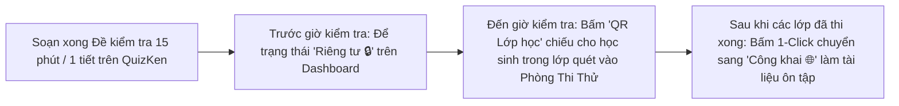

> **Tóm tắt nhanh (TL;DR):** Giáo viên luôn có hai nhóm học liệu khác nhau: các **đề ôn tập** muốn chia sẻ rộng rãi lên thư viện cộng đồng cho mọi học sinh cùng luyện, và các **đề kiểm tra 15 phút / 1 tiết chính thức** cần phải giữ ở chế độ **Riêng tư (Private)** để học sinh không thể tìm thấy trước giờ kiểm tra. Năm 2026, **Top 5 website quản lý ngân hàng đề thi cá nhân hỗ trợ phân quyền Công khai & Riêng tư linh hoạt nhất** gồm **QuizKen**, **Google Forms + Drive**, **Wordwall**, **Wayground (Quizizz)** và **Liveworksheets**.

---

# Top 5 Web Quản Lý Ngân Hàng Đề Thi Cá Nhân Công Khai & Riêng Tư 2026

Một tình huống "dở khóc dở cười" rất hay xảy ra với giáo viên khi sử dụng các nền tảng tạo trắc nghiệm miễn phí trên mạng là: nhiều nền tảng **ép buộc mọi đề thi tạo ở tài khoản miễn phí đều phải hiển thị Công khai (Public)** trên thanh tìm kiếm của trang web! Hệ quả là tối hôm trước cô giáo vừa soạn xong đề kiểm tra *"Kiểm tra 15 phút Chương Ester - Hóa 12 THPT Nguyễn Trãi"*, sáng hôm sau học sinh thông minh chỉ cần lên thanh tìm kiếm gõ tên đề hoặc tên giáo viên là xem trước được toàn bộ câu hỏi và đáp án!

Để bảo mật tuyệt đối cho các bài kiểm tra lấy điểm thường xuyên mà vẫn thuận tiện chia sẻ tài liệu ôn tập sau khi thi xong, một hệ thống quản lý đề thi hiện đại cần cho phép giáo viên **chuyển đổi trạng thái `Công khai (Public)` ⇄ `Riêng tư (Private)` chỉ với 1 cú nhấp chuột** ngay trên bảng điều khiển cá nhân.

Dưới đây là đánh giá chi tiết **Top 5 website quản lý ngân hàng đề thi cá nhân có phân quyền hiển thị tốt nhất năm 2026**.

---

## Bảng So Sánh 5 Web Quản Lý Đề Thi Công Khai & Riêng Tư (2026)

| Nền tảng | Cho phép để chế độ Riêng tư (Private) ở bản Miễn phí | Nút chuyển đổi 1-Click `Công khai ⇄ Riêng tư` trên Dashboard | Thống kê số lượt học sinh đã làm đề (`usage_count`) | Bộ nút thao tác nhanh (QR, Thi thử, Live, Góp ý) | Chi phí |
| :--- | :--- | :--- | :--- | :--- | :--- |
| **1. QuizKen (`CreatedQuizzes`)** | **Có (Miễn phí không giới hạn)** | **Có (`TeacherQuizActions` 1-Click)** | **Có (Cập nhật Realtime)** | **Có đủ 5 nút trên từng thẻ đề** | **Miễn phí 100%** |
| **2. Wayground (Quizizz)** | Giới hạn ở tài khoản Basic | Phải vào trang chỉnh sửa đề | Có thống kê lượt chơi | Cần mở chi tiết đề | Muốn Private toàn bộ cần gói Super |
| **3. Wordwall** | Giới hạn số bài ở bản Free | Có trong menu chia sẻ | Có cơ bản | Chủ yếu chia sẻ link | Giới hạn 3–5 bài ở bản Free |
| **4. Liveworksheets** | Giới hạn nghiêm ngặt số đề Private | Khi lưu đề mới | Không chi tiết | Giao bài tập phiếu | Bản Free ép đa số đề phải Public |
| **5. Google Forms + Drive** | Có (Mặc định trong Drive) | Phải chỉnh quyền Share phức tạp | Xem trong tab Responses | Không có Live Game / Phòng Thi Thử | Miễn phí |

---

## Đánh Giá Chi Tiết Top 5 Web Quản Lý Ngân Hàng Đề Thi Cá Nhân

### 1. QuizKen — Quản lý Đề đã tạo với thanh công cụ `TeacherQuizActions` 1-Click

Trong bản nâng cấp **Dashboard ➔ Đề đã tạo & Lịch sử làm bài (`DashboardQuizzesTab.tsx` & `CreatedQuizzes.tsx`)** năm 2026, **QuizKen** trao toàn quyền kiểm soát ngân hàng đề thi cho giáo viên hoàn toàn miễn phí.

* **Hệ thống quản lý đề toàn diện trên mỗi thẻ đề (`CreatedQuizzes`):**
  1. **Nút bật/tắt `Công khai 🌐` / `Riêng tư 🔒` 1-Click (`teacher-toggle-public`):**
     * Khi ở trạng thái **`Riêng tư 🔒`** (nhãn màu xám Slate): Đề thi hoàn toàn ẩn khỏi trang [Thư viện đề công khai](https://app.quizken.com/quiz/library) và công cụ tìm kiếm, đảm bảo học sinh không thể tự dò thấy đề trước giờ kiểm tra.
     * Khi ở trạng thái **`Công khai 🌐`** (nhãn màu xanh ngọc Emerald): Đề thi xuất hiện trên thư viện cộng đồng để học sinh các lớp dễ dàng tìm kiếm và tự luyện tập.
     * Giáo viên chỉ cần bấm nhẹ 1 lần vào nút nhãn này ngay trên danh sách Dashboard để đảo trạng thái tức thì mà không cần phải mở trình chỉnh sửa đề!
  2. **Theo dõi thông tin & độ phổ biến theo thời gian thực:** Mỗi thẻ đề hiển thị rõ *Danh mục môn học*, *Độ khó (Easy / Medium / Hard)*, *Tổng số câu hỏi*, *Ngày tạo* và *Số lượt đã làm bài (`usage_count`)* được đồng bộ tự động qua kênh Supabase Realtime.
  3. **Tích hợp 4 nút điều phối lớp học ngay cạnh nút Công khai/Riêng tư:**
     * **`QR Lớp học`**: Bật ngay màn hình QR Máy Chiếu cho đề đó.
     * **`Phòng Thi thử`**: Mở ngay sảnh thi nghiêm ngặt `/quiz/exam/:id`.
     * **`Đấu trường Live`**: Mở ngay sảnh Host Live Game `/game/lobby?quizId=:id&tab=host`.
     * **`Góp ý câu hỏi`**: Mở hộp thư kiểm tra và sửa các câu hỏi học sinh báo lỗi.
* **Ưu điểm:** Không thu phí tính năng đặt đề Riêng tư (Private Quiz) như các nền tảng thương mại nước ngoài; giao diện gom nhóm gọn gàng có phân trang rõ ràng.
* **Nhược điểm:** Chưa có tính năng gom nhiều đề vào một thư mục con (Folder) nhiều cấp (hiện phân loại nhanh qua thẻ Category và Tags).
* **Chi phí:** Hoàn toàn miễn phí.

👉 **Quản lý ngân hàng đề của bạn ngay:** [Truy cập Góc Học Tập & Quản Lý Đề trên QuizKen](https://app.quizken.com/user/dashboard).

---

### 2. Wayground (Quizizz) — Kho đề lớn nhưng hạn chế quyền Private ở tài khoản miễn phí

**Wayground (Quizizz)** có hệ thống quản lý *My Library* rất phong phú cho giáo viên.

* **Ưu điểm:**
  * Cho phép lưu đề đã tạo, nhân bản đề từ cộng đồng và sắp xếp vào các bộ sưu tập (Collections).
* **Nhược điểm:**
  * Chính sách nổi tiếng của các nền tảng freemium như Quizizz/Kahoot là sử dụng tài khoản miễn phí để làm giàu kho đề công khai: tính năng lưu đề ở chế độ **Private (Riêng tư hoàn toàn)** thường bị giới hạn hoặc yêu cầu nâng cấp lên gói trả phí *Super / School*.
* **Chi phí:** Muốn bảo mật không giới hạn số đề Private cần nâng cấp gói trả phí.

---

### 3. Wordwall — Quản lý các mẫu trò chơi tương tác ngắn

**Wordwall** giúp giáo viên tiểu học và giáo viên ngoại ngữ quản lý các bài tập nối từ, ô chữ, vòng quay.

* **Ưu điểm:**
  * Có thể chuyển đổi cùng một nội dung bài tập qua lại giữa nhiều mẫu giao diện trò chơi khác nhau.
* **Nhược điểm:**
  * Tài khoản miễn phí chỉ cho phép tạo tối đa **3 đến 5 bài tập** cho toàn bộ tài khoản; muốn tạo đề thứ 6 trở đi giáo viên buộc phải xóa đề cũ hoặc mua gói thuê bao hàng tháng.
* **Chi phí:** Giới hạn 3–5 bài ở bản Free.

---

### 4. Liveworksheets — Số hóa phiếu bài tập PDF tương tác

**Liveworksheets** cho phép giáo viên biến tờ phiếu bài tập PDF thành phiếu điền ô trống trực tuyến.

* **Ưu điểm:**
  * Phù hợp với các phiếu bài tập nối hình, điền từ cho học sinh nhỏ tuổi.
* **Nhược điểm:**
  * Tài khoản miễn phí bị giới hạn rất khắt khe về số lượng phiếu bài tập được phép để ở chế độ **Private** (vì nền tảng yêu cầu người dùng miễn phí phải chia sẻ phiếu công khai cho cộng đồng).
* **Chi phí:** Giới hạn số phiếu Private ở bản Free.

---

### 5. Google Forms + Google Drive — Quản lý file biểu mẫu truyền thống

Nhiều giáo viên lưu trữ ngân hàng đề kiểm tra dưới dạng các file **Google Forms** nằm trong các thư mục trên Google Drive.

* **Ưu điểm:**
  * Mặc định file nằm trong Drive cá nhân là riêng tư cho đến khi giáo viên gửi link cho học sinh.
* **Nhược điểm:**
  * Không có một thư viện cộng đồng giáo dục tích hợp để khi thi xong chỉ cần bấm 1 nút là chia sẻ đề lên cho học sinh toàn trường ôn tập; muốn xuất đề ra PDF A4 4 chế độ, xuất Slide `.pptx` hay mở Đấu trường Live Game đều không thực hiện được.
* **Chi phí:** Miễn phí theo dung lượng Google Drive (15GB).

---

## Quy Trình Bảo Mật Đề Kiểm Tra "Trước Riêng Tư - Sau Công Khai" Trên QuizKen

1. **Khi mới tạo đề kiểm tra định kỳ:** Vào trang **Dashboard ➔ Đề đã tạo**, kiểm tra nút trạng thái của đề đang là **`🔒 Riêng tư`**. Lúc này không một học sinh nào có thể tìm thấy đề của thầy cô trên thư viện.
2. **Khi vào tiết kiểm tra:** Thầy cô nhấn nút **`QR Lớp học`** trên thẻ đề đó ➔ Chọn chế độ **`Phòng Thi Thử`** để chiếu mã QR lên bảng cho đúng lớp đang kiểm tra quét vào làm bài.
3. **Sau khi toàn bộ các lớp trong khối đã kiểm tra xong:** Thầy cô chỉ cần bấm 1 lần vào nút **`🔒 Riêng tư`** để chuyển thành **`🌐 Công khai`**, biến đề kiểm tra đó thành học liệu mở cho học sinh tự ôn luyện cuối kỳ!

---

## Câu hỏi thường gặp (FAQ)

### 1. Khi đề thi đang ở chế độ "Riêng tư (Private)" trên QuizKen, học sinh có đường link trực tiếp hoặc quét Mã QR của giáo viên thì có vào làm bài được không?
Có. Chế độ **Riêng tư (`is_public = false`)** giúp ẩn đề thi khỏi danh sách tìm kiếm và Thư viện đề công khai để học sinh không tự dò thấy trước giờ thi; còn khi giáo viên chủ động chiếu **Mã QR Lớp học** hoặc gửi link trực tiếp trong tiết kiểm tra thì học sinh có mã vẫn vào làm bài bình thường.

### 2. Làm sao để biết đề thi tôi chia sẻ đã có bao nhiêu lượt học sinh vào làm bài?
Ngay trên từng thẻ đề trong mục **Đề đã tạo (`CreatedQuizzes`)** trên Dashboard, khi có học sinh hoàn thành bài làm, một huy hiệu màu tím hiển thị biểu tượng `PlayCircle` kèm **số lượt làm bài (`usage_count`)** sẽ tự động cập nhật để thầy cô nắm bắt mức độ tương tác của đề.

### 3. Nếu tôi xóa một đề thi trong danh sách Đề đã tạo thì có bước xác nhận tránh bấm nhầm không?
Có. Khi nhấn vào biểu tượng thùng rác trên thẻ đề, hệ thống luôn bật hộp thoại xác nhận `AlertDialog` hỏi lại trước khi thực hiện xóa vĩnh viễn khỏi cơ sở dữ liệu, đảm bảo thầy cô không bao giờ lỡ tay xóa mất học liệu quan trọng.
