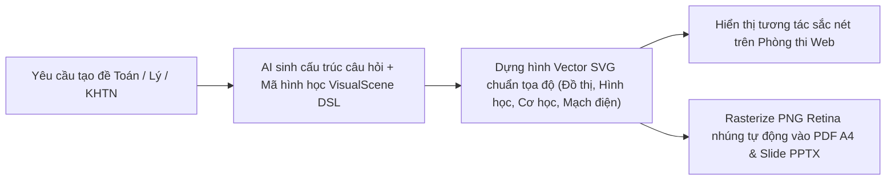

> **Tóm tắt nhanh (TL;DR):** Trước đây, các công cụ AI tạo câu hỏi trắc nghiệm chỉ sinh được chữ thuần túy (text-only), buộc giáo viên Toán và Vật lý phải tự mở phần mềm thứ ba để vẽ từng tam giác, đồ thị hàm số hay sơ đồ mạch điện rồi cắt dán thủ công vào đề. Năm 2026, sự ra đời của công nghệ **VisualScene DSL trên QuizKen** cùng các nền tảng trực quan hóa như **GeoGebra**, **Desmos**, **PhET** và **Draw.io** đã cho phép tạo đề thi kèm hình vẽ vector chuẩn xác và xuất thẳng ra PDF A4 hoặc Slide PowerPoint.

---

# Top 5 Web Tạo Đề Thi Có Hình Minh Họa Hình Học & Vật Lý Bằng AI 2026

Theo hướng dẫn kiểm tra đánh giá định kỳ tại **Công văn 7991/BGDĐT-GDTrH** của Bộ Giáo dục và Đào tạo, các câu hỏi ở mức độ **Thông hiểu (30%)** và **Vận dụng (30%)** trong môn Toán, Vật lý, Khoa học Tự nhiên ngày càng chú trọng khả năng đọc hiểu bảng biểu, đồ thị hàm số, sơ đồ thí nghiệm và hình học trực quan.

Thế nhưng, 95% công cụ tạo trắc nghiệm AI trên thị trường hiện nay chỉ trả về văn bản thô. Khi giáo viên yêu cầu *"Tạo câu hỏi đọc đồ thị hàm số bậc ba"* hay *"Tính lực căng dây trên mặt phẳng nghiêng"*, các AI thông thường chỉ mô tả bằng lời chứ không có hình minh họa, hoặc nếu dùng AI tạo ảnh bitmap (như DALL-E/Midjourney) thì lại bị sai lệch tọa độ, sai chữ cái đỉnh `A, B, C` và vô nghĩa về mặt toán học.

Để giải quyết thách thức này, dưới đây là **Top 5 website hỗ trợ tạo đề thi và câu hỏi có hình minh họa Hình học & Vật lý chuẩn xác nhất năm 2026**.

---

## Bảng So Sánh 5 Công Cụ Tạo Câu Hỏi & Hình Minh Họa STEM (2026)

| Nền tảng | Tự động sinh cả câu hỏi lẫn hình vẽ bằng AI | Độ chính xác tọa độ Toán / Lý | Xuất trực tiếp vào đề PDF & Slide PPTX | Hỗ trợ Tiếng Việt | Chi phí |
| :--- | :--- | :--- | :--- | :--- | :--- |
| **1. QuizKen (VisualScene AI)** | **Có (Tự động 100%)** | **Chuẩn Vector DSL** | **Có (Nhúng tự động vào PDF & PPTX)** | **100% Tiếng Việt** | **Miễn phí** |
| **2. GeoGebra Classroom** | Không (Giáo viên tự dựng hình) | Tuyệt đối | Xuất ảnh tĩnh thủ công | Có hỗ trợ | Miễn phí |
| **3. Desmos Activity Builder** | Không (Tự nhập hàm số) | Tuyệt đối về đồ thị | Chụp màn hình thủ công | Tiếng Anh | Miễn phí |
| **4. PhET Interactive** | Không (Thư viện mô phỏng có sẵn) | Chuẩn thí nghiệm Vật lý | Không hỗ trợ xuất đề PDF | Có bản dịch Việt | Miễn phí |
| **5. Diagrams.net (Draw.io)** | Hỗ trợ sinh sơ đồ Mermaid/SVG | Khá (Sơ đồ khối, mạch điện) | Xuất PNG/SVG rồi chèn thủ công | Có giao diện Việt | Miễn phí |

---

## Đánh Giá Chi Tiết Top 5 Web Tạo Đề Thi Có Hình Minh Họa Hình Học & Vật Lý

### 1. QuizKen — Nền tảng AI duy nhất tự động dựng hình `VisualScene` nhúng thẳng vào đề thi

Khác biệt hoàn toàn với các AI sinh ảnh nghệ thuật dễ bị "ảo giác" ký hiệu toán học, **QuizKen** phát triển bộ máy **`VisualSceneCanvas`** sử dụng ngôn ngữ mô tả hình học có cấu trúc (Structured Visual DSL). Khi AI tạo câu hỏi Toán học hoặc Vật lý cần hình minh họa, hệ thống sẽ sinh tọa độ đỉnh, góc, đoạn thẳng, vectơ lực hoặc hàm số chính xác để trình duyệt dựng thành đồ họa SVG sắc nét.

* **Các dạng hình minh họa được hỗ trợ tự động:**
  * **Hình học phẳng & Hệ trục tọa độ Oxy:** Tam giác, đường tròn, tiếp tuyến, góc vuông, ký hiệu độ dài cạnh, đồ thị hàm số bậc nhất, bậc hai, bậc ba, lượng giác.
  * **Sơ đồ Vật lý & Cơ học:** Vật trượt trên mặt phẳng nghiêng, hệ ròng rọc, phân tích các vectơ lực ($\vec{P}, \vec{N}, \vec{F}_{ms}, \vec{T}$), con lắc lò xo, mạch điện một chiều/xoay chiều.
  * **Biểu đồ thống kê & Khoa học tự nhiên:** Biểu đồ cột, biểu đồ đường, sơ đồ cấu trúc phân tử và quy trình sinh học.
* **Ưu điểm đột phá khi in ấn và trình chiếu:**
  * Khi giáo viên bấm **Xuất PDF A4** hoặc **Xuất Slide PowerPoint (`.pptx`)**, bộ máy `pdfVisualRasterizer` của QuizKen tự động chuyển đổi hình SVG `VisualScene` sang ảnh PNG độ phân giải Retina và nhúng thẳng vào đề thi giấy hoặc chia 2 cột cân đối trên slide trình chiếu.
* **Nhược điểm:** Đối với các hình không gian 3D quá phức tạp nhiều mặt cắt ẩn, giáo viên vẫn có thể kết hợp tải ảnh riêng lên trình soạn đề thủ công.
* **Chi phí:** Hoàn toàn miễn phí.

👉 **Trải nghiệm ngay:** [Tạo đề trắc nghiệm STEM có hình vẽ tự động trên QuizKen](https://app.quizken.com).

---

### 2. GeoGebra — Phần mềm dựng hình học động kinh điển cho giáo viên Toán

**GeoGebra** là công cụ không thể thiếu trong máy tính của mọi giáo viên Toán THCS và THPT khi cần dựng hình học phẳng và hình học không gian.

* **Ưu điểm:**
  * Độ chính xác toán học tuyệt đối; hỗ trợ dựng cả hình chóp, lăng trụ, mặt cầu 3D có nét đứt biểu diễn cạnh khuất đúng chuẩn sách giáo khoa Việt Nam.
* **Nhược điểm:**
  * Giáo viên phải tự nhập từng điểm, đường thẳng và căn chỉnh nhãn bằng tay rồi xuất ra file ảnh `.png` để chèn vào đề thi, chưa thể ra lệnh bằng ngôn ngữ tự nhiên để AI vừa viết câu hỏi trắc nghiệm vừa dựng hình hàng loạt cho đề 40 câu.
* **Chi phí:** Miễn phí cho mục đích giáo dục.

---

### 3. Desmos — Công cụ vẽ đồ thị hàm số tốc độ cao

**Desmos** được mệnh danh là máy tính đồ thị trực tuyến mượt mà nhất hiện nay, đặc biệt hữu ích cho chương trình Giải tích lớp 10, 11, 12.

* **Ưu điểm:**
  * Chỉ cần gõ phương trình hàm số, đồ thị xuất hiện tức thì với các điểm cực trị, giao điểm trục tọa độ và đường tiệm cận rất trực quan.
* **Nhược điểm:**
  * Chuyên sâu về đồ thị đại số/giải tích, không phù hợp để vẽ sơ đồ lực Vật lý hay mạch điện; không có tính năng xuất bộ đề trắc nghiệm A4 kèm bảng đáp án.
* **Chi phí:** Miễn phí.

---

### 4. PhET Interactive Simulations — Kho mô phỏng thí nghiệm Vật lý & Hóa học

Được phát triển bởi Đại học Colorado Boulder, **PhET** cung cấp hàng trăm mô phỏng thí nghiệm tương tác HTML5 cho môn Vật lý, Hóa học và Sinh học.

* **Ưu điểm:**
  * Học sinh có thể trực tiếp kéo thả thay đổi khối lượng, điện trở, góc khúc xạ ánh sáng để quan sát hiện tượng vật lý sinh động trên lớp.
* **Nhược điểm:**
  * Phục vụ cho hoạt động giảng dạy minh họa trên màn hình chứ không phải công cụ tạo đề kiểm tra trắc nghiệm hay in đề thi giấy.
* **Chi phí:** Miễn phí 100%.

---

### 5. Diagrams.net (Draw.io) — Vẽ sơ đồ mạch điện và lưu đồ thuật toán

Đối với môn Công nghệ, Tin học và phần Điện học trong Vật lý, **Draw.io** cung cấp bộ thư viện ký hiệu kỹ thuật chuẩn quốc tế.

* **Ưu điểm:**
  * Có sẵn hàng trăm biểu tượng nguồn điện, tụ điện, cuộn cảm, cổng logic, lưu đồ thuật toán Tin học; cho phép xuất ảnh nền trong suốt.
* **Nhược điểm:**
  * Thao tác kéo thả thủ công tốn nhiều thời gian; giáo viên phải tự lưu ảnh và chèn từng hình vào hệ thống thi.
* **Chi phí:** Miễn phí và mã nguồn mở.

---

## Cách Kết Hợp Hoàn Hảo Cho Giáo Viên Toán – Lý – KHTN Năm 2026

Để rút ngắn thời gian soạn đề kiểm tra có hình vẽ từ **3 giờ xuống còn 5 phút**, thầy cô có thể áp dụng quy trình sau:
1. Dùng **AI Quiz Generator của QuizKen** để sinh nhanh bộ đề 20–40 câu kèm hình minh họa `VisualScene` tự động cho các câu đồ thị, hình học phẳng và cơ học.
2. Nếu có 1–2 câu hình học không gian 3D đặc thù tự vẽ trên **GeoGebra**, thầy cô chỉ cần xuất ảnh từ GeoGebra và đính kèm vào câu hỏi trên trình chỉnh sửa của QuizKen.
3. Nhấn **Xuất PDF A4** (để in đề giấy) hoặc **Xuất Slide PPTX** (để trình chiếu chữa đề trên lớp với bố cục 2 cột: câu hỏi bên trái – hình vẽ bên phải).

👉 **Khám phá ngay:** [Thư viện đề thi STEM có hình minh họa trên QuizKen](https://app.quizken.com/quiz/library).

---

## Câu hỏi thường gặp (FAQ)

### 1. Hình minh họa do AI của QuizKen tạo ra có bị sai chữ cái đỉnh hay nhòe chữ như ảnh AI thông thường không?
Không. QuizKen không dùng mô hình khuếch tán ảnh (diffusion image) để vẽ mò chữ cái, mà dùng bộ dựng vector **`VisualSceneCanvas`** dựa trên tọa độ toán học chính xác. Nhờ đó các đỉnh `A, B, C`, trục `Ox, Oy`, góc vuông và nhãn lực luôn sắc nét 100% ở mọi kích thước phóng đại.

### 2. Khi tải đề thi về dưới dạng file PowerPoint (.pptx), hình vẽ có được giữ nguyên không?
Có. Khi thầy cô bấm xuất PowerPoint trên QuizKen, hệ thống tự động chuyển những câu hỏi có hình `VisualScene` sang bố cục **Slide 2 cột chuyên nghiệp**: cột bên trái chứa câu hỏi và 4 đáp án A/B/C/D, cột bên phải hiển thị hình minh họa chất lượng cao.

### 3. Học sinh làm bài trong Phòng Thi Thử (Exam Mode) có xem được hình minh họa trên điện thoại không?
Hoàn toàn được. Thành phần `VisualSceneCanvas` tự động co giãn (responsive) tương thích với mọi kích thước màn hình từ điện thoại di động, máy tính bảng cho đến màn hình máy chiếu lớp học.
