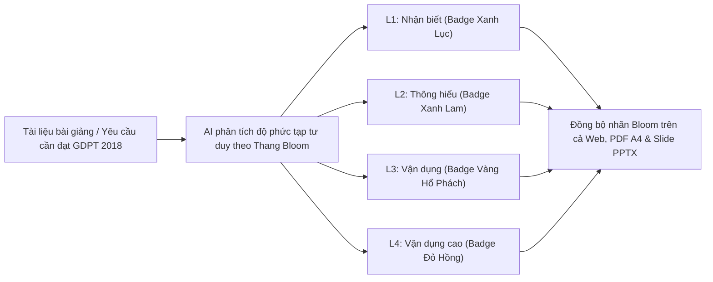

> **Tóm tắt nhanh (TL;DR):** Việc phân loại từng câu hỏi trắc nghiệm theo các mức độ nhận thức (**Nhận biết – Thông hiểu – Vận dụng / Vận dụng cao**) là yêu cầu bắt buộc khi lập Ma trận và Bản đặc tả đề kiểm tra định kỳ theo **Công văn 7991/BGDĐT-GDTrH** của Bộ GD&ĐT. Năm 2026, **Top 5 website tạo câu hỏi và xuất slide theo thang Bloom** gồm **QuizKen**, **ClassPoint AI**, **QuestionWell**, **Diffit** và **Formative** đã giúp giáo viên tự động gắn nhãn mức độ tư duy lên cả giao diện Web, bản in PDF A4 lẫn Slide PowerPoint.

---

# Top 5 Web Tạo Slide Câu Hỏi Phân Loại Theo Thang Bloom Chuẩn GDPT 2018

Thang nhận thức Bloom (*Bloom’s Taxonomy*) là khung tham chiếu sư phạm cốt lõi trong Chương trình Giáo dục phổ thông 2018. Đặc biệt, theo hướng dẫn tại **Công văn số 7991/BGDĐT-GDTrH** (áp dụng cho kiểm tra đánh giá định kỳ cấp THCS và THPT), mọi đề kiểm tra đều phải thể hiện rõ sự phân hóa năng lực học sinh qua các cấp độ nhận thức với tỷ lệ chuẩn tham khảo:
* **Mức 1 — Nhận biết (~40%):** Nhắc lại, nhận diện khái niệm, công thức, sự kiện cơ bản.
* **Mức 2 — Thông hiểu (~30%):** Diễn giải, so sánh, kết nối thông tin hoặc suy luận trực tiếp.
* **Mức 3 & 4 — Vận dụng & Vận dụng cao (~30%):** Áp dụng kiến thức giải quyết bài toán thực tiễn hoặc tình huống liên môn mới.

Trước đây, giáo viên phải tự đọc từng câu hỏi để gán nhãn mức độ bằng mắt thường, và khi chiếu câu hỏi lên slide hoặc in ra đề PDF thì học sinh cũng không hề biết câu nào là câu cơ bản cần làm chắc chắn, câu nào là câu nâng cao phân loại. Dưới đây là **Top 5 website tự động tạo và gắn nhãn thang nhận thức Bloom lên đề thi & slide bài giảng tốt nhất năm 2026**.

---

## Bảng So Sánh 5 Web Tạo Câu Hỏi & Slide Theo Thang Bloom (2026)

| Nền tảng | Tự động phân loại & gắn nhãn Bloom (L1–L4) | Hiển thị huy hiệu Bloom trên Slide PPTX & PDF A4 | Bám sát thuật ngữ Bộ GD&ĐT Việt Nam | Thống kê Radar năng lực theo từng kỹ năng | Chi phí |
| :--- | :--- | :--- | :--- | :--- | :--- |
| **1. QuizKen** | **Có (Tự động L1 ➔ L4)** | **Có (Trên cả Web, PDF A4 & Slide PPTX)** | **Chuẩn 100% (*Nhận biết ➔ Vận dụng cao*)** | **Có (Knowledge Gap Radar)** | **Miễn phí 100%** |
| **2. ClassPoint AI** | Chọn cấp độ Bloom khi sinh câu hỏi | Có trên slide PowerPoint | Dịch tự động từ 6 bậc tiếng Anh | Không | Miễn phí / Pro |
| **3. QuestionWell** | Chọn Learning Outcomes / Bloom | Xuất sang PPTX/Forms cơ bản | Giao diện Tiếng Anh | Không | Giới hạn ở bản Free |
| **4. Diffit for Teachers** | Phân hóa theo cấp độ đọc hiểu (DOK/Bloom) | Xuất phiếu bài tập Slides | Hỗ trợ tiếng Việt cơ bản | Không | Miễn phí / School |
| **5. Formative** | Gắn thẻ chuẩn đầu ra thủ công | Chỉ hiển thị trong báo cáo GV | Tiếng Anh | Có báo cáo theo chuẩn | Trả phí gói Silver/Gold |

---

## Đánh Giá Chi Tiết Top 5 Web Tạo Slide Câu Hỏi Phân Loại Theo Thang Bloom

### 1. QuizKen — Đồng bộ huy hiệu Bloom `L1–L4` từ Phòng làm bài đến PDF A4 & Slide PowerPoint

**QuizKen** là nền tảng duy nhất tại Việt Nam chuẩn hóa hệ thống phân loại câu hỏi theo đúng 4 cấp độ quen thuộc của giáo viên phổ thông Việt Nam (`L1: Nhận biết`, `L2: Thông hiểu`, `L3: Vận dụng`, `L4: Vận dụng cao`) và hiển thị xuyên suốt trên mọi định dạng xuất bản.

* **Sự đồng bộ 3 trong 1 của hệ thống nhãn Bloom trên QuizKen:**
  1. **Trên giao diện làm bài & xem lại kết quả (`BloomBadge`):** Mỗi câu hỏi hiển thị huy hiệu màu trực quan để học sinh biết rõ độ khó của câu hỏi mình đang chinh phục.
  2. **Trên bản in PDF A4 (`pdf.worker.ts`):** Ở góc trên bên phải mỗi thẻ câu hỏi A4, hệ thống vẽ huy hiệu vector bo tròn với bảng màu chuẩn sư phạm (*Xanh ngọc cho L1 Nhận biết, Xanh dương cho L2 Thông hiểu, Vàng hổ phách cho L3 Vận dụng, Đỏ hồng cho L4 Vận dụng cao*).
  3. **Trên Slide PowerPoint (`.pptx` - `pptx.worker.ts`):** Khi giáo viên xuất đề ra file `.pptx` để chiếu trên lớp, huy hiệu Bloom tự động nằm ngay cạnh tiêu đề `Câu X` trên từng slide, giúp giáo viên dễ dàng nhắc học sinh: *"Câu 25 này thuộc mức L3 Vận dụng, cả lớp chú ý cách biến đổi công thức!"*.
* **Ưu điểm:** Hỗ trợ song ngữ tự động (hiển thị *Nhận biết / Thông hiểu / Vận dụng / Vận dụng cao* ở giao diện Tiếng Việt và *L1 Remember / L2 Understand / L3 Apply / L4 Analyze* ở giao diện Tiếng Anh).
* **Nhược điểm:** Với các đề thi cũ do người dùng nhập thủ công mà không chọn mức độ Bloom, hệ thống sẽ ẩn nhãn hoặc dùng mức mặc định cho đến khi được phân loại.
* **Chi phí:** Hoàn toàn miễn phí.

👉 **Trải nghiệm ngay:** [Tạo đề trắc nghiệm chuẩn thang Bloom và xuất Slide PPTX trên QuizKen](https://app.quizken.com).

---

### 2. ClassPoint AI — Chọn 6 bậc Bloom ngay trong Microsoft PowerPoint

**ClassPoint** cho phép giáo viên tích chọn các bậc trong thang Bloom quốc tế (*Remember, Understand, Apply, Analyze, Evaluate, Create*) trước khi bấm nút sinh câu hỏi từ slide đang mở.

* **Ưu điểm:**
  * Giáo viên có thể chủ động yêu cầu AI chỉ sinh câu hỏi ở bậc *Analyze (Phân tích)* hoặc *Evaluate (Đánh giá)* cho học sinh khá giỏi.
* **Nhược điểm:**
  * Sinh từng câu hỏi lẻ trên từng slide PowerPoint có sẵn chứ không lập thành một bộ đề kiểm tra 40 câu hoàn chỉnh theo tỷ lệ 40% - 30% - 30% của Công văn 7991/BGDĐT-GDTrH.
* **Chi phí:** Bản miễn phí giới hạn số câu hỏi AI; gói Pro thu phí theo năm.

---

### 3. QuestionWell — Công cụ AI sinh ngân hàng câu hỏi theo mục tiêu bài học

**QuestionWell** là trang web quốc tế chuyên đọc văn bản hoặc video YouTube để sinh bộ câu hỏi bám sát chuẩn đầu ra (*Essential Questions & Learning Outcomes*).

* **Ưu điểm:**
  * Cho phép lọc câu hỏi theo cấp độ tư duy và xuất sang nhiều nền tảng như Kahoot, Quizizz, Gimkit hoặc PowerPoint.
* **Nhược điểm:**
  * Khi xuất sang file trình chiếu hoặc file in, các nhãn phân loại mức độ nhận thức không được đóng khung thành huy hiệu màu sắc chuẩn tiếng Việt như trên QuizKen; tính năng nâng cao yêu cầu trả phí.
* **Chi phí:** Freemium.

---

### 4. Diffit for Teachers — Phân hóa tài liệu dạy học theo năng lực học sinh

**Diffit** rất mạnh trong việc biến một chủ đề khó thành các phiếu học tập được điều chỉnh theo từng cấp độ lớp và bậc tư duy (DOK / Bloom).

* **Ưu điểm:**
  * Tạo nhanh bộ phiếu bài tập kèm slide Google Slides cho hoạt động thảo luận nhóm trên lớp.
* **Nhược điểm:**
  * Thiên về môn Ngữ văn, Tiếng Anh và Khoa học xã hội (đọc hiểu văn bản) hơn là các môn Toán – Lý – Hóa có công thức và hình vẽ.
* **Chi phí:** Miễn phí cơ bản / Thuê bao trường học.

---

### 5. Formative — Gắn thẻ chuẩn đầu ra (Standards Tagging) để theo dõi tiến bộ

**Formative** cho phép các trường quốc tế gắn mã chuẩn đầu ra vào từng câu hỏi trong bài kiểm tra.

* **Ưu điểm:**
  * Báo cáo thống kê cho tổ bộ môn biết học sinh đang yếu ở chuẩn kỹ năng nào.
* **Nhược điểm:**
  * Việc gắn nhãn mức độ nhận thức phải thực hiện thủ công cho từng câu hỏi chứ không tự động hóa bằng AI tiếng Việt; không hỗ trợ xuất file `.pptx` có huy hiệu Bloom.
* **Chi phí:** Tính năng gắn thẻ chuẩn đầu ra chỉ mở ở gói trả phí.

---

## Cách Ứng Dụng Huy Hiệu Bloom Trên QuizKen Để Dạy Học Phân Hóa

Khi sử dụng bộ đề có gắn nhãn Bloom `L1–L4` của **QuizKen** trên lớp học, thầy cô có thể cá nhân hóa nhiệm vụ cho từng nhóm học sinh:
* **Nhóm học sinh trung bình – khá:** Yêu cầu nắm chắc và không được phép sai bất kỳ câu nào mang nhãn **`L1 Nhận biết`** (màu xanh lục) và **`L2 Thông hiểu`** (màu xanh dương) để cầm chắc 7,0 điểm trong tay.
* **Nhóm học sinh giỏi – mũi nhọn:** Tập trung thảo luận sâu các slide mang nhãn **`L3 Vận dụng`** (màu vàng) và **`L4 Vận dụng cao`** (màu đỏ hồng) kết hợp hỏi đáp cùng trợ lý AI Socratic trên QuizKen.

👉 **Bắt đầu ngay:** [Khám phá hệ thống tạo đề chuẩn thang nhận thức Bloom trên QuizKen](https://www.quizken.com).

---

## Câu hỏi thường gặp (FAQ)

### 1. Công văn 7991/BGDĐT-GDTrH quy định mấy mức độ nhận thức trong đề kiểm tra định kỳ?
Theo Phụ lục Công văn 7991/BGDĐT-GDTrH ban hành cuối năm 2024 áp dụng cho chương trình GDPT 2018, ma trận đề kiểm tra định kỳ chuẩn hóa thành **3 mức độ chính**: *Nhận biết (~40%)*, *Thông hiểu (~30%)* và *Vận dụng (~30%)*. Trên QuizKen, mức Vận dụng còn được chi tiết hóa thành *L3 Vận dụng* và *L4 Vận dụng cao* để phục vụ cả kiểm tra định kỳ lẫn luyện thi tốt nghiệp THPT và học sinh giỏi.

### 2. Huy hiệu Bloom L1–L4 có xuất hiện trên cả bản in PDF và bản Slide PowerPoint không?
Có. Cả bộ máy xuất PDF (`pdf.worker.ts`) lẫn bộ máy xuất PowerPoint (`pptx.worker.ts`) của QuizKen đều tự động đọc trường `bloomLevel` của từng câu hỏi để vẽ huy hiệu màu tương ứng ở góc trên bên phải mỗi câu.

### 3. Khi xuất PDF chế độ "Đề thi trắng (In cho học sinh)", huy hiệu Bloom hiển thị như thế nào?
Ngay cả trên đề thi trắng hoặc tài liệu ôn tập, huy hiệu mức độ nhận thức vẫn được trình bày gọn gàng ở thanh tiêu đề của từng thẻ câu hỏi (`Câu 1` — `[L2 Thông hiểu]`), giúp học sinh phân bổ thời gian làm bài thông minh (làm câu L1, L2 trước rồi mới giải câu L3, L4).
