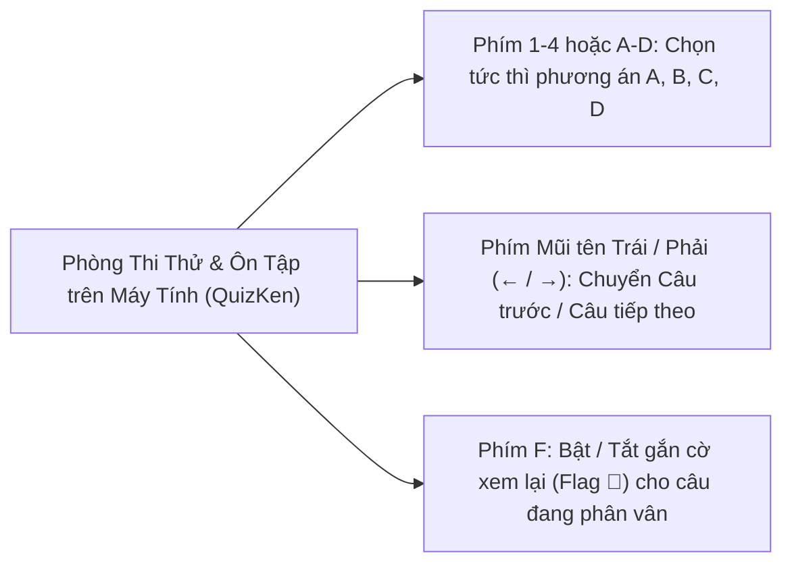

> **Tóm tắt nhanh (TL;DR):** Trong một bài thi trắc nghiệm 50 câu trên máy tính, việc phải liên tục rê chuột tìm từng ô tròn radio nhỏ xíu rồi lại rê chuột xuống góc dưới bấm nút "Câu tiếp theo" làm lãng phí từ 3 đến 5 phút quý giá và gây mỏi cổ tay. Năm 2026, **Top 5 website làm trắc nghiệm và ôn tập hỗ trợ phím tắt bàn phím siêu tốc** gồm **QuizKen**, **AnkiWeb**, **Quizlet**, **Study4** và **RemNote** đã cho phép người học điều khiển 100% phiên làm bài bằng hai bàn tay trên bàn phím với tốc độ phản xạ tức thì.

---

# Top 5 Web Làm Trắc Nghiệm Hỗ Trợ Phím Tắt Bàn Phím Siêu Tốc 2026

Theo định luật Fitts (*Fitts's Law*) trong thiết kế tương tác người – máy (HCI), thời gian để di chuyển con trỏ chuột từ vị trí đáp án `A` xuống nút `"Câu tiếp theo"` ở góc màn hình trung bình mất từ **1,2 đến 1,8 giây** cho mỗi câu hỏi. Nhân với một đề thi tổng hợp 50–100 câu (hoặc một buổi tối ôn luyện 300 câu trắc nghiệm), thao tác rê chuột thủ công tiêu tốn gần **10 phút vô ích** và làm đứt mạch tư duy của não bộ.

Ngược lại, khi một nền tảng luyện thi được thiết kế theo chuẩn **Keyboard-First (Ưu tiên bàn phím)**, tay trái của bạn đặt nhẹ trên cụm phím `1, 2, 3, 4` (hoặc `A, B, C, D`) và phím `F`, còn tay phải đặt trên hai phím mũi tên `← / →`. Bạn có thể chọn đáp án, gắn cờ xem lại `🚩` và chuyển câu tiếp theo chỉ trong **0,1 giây** mà mắt không bao giờ phải rời khỏi đề bài để tìm con trỏ chuột!

Dưới đây là đánh giá chi tiết **Top 5 website làm trắc nghiệm và ôn tập hỗ trợ hệ thống phím tắt bàn phím mượt mà nhất năm 2026**.

---

## Bảng So Sánh 5 Web Làm Trắc Nghiệm & Ôn Tập Có Phím Tắt Bàn Phím (2026)

| Nền tảng | Phím chọn đáp án (`1–4` VÀ `A–D`) | Phím chuyển câu (`←` / `→`) | Phím gắn cờ xem lại (`F` ➔ `🚩`) | Phản hồi âm thanh cơ học khi bấm phím | Chi phí |
| :--- | :--- | :--- | :--- | :--- | :--- |
| **1. QuizKen** | **Có cả hai (`1–4` & `A–D`)** | **Có (`ArrowLeft` & `ArrowRight`)** | **Có (`Phím F` bật/tắt cờ `🚩`)** | **Có (`pop`, `click`, `toggle` mượt mà)** | **Miễn phí 100%** |
| **2. Anki / AnkiWeb** | Phím `1–4` chấm mức độ nhớ | Phím `Space` / `Enter` lật thẻ | Phím `Ctrl + 1..7` gắn cờ thẻ | Không có sẵn âm thanh gốc | Miễn phí (Web/PC) |
| **3. Quizlet** | Phím `1–4` trong chế độ Learn | Phím mũi tên khi lật Flashcard | Phím `S` gắn sao (Star) | Hiệu ứng cơ bản | Giới hạn ở bản Free |
| **4. RemNote** | Phím `1–4` đánh giá thẻ nhớ | Phím `Tab` / `Enter` | Có phím tắt chỉnh sửa | Không | Freemium |
| **5. Study4** | Chủ yếu dùng chuột & `Tab` | Cuộn trang hoặc click bảng câu | Click chuột vào icon cờ | Không | Freemium |

---

## Đánh Giá Chi Tiết Top 5 Web Làm Trắc Nghiệm Hỗ Trợ Phím Tắt Bàn Phím

### 1. QuizKen — Trải nghiệm điều khiển Phòng Thi Thử 100% bằng bàn phím kèm âm thanh xúc giác

Trong cả chế độ **Làm bài Ôn tập (`QuizContentNew`)**, **Lật thẻ Flashcard (`FlashcardView`)** và đặc biệt là **Phòng Thi Thử Nghiêm Ngặt (`ExamModePage.tsx`)**, **QuizKen** đều tích hợp bộ lắng nghe sự kiện bàn phím thông minh, kèm huy hiệu gợi ý phím tắt hiển thị ngay trên từng nút đáp án.

* **Bảng phím tắt toàn diện trong Phòng Thi Thử QuizKen (`ExamModePage`):**
  * **Phím `1`, `2`, `3`, `4` HOẶC phím `A`, `B`, `C`, `D` (không phân biệt chữ hoa/thường):** Chọn ngay lập tức phương án A, B, C hoặc D của câu hỏi hiện tại, đồng thời phát âm thanh xúc giác `play("pop")` êm dịu xác nhận đã ghi nhận đáp án.
  * **Phím mũi tên phải `→` (`ArrowRight`):** Chuyển ngay sang câu hỏi tiếp theo kèm âm thanh `play("click")`.
  * **Phím mũi tên trái `←` (`ArrowLeft`):** Quay lại câu hỏi liền trước đó.
  * **Phím `F` (`Flag`):** Bật hoặc tắt trạng thái **Gắn cờ xem lại (`🚩`)** cho câu hỏi hiện tại kèm âm thanh `play("toggle")` và cập nhật tức thì lên bảng `QuestionPalette`.
  * **Cơ chế chống xung đột thông minh:** Hệ thống tự động bỏ qua phím tắt khi con trỏ đang nằm trong ô nhập liệu (`INPUT`, `TEXTAREA`, `isContentEditable`) hoặc khi đang mở hộp thoại xác nhận nộp bài, đảm bảo không bao giờ bấm nhầm.
* **Ưu điểm:** Thuận tiện cho cả người thuận tay trái lẫn người thuận tay phải (nhờ hỗ trợ song song cả dãy phím số `1–4` lẫn các chữ cái `A–D`); kết hợp được với chuột hoặc màn hình cảm ứng bất cứ lúc nào.
* **Nhược điểm:** Các phím tắt bàn phím phát huy tối đa sức mạnh trên Laptop, PC hoặc iPad có gắn Magic Keyboard (trên điện thoại cảm ứng người dùng vẫn thao tác chạm trực tiếp cực nhanh).
* **Chi phí:** Hoàn toàn miễn phí.

👉 **Thử cảm giác giải đề siêu tốc bằng bàn phím:** [Mở Phòng Thi Thử trên QuizKen](https://app.quizken.com).

---

### 2. Anki / AnkiWeb — Huyền thoại phím tắt cho người học Flashcard Spaced Repetition

**Anki** là phần mềm học thẻ nhớ lặp lại ngắt quãng nổi tiếng khắp thế giới, đặc biệt trong cộng đồng sinh viên Y khoa và người học ngoại ngữ nhờ khả năng bấm phím liên hoàn.

* **Ưu điểm:**
  * Người học chỉ cần nhấn phím `Space` để lật mặt sau của thẻ và nhấn phím `1 (Again)`, `2 (Hard)`, `3 (Good)` hoặc `4 (Easy)` để chấm mức độ nhớ mà không cần chạm vào chuột.
* **Nhược điểm:**
  * Anki thuần túy là phần mềm lật thẻ Flashcard tự đánh giá chứ không phải hệ thống Phòng Thi Thử trắc nghiệm 4 phương án A/B/C/D có đồng hồ đếm ngược, bảng điều hướng 50 câu và xuất đề thi PDF A4 như QuizKen.
* **Chi phí:** Miễn phí trên Máy tính, Web và Android (trả phí 25 USD trên iOS).

---

### 3. Quizlet — Phím tắt tiện lợi trong chế độ Lật thẻ và Học (Learn)

**Quizlet** hỗ trợ bộ phím tắt khá trực quan khi học sinh ôn từ vựng trên máy tính.

* **Ưu điểm:**
  * Trong chế độ Flashcard, phím `Space` dùng để lật thẻ, phím `← / →` để qua thẻ mới và phím `S` để đánh dấu sao từ khó. Trong chế độ trắc nghiệm 4 đáp án, người học có thể bấm phím `1, 2, 3, 4`.
* **Nhược điểm:**
  * Chế độ *Learn* và *Test* có phím tắt trắc nghiệm trên Quizlet hiện bị giới hạn số lượt sử dụng rất chặt ở tài khoản miễn phí.
* **Chi phí:** Yêu cầu nâng cấp Quizlet Plus để học không giới hạn.

---

### 4. RemNote — Kết hợp gõ phím ghi chú Markdown và ôn tập thẻ nhớ

**RemNote** hướng tới những sinh viên thích gõ ghi chú bằng các tổ hợp phím tắt kiểu lập trình viên rồi biến dòng ghi chú thành thẻ ôn tập.

* **Ưu điểm:**
  * Hệ thống phím tắt soạn thảo rất phong phú (dùng ký hiệu `::` hoặc `>>` để tạo câu hỏi ngay khi đang gõ bài).
* **Nhược điểm:**
  * Đường cong học tập (learning curve) khá dốc, giao diện bằng tiếng Anh và không chuyên về tổ chức phòng thi thử theo cấu trúc đề thi THPT Việt Nam.
* **Chi phí:** Freemium.

---

### 5. Study4 — Điều hướng bằng chuột kết hợp phím Tab cơ bản

Trên **Study4**, người học chủ yếu sử dụng chuột để chọn các ô đáp án và điền từ vào chỗ trống (Listening/Reading Fill-in-the-blank).

* **Ưu điểm:**
  * Khi làm dạng bài điền từ IELTS Listening, thí sinh có thể nhấn phím `Tab` để nhảy nhanh từ ô trống câu 1 sang ô trống câu 2 rất tiện lợi.
* **Nhược điểm:**
  * Với các đề trắc nghiệm 4 lựa chọn A/B/C/D, chưa có hệ thống phím tắt 1 chạm (`A/B/C/D` để chọn + `F` để gắn cờ `🚩` + `→` để qua câu kèm hiệu ứng âm thanh) đồng bộ như Phòng Thi Thử của QuizKen.
* **Chi phí:** Freemium.

---

## Mẹo Luyện Phản Xạ Bàn Phím "Tay Trái Chọn - Tay Phải Chuyển" Trên QuizKen

Để đạt tốc độ giải đề tối đa trên [QuizKen](https://app.quizken.com) bằng máy tính:
1. **Tay trái:** Đặt ngón trỏ lên phím **`F`** (sẵn sàng gắn cờ `🚩` ngay khi gặp câu cần suy nghĩ thêm) và các ngón còn lại phụ trách cụm phím **`1, 2, 3, 4`** hoặc **`A, B, C, D`**.
2. **Tay phải:** Đặt lên hai phím mũi tên **`←`** và **`→`** để duyệt câu tiến/lùi mượt mà.
3. Bạn cũng có thể bật/tắt âm thanh phản hồi ngay trên thanh điều hướng (`Navbar`) tùy theo sở thích không gian yên tĩnh hay âm thanh cơ học sống động!

---

## Câu hỏi thường gặp (FAQ)

### 1. Khi tôi bấm phím A, B, C, D để chọn đáp án trong Phòng Thi Thử QuizKen thì có cần giữ thêm phím Shift hay Ctrl không?
Không cần. Bạn chỉ cần nhấn trực tiếp một phím đơn **`A`**, **`B`**, **`C`**, **`D`** (hoặc **`1`**, **`2`**, **`3`**, **`4`**). Hệ thống tự động nhận diện cả khi bạn đang bật hay tắt `Caps Lock`.

### 2. Nếu tôi muốn đổi đáp án đã chọn từ câu A sang câu C bằng bàn phím thì làm thế nào?
Trong suốt thời gian làm bài trước khi bấm nộp, bạn chỉ cần nhấn phím **`C`** (hoặc phím **`3`**), hệ thống sẽ lập tức chuyển lựa chọn của câu hỏi đó sang phương án C.

### 3. Khi đang mở hộp thoại Bảng Câu Hỏi (`QuestionPalette`) hoặc hộp thoại Xác nhận nộp bài thì phím tắt có bị kích hoạt nhầm không?
Không. Bộ xử lý sự kiện bàn phím trong `ExamModePage.tsx` tự động tạm ngưng nhận phím chọn đáp án khi `isConfirmModalOpen` hoặc `isPaletteOpen` đang mở, đảm bảo an toàn tuyệt đối cho bài làm của bạn.
