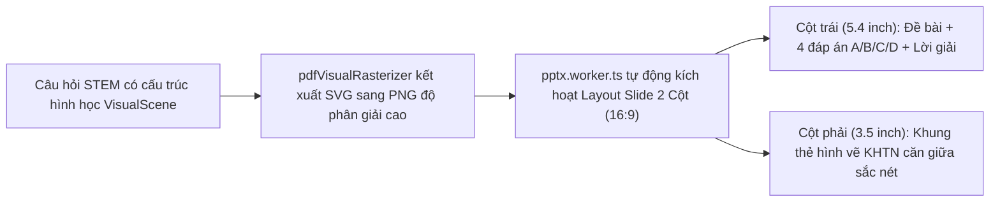

> **Tóm tắt nhanh (TL;DR):** Khi soạn slide bài giảng và bài tập các môn Khoa học Tự nhiên (Toán, Vật lý, Hóa học, Sinh học), việc chèn hình vẽ đồ thị, sơ đồ lực hay cấu trúc phân tử sao cho không bị méo tỷ lệ hoặc đè lên chữ đáp án A, B, C, D là khâu tốn nhiều công sức nhất. Năm 2026, **Top 5 website xuất slide PowerPoint có hình vẽ KHTN** gồm **QuizKen**, **BioRender**, **Canva for Education**, **Visme** và **Gamma** đã giúp giáo viên tự động dựng hình vector và dàn trang slide 2 cột sắc nét.

---

# Top 5 Web Xuất Slide PowerPoint Có Hình Vẽ Khoa Học Tự Nhiên 2026

Môn **Khoa học Tự nhiên (KHTN)** ở bậc THCS và tổ hợp **Toán – Lý – Hóa – Sinh** ở bậc THPT theo Chương trình GDPT 2018 đòi hỏi tính trực quan cực kỳ cao. Một slide câu hỏi Vật lý về dao động con lắc lò xo hay một câu Toán về đồ thị đạo hàm không thể thiếu hình vẽ minh họa nằm ngay cạnh đề bài.

Khi thiết kế slide KHTN theo cách thủ công truyền thống, giáo viên thường gặp 3 bất cập:
1. **Ảnh cắt từ file PDF hoặc chụp màn hình bị vỡ hạt (pixelated):** Khi phóng to lên màn chiếu 100 inch của lớp học, các đường kẻ trục tọa độ `Ox, Oy` và chỉ số góc bị nhòe mờ.
2. **Mất cân đối bố cục giữa chữ và hình:** Nếu đặt hình vẽ ở dưới câu hỏi thì 4 phương án A, B, C, D bị đẩy tràn xuống mép dưới slide; nếu đặt đè lên bên phải mà không co khung chữ thì hình sẽ che khuất nội dung đáp án.
3. **Nền trắng của ảnh chụp đè thô kệch lên nền slide:** Làm mất tính thẩm mỹ chuyên nghiệp của bài giảng điện tử.

Dưới đây là đánh giá chi tiết **Top 5 website hỗ trợ tạo và xuất slide PowerPoint có hình vẽ Khoa học Tự nhiên tốt nhất năm 2026**.

---

## Bảng So Sánh 5 Web Xuất Slide PowerPoint Có Hình Vẽ KHTN (2026)

| Nền tảng | Tự động sinh hình vẽ Toán / Lý bằng AI | Tự động chia Slide 2 cột (Chữ trái - Hình phải) | Độ sắc nét khi chiếu màn hình lớn | Xuất trực tiếp file `.pptx` | Chi phí |
| :--- | :--- | :--- | :--- | :--- | :--- |
| **1. QuizKen** | **Có (`VisualScene` Vector DSL)** | **Có (Tự động 100% khi có hình)** | **Retina PNG từ gốc Vector SVG** | **Có (1-Click miễn phí)** | **Miễn phí 100%** |
| **2. BioRender** | Thư viện icon Sinh – Hóa – Y học | Thủ công | Rất cao (Chuẩn tạp chí khoa học) | Xuất ảnh/PPTX ở gói trả phí | Giới hạn ở bản Free |
| **3. Canva for Education** | Kho hình vẽ vector có sẵn | Kéo thả theo lưới mẫu | Cao | Có tải `.pptx` | Miễn phí cho Edu |
| **4. Visme** | Biểu đồ & Infographic dữ liệu | Theo template | Cao | Xuất PPTX ở gói Business | Trả phí cao |
| **5. Gamma App** | Sinh ảnh AI minh họa chung | Bố cục thẻ 2 cột | Đẹp nhưng sai ký hiệu Toán/Lý | Có xuất `.pptx` | Giới hạn Credit Free |

---

## Đánh Giá Chi Tiết Top 5 Web Xuất Slide PowerPoint Có Hình Vẽ KHTN

### 1. QuizKen — Tự động rasterize hình vẽ `VisualScene` sang Layout Slide 2 cột chuẩn 16:9

Trong bản nâng cấp hệ thống xuất bản năm 2026, **QuizKen** đã đồng bộ hoàn toàn công nghệ đồ họa **`VisualScene`** giữa trình xuất PDF A4 và trình xuất PowerPoint (`pptx.worker.ts`).

* **Cơ chế dàn trang Slide KHTN tự động trên QuizKen:**
  * **Lazy Rasterization từ Vector SVG:** Khi giáo viên bấm nút **PPTX**, chỉ những câu hỏi nào có chứa hình minh họa `VisualScene` mới kích hoạt bộ kết xuất `preparePayloadWithVisualImages`. Hệ thống dựng hình SVG gốc ở độ phân giải cao rồi chuyển thành ảnh PNG sắc nét trước khi đưa vào worker tạo slide.
  * **Chuyển đổi bố cục 2 cột thông minh (`Two-Column Slide Layout`):**
    * Nếu câu hỏi **không có hình vẽ**: Khung đề bài và 4 thẻ đáp án A, B, C, D tự động mở rộng toàn bộ chiều ngang slide (`9.0 inch`), giúp tận dụng tối đa diện tích màn chiếu.
    * Nếu câu hỏi **có hình vẽ `VisualScene`**: Slide tự động thu gọn cột câu hỏi & đáp án sang bên trái (`5.4 inch`) và dành riêng một khung thẻ bo góc trang trọng ở bên phải (`3.5 × 3.05 inch`) để đặt hình vẽ đồ thị, mạch điện hoặc hình học phẳng.
  * **Giữ trọn vẹn ký hiệu KHTN:** Mọi ký hiệu vectơ, chữ cái Hy Lạp ($\alpha, \beta, \omega, \Delta, \lambda$), chỉ số hóa học và lời giải đều được xử lý qua `formatPdfText` sạch sẽ trên slide.
* **Ưu điểm:** Giáo viên không cần đụng tay vào bất kỳ thao tác căn chỉnh khung hình hay co kéo lề nào trong PowerPoint — file `.pptx` tải về đã sẵn sàng trình chiếu ngay.
* **Nhược điểm:** Chuyên biệt cho slide câu hỏi kiểm tra và bài tập KHTN hơn là slide poster hội nghị.
* **Chi phí:** Hoàn toàn miễn phí.

👉 **Trải nghiệm ngay:** [Tạo đề KHTN có hình vẽ và xuất Slide PowerPoint trên QuizKen](https://app.quizken.com).

---

### 2. BioRender — Kho đồ họa chuyên sâu số 1 cho môn Sinh học và Hóa sinh

Đối với giáo viên chuyên Sinh học hoặc Hóa học cần minh họa cấu trúc tế bào, chuỗi xoắn ADN, màng phospholipid hay dụng cụ thí nghiệm ống nghiệm, **BioRender** là tiêu chuẩn vàng trên thế giới.

* **Ưu điểm:**
  * Hàng chục ngàn biểu tượng sinh học phân tử, giải phẫu, miễn dịch học và dụng cụ phòng thí nghiệm cực kỳ chuẩn xác về mặt khoa học.
* **Nhược điểm:**
  * Không hỗ trợ dựng đồ thị hàm số Toán học hay sơ đồ lực cơ học Vật lý; giáo viên phải tự lắp ghép từng icon bằng tay và tính năng xuất độ phân giải cao sang PowerPoint yêu cầu tài khoản trả phí.
* **Chi phí:** Bản miễn phí gắn watermark và giới hạn độ phân giải xuất ảnh.

---

### 3. Canva for Education — Kho hình minh họa bài giảng KHTN đa dạng

**Canva** sở hữu kho *Elements* khổng lồ với nhiều hình vẽ minh họa thí nghiệm Vật lý, bảng tuần hoàn Hóa học và sơ đồ Sinh học.

* **Ưu điểm:**
  * Dễ dàng tìm kiếm hình minh họa bằng tiếng Việt hoặc tiếng Anh để trang trí cho slide bài giảng thêm sinh động; xuất trực tiếp ra file `.pptx`.
* **Nhược điểm:**
  * Hình vẽ trong Canva là hình đồ họa tĩnh cố định, không thể tự động vẽ một đồ thị hàm số theo đúng phương trình $y = x^3 - 3x + 1$ hay vẽ tam giác có góc $60^\circ$ khớp với số liệu bài toán cụ thể như `VisualScene` của QuizKen.
* **Chi phí:** Miễn phí cho tài khoản giáo viên.

---

### 4. Visme — Công cụ thiết kế slide biểu đồ và thống kê dữ liệu

**Visme** nổi bật khi giáo viên Địa lý, Sinh học (phần Sinh thái/Di truyền) hoặc Toán thống kê cần trình bày biểu đồ số liệu trên slide.

* **Ưu điểm:**
  * Hệ thống biểu đồ cột, biểu đồ tròn, biểu đồ miền và bản đồ dữ liệu trực quan, chuyên nghiệp.
* **Nhược điểm:**
  * Tính năng tải bài thuyết trình về dưới dạng file `.pptx` bị khóa hoàn toàn ở tài khoản miễn phí (chỉ mở ở gói Business đắt đỏ).
* **Chi phí:** Trả phí cao để xuất PPTX.

---

### 5. Gamma App — Tạo nhanh slide lý thuyết KHTN tổng quan

**Gamma** giúp giáo viên tạo nhanh phần slide giới thiệu đầu bài học (ví dụ: *"Ứng dụng của hiện tượng cảm ứng điện từ trong đời sống"*).

* **Ưu điểm:**
  * Tốc độ tạo slide nhanh, bố cục thẻ 2 cột hiện đại.
* **Nhược điểm:**
  * Khi yêu cầu AI của Gamma vẽ hình minh họa cho bài toán Hình học hoặc Vật lý cụ thể, AI tạo ảnh thường vẽ hình trang trí mang tính minh họa nghệ thuật chứ không đúng tọa độ và ký hiệu khoa học.
* **Chi phí:** Freemium (giới hạn credits).

---

## Mẹo Kiểm Tra Nhanh Bộ Slide KHTN Trước Giờ Lên Lớp

1. Tạo bộ câu hỏi Toán / Lý / Hóa / KHTN trên [QuizKen](https://app.quizken.com) và bật tùy chọn sinh hình minh họa trực quan.
2. Nhấn nút **PPTX** để tải file trình chiếu 16:9 về máy tính.
3. Nhấn `F5` trong PowerPoint để kiểm tra chế độ toàn màn hình: các slide có hình vẽ sẽ tự động hiển thị ở bố cục 2 cột cân đối, kèm huy hiệu Bloom `L1–L4` và bảng tổng hợp đáp án phân trang ở cuối bài.

---

## Câu hỏi thường gặp (FAQ)

### 1. Khi đề thi chỉ có 5 câu chứa hình vẽ và 15 câu chỉ có chữ thì file PowerPoint xuất từ QuizKen sẽ dàn trang thế nào?
Bộ máy `pptx.worker.ts` của QuizKen kiểm tra tự động từng câu hỏi một: 15 câu chỉ có chữ sẽ được dàn **layout 1 cột rộng rãi** toàn màn hình, còn đúng 5 câu có hình `VisualScene` sẽ tự động chuyển sang **layout 2 cột (Chữ bên trái – Hình vẽ bên phải)**.

### 2. Nếu đề thi không có câu nào chứa hình vẽ thì trình xuất PPTX có phải tải thêm thư viện đồ họa nặng không?
Không. QuizKen áp dụng kỹ thuật **Lazy Import thông minh**: chỉ khi nào trong đề có ít nhất 1 câu hỏi chứa dữ liệu `visual` chưa được kết xuất ảnh thì hệ thống mới nạp mô-đun `pdfVisualRasterizer`, giúp tốc độ xuất các đề thông thường nhanh tức thì.

### 3. Hình vẽ trên slide PowerPoint của QuizKen có thể kéo to hoặc di chuyển sang vị trí khác sau khi tải về không?
Có. Trong file `.pptx` tải về, mỗi hình minh họa là một đối tượng ảnh PNG độc lập nằm trên slide, nên thầy cô có thể bấm chuột vào hình trong PowerPoint để phóng to, thu nhỏ hoặc thêm hiệu ứng Zoom tùy ý.
