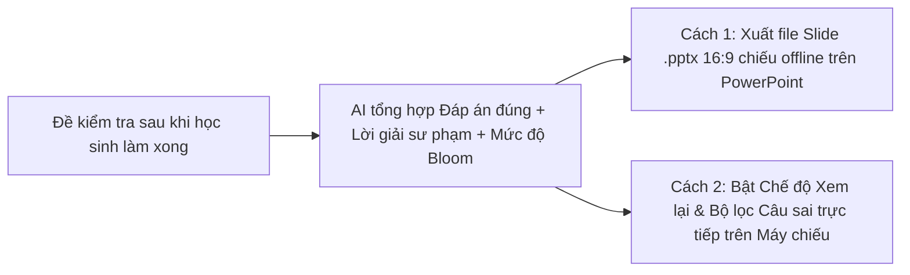

> **Tóm tắt nhanh (TL;DR):** Tiết trả bài và chữa đề kiểm tra là thời điểm vàng để học sinh lấp đầy lỗ hổng kiến thức, nhưng nhiều giáo viên không đủ thời gian soạn riêng bộ slide chữa bài có lời giải chi tiết cho từng câu. Năm 2026, **Top 6 công cụ AI làm slide chữa đề thi trên máy chiếu** gồm **QuizKen**, **Brisk Teaching**, **MagicSchool AI**, **Microsoft Copilot for PowerPoint**, **Curipod** và **ClassPoint** đã giúp tự động hóa 100% khâu dàn trang slide câu hỏi kèm hộp giải thích từng bước.

---

# Top 6 Công Cụ AI Làm Slide Chữa Đề Thi Trên Máy Chiếu Cho Giáo Viên

Trong phương pháp dạy học phát triển năng lực theo Chương trình GDPT 2018, một tiết trả bài kiểm tra hiệu quả không chỉ là đọc bảng đáp án `1A, 2C, 3D` cho học sinh chép điểm, mà là **phân tích trực quan trên máy chiếu** vì sao phương án đó đúng và chỉ ra bẫy tư duy ở các phương án nhiễu.

Tuy nhiên, thực tế tại các trường phổ thông cho thấy:
* Nếu giáo viên chiếu file Word đề thi lên bảng, cỡ chữ `11pt–12pt` quá nhỏ khiến học sinh bàn cuối phải nheo mắt nhìn, còn phần lời giải lại nằm ở một file hướng dẫn chấm riêng biệt phải chuyển cửa sổ qua lại liên tục.
* Nếu giáo viên tự làm slide PowerPoint chữa 40 câu trắc nghiệm thì mất ít nhất cả buổi tối cuối tuần.

Dưới đây là bảng xếp hạng **Top 6 công cụ AI làm slide chữa đề thi trên máy chiếu tốt nhất cho giáo viên năm 2026**.

---

## Bảng So Sánh 6 Công Cụ AI Làm Slide Chữa Đề Thi Trên Máy Chiếu (2026)

| Công cụ AI | Tự động chèn Hộp lời giải lên từng Slide | Tô màu nổi bật Đáp án đúng trên Slide | Có bộ lọc chiếu riêng các Câu nhiều học sinh sai | Hỗ trợ Tiếng Việt & Toán Lý Hóa | Chi phí |
| :--- | :--- | :--- | :--- | :--- | :--- |
| **1. QuizKen** | **Có (Tự động 100% trên PPTX & Web)** | **Có (Nền Emerald + Icon Check)** | **Có (Bộ lọc Câu sai / Gắn cờ 🚩)** | **100% Tiếng Việt + Toán Unicode** | **Miễn phí 100%** |
| **2. Brisk Teaching** | Tạo slide từ Google Docs | Thủ công | Không | Hỗ trợ tiếng Việt cơ bản | Miễn phí / Educator Pro |
| **3. MagicSchool AI** | Sinh dàn ý slide bài giảng | Không tự đóng khung đề thi | Không | Có hỗ trợ đa ngôn ngữ | Giới hạn ở bản Free |
| **4. Copilot PowerPoint** | Theo câu lệnh prompt | Thủ công | Không | Tốt nhưng không chuyên đề thi | Thuê bao Microsoft 365 đắt |
| **5. ClassPoint AI** | Hiển thị giải thích khi bấm | Có trong chế độ Live | Có thống kê biểu đồ cột | Giao diện Tiếng Việt/Anh | Giới hạn 25 học sinh Free |
| **6. Curipod** | Phản hồi AI cho câu tự luận | Có trên giao diện web | Theo lượt bình chọn lớp | Chủ yếu Tiếng Anh | Freemium |

---

## Đánh Giá Chi Tiết Top 6 Công Cụ AI Làm Slide Chữa Đề Thi Cho Giáo Viên

### 1. QuizKen — Bộ đôi Xuất Slide `.pptx` Chữa Đề & Màn Hình Lọc Câu Sai Trực Tiếp

**QuizKen** mang đến cho giáo viên **2 phương thức chữa đề trên máy chiếu** linh hoạt nhất hiện nay, phù hợp cho cả phòng học offline lẫn phòng học thông minh có kết nối mạng:

* **Phương thức 1 — Xuất file Slide PowerPoint (`.pptx`) chữa đề chuyên nghiệp:**
  * Chỉ cần bấm nút **PPTX**, QuizKen tự động sinh bộ slide tỉ lệ Widescreen 16:9 với phông chữ lớn rõ ràng.
  * Trên mỗi slide câu hỏi, phương án đúng được **tô nền xanh ngọc nổi bật kèm dấu tích `✓`**, các phương án nhiễu được giữ nền xám nhạt đối조 rõ rệt.
  * Phía dưới các phương án là **Hộp Giải Thích (`Giải thích chi tiết`)** trình bày căn cứ lý thuyết và công thức giải nhanh.
  * Nếu câu hỏi có đồ thị hoặc hình học **`VisualScene`**, hình vẽ sẽ nằm ngay ở cột bên phải slide để thầy cô dùng bút laser chỉ trực tiếp từng góc, từng điểm cực trị trên màn chiếu.
* **Phương thức 2 — Chữa đề trực tiếp trên giao diện Phòng Thi Thử (`ExamScoreCard`):**
  * Ngay trên màn hình kết quả của QuizKen, giáo viên có thể bấm vào thanh bộ lọc **`Câu sai`** hoặc **`🚩 Đã gắn cờ`** để chỉ lọc riêng những câu khó, câu bẫy mà học sinh trong lớp hay vướng mắc nhất để chiếu lên chữa sâu, tiết kiệm một nửa thời gian tiết học.
* **Ưu điểm:** Không tốn công thiết kế, không lỗi công thức Toán/Hóa, dùng được ngay cả khi trường mất mạng (với file `.pptx` đã tải về).
* **Nhược điểm:** Chưa tích hợp bút vẽ viết tay trực tiếp lên web (nhưng khi mở bằng PowerPoint thì thầy cô dùng bút Pen/Laser của PowerPoint thoải mái).
* **Chi phí:** Hoàn toàn miễn phí.

👉 **Thử ngay:** [Xuất slide PowerPoint chữa đề thi tự động trên QuizKen](https://app.quizken.com).

---

### 2. Brisk Teaching — Tiện ích Chrome biến tài liệu Google Docs thành Slide

**Brisk Teaching** là tiện ích mở rộng trên trình duyệt Chrome rất được lòng giáo viên sử dụng hệ sinh thái Google.

* **Ưu điểm:**
  * Có thể đọc một file tài liệu trên Google Docs hoặc trang web và bấm nút tạo nhanh bộ Google Slides tóm tắt nội dung bài học.
* **Nhược điểm:**
  * Thiên về tạo slide giảng bài lý thuyết mới; khi đưa vào một đề thi 40 câu trắc nghiệm Toán – Lý – Hóa thì Brisk thường chỉ tóm tắt thành 8–10 slide khái quát chứ không tạo đủ 40 slide chữa từng câu hỏi chi tiết như QuizKen.
* **Chi phí:** Có bản miễn phí và gói Brisk Educator Pro trả phí.

---

### 3. MagicSchool AI — Bộ trợ lý AI đa năng cho giáo viên

**MagicSchool AI** cung cấp hơn 60 công cụ nhỏ hỗ trợ giáo viên từ viết nhận xét học bạ, soạn giáo án cho tới gợi ý nội dung slide.

* **Ưu điểm:**
  * Có công cụ *Presentation Generator* giúp lên cấu trúc nội dung từng slide theo khối lớp và chủ đề.
* **Nhược điểm:**
  * Công cụ chủ yếu xuất ra dàn ý văn bản (text outline) hoặc xuất cơ bản sang Google Slides, chưa thể tự động vẽ hình học vector hay đóng khung 4 phương án A/B/C/D kèm bảng đáp án phân trang.
* **Chi phí:** Giới hạn tính năng xuất file ở bản miễn phí.

---

### 4. Microsoft Copilot for PowerPoint — AI tích hợp trong bộ Office 365

Đối với các trường học có bản quyền Microsoft 365 Copilot, giáo viên có thể ra lệnh cho Copilot tạo slide từ file Word.

* **Ưu điểm:**
  * Tích hợp sẵn ngay trong phần mềm PowerPoint bản quyền, sử dụng các mẫu thiết kế (Designer Themes) chính chủ của Microsoft.
* **Nhược điểm:**
  * Chi phí bản quyền Copilot cực kỳ đắt đỏ (khoảng 20–30 USD/tháng); đôi khi AI tự ý rút gọn bớt câu hỏi trong file đề gốc thay vì giữ nguyên từng câu để chữa bài.
* **Chi phí:** Trả phí bản quyền cao.

---

### 5. ClassPoint AI — Chữa câu hỏi trực tiếp theo biểu đồ trả lời của lớp

**ClassPoint** giúp giáo viên thu thập đáp án của học sinh ngay trong lúc trình chiếu PowerPoint và hiển thị biểu đồ cột xem bao nhiêu % học sinh chọn A, B, C, D.

* **Ưu điểm:**
  * Giáo viên nhìn ngay được câu nào cả lớp chọn sai nhiều nhất để dừng lại giải thích kỹ.
* **Nhược điểm:**
  * Yêu cầu máy tính phòng học phải cài đặt sẵn plugin ClassPoint và có kết nối mạng ổn định trong suốt tiết học.
* **Chi phí:** Bản miễn phí giới hạn 25 học sinh/lớp.

---

### 6. Curipod — Chiếu phản hồi AI trực tiếp cho câu hỏi mở

**Curipod** rất mạnh khi giáo viên muốn tổ chức tiết chữa bài tập tự luận ngắn hoặc câu hỏi thảo luận mở.

* **Ưu điểm:**
  * Học sinh gửi câu trả lời lên màn chiếu (ẩn danh tên để học sinh không ngại), sau đó AI của Curipod chấm nhận xét ưu/nhược điểm ngay trên bảng.
* **Nhược điểm:**
  * Giao diện và phản hồi AI tối ưu nhất cho tiếng Anh; ít phù hợp để chữa đề thi trắc nghiệm 40–50 câu các môn Khoa học Tự nhiên tại Việt Nam.
* **Chi phí:** Miễn phí cơ bản / Gói trả phí.

---

## Mẹo Tổ Chức Tiết Chữa Đề 45 Phút Hiệu Quả Gấp Đôi Với QuizKen

Thay vì chữa tuần tự từ Câu 1 đến Câu 40 khiến học sinh giỏi thấy nhàm chán ở 20 câu đầu còn những câu khó cuối đề lại hết giờ, thầy cô có thể áp dụng cấu trúc **"10 - 25 - 10"** với QuizKen:
* **10 phút đầu:** Chiếu slide **Bảng Tổng Hợp Kết Quả & Đáp Án** ở cuối file `.pptx` của QuizKen để học sinh tự đối chiếu nhanh các câu mức độ *Nhận biết (`L1`)* và *Thông hiểu (`L2`)*.
* **25 phút giữa:** Chuyển tới các slide có gắn huy hiệu **`L3 Vận dụng`** và **`L4 Vận dụng cao`** (hoặc dùng bộ lọc **`Câu sai / Đã gắn cờ 🚩`** trên màn hình kết quả QuizKen) để phân tích sâu hình vẽ `VisualScene` và hộp giải thích.
* **10 phút cuối:** Nhấn nút **"Góp ý câu hỏi"** trên Dashboard nếu phát hiện câu nào cần điều chỉnh, và gửi file **PDF Tài liệu ôn tập (`study_guide`)** vào nhóm lớp để học sinh lưu trữ!

👉 **Trải nghiệm ngay:** [Truy cập QuizKen để tạo đề và xuất Slide chữa bài miễn phí](https://app.quizken.com).

---

## Câu hỏi thường gặp (FAQ)

### 1. Trên mỗi slide PowerPoint xuất từ QuizKen đã có sẵn lời giải chi tiết chưa?
Có. Ngay phía dưới 4 phương án A, B, C, D trên mỗi slide câu hỏi, QuizKen tự động chèn một khung **Giải thích chi tiết** (nếu câu hỏi có lời giải), giúp giáo viên không cần phải lật sổ tay hay mở thêm file Word hướng dẫn chấm.

### 2. Làm sao để biết câu hỏi đang chiếu trên slide thuộc mức độ Nhận biết hay Vận dụng cao?
Ở góc trên bên phải của mỗi slide câu hỏi trong file `.pptx`, hệ thống tự động gắn huy hiệu màu phân loại theo thang nhận thức Bloom: **L1 Nhận biết**, **L2 Thông hiểu**, **L3 Vận dụng**, hoặc **L4 Vận dụng cao**.

### 3. Học sinh ngồi bàn cuối lớp 45 người có đọc rõ chữ trên slide PowerPoint của QuizKen không?
Rất rõ. Khác với việc chiếu file Word chữ nhỏ, bộ xuất `.pptx` của QuizKen sử dụng tỉ lệ màn hình rộng 16:9 với cỡ chữ tiêu đề và câu hỏi lớn (`16pt–22pt`), độ tương phản cao trên nền sáng và mỗi câu hỏi chiếm trọn 1 slide độc lập.
