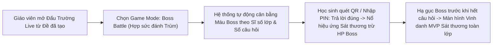

> **Tóm tắt nhanh (TL;DR):** Ở các trò chơi đua bảng xếp hạng cá nhân truyền thống, những học sinh có lực học trung bình – yếu thường sớm bỏ cuộc khi thấy mình bị tụt lại ở cuối bảng. Năm 2026, xu hướng **Co-op Gamification (Cả lớp hợp sức đánh Boss)** trên **Top 6 nền tảng gồm QuizKen (Boss Battle), Blooket, Gimkit, Wayground (Quizizz), Kahoot! Team Mode và Baamboozle** đã giúp mọi học sinh từ trung bình đến giỏi đều đóng góp sát thương vào chiến thắng chung của tập thể lớp.

---

# Top 6 Web Biến Tiết Học 45 Phút Thành Gameshow Đánh Boss Sôi Động 2026

Tại sao nhiều học sinh vốn rất sợ giờ kiểm tra bài cũ lại có thể ngồi say mê giải liền 30–40 câu hỏi trắc nghiệm Toán, Lý, Hóa, Sử, Anh khi câu hỏi đó được đặt trong một trận **Đánh Boss (Boss Battle)** hoặc **Thách Đấu 1v1**?

Các nhà nghiên cứu giáo dục giải thích hiện tượng này qua cơ chế **Động lực đồng đội (Collaborative Motivation)**:
* Trong bảng xếp hạng đua cá nhân thuần túy, chỉ có 3 học sinh đứng đầu cảm thấy hào hứng, còn 35 học sinh phía dưới dễ nản lòng nếu sai 2–3 câu đầu tiên.
* Ngược lại, trong chế độ **Hợp Sức Đánh Boss (`Boss Battle`)**, cả lớp 40 học sinh đứng chung một chiến tuyến đối đầu với một "Trùm cuối" có thanh máu khổng lồ trên màn chiếu. Mỗi câu trả lời đúng của bất kỳ học sinh nào trong lớp — dù chỉ là một câu *Nhận biết (`L1`)* cơ bản — cũng tạo ra một đòn tấn công trừ thẳng vào thanh máu của Boss (`DamageFloater`)!

Dưới đây là đánh giá chi tiết **Top 6 website biến tiết ôn tập 45 phút thành gameshow đánh Boss và thi đấu sôi động nhất năm 2026**.

---

## Bảng So Sánh 6 Web Tổ Chức Gameshow Đánh Boss & Thi Đấu Lớp Học (2026)

| Nền tảng | Có chế độ Hợp sức Đánh Boss (Co-op Boss Battle) | Có chế độ Thách đấu 1v1 qua Mã QR / Link | Tự động cân bằng máu Boss theo sĩ số lớp | Hỗ trợ tạo đề AI Tiếng Việt & Toán Lý Hóa | Chi phí |
| :--- | :--- | :--- | :--- | :--- | :--- |
| **1. QuizKen (`BossBattle`)** | **Có (`boss_battle` Mode)** | **Có (1v1 giao hữu & cược ZCoin)** | **Có (`(Players * 500) * ceil(Q / 1.5)`)** | **100% Tiếng Việt + KaTeX + VisualScene** | **Miễn phí 100%** |
| **2. Gimkit (Boss Mode)** | Có (1 vs All Boss) | Không | Thủ công | Cơ bản | Giới hạn 5 người ở bản Free |
| **3. Blooket (Monster Brawl)** | Đánh quái cá nhân / Thủ thành | Không | Theo màn chơi | Không chuyên công thức STEM | Miễn phí 60 người |
| **4. Wayground (Mastery Peak)** | Leo núi tập thể | Có thách đấu bạn bè | Theo mục tiêu phần trăm | Khá | Freemium |
| **5. Kahoot! (Team Mode)** | Đua điểm giữa các tổ | Không có 1v1 đặt cược | Không có thanh máu Boss | Hạn chế công thức sâu | Giới hạn người chơi Free |
| **6. Baamboozle** | Thi đấu tổ trên bảng | Không | Điểm cộng/trừ theo ô | Cơ bản | Freemium |

---

## Đánh Giá Chi Tiết Top 6 Web Biến Tiết Học Thành Gameshow Đánh Boss

### 1. QuizKen — Chế độ `Boss Battle` cân bằng máu tự động & Đấu trường 1v1 cược ZCoin

**QuizKen** là nền tảng EdTech tiếng Việt tiên phong xây dựng trọn bộ hệ thống **`BossBattleHostView`**, **`BossBattlePlayerView`** và **`BossBattleResultView`** ngay trong Đấu Trường Live mà không thu bất kỳ khoản phí nào của giáo viên.

* **Điểm cuốn hút của trận Đánh Boss trên QuizKen:**
  1. **Thuật toán cân bằng máu Boss tự động theo sĩ số thực tế:** Khi giáo viên chọn chế độ **`Boss Battle`** trên thanh `HostHeader` và bấm bắt đầu trận đấu, hệ thống tự động đếm số học sinh đã vào phòng (`playerCount`) và tổng số câu hỏi của đề (`count`) để tính lượng máu tối đa của Boss:
     $$\text{Max Boss HP} = (\max(1, \text{Players}) \times 500) \times \lceil \text{Questions} / 1.5 \rceil$$
     Nhờ công thức này, dù lớp chỉ có 15 học sinh học nhóm hay cả giảng đường 60 học sinh thì độ khó để hạ gục Boss vẫn vừa vặn và hồi hộp đến tận những phút cuối!
  2. **Hiệu ứng chiến đấu thời gian thực (`BossAvatar`, `BossHealthBar`, `DamageFloater`):** Trên màn chiếu của giáo viên hiển thị hình ảnh Boss khổng lồ cùng thanh máu chuyển màu theo giai đoạn. Mỗi khi học sinh dưới lớp chọn đúng đáp án trên điện thoại, các con số sát thương bay lên dồn dập kèm hiệu ứng rung lắc khi Boss trúng đòn.
  3. **Bảng vinh danh Chiến Công (`BossBattleResultView`):** Khi Boss bị hạ gục (hoặc hết giờ), màn hình tổng kết vinh danh chiến thắng của cả tập thể lớp đồng thời xướng tên các **Xạ thủ MVP đóng góp tổng sát thương cao nhất**.
  4. **Chế độ Thách đấu 1v1 ngoài giờ học:** Học sinh có thể bấm mời bạn thân đấu tay đôi 1v1 trên bất kỳ đề thi nào (chọn đấu giao hữu hoặc đặt cược đồng xu thưởng **ZCoin** tích lũy từ việc học tập) thông qua Mã QR thách đấu trong `ShareDialog`.
* **Ưu điểm:** Khơi dậy tinh thần đoàn kết của cả lớp; chuyển đổi qua lại giữa `Classic` và `Boss Battle` chỉ bằng 1 cú nhấp chuột ngay tại sảnh chờ.
* **Nhược điểm:** Dễ khiến học sinh hào hứng reo hò hơi to trong lớp (thầy cô nhớ dặn học sinh giữ trật tự vừa phải trước khi bấm Start!).
* **Chi phí:** Hoàn toàn miễn phí.

👉 **Tổ chức trận đánh Boss ngay cho lớp bạn:** [Mở sảnh Đấu Trường Live Boss Battle trên QuizKen](https://app.quizken.com/game/lobby).

---

### 2. Gimkit (Boss Battle Mode) — Cuộc đối đầu "1 Giáo Viên vs Cả Lớp"

**Gimkit** có chế độ *Boss Battle* trong đó giáo viên (hoặc một học sinh được chọn) đóng vai Boss đối đầu với phần còn lại của lớp.

* **Ưu điểm:**
  * Lối chơi đối kháng thú vị khi học sinh được hợp sức "đánh bại" thầy cô trên bảng câu hỏi.
* **Nhược điểm:**
  * Yêu cầu giáo viên cũng phải ngồi liên tục bấm trả lời câu hỏi để giữ máu cho Boss chứ không thể đi quanh lớp quan sát và hỗ trợ học sinh yếu như chế độ AI Boss tự động của QuizKen; bản miễn phí giới hạn chỉ 5 người chơi.
* **Chi phí:** Phải mua gói Gimkit Pro mới mở được cho cả lớp 40 học sinh.

---

### 3. Blooket (Monster Brawl & Tower Defense) — Sinh tồn chống quái vật

Trong chế độ *Monster Brawl* của **Blooket**, mỗi học sinh điều khiển nhân vật của mình trên màn hình điện thoại và trả lời câu hỏi để bắn đạn tiêu diệt các đợt quái vật nhỏ.

* **Ưu điểm:**
  * Đồ họa 2D vui nhộn, thu hút học sinh nhỏ tuổi.
* **Nhược điểm:**
  * Mỗi học sinh tự đánh quái trên màn hình riêng của mình chứ không phải cả lớp cùng chung tay trừ một thanh máu Boss chung trên màn chiếu lớn; học sinh dễ mải mê di chuyển nhân vật trên bản đồ mà làm giảm số lượng câu hỏi giải được trong tiết.
* **Chi phí:** Miễn phí (tối đa 60 người) / Gói Plus trả phí.

---

### 4. Wayground / Quizizz (Mastery Peak) — Chế độ cùng nhau leo đỉnh núi

**Wayground** cung cấp chế độ *Mastery Peak* nơi các nhân vật đại diện của học sinh cùng leo lên một ngọn núi tuyết trên màn chiếu khi độ chính xác của lớp tăng lên.

* **Ưu điểm:**
  * Khuyến khích độ chính xác (Accuracy) thay vì chỉ bấm nhanh ẩu.
* **Nhược điểm:**
  * Nhịp độ khá nhẹ nhàng, thiếu cảm giác dồn sát thương kịch tính của một trận đánh Boss thực thụ.
* **Chi phí:** Freemium.

---

### 5. Kahoot! (Team Mode) — Chia tổ thảo luận trước khi bấm

**Kahoot!** cho phép chia lớp thành các đội (Teams) và dành 5 giây thảo luận nhóm (Team Talk) trước khi bấm chọn đáp án.

* **Ưu điểm:**
  * Rèn kỹ năng thảo luận nhanh giữa các thành viên trong cùng một bàn hoặc một tổ.
* **Nhược điểm:**
  * Vẫn là mô hình các tổ ganh đua điểm số với nhau chứ chưa có chế độ toàn bộ lớp học cùng hợp lực tiêu diệt một Boss chung.
* **Chi phí:** Giới hạn số lượng đội/người chơi ở bản miễn phí.

---

### 6. Baamboozle — Lật thẻ Power-ups bất ngờ giữa các tổ

**Baamboozle** thêm gia vị cho tiết ôn tập bằng các ô thẻ chức năng ngẫu nhiên (*Cộng 50 điểm, Trừ điểm đội bạn, Đổi điểm hai đội*).

* **Ưu điểm:**
  * Không cần thiết bị học sinh, phù hợp cho tiết sinh hoạt ngoại khóa.
* **Nhược điểm:**
  * Mang tính giải trí may rủi cao, không lưu lại lịch sử câu sai của từng học sinh để ôn tập sau giờ chơi.
* **Chi phí:** Freemium.

---

## Câu hỏi thường gặp (FAQ)

### 1. Làm thế nào để bật chế độ "Boss Battle" thay vì chế độ đua điểm "Classic" trên QuizKen?
Thầy cô có thể chọn **`Boss Battle`** ở ngay 2 nơi:
1. Tại tab **Tổ chức phòng (Host Tab)** ở sảnh `/game/lobby` trước khi bấm tạo phòng.
2. Hoặc ngay tại thanh tiêu đề trên cùng (`HostHeader`) trong lúc đang đợi học sinh quét QR vào phòng, thầy cô chỉ cần bấm menu **`Game Mode`** và đổi từ `Classic` sang `Boss Battle` (biểu tượng hai thanh kiếm chéo màu đỏ).

### 2. Trong lúc đang chờ học sinh vào phòng Đánh Boss, giáo viên có thể chiếu to Mã QR lên toàn màn hình không?
Có. Ngay trên thẻ thông tin phòng bên trái (`HostActionCard`), dưới khung Mã QR có nút **`"Phóng to QR Máy Chiếu"`**. Khi bấm vào, cửa sổ `ClassroomQrModal` sẽ phóng to Mã QR `320×320` kèm **Mã PIN 6 số** chữ vàng khổng lồ để học sinh cuối lớp quét vào trận trong tích tắc.

### 3. Đồng ZCoin dùng để thách đấu 1v1 trên QuizKen kiếm từ đâu? có phải nạp tiền thật không?
Tuyệt đối **không dùng tiền thật**. **ZCoin** là đơn vị xu thưởng học tập hoàn toàn miễn phí trên QuizKen: học sinh nhận được ZCoin khi hoàn thành các bài quiz ôn tập, duy trì chuỗi ngày học (Daily Quests / Streak) và chiến thắng các thử thách kiến thức.
