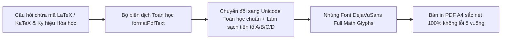

> **Tóm tắt nhanh (TL;DR):** Lỗi nhảy dòng, biến ký hiệu căn bậc hai, tích phân, mũi tên phản ứng hóa học thành ô vuông `□` hoặc chuỗi mã `$...$` thô kệch là cơn ác mộng của giáo viên khối Khoa học Tự nhiên (Toán – Lý – Hóa – Sinh) khi xuất đề thi ra PDF. Năm 2026, 6 nền tảng hàng đầu gồm **QuizKen**, **Overleaf**, **Mathpix**, **SmartTest**, **Azota** và **Equatio** đã giải quyết triệt để vấn đề này bằng công nghệ biên dịch LaTeX/KaTeX và nhúng font Unicode toán học trực tiếp vào lõi PDF.

---

# Top 6 Web In Đề Thi Toán Lý Hóa Không Lỗi Font Công Thức KaTeX 2026

Đối với giáo viên giảng dạy các môn **STEM / Khoa học Tự nhiên** theo Chương trình GDPT 2018, một đề kiểm tra tiêu chuẩn chứa hàng trăm ký hiệu đặc thù: từ giới hạn, tích phân, vectơ trong môn Toán; phương trình dao động điều hòa, ký hiệu hạt nhân trong Vật lý; cho tới chỉ số phân tử `H₂SO₄`, mũi tên thuận nghịch `⇌` trong Hóa học.

Khi sử dụng các trang web tạo trắc nghiệm thông thường rồi bấm xuất PDF, giáo viên thường gặp 3 lỗi nghiêm trọng:
1. **ộ mã LaTeX thô trên giấy in:** Thay vì hiển thị `x² + 2x - 3 = 0`, tờ giấy in ra nguyên chuỗi `$$x^2 + 2x - 3 = 0$$` hoặc `\frac{a}{b}` gây hoang mang cho học sinh.
2. **Lỗi thiếu glyph Unicode (Ô vuông hoặc dấu chấm hỏi):** Nhiều trình tạo PDF dùng font chữ cơ bản (như Roboto-Light hoặc Arial rút gọn) không có bảng mã Mathematical Operators, khiến các dấu `⇒`, `⇔`, `∈`, `⊂`, `√`, `∫` bị biến mất hoặc thành ký tự lạ.
3. **Đáp án dính chữ `A. A.` hoặc nhảy dòng lộn xộn:** Khi câu hỏi có công thức xen lẫn tiếng Việt, bộ ngắt dòng tự động cắt đứt giữa chừng biểu thức toán học.

Dưới đây là đánh giá chi tiết **Top 6 công cụ và website in đề thi Toán – Lý – Hóa không lỗi font công thức tốt nhất năm 2026**.

---

## Bảng So Sánh 6 Công Cụ Xuất & In Đề Thi Toán Lý Hóa (2026)

| Công cụ / Website | Xử lý mã LaTeX / KaTeX | Hỗ trợ chỉ số Hóa học & Ký hiệu Toán | Tự động tạo đề bằng AI | Độ khó sử dụng | Chi phí |
| :--- | :--- | :--- | :--- | :--- | :--- |
| **1. QuizKen** | **Tự động chuẩn hóa 100%** | **Đầy đủ (`DejaVuSans` Unicode)** | **Có (Gemini AI + RAG)** | **Rất dễ (1-Click)** | **Miễn phí 100%** |
| **2. Overleaf (LaTeX)** | Chuẩn xuất bản học thuật | Tuyệt đối (Vector TeX) | Không (Phải gõ code TeX) | Khó (Cần biết lập trình LaTeX) | Miễn phí / Pro |
| **3. Mathpix Snip & Docs** | Nhận diện OCR Toán cực mạnh | Rất tốt | Không sinh đề tự động | Trung bình | Giới hạn bản Free |
| **4. Azota** | Hỗ trợ qua Word/PDF gốc | Tốt (Giữ từ MathType) | Hỗ trợ bóc tách đề | Dễ | Miễn phí / VIP |
| **5. SmartTest** | Phụ thuộc Microsoft Word | Tốt (Giữ đối tượng OLE) | Không | Trung bình | Trả phí bản quyền |
| **6. Equatio (Texthelp)** | Chèn công thức vào Docs/Forms | Khá | Không | Dễ | Trả phí cho giáo viên |

---

## Chi Tiết Top 6 Web In Đề Thi Toán Lý Hóa Không Lỗi Font Công Thức

### 1. QuizKen — Nền tảng AI Quiz tích hợp bộ biên dịch Toán học & Font DejaVuSans Unicode

**QuizKen** là nền tảng duy nhất tại Việt Nam hiện nay kết hợp đồng thời **hiển thị KaTeX thời gian thực trên Web** với **bộ máy biên dịch ký hiệu toán học chuyên dụng (`pdfTextFormatter`) khi xuất file PDF và PowerPoint**.

* **Công nghệ xử lý công thức độc quyền:**
  * **Tự động chuyển đổi LaTeX sang ký hiệu toán học chuẩn:** Mọi biểu thức như `\sqrt{x}`, `\int_0^1`, `\sum`, `\alpha, \beta, \Delta, \pi`, `\Rightarrow, \Leftrightarrow`, `\in, \subset, \cup, \cap`, `\neq, \leq, \geq` hay phân số, lũy thừa `x^{2n}`, chỉ số hóa học `H_2SO_4` đều được biên dịch sạch sẽ sang ký tự toán học chuẩn xác trước khi đưa vào trang in.
  * **Nhúng bộ font `DejaVuSans` & `DejaVuSans-Bold` đầy đủ bảng mã:** Khác với các font web thông thường bị lược bỏ vùng ký tự toán học để giảm dung lượng, worker PDF của QuizKen nạp trọn bộ glyph Unicode giúp in rõ nét từng dấu suy ra (`⇒`), dấu tương đương (`⇔`), tập số thực (`ℝ`) và chữ cái Hy Lạp.
  * **Khử trùng lặp nhãn đáp án (`cleanPdfOptionText`):** Tự động loại bỏ tình trạng đáp án bị lặp tiền tố kiểu `A. A. x = 2` thường gặp khi xuất đề từ AI.
* **Ưu điểm:**
  * Giáo viên không cần cài MathType hay biết gõ code LaTeX phức tạp: chỉ cần tải giáo án PDF hoặc nhập chủ đề (ví dụ: *"Đề kiểm tra 45 phút Hàm số bậc ba Toán 12 kèm đồ thị"*), AI sẽ tự sinh câu hỏi, vẽ đồ thị `VisualScene` và xuất PDF A4 hoàn chỉnh.
  * Hỗ trợ 4 chế độ xuất PDF (Đề trắng, Đề + Bảng đáp án, Tài liệu ôn tập có lời giải, Phiếu chấm điểm).
* **Nhược điểm:** Với các hệ phương trình nhiều tầng quá dài, biểu thức sẽ được dàn trên dòng tuyến tính chuẩn Unicode để tối ưu khung thẻ câu hỏi.
* **Chi phí:** Miễn phí.

👉 **Thử ngay:** [Tạo và xuất đề thi Toán – Lý – Hóa PDF sắc nét trên QuizKen](https://app.quizken.com).

---

### 2. Overleaf — Tiêu chuẩn vàng về soạn thảo LaTeX học thuật

**Overleaf** là trình biên tập LaTeX trực tuyến nổi tiếng nhất thế giới, được nhiều giảng viên đại học và giáo viên chuyên Toán sử dụng cùng gói `ex_test` để soạn đề.

* **Ưu điểm:**
  * Chất lượng bản in PDF đạt độ hoàn mỹ tuyệt đối về mặt排版 (typesetting) cho mọi công thức tích phân, ma trận, hình vẽ TikZ phức tạp.
* **Nhược điểm:**
  * Rào cản kỹ thuật rất cao: giáo viên phải viết mã lệnh LaTeX thủ công, chỉ cần thiếu một dấu ngoặc nhọn `{}` là toàn bộ file không thể biên dịch ra PDF. Không có phòng thi trực tuyến hay đấu trường tương tác cho học sinh.
* **Chi phí:** Miễn phí (giới hạn thời gian compile) hoặc gói trả phí theo tháng.

---

### 3. Mathpix — Công cụ OCR chuyển ảnh chụp công thức thành PDF/LaTeX

**Mathpix** nổi tiếng với khả năng chụp ảnh đề thi giấy hoặc sách giáo khoa Toán học và chuyển đổi tức thì sang văn bản số hóa.

* **Ưu điểm:**
  * Độ chính xác khi nhận diện công thức viết tay và công thức in trong sách Toán, Lý, Hóa đứng đầu thị trường.
  * Cho phép xuất tài liệu ra PDF, Word (`.docx`) hoặc mã LaTeX.
* **Nhược điểm:**
  * Chỉ là công cụ chuyển đổi tài liệu (OCR), không phải nền tảng tạo đề kiểm tra theo ma trận hay tổ chức thi thử cho học sinh.
* **Chi phí:** Bản miễn phí giới hạn số lượt Snip mỗi tháng; gói Pro khá đắt đối với cá nhân.

---

### 4. Azota — Giữ nguyên định dạng công thức từ file PDF/Word gốc

**Azota** tiếp cận bài toán công thức Toán bằng cách giữ nguyên bố cục file PDF hoặc xử lý file Word do giáo viên tải lên.

* **Ưu điểm:**
  * Nếu giáo viên đã soạn sẵn đề đẹp trên Word bằng MathType rồi xuất ra PDF đẩy lên Azota, học sinh sẽ nhìn thấy đúng hình ảnh công thức đó mà không sợ lỗi font.
* **Nhược điểm:**
  * Nếu giáo viên muốn chỉnh sửa trực tiếp nội dung công thức hoặc tạo câu hỏi mới hoàn toàn bằng AI ngay trên web rồi xuất lại PDF định dạng mới thì vẫn cần thao tác lại trên Word.
* **Chi phí:** Miễn phí cơ bản / Gói VIP giáo viên.

---

### 5. SmartTest — Bảo toàn đối tượng MathType từ Microsoft Word

**SmartTest** hoạt động chặt chẽ với hệ sinh thái Microsoft Office trên máy tính Windows.

* **Ưu điểm:**
  * Giữ nguyên các đối tượng công thức OLE (MathType / Microsoft Equation) khi trộn đề và xuất ra các mã đề Word/PDF khác nhau.
* **Nhược điểm:**
  * Phụ thuộc vào máy tính cài sẵn Word và MathType; khó thao tác nhanh trên MacBook, iPad hoặc điện thoại di động.
* **Chi phí:** Phần mềm thương mại trả phí.

---

### 6. Equatio — Tiện ích chèn công thức Toán Hóa cho Google Workspace

**Equatio** là tiện ích mở rộng giúp giáo viên gõ hoặc đọc công thức Toán – Hóa để chèn vào Google Forms và Google Docs.

* **Ưu điểm:**
  * Nhận diện giọng nói và chữ viết tay công thức toán khá thông minh.
* **Nhược điểm:**
  * Khi chèn vào Google Forms, công thức thực chất được lưu dưới dạng ảnh tĩnh rời rạc, khiến việc in đề ra giấy A4 bị lệch kích thước chữ và rất tốn trang giấy.
* **Chi phí:** Chỉ miễn phí dùng thử ngắn hạn.

---

## Mẹo Kiểm Tra Đề Thi STEM Trước Khi Bấm In Hàng Loạt

Để đảm bảo tờ đề thi phát cho 40 học sinh trong lớp đạt chất lượng tốt nhất, thầy cô nên áp dụng quy trình 3 bước trên **QuizKen**:
1. Mở đề thi vừa tạo trên [QuizKen](https://app.quizken.com), kiểm tra nhanh các câu có hình minh họa `VisualScene` và công thức KaTeX.
2. Nhấn nút mũi tên cạnh **PDF** ➔ Chọn **"Đề thi + Bảng đáp án cuối trang"** để tải bản xem trước có đầy đủ cả đề lẫn đáp án.
3. Chọn **"Đề thi trắng (In cho học sinh)"** để gửi file ra máy photocopy của nhà trường.

---

## Câu hỏi thường gặp (FAQ)

### 1. Vì sao khi xuất đề Toán ra PDF ở nhiều trang web khác lại bị lỗi chữ ô vuông?
Nguyên nhân là các trang web đó sử dụng font chữ tiêu chuẩn không chứa vùng bảng mã Unicode Toán học (Mathematical Operators `U+2200–U+22FF`). QuizKen khắc phục triệt để bằng cách nhúng trực tiếp font **DejaVuSans** đầy đủ glyph toán học kết hợp bộ chuyển đổi `formatPdfText`.

### 2. QuizKen có hỗ trợ công thức Hóa học có chỉ số dưới và phương trình phản ứng không?
Có. Bộ biên dịch của QuizKen tự động chuyển đổi cả mã LaTeX (`H_2SO_4`, `Fe^{3+}`, `\rightarrow`, `\rightleftharpoons`) lẫn văn bản thường sang ký tự chỉ số trên/dưới và mũi tên phản ứng sắc nét trên cả Web, PDF và Slide PowerPoint.

### 3. Tôi có thể vừa in công thức Toán vừa in kèm đồ thị hàm số trên cùng một câu hỏi PDF không?
Hoàn toàn được. Khi câu hỏi có thành phần đồ thị hoặc hình học `VisualScene`, QuizKen tự động kết xuất hình vẽ ở độ phân giải cao và đóng khung cùng câu hỏi trên một khối `keepTogether` duy nhất, không bao giờ bị tách rời hình ở trang này mà câu hỏi ở trang kia.
