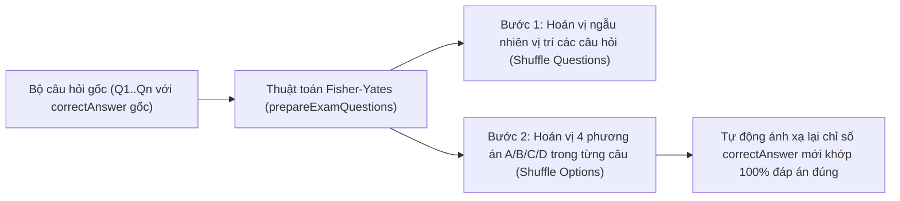

> **Tóm tắt nhanh (TL;DR):** Khi làm lại một đề trắc nghiệm lần thứ 2 hoặc thứ 3, não bộ học sinh rất dễ rơi vào bẫy *"nhớ vị trí đáp án"* (ví dụ: nhớ câu có hình tam giác thì khoanh câu C) thay vì thực sự hiểu bài. Bên cạnh đó, trong phòng kiểm tra, việc 40 học sinh cùng làm một thứ tự câu hỏi rất dễ dẫn đến nhìn bài nhau. Năm 2026, **Top 6 website trộn câu hỏi và đảo đáp án A/B/C/D trực tuyến miễn phí** gồm **QuizKen**, **YoungMix**, **Azota**, **SmartTest**, **MasterTest** và **McMIX** đã giải quyết triệt để cả hai bài toán này.

---

# Top 6 Web Trộn Câu Hỏi & Đảo Đáp Án A B C D Trực Tuyến Miễn Phí 2026

Trong cả hoạt động **kiểm tra trên lớp của giáo viên** lẫn hoạt động **tự luyện đề của học sinh**, thuật toán hoán vị câu hỏi và phương án trả lời (*Question & Option Shuffling*) đóng vai trò quyết định đến độ tin cậy của điểm số:
* **Đối với giáo viên tổ chức kiểm tra:** Khi bật trộn cả câu hỏi lẫn đáp án A, B, C, D, mỗi học sinh mở link thi trên điện thoại sẽ nhận được một **"mã đề độc bản"**. Câu số 1 trên máy của bạn A có thể là câu số 17 trên máy của bạn B, và đáp án đúng `A` trên máy bạn A đã được đảo sang vị trí `D` trên máy bạn B.
* **Đối với học sinh tự ôn thi nhiều lượt:** Theo nguyên lý **Luyện tập xen kẽ (Interleaving Practice)**, việc bật đảo ngẫu nhiên thứ tự câu và thứ tự phương án A/B/C/D trong mỗi lần bấm *"Làm lại bài thi"* buộc não bộ phải đọc hiểu lại nội dung từng phương án, xóa bỏ hoàn toàn thói quen học vẹt theo vị trí.

Dưới đây là đánh giá chi tiết **Top 6 công cụ và website trộn câu hỏi & đảo đáp án A, B, C, D tốt nhất năm 2026**.

---

## Bảng So Sánh 6 Công Cụ Trộn Câu Hỏi & Đảo Đáp Án A B C D (2026)

| Công cụ / Website | Trộn thứ tự câu hỏi | Đảo đáp án A/B/C/D & Tự cập nhật đáp án đúng | Dùng trực tiếp trên Web / MacBook / Điện thoại | Trộn lại tức thì khi bấm "Làm lại" | Chi phí |
| :--- | :--- | :--- | :--- | :--- | :--- |
| **1. QuizKen (`ExamEntry`)** | **Có (1-Click bật/tắt)** | **Có (`prepareExamQuestions` chuẩn 100%)** | **Có (Mọi thiết bị không cần cài đặt)** | **Có (Mỗi lượt thi một thứ tự mới)** | **Miễn phí 100%** |
| **2. YoungMix (youngmix.vn)** | Có | Có (Xuất file Word mã đề) | Có chạy trên trình duyệt | Phải tải lại file Word | Miễn phí / Tài trợ |
| **3. Azota** | Có | Có | Có chạy trên trình duyệt | Khi tạo lượt thi mới | Miễn phí / VIP |
| **4. SmartTest** | Có (Theo nhóm phần) | Có | Bản Web & Bản cài Windows | Xuất cố định theo mã đề | Trả phí bản quyền |
| **5. MasterTest** | Có | Có | Chỉ cài đặt trên Windows | Xuất file in cố định | Trả phí |
| **6. McMIX / McMIX-Pro** | Có | Có (Giữ cố định câu "Tất cả đều đúng") | Chỉ cài đặt trên Windows | Xuất file Word cố định | Miễn phí bản cũ / Pro |

---

## Đánh Giá Chi Tiết Top 6 Web Trộn Câu Hỏi & Đảo Đáp Án A B C D

### 1. QuizKen — Sảnh Thi Thử tích hợp công tắc Trộn Câu Hỏi & Đảo Đáp Án thông minh

Trong bản nâng cấp **Phòng Thi Thử (`ExamEntry.tsx` & `ExamModePage.tsx`)** năm 2026, **QuizKen** trang bị bộ thuật toán hoán vị **`prepareExamQuestions`** cho phép cả giáo viên lẫn học sinh chủ động bật/tắt trộn đề ngay trước giờ bấm nút làm bài.

* **Cơ chế hoạt động chuẩn xác của bộ trộn đề trên QuizKen:**
  * **Hai công tắc độc lập tại Sảnh chuẩn bị thi (`ExamEntry`):**
    1. **`Trộn ngẫu nhiên thứ tự câu hỏi` (`shuffleQuestions`):** Sử dụng thuật toán hoán vị không chệch *Fisher–Yates* để đảo vị trí toàn bộ các câu hỏi trong đề.
    2. **`Trộn ngẫu nhiên đáp án A / B / C / D` (`shuffleOptions`):** Đảo thứ tự 4 phương án trả lời bên trong từng câu hỏi, đồng thời **tự động định vị và cập nhật lại chỉ số `correctAnswer` mới** sao cho phương án đúng sau khi đảo luôn khớp tuyệt đối 100% với đáp án gốc.
  * **Tự động trộn mới khi bấm "Làm lại bài thi" (`handleRetake`):** Mỗi khi học sinh hoàn thành lượt thi và nhấn nút *"Làm lại bài thi"* trên bảng điểm `ExamScoreCard`, hệ thống sẽ lấy lại tập câu hỏi gốc (`rawQuestions`) và chạy một lượt hoán vị mới hoàn toàn, giúp học sinh luyện đi luyện lại một đề 5 lần mà vẫn tươi mới như 5 mã đề khác nhau.
  * **Xuất PDF theo đúng thứ tự đã trộn:** Khi học sinh hoặc giáo viên bấm nút **PDF** ngay trên trang kết quả thi thử, file PDF xuất ra sẽ giữ đúng thứ tự câu hỏi, thứ tự đáp án và lời giải của chính lượt thi vừa hoàn thành.
* **Ưu điểm:** Hoạt động mượt mà 100% trên trình duyệt Web (MacBook, Windows, iPad, iPhone, Android) mà không cần phải đánh dấu ký hiệu ` ` hay `[$]` phức tạp trong file Word.
* **Nhược điểm:** Hướng tới trộn đề trực tuyến động theo từng phiên thi và xuất PDF đề thi hơn là xuất 24 file `.docx` riêng lẻ trong một thư mục nén.
* **Chi phí:** Hoàn toàn miễn phí.

👉 **Trải nghiệm ngay:** [Bật chế độ Trộn câu hỏi & Đảo đáp án A/B/C/D trong Phòng Thi Thử QuizKen](https://app.quizken.com).

---

### 2. YoungMix — Công cụ trộn đề Word trực tuyến không cần cài đặt

**YoungMix** là trang web được nhiều giáo viên sử dụng MacBook tìm đến khi không thể cài các phần mềm trộn đề `.exe` truyền thống của Windows.

* **Ưu điểm:**
  * Chạy trực tiếp trên trình duyệt web; giáo viên tải file `.docx` đã gạch chân đáp án đúng lên và chọn số lượng mã đề cần xuất.
* **Nhược điểm:**
  * Yêu cầu file Word đầu vào phải tuân thủ nghiêm ngặt quy tắc định dạng (gạch chân hoặc tô đỏ chữ cái A., B., C., D.); chỉ dùng để xuất file Word đi in chứ không có phòng thi trực tuyến đếm ngược cho học sinh làm bài ngay.
* **Chi phí:** Miễn phí.

---

### 3. Azota — Trộn mã đề khi giao bài kiểm tra trực tuyến hoặc in giấy

**Azota** hỗ trợ giáo viên tích chọn đảo câu hỏi và đảo đáp án trong phần cài đặt bài kiểm tra.

* **Ưu điểm:**
  * Hỗ trợ chia nhóm câu hỏi để đảo trong phạm vi từng phần (Phần I, Phần II, Phần III) của cấu trúc đề thi mới.
* **Nhược điểm:**
  * Quyền bật/tắt đảo câu hỏi thuộc về phía giáo viên khi cấu hình đề; học sinh khi tự vào ôn tập một bộ đề công khai không có sẵn bảng điều khiển Sảnh chuẩn bị thi (`ExamEntry`) để tự bật/tắt trộn câu và đảo đáp án theo ý muốn như trên QuizKen.
* **Chi phí:** Miễn phí cơ bản / Gói VIP trả phí.

---

### 4. SmartTest — Phần mềm trộn đề theo ma trận cố định nhóm câu

**SmartTest** được các tổ chuyên môn sử dụng để trộn đề kiểm tra tập trung toàn khối.

* **Ưu điểm:**
  * Cho phép khóa thứ tự một số câu hỏi đặc biệt hoặc gom các câu hỏi cùng một đoạn văn đọc hiểu Tiếng Anh vào một cụm (block) để không bị tách rời khi trộn.
* **Nhược điểm:**
  * Quy trình nhập liệu qua mẫu bảng Word khá cầu kỳ, thiên về quản lý hành chính hơn là công cụ ôn luyện linh hoạt hàng ngày.
* **Chi phí:** Phần mềm thương mại trả phí.

---

### 5. MasterTest — Phần mềm trộn đề trắc nghiệm truyền thống trên Windows

**MasterTest** là phần mềm máy tính giúp quản lý ngân hàng câu hỏi theo cây thư mục chương, bài, mức độ nhận thức.

* **Ưu điểm:**
  * Hoạt động ổn định khi trộn số lượng mã đề lớn (12–24 mã đề) để in phát cho cả khối lớp.
* **Nhược điểm:**
  * Chỉ chạy trên hệ điều hành Windows; không có tính năng AI tự động sinh câu hỏi hay phòng thi trực tuyến trên trình duyệt.
* **Chi phí:** Trả phí bản quyền theo máy tính.

---

### 6. McMIX / McMIX-Pro — Công cụ trộn đề giấy lâu đời nhất tại Việt Nam

Nhắc đến trộn đề giấy từ file Word trên máy tính Windows thì **McMIX** là phần mềm tiên phong suốt nhiều năm qua.

* **Ưu điểm:**
  * Giữ nguyên công thức MathType và biết nhận diện các phương án kiểu *"Cả A, B, C đều đúng"* để giữ cố định ở vị trí D khi người soạn đặt lệnh khóa.
* **Nhược điểm:**
  * Bắt buộc dùng máy tính Windows cài Microsoft Office; không thể gửi link hay chiếu Mã QR cho học sinh làm bài trực tiếp trên điện thoại.
* **Chi phí:** Bản cũ miễn phí, bản McMIX-Pro thu phí bản quyền.

---

## Khi Nào Học Sinh Nên Bật Cả 2 Công Tắc Trộn Đề Trên QuizKen?

Khi tự ôn thi một bộ đề 40–50 câu trên [QuizKen](https://app.quizken.com):
* **Lần làm thứ 1:** Bạn có thể để mặc định (*Tắt trộn câu hỏi*) để làm theo thứ tự từ dễ đến khó của cấu trúc đề gốc.
* **Lần làm thứ 2 & thứ 3 (Sau khi đã đọc lời giải các câu sai):** Hãy vào **Sảnh Thi Thử (`/quiz/exam/:id`)**, bật cả **2 công tắc: `Trộn ngẫu nhiên thứ tự câu hỏi` + `Trộn ngẫu nhiên đáp án A/B/C/D`**. Nếu bạn vẫn đạt **100% điểm tuyệt đối** khi cả thứ tự câu lẫn vị trí A, B, C, D đã bị đảo tung, đó là minh chứng bạn đã thực sự làm chủ kiến thức!

---

## Câu hỏi thường gặp (FAQ)

### 1. Khi bật "Trộn ngẫu nhiên đáp án A / B / C / D" trên QuizKen, hệ thống chấm điểm có sợ bị chấm nhầm theo vị trí cũ không?
Tuyệt đối không. Hàm `prepareExamQuestions` của QuizKen đính kèm cờ `isCorrect` trực tiếp vào từng nội dung phương án trước khi hoán vị, sau đó xác định lại chính xác vị trí mới của phương án đúng (`nextCorrect`) rồi mới khởi tạo phiên thi. Bài kiểm thử tự động `examModeProUpgrade.test.tsx` xác minh 100% văn bản đáp án đúng trước và sau khi đảo luôn trùng khớp tuyệt đối.

### 2. Nếu câu hỏi có hình minh họa `VisualScene` thì khi trộn thứ tự câu hỏi, hình vẽ có đi theo đúng câu hỏi của nó không?
Có. Dữ liệu hình vẽ `visual` và lời giải `explanation` là thuộc tính gắn liền bên trong từng đối tượng câu hỏi (`Question`), nên dù câu hỏi số 5 được đảo lên vị trí số 1 hay xuống vị trí số 30 thì hình minh họa và lời giải vẫn đi kèm chính xác với câu hỏi đó.

### 3. Tôi dùng MacBook hoặc iPad thì có sử dụng được tính năng trộn câu hỏi và đảo đáp án của QuizKen không?
Hoàn toàn được. Toàn bộ hệ thống trộn đề và Phòng Thi Thử của QuizKen chạy trực tiếp trên trình duyệt web hiện đại (Safari, Chrome, Edge, Firefox) trên mọi thiết bị MacBook, iPad, iPhone, Windows và Android mà không cần cài thêm bất kỳ phần mềm nào.
