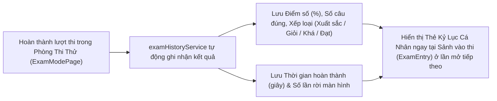

> **Tóm tắt nhanh (TL;DR):** Động lực học tập lớn nhất không đến từ việc so sánh bản thân với hàng ngàn người lạ, mà đến từ việc nhìn thấy chính mình hôm nay đạt `90%` trong `12 phút` so với mức `65%` trong `20 phút` của tuần trước trên cùng một bộ đề. Năm 2026, **Top 6 website theo dõi lịch sử điểm thi thử và kỷ lục cá nhân** gồm **QuizKen**, **Khan Academy**, **Study4**, **Duolingo English Test Practice**, **Memrise** và **MochiMochi** đã ứng dụng cơ chế *Personal Best Tracking* để biến việc ôn thi thành hành trình tự phá kỷ lục đầy hứng khởi.

---

# Top 6 Web Theo Dõi Lịch Sử Điểm Thi Thử & Phá Kỷ Lục Cá Nhân 2026

Khi làm bài trên giấy hoặc trên các trang web trắc nghiệm thế hệ cũ, ngay khi bạn đóng tab trình duyệt lại là toàn bộ kết quả của lượt làm bài đó biến mất. Hai tuần sau quay lại đúng đề thi đó, bạn không thể nhớ nổi:
* *"Đề này mình đã làm thử bao nhiêu lần rồi?"*
* *"Lần trước mình đạt bao nhiêu phần trăm, xếp loại Khá hay Giỏi?"*
* *"Thời gian hoàn thành nhanh nhất của mình ở đề này là bao nhiêu phút?"*

Trong tâm lý học giáo dục hiện đại, phương pháp **Tự đối chiếu tiến bộ cá nhân (Ipsative Assessment / Personal Best Tracking)** được chứng minh giúp giảm 45% sự lo âu thi cử và tăng gấp đôi tỷ lệ kiên trì hoàn thành mục tiêu ôn tập.

Dưới đây là bảng xếp hạng **Top 6 nền tảng luyện thi có hệ thống theo dõi lịch sử điểm số và kỷ lục cá nhân xuất sắc nhất năm 2026**.

---

## Bảng So Sánh 6 Web Theo Dõi Lịch Sử Điểm Thi & Kỷ Lục Cá Nhân (2026)

| Nền tảng | Hiển thị Kỷ lục cá nhân ngay tại Sảnh trước khi thi | Thống kê Điểm cao nhất, Điểm gần nhất & Thời gian nhanh nhất | Biểu đồ Xu hướng tiến bộ & Radar lỗ hổng kiến thức | Xuất PDF biên bản điểm từng lượt thi | Chi phí |
| :--- | :--- | :--- | :--- | :--- | :--- |
| **1. QuizKen** | **Có (`ExamEntry` Personal Best Banner)** | **Có (`getBestExamScore` tự động)** | **Có (`ProgressTrendline` + `KnowledgeGapCard`)** | **Có (`graded_review` PDF A4)** | **Miễn phí 100%** |
| **2. Khan Academy** | Có mức Mastery (Crown) | Lưu điểm cao nhất theo bài | Có báo cáo tiến độ chương | Không xuất PDF bảng điểm | Miễn phí 100% |
| **3. Study4** | Có bảng lịch sử các lần làm dưới đề | Có điểm và thời gian từng lần | Có thống kê theo dạng câu hỏi | Không | Miễn phí / Khóa trả phí |
| **4. Prep.vn** | Có lịch sử bài test trong khóa | Có điểm từng lần thi | Có lộ trình học tập | Hạn chế | Thu phí theo khóa |
| **5. MochiMochi** | Thống kê cấp độ nhớ từ vựng (1–5) | Theo Sổ tay từ vựng | Biểu đồ cột 5 cấp độ | Không | Thu phí gói Premium |
| **6. Memrise** | Theo dõi chuỗi ngày (Streak) & điểm | Điểm tích lũy khóa học | Cơ bản | Không | Freemium |

---

## Đánh Giá Chi Tiết Top 6 Web Theo Dõi Lịch Sử Điểm Thi & Kỷ Lục Cá Nhân

### 1. QuizKen — Hệ thống Kỷ Lục Cá Nhân tại Sảnh Thi (`ExamEntry`) kết hợp Dashboard Analytics

Với bản nâng cấp **`examHistoryService.ts`** và **Sảnh Chuẩn Bị Thi (`ExamEntry.tsx`)** năm 2026, **QuizKen** kết hợp hoàn hảo giữa việc lưu trữ kỷ lục tốc độ của từng đề thi thử với bức tranh phân tích năng lực toàn diện trên Dashboard.

* **Thẻ "Kỷ lục cá nhân đề này" ngay tại Sảnh vào thi (`ExamEntry`):**
  * Ngay khi bạn mở lại đường dẫn `/quiz/exam/:quizId` của một đề đã từng thi thử, một biểu ngữ Cúp Vàng (`exam-history-summary`) tự động xuất hiện ngay dưới tiêu đề đề thi, cung cấp 4 chỉ số vàng:
    1. **Tổng số lần đã thi đề này:** Ví dụ `(3 lần thi)`.
    2. **Điểm cao nhất (`bestPercentage` & `bestGrade`):** Ví dụ `Cao nhất: 95% (Xuất sắc)`.
    3. **Điểm lần thi gần nhất (`latestPercentage`):** Giúp bạn so sánh ngay phong độ gần đây với đỉnh cao cá nhân.
    4. **Kỷ lục thời gian nhanh nhất (`fastestTimeSeconds`):** Ví dụ `12p 40s`, tạo động lực để bạn vừa giữ điểm 100% vừa rút ngắn thời gian giải đề ở lượt thi mới!
* **Hệ thống phân tích đa chiều trên Góc Học Tập (`PersonalDashboard`):**
  * **Biểu đồ xu hướng điểm số (`ProgressTrendline`):** Vẽ đường cong điểm trung bình và số lượng đề đã làm theo từng ngày.
  * **Radar Lỗ Hổng Kiến Thức (`KnowledgeGapCard`):** Phân tích điểm mạnh và chủ đề yếu nhất để gợi ý nhiệm vụ ôn tập hàng ngày trong thẻ **Đếm ngược ngày thi (`ExamCountdownCard`)**.
  * **Lịch sử làm bài chi tiết (`RecentQuizzes` & `QuizDetailPage`):** Xem lại từng lượt làm bài trong quá khứ và tải lại file PDF biên bản bài thi bất cứ lúc nào.
* **Ưu điểm:** Dữ liệu kỷ lục thi thử được phân tách an toàn theo từng tài khoản người dùng (`quizken_exam_history_${userId}`), hoạt động tức thì mà không làm chậm tốc độ nộp bài.
* **Nhược điểm:** Lịch sử thi thử nghiêm ngặt (Exam Mode) được lưu cục bộ trên trình duyệt thiết bị để đảm bảo tốc độ chấm điểm client-side 0ms, trong khi lịch sử làm bài Ôn tập (Practice Mode) được đồng bộ trực tiếp lên đám mây Supabase.
* **Chi phí:** Hoàn toàn miễn phí.

👉 **Phá kỷ lục cá nhân của bạn ngay:** [Vào Phòng Thi Thử và theo dõi tiến độ trên QuizKen](https://app.quizken.com).

---

### 2. Khan Academy — Hệ thống điểm thông thạo (Mastery Levels) chuẩn mực

**Khan Academy** là nền tảng giáo dục phi lợi nhuận nổi tiếng thế giới với cơ chế đánh giá mức độ thông thạo từng kỹ năng (*Familiar ➔ Proficient ➔ Mastered*).

* **Ưu điểm:**
  * Hiển thị chiếc vương miện trên từng bài tập nhỏ và giữ lại số điểm cao nhất mà học sinh từng đạt được.
* **Nhược điểm:**
  * Các bài kiểm tra trên Khan Academy thường chỉ gồm 4–7 câu hỏi ngắn theo chuẩn Common Core của Mỹ; không phải là các bộ đề thi thử 40–50 câu bấm giờ 50–90 phút kèm bộ trộn đề theo cấu trúc thi THPT Việt Nam.
* **Chi phí:** Miễn phí 100%.

---

### 3. Study4 — Bảng lịch sử các lần làm bài (Attempt History Table) cho đề Tiếng Anh

Trước khi bấm vào làm một đề IELTS hoặc THPT môn Tiếng Anh trên **Study4**, người học có thể nhìn thấy bảng danh sách các lần mình đã làm đề đó trước đây.

* **Ưu điểm:**
  * Ghi rõ ngày làm, số câu đúng trên tổng số câu và thời gian làm bài của từng lượt để học sinh tiện so sánh.
* **Nhược điểm:**
  * Chỉ phục vụ các bộ đề ngoại ngữ có sẵn trên hệ thống, người học không thể tự tải đề Toán, Lý, Hóa, Sinh, Sử, Địa của mình lên để theo dõi kỷ lục thi thử.
* **Chi phí:** Freemium.

---

### 4. Prep.vn — Theo dõi điểm bài kiểm tra định kỳ theo lộ trình khóa học

**Prep.vn** lưu lại điểm số các bài Mini Test và Full Test của học viên trên bảng lịch học cá nhân.

* **Ưu điểm:**
  * Giao diện báo cáo điểm trực quan, gắn liền với mục tiêu đầu ra (Target Score) mà học viên đã đăng ký.
* **Nhược điểm:**
  * Tính năng nằm bên trong các khóa học trả phí; không phải công cụ mở miễn phí cho mọi môn học phổ thông.
* **Chi phí:** Trả phí theo khóa học.

---

### 5. MochiMochi — Biểu đồ 5 cấp độ ghi nhớ từ vựng ("Thời điểm vàng")

**MochiMochi** gây ấn tượng với học sinh học từ vựng Tiếng Anh nhờ biểu đồ 5 cột tượng trưng cho 5 cấp độ ghi nhớ từ *Mới học* đến *Nhớ rất sâu*.

* **Ưu điểm:**
  * Tạo cảm giác thành tựu rõ rệt khi nhìn các từ vựng chuyển dần từ cột cấp độ 1 sang cột cấp độ 5.
* **Nhược điểm:**
  * Chỉ chuyên về học thẻ từ vựng Tiếng Anh, không có Phòng Thi Thử giải đề trắc nghiệm bấm giờ hay xuất PDF bảng điểm.
* **Chi phí:** Dùng thử 3 bài đầu, sau đó thu phí theo năm.

---

### 6. Memrise — Theo dõi chuỗi ngày học (Streak) và điểm XP tích lũy

**Memrise** sử dụng cơ chế tính điểm thưởng mỗi khi người học trả lời đúng và nhanh các câu hỏi ôn từ vựng.

* **Ưu điểm:**
  * Khích lệ thói quen học đều đặn mỗi ngày thông qua chỉ số Streak và bảng xếp hạng tuần.
* **Nhược điểm:**
  * Điểm số mang tính chất điểm thưởng trò chơi (gamification points) chứ không phải tỷ lệ `%` điểm bài thi chuẩn hay xếp loại học lực (*Xuất sắc, Giỏi, Khá, Đạt*) như `ExamScoreCard` của QuizKen.
* **Chi phí:** Freemium.

---

## Phương Pháp "Luyện Đề 3 Lượt" Để Đạt Điểm Tuyệt Đối 100%

Với tính năng **Kỷ lục cá nhân (`ExamEntry`)** trên [QuizKen](https://app.quizken.com), bạn có thể áp dụng phương pháp luyện đề 3 lượt cực kỳ khoa học:
1. **Lượt 1 (Khảo sát điểm khởi đầu):** Thi thử lần đầu với thời gian tiêu chuẩn ➔ Hệ thống ghi nhận mốc điểm gốc (ví dụ `70% — Khá`) và tự động lưu 30% câu sai vào **Sổ tay câu sai**.
2. **Lượt 2 (Chinh phục độ chính xác 100%):** Sau khi đã đọc kỹ hộp giải thích các câu sai, mở lại đề thi thử đó, bật công tắc **Trộn thứ tự câu hỏi + Trộn đáp án A/B/C/D** để thi lại cho tới khi thẻ Kỷ lục cá nhân báo **`100% (Xuất sắc)`**.
3. **Lượt 3 (Phá kỷ lục tốc độ):** Thi lại đề đó ở mốc thời gian rút ngắn (ví dụ chọn `30 phút` thay vì `45 phút`) để rèn tốc độ phản xạ và phá kỷ lục `Thời gian nhanh nhất` của chính mình!

---

## Câu hỏi thường gặp (FAQ)

### 1. Thang xếp loại học lực trong Phòng Thi Thử của QuizKen được tính theo các mốc phần trăm nào?
Hàm `calculateExamGrade` của QuizKen phân loại kết quả bài thi thử theo 5 mức chuẩn mực:
* **Từ 90% đến 100%:** `Xuất sắc` (Huy hiệu Cúp Vàng)
* **Từ 80% đến 89%:** `Giỏi` (Huy hiệu Ngôi Sao)
* **Từ 65% đến 79%:** `Khá` (Huy hiệu Huy Chương)
* **Từ 50% đến 64%:** `Đạt` (Huy hiệu Mục Tiêu)
* **Dưới 50%:** `Cần cố gắng` (Cảnh báo cần ôn lại ngay)

### 2. Nếu có 2 lần thi thử cùng đạt 100% điểm thì hệ thống chọn lần nào làm Kỷ lục cao nhất?
Thuật toán `getBestExamScore` trong `examHistoryService.ts` của QuizKen ưu tiên điểm phần trăm (`percentage`) cao nhất trước; nếu hai lượt thi có cùng điểm phần trăm cao nhất, hệ thống sẽ vinh danh lượt thi có **thời gian hoàn thành ngắn hơn (`timeTakenSeconds`)** làm kỷ lục tốt nhất.

### 3. Khi đạt điểm từ Khá (65%) trở lên trong Phòng Thi Thử, hệ thống có hiệu ứng chúc mừng gì không?
Có. Ngay khi bạn nộp bài và đạt từ `65%` trở lên trên `ExamScoreCard`, hệ thống `useCelebration` của QuizKen sẽ kích hoạt hiệu ứng pháo hoa chúc mừng (`fireLevelUp`) cùng âm thanh chiến thắng để khích lệ tinh thần học tập của bạn.
