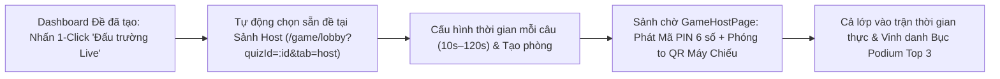

> **Tóm tắt nhanh (TL;DR):** Tổ chức đấu trường trắc nghiệm trực tiếp (Live Quiz Arena) nơi cả lớp nhập Mã PIN 6 số hoặc quét QR để đua top thời gian thực là cách tuyệt vời nhất để khuấy động tiết ôn tập. Năm 2026, **Top 6 website tổ chức đấu trường trắc nghiệm Live bằng Mã PIN** gồm **QuizKen Live Arena**, **Kahoot!**, **Wayground (Quizizz)**, **Blooket**, **Gimkit** và **Bamboozle** mang đến những trải nghiệm thi đấu kịch tính theo thời gian thực.

---

# Top 6 Web Tổ Chức Đấu Trường Trắc Nghiệm Live Bằng Mã PIN 6 Số 2026

Chỉ cần 10 phút cuối tiết học bật một phòng **Đấu Trường Trắc Nghiệm Trực Tiếp (Live Game)** trên màn chiếu, bầu không khí trầm lắng của những tiết học chiều sẽ lập tức bùng nổ. Khi học sinh nhập **Mã PIN 6 số** (hoặc quét Mã QR) để nhìn thấy tên và nhân vật đại diện (Avatar) của mình xuất hiện trên màn hình lớn của giáo viên, động lực trả lời đúng và nhanh tăng lên gấp bội.

Tuy nhiên, nhiều giáo viên Việt Nam khi sử dụng các nền tảng quốc tế như Kahoot! hay Gimkit thường vấp phải 3 rào cản:
1. **Giới hạn sĩ số người chơi ở tài khoản miễn phí:** Một lớp học công lập tại Việt Nam có từ **40–50 học sinh**, trong khi nhiều nền tảng quốc tế khóa giới hạn bản miễn phí ở mức 10–30 người chơi.
2. **Không tạo được đề thi bằng AI tiếng Việt có công thức Toán/Lý/Hóa:** Phải gõ tay từng câu hỏi hoặc gặp lỗi hiển thị công thức trên màn hình điện thoại của học sinh.
3. **Thao tác mở phòng rườm rà:** Phải chuyển qua nhiều trang quản trị mới mở được sảnh chờ cho một bộ đề vừa tạo.

Dưới đây là đánh giá chi tiết **Top 6 nền tảng tổ chức đấu trường trắc nghiệm Live bằng Mã PIN 6 số tốt nhất năm 2026**.

---

## Bảng So Sánh 6 Web Tổ Chức Đấu Trường Trắc Nghiệm Live Bằng Mã PIN (2026)

| Nền tảng | Mã PIN 6 số + Phóng to QR Máy Chiếu | Chế độ thi đấu | Mở phòng 1-Click từ danh sách Đề đã tạo | Hỗ trợ công thức Toán/Lý/Hóa & AI Tiếng Việt | Chi phí |
| :--- | :--- | :--- | :--- | :--- | :--- |
| **1. QuizKen Live Arena** | **Có (`room.code` 6 số + `ClassroomQrModal`)** | **Đấu trường Live & Thách đấu 1v1** | **Có (`TeacherQuizActions` 1-Click)** | **100% Tiếng Việt + KaTeX + VisualScene** | **Miễn phí 100%** |
| **2. Kahoot!** | Có Game PIN + QR | Classic & Team Mode | Từ thư viện Kahoot | Hạn chế công thức phức tạp | Giới hạn người chơi Free |
| **3. Wayground (Quizizz)** | Có Join Code + QR | Classic, Team, Mastery Peak | Từ thư viện đề | Khá | Miễn phí / Gói Super |
| **4. Blooket** | Có Game ID + QR | Tower Defense, Gold Quest... | Từ bộ câu hỏi Blooket | Không chuyên công thức STEM | Giới hạn 60 người Free |
| **5. Gimkit** | Có Game Code + QR | Chiến thuật mua vật phẩm | Từ bộ Kit | Cơ bản | Giới hạn 5 người ở bản Free |
| **6. Bamboozle** | Chơi theo đội trên 1 màn hình | Lật ô số trúng thưởng | Từ thư viện cộng đồng | Cơ bản | Miễn phí 1 chế độ cơ bản |

---

## Đánh Giá Chi Tiết Top 6 Web Tổ Chức Đấu Trường Trắc Nghiệm Live

### 1. QuizKen Live Arena — Mở sảnh Live 1-Click, Mã PIN 6 số khổng lồ & Phóng to QR Máy Chiếu

Với bản nâng cấp **Thanh Công Cụ Giáo Viên (`TeacherQuizActions.tsx`)** và **Sảnh Host (`HostActionCard.tsx`)** năm 2026, **QuizKen** biến việc tổ chức một trận đấu trường trực tiếp cho cả lớp trở nên nhanh gọn chưa từng có.

* **Trải nghiệm tổ chức Đấu Trường Live trên QuizKen:**
  1. **Mở phòng 1-Click từ Dashboard:** Ngay trên thẻ của bất kỳ đề nào trong mục **Đề đã tạo**, giáo viên chỉ cần nhấn nút **`Đấu trường Live`**. Hệ thống lập tức chuyển tới sảnh `/game/lobby?quizId=:id&tab=host` với đề thi đó đã được chọn sẵn tự động!
  2. **Đua top thời gian thực & tùy chỉnh giây mỗi câu (`10s–120s`):** Học sinh đua điểm và tốc độ qua từng câu hỏi để giành vị trí Top 1, 2, 3 trên bục vinh quang, đồng thời giáo viên linh hoạt chọn thời gian suy nghĩ phù hợp từ `10s` đến `120s` cho từng môn học.
  3. **Màn hình Sảnh chờ kết hợp Mã PIN 6 số + Phóng to QR Máy Chiếu:** Trên màn hình của giáo viên (`GameHostPage`), mã PIN 6 số hiển thị ở kích thước khổng lồ (`text-8xl`), đi kèm nút **"Phóng to QR Máy Chiếu"** mở cửa sổ `ClassroomQrModal` hiển thị song song cả QR `320×320` lẫn Mã PIN chữ vàng trên nền tối chống lóa.
* **Ưu điểm:** Hoàn toàn miễn phí cho giáo viên và học sinh Việt Nam, đồng bộ thời gian thực siêu mượt qua Supabase Realtime, hỗ trợ đầy đủ câu hỏi có công thức Toán học và hình vẽ `VisualScene`.
* **Nhược điểm:** Cần kết nối mạng Internet ổn định cho các thiết bị tham gia trong suốt trận đấu trực tiếp.
* **Chi phí:** Hoàn toàn miễn phí.

👉 **Mở phòng thi đấu ngay:** [Khởi tạo Đấu Trường Live bằng Mã PIN 6 số trên QuizKen](https://app.quizken.com/game/lobby).

---

### 2. Kahoot! — Huyền thoại âm nhạc Game Show lớp học

**Kahoot!** là cái tên đã định hình khái niệm nhập mã PIN để chơi trắc nghiệm trên lớp học toàn cầu.

* **Ưu điểm:**
  * Nhạc nền đếm ngược tạo sự hồi hộp đặc trưng; giao diện 4 khối màu hình học đơn giản, dễ bấm.
* **Nhược điểm:**
  * Ở chế độ mặc định, câu hỏi chỉ hiện trên màn chiếu của giáo viên còn trên điện thoại học sinh chỉ hiện 4 ô màu trống (khiến học sinh ngồi bàn cuối lớp nhìn không rõ công thức Toán/Hóa sẽ rất thiệt thòi); chi phí nâng cấp gói giáo viên khá đắt đỏ.
* **Chi phí:** Giới hạn nghiêm ngặt ở bản miễn phí.

---

### 3. Wayground (Quizizz) — Làm bài theo nhịp độ học sinh kèm vật phẩm Power-ups

**Wayground (Quizizz)** khắc phục nhược điểm của Kahoot bằng cách hiển thị cả nội dung câu hỏi lẫn đáp án ngay trên màn hình điện thoại của từng học sinh.

* **Ưu điểm:**
  * Có hệ thống vật phẩm hỗ trợ (*Power-ups*: nhân đôi điểm, xóa bớt đáp án sai) và giao diện bảng xếp hạng sinh động.
* **Nhược điểm:**
  * Nhiều loại câu hỏi nâng cao và tính năng tạo đề tự động từ tài liệu PDF bằng AI bị khóa sau bức tường thu phí gói Super/School.
* **Chi phí:** Freemium.

---

### 4. Blooket — Biến câu hỏi ôn tập thành các mini-game Arcade

**Blooket** cực kỳ thu hút học sinh cấp 1 và cấp 2 nhờ việc lồng ghép câu hỏi trắc nghiệm vào các trò chơi như *Gold Quest (Đào vàng)*, *Tower Defense (Thủ thành)* hay *Café*.

* **Ưu điểm:**
  * Bản miễn phí cho phép tới 60 học sinh tham gia cùng lúc; yếu tố may rủi (cướp vàng của bạn dẫn đầu) tạo tiếng cười sảng khoái cho lớp học.
* **Nhược điểm:**
  * Đôi khi yếu tố trò chơi lấn át yếu tố học thuật (học sinh trả lời đúng 100% vẫn có thể thua bạn trả lời đúng 70% nếu bị cướp vàng); không hỗ trợ tốt các đề thi Toán – Lý – Hóa dài có hình vẽ kỹ thuật.
* **Chi phí:** Miễn phí (60 người) / Gói Plus trả phí.

---

### 5. Gimkit — Trò chơi chiến thuật tích lũy tiền ảo mua nâng cấp

Được sáng tạo bởi một học sinh trung học tại Mỹ, **Gimkit** cho phép học sinh dùng số tiền ảo kiếm được từ mỗi câu trả lời đúng để mua nâng cấp điểm thưởng.

* **Ưu điểm:**
  * Cơ chế kinh tế trong game rất cuốn hút học sinh THCS và THPT.
* **Nhược điểm:**
  * **Giới hạn bản miễn phí cực thấp:** Ở các chế độ không thuộc danh sách xoay vòng miễn phí, tài khoản Gimkit Basic chỉ cho phép tối đa **5 học sinh** tham gia một phòng, buộc giáo viên phải mua gói Gimkit Pro.
* **Chi phí:** Giới hạn 5 học sinh ở bản Free tiêu chuẩn; gói Pro khoảng 60 USD/năm.

---

### 6. Bamboozle — Giải pháp chia đội thi đấu khi học sinh không mang điện thoại

Nếu trường học cấm học sinh mang smartphone vào lớp, **Bamboozle** là giải pháp thay thế thú vị vì chỉ cần duy nhất chiếc máy tính và máy chiếu của giáo viên.

* **Ưu điểm:**
  * Giáo viên chia lớp thành 2–4 tổ, đại diện từng tổ đứng lên đọc số ô muốn mở trên màn chiếu và trả lời miệng để giáo viên bấm cộng điểm.
* **Nhược điểm:**
  * Không thu thập được câu trả lời cá nhân của cả 40 học sinh cùng lúc như khi quét QR / nhập PIN trên QuizKen.
* **Chi phí:** Miễn phí chế độ lưới ô số cơ bản.

---

## Câu hỏi thường gặp (FAQ)

### 1. Trong Đấu Trường Live của QuizKen, giáo viên có thể đổi thời gian suy nghĩ cho mỗi câu hỏi ngay tại sảnh chờ không?
Có. Ngay trên thanh tiêu đề của Sảnh chờ Host (`HostHeader.tsx`), giáo viên có thể chọn thời gian cho mỗi câu hỏi từ **`10s`**, **`15s`**, **`20s`**, **`30s`**, **`45s`**, **`60s`**, **`90s`** lên tới **`120s`** (rất phù hợp cho các câu bài tập tính toán Toán, Lý, Hóa).

### 2. Ngoài Đấu Trường Live cả lớp, học sinh có thể tự thách đấu 1v1 với bạn bè không?
Có. Ngay trên trang làm bài của bất kỳ đề thi nào trên QuizKen, học sinh có thể bấm nút **"Thách đấu 1v1"** (chọn đấu giao hữu hoặc cược ZCoin) để hệ thống sinh riêng một đường link và Mã QR thách đấu gửi trực tiếp cho đối thủ.
