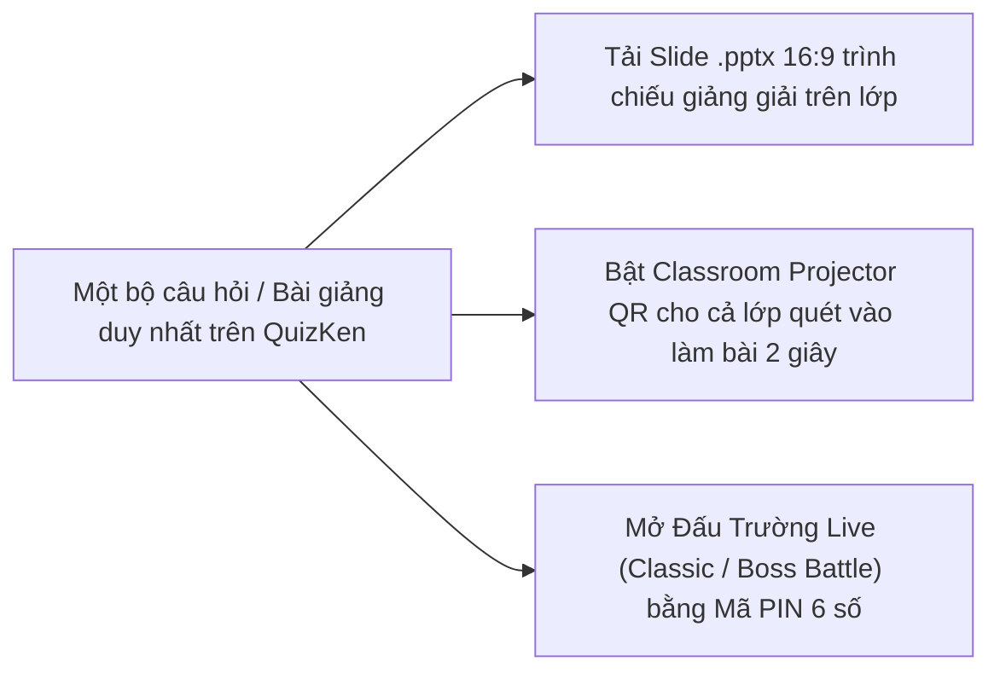

> **Tóm tắt nhanh (TL;DR):** Một tiết học hiện đại năm 2026 không còn cảnh giáo viên độc thoại bên những trang slide tĩnh suốt 45 phút, mà là sự đan xen liên tục giữa trình chiếu kiến thức và các hoạt động kiểm tra tương tác nhanh. Dưới đây là bảng xếp hạng **Top 6 phần mềm soạn bài giảng tương tác kết hợp Slide và Trắc nghiệm tốt nhất năm 2026**: **QuizKen**, **Nearpod**, **Pear Deck**, **Mentimeter**, **Wooclap** và **Genially**.

---

# Top 6 Phần Mềm Soạn Bài Giảng Tương Tác Kết Hợp Slide & Trắc Nghiệm

Theo định hướng đổi mới phương pháp dạy học của Chương trình GDPT 2018, giáo viên đóng vai trò là người tổ chức, hướng dẫn hoạt động nhận thức chủ động của học sinh. Các nghiên cứu sư phạm chỉ ra rằng khoảng tập trung chú ý (attention span) của học sinh trung học khi nghe giảng thụ động chỉ kéo dài khoảng **10–15 phút**. Việc chèn một hoạt động trắc nghiệm nhanh, quét mã QR hoặc đấu trường 5 câu hỏi ngay sau mỗi phần lý thuyết giúp kéo sự tập trung của cả lớp lên tới **92%**.

Tuy nhiên, nhiều giáo viên ngại áp dụng bài giảng tương tác vì sợ phải soạn bài hai lần: một lần soạn trên PowerPoint để giảng bài, và một lần gõ lại câu hỏi sang một trang web khác để cho học sinh chơi game.

Dưới đây là **6 nền tảng giải quyết trọn vẹn bài toán kết hợp Slide trình chiếu và Trắc nghiệm tương tác năm 2026**.

---

## Bảng So Sánh 6 Phần Mềm Kết Hợp Slide & Trắc Nghiệm Tương Tác (2026)

| Nền tảng | Xuất được file `.pptx` độc lập về máy | Có chế độ QR Máy Chiếu & Mã PIN Live Game | Tự động tạo câu hỏi từ tài liệu bằng AI | Giới hạn học sinh ở bản Miễn phí | Chi phí |
| :--- | :--- | :--- | :--- | :--- | :--- |
| **1. QuizKen** | **Có (1-Click tải `.pptx`)** | **Có (Classroom QR + Live Arena + Phòng Thi Thử)** | **Có (Gemini AI + RAG tiếng Việt)** | **Không giới hạn** | **Miễn phí 100%** |
| **2. Nearpod** | Chỉ nhập PPTX lên web | Có mã PIN bài học | Có Nearpod AI cơ bản | Giới hạn 40 học sinh & 100MB | Trả phí gói Gold/Platinum |
| **3. Pear Deck** | Gắn với Google Slides / PPT | Có mã tham gia | Có Pear Deck AI | Giới hạn tính năng ở bản Free | Trả phí theo năm |
| **4. Mentimeter** | Xuất PDF / Ảnh tĩnh | Có QR Code & Mã số | Có Menti AI | Giới hạn 2 slide câu hỏi/bài (Free) | Trả phí theo tháng |
| **5. Wooclap** | Có tích hợp PowerPoint | Có QR Code & Link | Có AI sinh câu hỏi từ PDF | Giới hạn 2 câu hỏi/sự kiện (Free) | Miễn phí có điều kiện / Pro |
| **6. Genially** | Chỉ tải PDF/HTML ở bản Pro | Chia sẻ link web | Hỗ trợ AI cơ bản | Không giới hạn người xem | Trả phí để tải offline |

---

## Đánh Giá Chi Tiết Top 6 Phần Mềm Soạn Bài Giảng Kết Hợp Slide & Trắc Nghiệm

### 1. QuizKen — Hệ sinh thái "1 Đề Thi - 4 Kịch Bản Lớp Học" cho giáo viên Việt Nam

Thay vì ép giáo viên phải lệ thuộc vào một trình chiếu web duy nhất (rất rủi ro khi mạng Wi-Fi phòng học chập chờn), **QuizKen** cho phép thầy cô sử dụng **cùng một bộ câu hỏi AI** cho cả 4 kịch bản dạy học trong một tiết 45 phút:

1. **Kịch bản Trình chiếu Slide Offline (`.pptx`):** Nhấn nút **PPTX** để tải bộ slide Widescreen 16:9 (có sẵn hình minh họa `VisualScene`, nhãn Bloom `L1–L4`, đáp án đúng và lời giải) về mở trực tiếp trên Microsoft PowerPoint của máy tính lớp học.
2. **Kịch bản Quét QR Làm Bài Nhanh (`ClassroomQrModal`):** Ngay từ danh sách **Đề đã tạo** trên Dashboard, nhấn nút **"QR Lớp học"** để bật màn hình máy chiếu độ tương phản cao. Giáo viên có thể chuyển đổi 1-click giữa link **Làm bài Ôn tập** và **Phòng Thi Thử nghiêm ngặt** để 40 học sinh quét camera vào làm bài trong 2 giây.
3. **Kịch bản Đấu Trường Trực Tiếp (`Đấu trường Live`):** Nhấn nút **"Đấu trường Live"** ngay trên thẻ đề để mở sảnh chờ có **Mã QR cỡ lớn + Mã PIN 6 số** với 2 chế độ chơi: *Classic (Đua top bảng xếp hạng)* hoặc *Boss Battle (Cả lớp hợp sức đánh Boss)*.
4. **Kịch bản In Phiếu Học Tập Giấy (`PDF A4 4 chế độ`):** Tải đề trắng hoặc đề cương có lời giải để phát cho những lớp không sử dụng điện thoại.
* **Ưu điểm:** Hoàn toàn miễn phí, hỗ trợ 100% tiếng Việt và công thức Toán – Lý – Hóa, không giới hạn số câu hỏi trong một bài như Mentimeter hay Wooclap.
* **Nhược điểm:** Chưa có dạng slide bình chọn đám mây từ khóa (Word Cloud) tự do (nhưng đã có hệ thống chat trực tiếp và đấu trường trắc nghiệm).
* **Chi phí:** Miễn phí.

👉 **Khám phá ngay:** [Bộ công cụ lớp học QR, Slide PPTX và Live Game trên QuizKen](https://app.quizken.com).

---

### 2. Nearpod — Nền tảng bài giảng đồng bộ màn hình giáo viên và học sinh

**Nearpod** là giải pháp quốc tế nổi tiếng cho phép giáo viên tải file PowerPoint hoặc PDF lên web, sau đó chèn các hoạt động tương tác (*Time to Climb, Matching Pairs, Draw It*) xen kẽ giữa các trang slide.

* **Ưu điểm:**
  * Khi giáo viên chuyển slide trên máy chủ, màn hình điện thoại/iPad của toàn bộ học sinh trong lớp cũng tự động chuyển slide theo đồng bộ.
* **Nhược điểm:**
  * Dung lượng lưu trữ bản miễn phí rất nhỏ (chỉ 100MB cho toàn bộ tài khoản), chỉ cần tải vài bộ slide có ảnh chất lượng cao là đầy bộ nhớ; không cho phép xuất ngược bộ câu hỏi ra file `.pptx` để dùng offline.
* **Chi phí:** Miễn phí giới hạn 100MB; gói Gold giá khoảng 159 USD/năm.

---

### 3. Pear Deck — Tiện ích biến Google Slides thành câu hỏi tương tác

**Pear Deck** là lựa chọn quen thuộc tại các trường học sử dụng Google Workspace for Education.

* **Ưu điểm:**
  * Cho phép học sinh kéo chấm tròn trên bản đồ, vẽ lên slide hoặc chọn đáp án trắc nghiệm ngay trên bộ Google Slides của giáo viên.
* **Nhược điểm:**
  * Thao tác khởi chạy qua Google Drive đôi khi khá chậm trên đường truyền mạng trường học; nhiều tính năng chấm điểm và xem lại theo tên học sinh thuộc gói trả phí Premium.
* **Chi phí:** Dùng thử miễn phí 30 ngày, sau đó thu phí theo năm.

---

### 4. Mentimeter — Trình chiếu khảo sát ý kiến và đám mây từ vựng (Word Cloud)

**Mentimeter** được nhiều giảng viên đại học và diễn giả hội thảo yêu thích nhờ hiệu ứng biểu đồ nhảy số theo thời gian thực rất đẹp mắt.

* **Ưu điểm:**
  * Màn hình QR Code và mã số tham gia chuyên nghiệp; tính năng Word Cloud rất phù hợp cho hoạt động hỏi ý kiến đầu giờ (Ice-breaker).
* **Nhược điểm:**
  * **Giới hạn cực gắt ở bản miễn phí:** Một bài thuyết trình miễn phí chỉ được phép tạo tối đa **2 slide câu hỏi (Question slides)** và **5 slide đố vui (Quiz slides)**, hoàn toàn không đủ để tổ chức một bài ôn tập 15–40 câu cho học sinh phổ thông.
* **Chi phí:** Bản miễn phí giới hạn 2–5 câu; gói Pro tính phí theo tháng bằng USD.

---

### 5. Wooclap — Công cụ tương tác giảng đường đại học từ châu Âu

**Wooclap** hỗ trợ hơn 20 dạng câu hỏi tương tác và có plugin nhúng vào PowerPoint hoặc Google Slides.

* **Ưu điểm:**
  * Hỗ trợ công thức toán học LaTeX tốt hơn Mentimeter và có tính năng nút bấm *"Em đang chưa hiểu bài" (I am confused)* để sinh viên báo hiệu cho giảng viên.
* **Nhược điểm:**
  * Bản miễn phí thương mại cũng giới hạn chỉ **2 câu hỏi mỗi sự kiện (event)** trừ khi giáo viên hoàn tất quy trình xác minh tài khoản tổ chức giáo dục phức tạp.
* **Chi phí:** Giới hạn 2 câu ở bản Free tiêu chuẩn.

---

### 6. Genially — Thiết kế bài giảng hoạt hình và Escape Room

**Genially** mạnh về việc thiết kế các bài giảng đồ họa tương tác có hiệu ứng bấm mở từng cửa sổ (Interactive Infographics & Escape Games).

* **Ưu điểm:**
  * Nhiều mẫu trò chơi giải mật mã mở khóa phòng học ảo đẹp mắt cho học sinh tiểu học và THCS.
* **Nhược điểm:**
  * Không có tính năng AI đọc giáo án tiếng Việt để sinh tự động 30–40 câu hỏi trắc nghiệm và xuất ra file `.pptx` hay `.pdf` A4 trong vài giây như QuizKen.
* **Chi phí:** Bản miễn phí chỉ cho xem online, muốn tải file về máy phải mua gói Pro.

---

## Tổng Kết: Đâu Là Lựa Chọn Tối Ưu Cho Giáo Viên Việt Nam?

* Nếu thầy cô cần **1–2 câu hỏi khảo sát nhanh đám mây từ khóa (Word Cloud)** trong buổi họp phụ huynh hoặc hội thảo: **Mentimeter** rất phù hợp.
* Nếu thầy cô cần **tạo đề kiểm tra 10–50 câu hỏi từ giáo án tiếng Việt, vừa tải được Slide `.pptx` chữa bài offline, vừa in được đề PDF A4 4 chế độ, vừa chiếu được Mã QR Lớp học & Đấu trường Live không giới hạn số câu miễn phí**: **QuizKen** là lựa chọn số 1 năm 2026.

👉 **Bắt đầu ngay:** [Trải nghiệm trọn bộ công cụ giảng dạy tương tác trên QuizKen](https://app.quizken.com).

---

## Câu hỏi thường gặp (FAQ)

### 1. Khi mở chế độ QR Máy Chiếu trên QuizKen, học sinh có cần cài đặt ứng dụng gì trên điện thoại không?
Không cần cài đặt bất kỳ ứng dụng nào. Học sinh chỉ cần mở Camera mặc định của điện thoại (iOS/Android) hoặc trình quét QR của Zalo hướng lên màn chiếu của giáo viên là trình duyệt sẽ mở thẳng vào bài thi hoặc phòng đấu trường trong 2 giây.

### 2. Giáo viên có thể chuyển một đề đã tạo trên QuizKen thành phòng Đấu Trường Live ngay trên Dashboard không?
Có. Ngay tại mục **Đề đã tạo (Created Quizzes)** trên Dashboard của QuizKen, mỗi thẻ đề đều có thanh công cụ giáo viên gồm 5 nút bấm nhanh: **Công khai/Riêng tư**, **QR Lớp học**, **Phòng Thi thử**, **Đấu trường Live** và **Góp ý câu hỏi**.

### 3. QuizKen có giới hạn số lượng câu hỏi khi xuất ra Slide PowerPoint (.pptx) như Mentimeter hay Wooclap không?
Không giới hạn. Dù bộ đề của thầy cô có 10 câu, 30 câu hay 50 câu, QuizKen đều xuất trọn vẹn 100% số câu hỏi kèm hình minh họa `VisualScene`, lời giải chi tiết và các trang bảng tổng hợp đáp án ra file `.pptx` hoàn toàn miễn phí.
