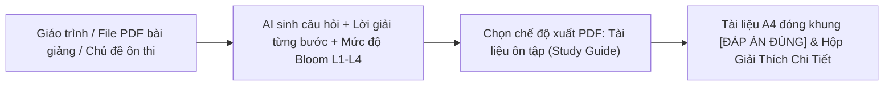

> **Tóm tắt nhanh (TL;DR):** Làm hàng trăm câu trắc nghiệm mà chỉ biết đáp án là `A` hay `C` nhưng không hiểu *vì sao các phương án khác lại sai* là nguyên nhân hàng đầu khiến học sinh bị "học vẹt" và mất điểm khi đề thi đổi số liệu. Năm 2026, các nền tảng tạo **Tài liệu ôn tập (Study Guide PDF) kèm lời giải chi tiết** như **QuizKen**, **Knowt**, **Studocu AI**, **Quizlet**, **Gizmo** và **Notion AI** đã giúp học sinh và giáo viên xuất ngay bộ đề cương A4 đóng khung lời giải từng câu chỉ trong vài giây.

---

# Top 6 Web Xuất Tài Liệu Ôn Tập PDF Kèm Lời Giải Chi Tiết Tốt Nhất 2026

Khi bước vào giai đoạn nước rút ôn thi học kỳ, thi chuyển cấp lớp 10 hay thi tốt nghiệp THPT theo Chương trình GDPT 2018, tài liệu quý giá nhất đối với học sinh không phải là một tập đề trống chỉ có bảng đáp án `1A - 2B - 3C` khô khan ở trang cuối, mà là một cuốn **Đề cương ôn tập có lời giải chi tiết (Study Guide)** ngay bên dưới từng câu hỏi.

Theo các nghiên cứu về khoa học nhận thức và phương pháp **Phản hồi tạo sinh (Elaborative Feedback)**, khi người học đọc ngay phần phân tích bản chất kiến thức và công thức áp dụng dưới mỗi câu hỏi trắc nghiệm, tốc độ ghi nhớ dài hạn tăng gấp **2,4 lần** so với việc chỉ tra đáp án đúng/sai.

Dưới đây là bảng xếp hạng **Top 6 website xuất tài liệu ôn tập PDF kèm lời giải chi tiết tốt nhất năm 2026**.

---

## Bảng So Sánh 6 Web Xuất Tài Liệu Ôn Tập (Study Guide PDF) Năm 2026

| Nền tảng | Lời giải chi tiết dưới từng câu trong PDF | Gắn nhãn mức độ tư duy Bloom (L1–L4) | Hỗ trợ công thức Toán/Lý/Hóa & Hình vẽ | Tùy chọn chuyển đổi giữa Đề trắng & Đề cương | Chi phí |
| :--- | :--- | :--- | :--- | :--- | :--- |
| **1. QuizKen** | **Có (Hộp Callout giải thích chuyên sâu)** | **Có (`L1 Nhận biết` ➔ `L4 Vận dụng cao`)** | **Có (`DejaVuSans` + Hình `VisualScene`)** | **1-Click (4 chế độ PDF)** | **Miễn phí 100%** |
| **2. Knowt AI** | Có tóm tắt lý thuyết & thẻ từ | Không | Cơ bản | Xuất từ Flashcard/Notes | Miễn phí / Plus |
| **3. Studocu AI Notes** | Tóm tắt tài liệu đại học | Không | Khá | Xuất bản tóm tắt | Yêu cầu tài khoản Premium |
| **4. Quizlet** | Giới hạn ở bộ thẻ có giải thích | Không | Hạn chế | In danh sách thuật ngữ | Trả phí Quizlet Plus |
| **5. Gizmo AI** | Giải thích ngắn trên app | Không | Cơ bản | Hạn chế xuất PDF A4 | Miễn phí / Pro |
| **6. Notion AI (Export PDF)** | Tùy thuộc người dùng soạn thảo | Thủ công | Hỗ trợ KaTeX tốt | Phải tự nhân bản trang | Giới hạn lượt AI Free |

---

## Đánh Giá Chi Tiết Top 6 Web Xuất Tài Liệu Ôn Tập PDF Kèm Lời Giải

### 1. QuizKen — Chế độ xuất PDF `Tài liệu ôn tập (Study Guide)` chuẩn sư phạm Việt Nam

Trong đợt nâng cấp hệ thống xuất bản năm 2026, **QuizKen** đã tích hợp riêng chế độ **`Tài liệu ôn tập (Đáp án & lời giải - study_guide)`** ngay trong nút Split Button xuất PDF trên mọi đề thi.

* **Điểm khác biệt của cuốn Study Guide PDF từ QuizKen:**
  * **Nổi bật đáp án đúng tức thì:** Phương án đúng trong mỗi câu hỏi được tô nền xanh ngọc dịu mắt kèm huy hiệu vector **`[ĐÁP ÁN ĐÚNG]`**, giúp học sinh lướt ôn tập cực nhanh trước giờ kiểm tra mà không cần lật qua lật lại trang cuối.
  * **Hộp Giải Thích Chi Tiết (`Explanation Callout Box`):** Ngay bên dưới 4 lựa chọn A, B, C, D là khung giải thích có thanh nhấn màu xanh lam bên trái, trình bày rõ công thức áp dụng, căn cứ sách giáo khoa hoặc phân tích vì sao các phương án nhiễu lại sai.
  * **Huy hiệu phân loại mức độ nhận thức Bloom (`L1–L4`):** Mỗi câu hỏi trên trang A4 đều gắn nhãn mức độ tư duy (*Nhận biết, Thông hiểu, Vận dụng, Vận dụng cao*), giúp học sinh biết câu nào là câu ăn điểm cơ bản và câu nào là câu phân loại điểm 9–10.
* **Ưu điểm:**
  * Từ cùng 1 đề thi trên QuizKen, học sinh có thể xuất **1 bản `Đề thi trắng`** để tự bấm giờ làm thử trên giấy, sau đó xuất **1 bản `Tài liệu ôn tập`** để tự chấm và đọc lời giải chi tiết.
* **Nhược điểm:** Dung lượng file PDF của chế độ Study Guide có thể nhiều hơn đề trắng từ 1–2 trang do chứa thêm các hộp giải thích chi tiết.
* **Chi phí:** Hoàn toàn miễn phí.

👉 **Tải ngay đề cương ôn tập của bạn:** [Tạo đề và xuất PDF Tài liệu ôn tập kèm lời giải trên QuizKen](https://app.quizken.com).

---

### 2. Knowt — Nền tảng chuyển bài giảng tiếng Anh thành Note & Flashcard

**Knowt** là đối thủ cạnh tranh trực tiếp với Quizlet tại thị trường quốc tế, nổi bật với tính năng AI tự động tóm tắt bài giảng thành ghi chú ôn tập.

* **Ưu điểm:**
  * Giao diện hiện đại, cho phép biến file PDF bài giảng thành bản tóm tắt lý thuyết (Study Guide) và bộ thẻ lật khá nhanh.
* **Nhược điểm:**
  * Bản xuất PDF thiên về ghi chú tóm tắt văn bản tiếng Anh hơn là định dạng đề thi trắc nghiệm 4 đáp án kèm khung lời giải từng câu chuẩn chương trình phổ thông Việt Nam.
* **Chi phí:** Có gói miễn phí và gói Knowt Plus trả phí.

---

### 3. Studocu AI — Kho đề cương sinh viên đại học kết hợp AI tóm tắt

**Studocu** sở hữu kho tài liệu do sinh viên các trường đại học tải lên, đi kèm công cụ AI tạo bản tóm tắt ôn thi.

* **Ưu điểm:**
  * Nguồn tài liệu tham khảo phong phú cho các môn đại cương và chuyên ngành bậc đại học.
* **Nhược điểm:**
  * Để tải file PDF về máy tính, người dùng bắt buộc phải tải tài liệu mới lên đóng góp hoặc mua gói thuê bao trả phí; nhiều tài liệu do sinh viên tự soạn chưa được kiểm chứng đáp án chuẩn.
* **Chi phí:** Thu phí thuê bao theo tháng/năm.

---

### 4. Quizlet — In danh sách thuật ngữ và định nghĩa (Glossary Print)

**Quizlet** hỗ trợ người học in bộ thẻ từ vựng ra giấy dưới dạng bảng đối chiếu thuật ngữ – định nghĩa.

* **Ưu điểm:**
  * Rất tiện lợi khi cần in bảng từ vựng Tiếng Anh, Tiếng Trung, Tiếng Nhật để mang theo học thuộc lòng.
* **Nhược điểm:**
  * Không hỗ trợ xuất đề thi trắc nghiệm A4 có hình vẽ toán học kèm hộp giải thích chi tiết từng câu hỏi như QuizKen.
* **Chi phí:** Yêu cầu nâng cấp Quizlet Plus cho các tính năng AI.

---

### 5. Gizmo AI — Học qua thẻ nhớ gamification trên di động

**Gizmo** giúp học sinh nhập tài liệu để AI đặt câu hỏi ôn tập theo cơ chế lặp lại ngắt quãng trên ứng dụng di động.

* **Ưu điểm:**
  * Trải nghiệm học trên ứng dụng thú vị, gợi nhớ kiến thức hiệu quả.
* **Nhược điểm:**
  * Tập trung vào tương tác trên màn hình điện thoại; tính năng xuất ra tài liệu PDF A4 chuẩn in ấn để đóng thành cuốn đề cương giấy còn rất hạn chế.
* **Chi phí:** Miễn phí có giới hạn tim/năng lượng; trả phí bản không giới hạn.

---

### 6. Notion AI — Tự xây dựng cuốn Sổ tay đề cương và xuất PDF

Nhiều học sinh giỏi và sinh viên đại học sử dụng **Notion** để ghi chép kiến thức, chèn công thức KaTeX rồi dùng lệnh *Export to PDF*.

* **Ưu điểm:**
  * Tự do tùy biến bố cục ghi chú, chèn bảng biểu, callout box và mã màu theo ý thích cá nhân.
* **Nhược điểm:**
  * Tốn rất nhiều thời gian biên tập thủ công; khi xuất PDF từ Notion thường bị ngắt trang giữa chừng các khối nội dung và không thể tự động chuyển đổi qua lại giữa "Đề thi trắng" và "Đề cương có lời giải".
* **Chi phí:** Miễn phí cho cá nhân; tính năng Notion AI thu phí riêng.

---

## Chiến Lược Ôn Thi "2 Bản In" Đạt Điểm 9+ Với QuizKen

Các thủ khoa kỳ thi THPT thường áp dụng phương pháp kết hợp giữa **Active Recall (Chủ động gợi nhớ)** và **Deep Explanation Review (Đọc hiểu sâu lời giải)** bằng cách sử dụng 2 chế độ xuất PDF của QuizKen:
1. **Lượt 1 (Kiểm tra năng lực thực chất):** Xuất đề ở chế độ **`Đề thi trắng (In cho học sinh)`** hoặc vào thẳng **Phòng Thi Thử (Exam Mode)** trên QuizKen để làm bài nghiêm túc dưới áp lực thời gian.
2. **Lượt 2 (Chữa lỗi tận gốc):** Xuất cùng đề đó ở chế độ **`Tài liệu ôn tập (Đáp án & lời giải)`**, dùng bút dạ quang đánh dấu vào các hộp giải thích của những câu vừa làm sai để nắm chắc bản chất trước ngày thi.

👉 **Áp dụng ngay hôm nay:** [Khám phá kho đề thi và xuất Tài liệu ôn tập PDF trên QuizKen](https://app.quizken.com/quiz/library).

---

## Câu hỏi thường gặp (FAQ)

### 1. Chế độ "Tài liệu ôn tập (Study Guide)" khác gì với chế độ "Đề thi + Bảng đáp án cuối trang"?
Ở chế độ **"Đề thi + Bảng đáp án cuối trang"**, toàn bộ các câu hỏi vẫn để trắng để học sinh làm bài, chỉ có bảng tra cứu `1A, 2B, 3C...` ở trang cuối cùng. Trong khi đó, ở chế độ **"Tài liệu ôn tập (Study Guide)"**, mỗi câu hỏi đều được đánh dấu sẵn `[ĐÁP ÁN ĐÚNG]` và hiển thị luôn **Hộp giải thích chi tiết (Explanation Callout Box)** ngay bên dưới câu hỏi đó.

### 2. Nếu đề thi do tôi tự tạo bằng AI trên QuizKen thì AI có tự viết lời giải chi tiết cho từng câu không?
Có. Khi tạo đề bằng AI trên QuizKen, hệ thống tự động biên soạn lời giải chi tiết, phân tích lý do chọn đáp án đúng và gắn nhãn mức độ tư duy Bloom cho 100% câu hỏi trong đề để sẵn sàng xuất ra bản PDF Tài liệu ôn tập.

### 3. Khi in chế độ Tài liệu ôn tập, hộp giải thích dài có bị cắt đứt qua trang sau không?
Không. Bộ dàn trang của QuizKen tính toán tổng chiều cao của cả câu hỏi, hình vẽ, 4 đáp án và hộp giải thích trong một khối `keepTogether` thống nhất, đảm bảo câu hỏi và lời giải luôn nằm trọn vẹn trên cùng một trang A4.
