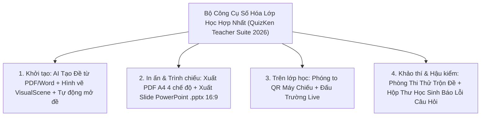

> **Tóm tắt nhanh (TL;DR):** Chuyển đổi số lớp học theo **Quyết định 131/QĐ-TTg** và **Khung năng lực số cho nhà giáo** không có nghĩa là giáo viên phải đăng ký tới 10 trang web nước ngoài đắt đỏ khác nhau. Năm 2026, chỉ cần kết hợp khéo léo **Top 7 bộ công cụ số hóa lớp học miễn phí** gồm **QuizKen Teacher Toolkit**, **Google Classroom**, **Azota**, **Canva for Education**, **Microsoft Teams Edu**, **Padlet** và **ClassDojo**, thầy cô đã có một hệ sinh thái giảng dạy thông minh từ khâu soạn đề AI, in ấn A4, trình chiếu Slide đến tổ chức thi thử.

---

# Top 7 Bộ Công Cụ Số Hóa Lớp Học Miễn Phí Cho Giáo Viên Việt Nam 2026

Trước đây, để số hóa một bài dạy từ giáo án ra tới lớp học, một giáo viên tâm huyết thường phải "chắp vá" tới 5–6 công cụ rời rạc:
* Dùng *ChatGPT* để nhờ gợi ý câu hỏi thô.
* Copy sang *Microsoft Word + MathType* để gõ lại công thức Toán/Lý/Hóa và căn lề in giấy A4.
* Dùng *McMIX* trên máy Windows để trộn mã đề.
* Copy từng câu sang *PowerPoint* để làm slide chữa bài trên máy chiếu.
* Rồi lại gõ lại bộ câu hỏi đó lên *Kahoot!* hoặc *Google Forms* để tổ chức trò chơi hoặc kiểm tra trực tuyến.

Việc phải chuyển dữ liệu qua lại giữa 5 phần mềm không tương thích nhau chính là nguyên nhân khiến nhiều thầy cô cảm thấy chuyển đổi số trở thành gánh nặng thay vì sự giải phóng sức lao động.

Năm 2026, xu hướng **Nền tảng số hóa hợp nhất (Unified Classroom Toolkit)** đã thay đổi hoàn toàn bức tranh này. Dưới đây là đánh giá chi tiết **Top 7 bộ công cụ số hóa lớp học miễn phí đáng trang bị nhất cho giáo viên Việt Nam**.

---

## Bảng So Sánh 7 Bộ Công Cụ Số Hóa Lớp Học Cho Giáo Viên Việt Nam (2026)

| Bộ công cụ | Tạo đề AI & Xuất PDF A4 4 chế độ | Xuất Slide `.pptx` 16:9 tự động | Chiếu QR Lớp Học & Đấu Trường Live | Phòng Thi Thử Trộn Đề & Hộp Thư Góp Ý | Chi phí |
| :--- | :--- | :--- | :--- | :--- | :--- |
| **1. QuizKen Teacher Toolkit** | **Có (100% tự động + Font Toán Unicode)** | **Có (Chia 2 cột hình vẽ + Nhãn Bloom)** | **Có (`ClassroomQrModal` + Mã PIN 6 số)** | **Có (`ExamEntry` + `TeacherReportInboxDialog`)** | **Miễn phí 100%** |
| **2. Google Classroom + Forms** | Không có AI tạo đề & PDF 4 chế độ | Không tự chuyển đề sang Slide | Không có Live Game Arena | Không có cảnh báo chuyển tab gốc | Miễn phí |
| **3. Azota** | Tốt cho đề có sẵn | Không xuất Slide `.pptx` | Có QR giao bài | Có giám sát thi online | Miễn phí / VIP |
| **4. Canva for Education** | Thiết kế thủ công | Xuất Slide đẹp (Soạn thủ công) | Có QR trình chiếu | Không có phòng thi thử | Miễn phí cần xác minh `.edu` |
| **5. Microsoft Teams for Edu** | Qua Microsoft Forms cơ bản | Cần mua thêm Copilot đắt đỏ | Tích hợp họp trực tuyến | Cơ bản | Cần tài khoản Office 365 trường |
| **6. ClassDojo** | Không (Chuyên điểm danh & hành vi) | Không | Kết nối phụ huynh | Không | Miễn phí cho GV |
| **7. Padlet** | Không (Chuyên bảng ghim thảo luận) | Xuất bản in bảng ghim | Có QR nộp bài nhóm | Không | Giới hạn 3 bảng Free |

---

## Đánh Giá Chi Tiết Top 7 Bộ Công Cụ Số Hóa Lớp Học Cho Giáo Viên

### 1. QuizKen Teacher Toolkit — Bộ công cụ "5 trong 1" trên từng thẻ đề đã tạo

Với loạt nâng cấp toàn diện trong năm 2026, **QuizKen** không chỉ là một trình tạo câu hỏi AI mà đã trở thành **Trạm điều hành lớp học số (`Teacher Classroom Toolkit`)** gói gọn toàn bộ nhu cầu khảo thí và tương tác của giáo viên Việt Nam.

* **Điểm danh 5 vũ khí số hóa vừa được tích hợp thẳng vào Dashboard của QuizKen:**
  1. **Thanh thao tác nhanh 5 nút trên từng thẻ đề (`TeacherQuizActions`):** Ngay tại mục **Đề đã tạo**, mỗi bộ đề đều có sẵn 5 nút điều khiển 1-Click:
     * **`🌐 Công khai / 🔒 Riêng tư`**: Bảo mật đề kiểm tra trước giờ thi và mở công khai làm tài liệu ôn tập sau khi thi xong.
     * **`QR Lớp học`**: Bật màn hình **Chế độ Máy Chiếu Lớp Học (`ClassroomQrModal`)** nền tối chống lóa với mã QR `320×320 Level H`, chuyển đổi tức thì giữa link *Làm bài Ôn tập* và *Phòng Thi Thử*, kèm nút tải ảnh QR PNG.
     * **`Phòng Thi thử`**: Đưa học sinh vào **Sảnh Chuẩn Bị Thi (`ExamEntry`)** với 6 mốc thời gian (`Auto`, `15p`, `30p`, `45p`, `60p`, `90p`), công tắc **Trộn câu hỏi & Đảo đáp án A/B/C/D**, cảnh báo chuyển tab và bộ lọc xem lại câu gắn cờ `🚩`.
     * **`Đấu trường Live`**: Mở ngay sảnh chờ Live Game với **Mã PIN 6 số** khổng lồ cho cả lớp đua top trực tiếp theo thời gian thực.
     * **`Góp ý câu hỏi`**: Mở hộp thoại **`TeacherReportInboxDialog`** để xem và sửa trực tiếp các câu hỏi mà học sinh phản hồi lỗi trong quá trình làm bài.
  2. **Bộ đôi Xuất bản In ấn & Trình chiếu đẳng cấp:**
     * **Nút Split Button `PDF 4 chế độ`:** Xuất đề trắng in cho học sinh, đề kèm lưới đáp án 5 cột cuối trang, tài liệu ôn tập Study Guide có hộp lời giải, hoặc phiếu kết quả đã chấm điểm.
     * **Nút `PPTX`:** Xuất bộ slide PowerPoint 16:9 tự động chia 2 cột cho câu hỏi có hình minh họa `VisualScene` và gắn nhãn nhận thức Bloom `L1–L4`.
* **Ưu điểm:** Xóa bỏ hoàn toàn cảnh phải copy-paste dữ liệu qua 5 phần mềm khác nhau; tối ưu tốc độ tải trang cực nhanh ngay cả trên mạng 4G di động ở các trường vùng xa.
* **Nhược điểm:** Chưa bao gồm tính năng quản lý sổ điểm danh chuyên cần hàng ngày (có thể kết hợp cùng Google Classroom hoặc sổ điểm điện tử của Sở GD&ĐT).
* **Chi phí:** Hoàn toàn miễn phí.

👉 **Trang bị ngay cho lớp học của bạn:** [Khám phá Bộ Công Cụ Lớp Học trên QuizKen](https://app.quizken.com).

---

### 2. Google Classroom — Nền tảng quản lý thông báo và thu bài tập tự luận

**Google Classroom** vẫn là "xương sống" quản lý lớp học trực tuyến tại nhiều trường phổ thông và đại học.

* **Ưu điểm:**
  * Giao thông báo, đính kèm tài liệu đọc trước ở nhà và thu bài tập dạng file đính kèm (Word, PDF, ảnh chụp vở) theo hạn nộp rõ ràng.
* **Nhược điểm:**
  * Phần tạo bài kiểm tra trắc nghiệm của Google Classroom thực chất chỉ gọi sang Google Forms cơ bản (không có AI tạo đề từ sách giáo khoa, không xuất được PDF A4 4 chế độ hay Slide `.pptx` chữa bài).
* **Chi phí:** Miễn phí.

---

### 3. Azota — Công cụ giao bài tập về nhà và chấm phiếu qua Zalo

**Azota** phát triển mạnh nhờ sự tương thích cao với thói quen dùng nhóm Zalo lớp học tại Việt Nam.

* **Ưu điểm:**
  * Học sinh nộp ảnh chụp vở bài tập tự luận để giáo viên chấm gạch đúng/sai trực tiếp trên màn hình cảm ứng rất nhanh.
* **Nhược điểm:**
  * Ít tính năng trò chơi hóa (Gamification như Đấu trường Live, Flashcard Spaced Repetition, English Hub CEFR hay xuất Slide PowerPoint `.pptx` tự động có hình vẽ `VisualScene` như QuizKen).
* **Chi phí:** Miễn phí cơ bản / Gói VIP trả phí.

---

### 4. Canva for Education — Thiết kế sơ đồ tư duy, giấy khen và poster lớp học

**Canva** là trợ thủ đắc lực về mặt hình ảnh mỹ thuật cho giáo viên chủ nhiệm và giáo viên bộ môn.

* **Ưu điểm:**
  * Thiết kế giấy khen cuối tuần, sơ đồ tư duy tổng kết chương, thời khóa biểu lớp học cực kỳ bắt mắt.
* **Nhược điểm:**
  * Không phải nền tảng khảo thí trắc nghiệm hay phân tích lỗ hổng kiến thức bằng thuật toán AI.
* **Chi phí:** Miễn phí khi xác minh giấy tờ giáo viên.

---

### 5. Microsoft Teams for Education — Lớp học ảo kết hợp họp video trực tuyến

Với các trường học được cấp tài khoản Office 365 có đuôi `.edu.vn`, **Microsoft Teams** là nền tảng dạy học từ xa đồng bộ.

* **Ưu điểm:**
  * Họp video ổn định, chia phòng thảo luận nhóm (Breakout Rooms) và tích hợp sổ tay OneNote Class Notebook.
* **Nhược điểm:**
  * Giao diện khá nặng nề trên các dòng điện thoại cấu hình thấp của học sinh; thiếu các công cụ tạo đề AI và xuất đề in A4 chuẩn tiếng Việt tức thì.
* **Chi phí:** Theo gói bản quyền tổ chức giáo dục.

---

### 6. ClassDojo — Quản lý nề nếp, cộng điểm rèn luyện cho bậc Tiểu học & THCS

**ClassDojo** biến việc quản lý kỷ luật lớp học thành trò chơi nuôi quái vật nhỏ dễ thương.

* **Ưu điểm:**
  * Giáo viên bấm cộng điểm tức thì trên bảng khi học sinh phát biểu xây dựng bài hoặc giữ vệ sinh lớp, đồng thời gửi thông báo tự động cho phụ huynh.
* **Nhược điểm:**
  * Chỉ phục vụ quản lý hành vi nề nếp chứ không có tính năng học thuật hay kiểm tra đánh giá kiến thức.
* **Chi phí:** Miễn phí cho giáo viên.

---

### 7. Padlet — Bảng triển lãm sản phẩm dự án học tập của cả lớp

**Padlet** rất phù hợp cho các tiết học dự án (Project-based Learning), hoạt động trải nghiệm hướng nghiệp hoặc môn Ngữ văn, Lịch sử.

* **Ưu điểm:**
  * Các nhóm học sinh quét mã QR để ghim bài thuyết trình, video hoặc poster của nhóm mình lên bảng chung cho cả lớp bình chọn.
* **Nhược điểm:**
  * Tài khoản miễn phí chỉ cho tạo tối đa 3 bảng Padlet.
* **Chi phí:** Freemium.

---

## Câu hỏi thường gặp (FAQ)

### 1. Tôi có thể kết hợp QuizKen với Google Classroom hoặc nhóm Zalo lớp học như thế nào?
Rất ăn ý! Thầy cô tạo đề trên **QuizKen**, sau đó mở hộp thoại **Chia sẻ (`ShareDialog`)** hoặc **QR Máy Chiếu (`ClassroomQrModal`)**, chọn chế độ **`Làm bài Ôn tập`** hoặc **`Phòng Thi Thử`** rồi bấm **"Sao chép Link"** (hoặc tải ảnh Mã QR PNG) dán thẳng vào luồng giao bài tập trên Google Classroom hoặc nhóm Zalo lớp.

### 2. Toàn bộ các công cụ trong Teacher Toolkit của QuizKen (QR Lớp học, Phòng Thi Thử, Xuất PDF 4 chế độ, Xuất PPTX, Hộp thư góp ý) có bị khóa tính năng nào bắt nâng cấp VIP không?
Không. Theo định hướng phi thương mại hỗ trợ cộng đồng giáo dục Việt Nam, toàn bộ các tính năng xuất bản PDF A4 4 chế độ, xuất Slide PowerPoint `.pptx`, Mã QR Máy Chiếu, Phòng Thi Thử trộn đề và Hộp thư báo lỗi câu hỏi đều được mở **miễn phí 100%** cho mọi giáo viên và học sinh.

### 3. Khi trường học kiểm tra hồ sơ chuyên môn định kỳ, tôi có thể dùng file xuất từ QuizKen để nộp không?
Hoàn toàn được. Thầy cô chỉ cần xuất file PDF ở chế độ **`Đề thi + Bảng đáp án cuối trang`** (để lưu kèm đề kiểm tra chính thức và bảng đáp án 5 cột) kết hợp chế độ **`Tài liệu ôn tập (Study Guide)`** (có đầy đủ lời giải chi tiết và phân loại mức độ nhận thức Bloom `L1–L4` cho từng câu hỏi) để hoàn thiện bộ hồ sơ chuyên môn nhanh chóng.
