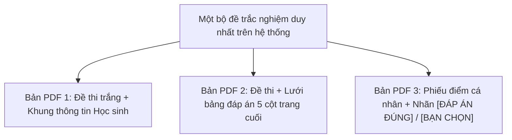

> **Tóm tắt nhanh (TL;DR):** Theo quy định về hồ sơ kiểm tra đánh giá định kỳ tại **Công văn 7991/BGDĐT-GDTrH**, mỗi đề kiểm tra chính thức phải đi kèm bản Đáp án và Hướng dẫn chấm thống nhất, đồng thời học sinh cần nhận được phiếu phản hồi kết quả rõ ràng để tự sửa lỗi sai. Dưới đây là đánh giá chi tiết **Top 7 website tạo đề thi kèm bảng đáp án và phiếu chấm điểm PDF tốt nhất năm 2026**, dẫn đầu bởi **QuizKen** với lưới đáp án 5 cột tự động và thẻ tổng kết điểm số chuẩn A4.

---

# Top 7 Web Tạo Đề Thi Kèm Bảng Đáp Án & Phiếu Chấm Điểm PDF 2026

Khi tổ chức kiểm tra 15 phút, kiểm tra giữa kỳ hoặc thi thử tốt nghiệp THPT, công việc của giáo viên không dừng lại ở việc soạn xong câu hỏi. Thầy cô còn phải chuẩn bị **3 loại tài liệu PDF** khác nhau cho cùng một đề thi:
1. **Bản đề thi trắng có khung điền thông tin thí sinh** (*Họ và tên, Lớp, Mã đề, Điểm, Lời phê*) để in phát cho học sinh.
2. **Bản đề kèm Bảng đáp án tổng hợp (Answer Key Grid)** để nộp vào hồ sơ chuyên môn của tổ bộ môn và dùng làm căn cứ đối chiếu nhanh khi chấm bài.
3. **Phiếu kết quả bài làm đã chấm điểm (Graded Scorecard PDF)** đối với học sinh làm bài trực tuyến muốn tải biên bản bài thi về gửi phụ huynh hoặc lưu làm tư liệu ôn tập.

Nếu làm thủ công trên Word và Excel, việc lập bảng đáp án 40–50 câu rất dễ xảy ra sai sót lệch dòng (ví dụ: câu 23 đáp án B nhưng gõ nhầm vào ô câu 24). Dưới đây là **7 nền tảng tự động hóa hoàn toàn việc xuất đề thi kèm bảng đáp án và phiếu kết quả chấm điểm PDF năm 2026**.

---

## Bảng So Sánh 7 Web Tạo Đề Kèm Bảng Đáp Án & Phiếu Điểm PDF (2026)

| Nền tảng | Tự động sinh Bảng đáp án cuối trang | Xuất Phiếu kết quả bài làm cá nhân (Graded PDF) | Nhãn phân biệt Đáp án đúng / Đáp án học sinh chọn | Hỗ trợ Tiếng Việt & Toán | Chi phí |
| :--- | :--- | :--- | :--- | :--- | :--- |
| **1. QuizKen** | **Lưới 5 cột chuẩn A4** | **Có (Kèm Thẻ điểm & Lời giải)** | **Vector Pill `[ĐÁP ÁN ĐÚNG]` & `[BẠN CHỌN]`** | **100% (Font DejaVuSans)** | **Miễn phí 100%** |
| **2. ZipGrade** | Tạo phiếu tô OMR | Xuất báo cáo phiếu tô | Đánh dấu trên ảnh quét | Giao diện Tiếng Anh | Miễn phí 100 phiếu/tháng |
| **3. Azota** | Có (Bảng đáp án theo mã đề) | Có xem kết quả online | Hiển thị trên web | 100% Tiếng Việt | Miễn phí / VIP |
| **4. Testportal** | Có xuất báo cáo kết quả | Có (Cho quản trị viên) | Có | Hỗ trợ đa ngôn ngữ | Giới hạn ở bản Free |
| **5. AkhaTest / McMIX** | Có (File Word/Excel đáp án) | Không (Chỉ trộn đề giấy) | Gạch chân trên bản gốc | Tốt trên Windows | Miễn phí / Trả phí |
| **6. GradeCam** | Tạo phiếu chấm camera | Báo cáo thống kê lớp | Trên giao diện giáo viên | Tiếng Anh | Trả phí |
| **7. ClassMarker** | Có khi in bài kiểm tra | Có xuất PDF kết quả | Đánh dấu cơ bản | Tiếng Anh | Trả phí cho giáo dục |

---

## Đánh Giá Chi Tiết Top 7 Web Tạo Đề Kèm Bảng Đáp Án & Phiếu Chấm Điểm PDF

### 1. QuizKen — Xuất đề A4 kèm Lưới đáp án 5 cột & Phiếu chấm điểm cá nhân hóa

**QuizKen** nổi bật nhờ thiết kế bản in PDF đạt thẩm mỹ xuất bản hiện đại, đáp ứng trọn vẹn nhu cầu của cả **giáo viên ra đề** lẫn **học sinh làm bài**.

* **Dành cho giáo viên (Chế độ `Đề thi + Bảng đáp án cuối trang`):**
  * Đầu trang 1 tự động hiển thị tiêu đề đề thi, siêu dữ liệu (*Số câu hỏi, Ngày xuất, Mã tài liệu*) và **Khung thông tin học sinh** (*Họ và tên, Lớp, Mã đề, Điểm số*).
  * Toàn bộ các câu hỏi giữ nguyên trạng thái đề trắng để học sinh khoanh trực tiếp trên giấy.
  * Cuối tài liệu tự động sinh khối **`BẢNG ĐÁP ÁN THAM CHIẾU`** được chia thành **lưới 5 cột cân đối** (`1: A | 2: C | 3: B | 4: D | 5: A...`), giúp giáo viên cắt rời trang cuối làm đáp án chấm hoặc ghim trực tiếp vào hồ sơ kiểm tra định kỳ.
* **Dành cho học sinh & phụ huynh (Chế độ `Kết quả bài làm của tôi - graded_review`):**
  * Sau khi hoàn thành bài làm ở chế độ Ôn tập hoặc Phòng Thi Thử (Exam Mode), học sinh chỉ cần nhấn nút **PDF** để tải về biên bản bài làm hoàn chỉnh.
  * Trang đầu hiển thị **Thẻ Tổng Kết Điểm Số (Score Summary Card)** cỡ lớn (ví dụ: `85% — 34/40 câu đúng`).
  * Từng câu hỏi bên dưới được tô màu viền thông minh và gắn huy hiệu vector **`[ĐÁP ÁN ĐÚNG]`** (màu xanh lục) cùng **`[BẠN CHỌN]`** (màu đỏ nếu chọn sai), kèm theo hộp giải thích chi tiết ngay bên dưới.
* **Ưu điểm:** Không bao giờ bị lệch đáp án giữa đề và bảng tra cứu vì cả hai được trích xuất từ cùng một cấu trúc dữ liệu câu hỏi trong thời gian thực.
* **Nhược điểm:** Chưa tích hợp tính năng dùng camera điện thoại quét phiếu tô chì OMR (do QuizKen đã có sẵn chế độ quét Mã QR vào làm bài trực tiếp trên điện thoại và chấm điểm tức thì).
* **Chi phí:** Miễn phí 100%.

👉 **Trải nghiệm ngay:** [Tạo đề thi kèm bảng đáp án và phiếu chấm điểm PDF trên QuizKen](https://app.quizken.com).

---

### 2. ZipGrade — Ứng dụng tạo phiếu trả lời OMR và chấm bài qua Camera

**ZipGrade** là công cụ quen thuộc với các trường chưa cho phép học sinh mang điện thoại vào lớp và muốn chấm phiếu tô bút chì bằng camera điện thoại của giáo viên.

* **Ưu điểm:**
  * Cho phép tải các mẫu phiếu tô trắc nghiệm 20, 50, 100 câu định dạng PDF về in ra giấy; tốc độ quét camera chấm điểm rất nhanh.
* **Nhược điểm:**
  * ZipGrade chỉ tạo **tờ phiếu tô đáp án trống (Bubble Sheet)** chứ không chứa nội dung câu hỏi đề thi; giáo viên vẫn phải dùng công cụ khác để soạn và in tờ đề câu hỏi riêng. Bản miễn phí chỉ cho quét tối đa 100 bài mỗi tháng.
* **Chi phí:** Miễn phí giới hạn 100 lượt quét/tháng; trả phí theo năm để mở khóa không giới hạn.

---

### 3. Azota — Xuất bảng đáp án Excel/PDF cho nhiều mã đề hoán vị

Khi giáo viên dùng tính năng trộn đề trên **Azota**, hệ thống sẽ đóng gói file nén chứa các mã đề kèm file bảng đáp án.

* **Ưu điểm:**
  * Quản lý tốt bảng đáp án của nhiều mã đề (ví dụ mã 101, 102, 103, 104) trong một bảng tổng hợp duy nhất để giáo viên tra cứu.
* **Nhược điểm:**
  * Với học sinh làm bài tự luyện, trải nghiệm tải riêng một cuốn PDF "Sổ tay bài làm đã chấm kèm lời giải AI" chưa được thiết kế chuyên sâu như chế độ `graded_review` và `study_guide` của QuizKen.
* **Chi phí:** Miễn phí cơ bản / Gói VIP trả phí.

---

### 4. Testportal — Hệ thống xuất báo cáo bài kiểm tra chuẩn doanh nghiệp & đại học

**Testportal** được nhiều trung tâm ngoại ngữ và trường đại học sử dụng nhờ tính năng báo cáo kết quả chi tiết của từng thí sinh.

* **Ưu điểm:**
  * Cho phép quản trị viên xuất biên bản bài thi của từng thí sinh ra PDF gồm điểm số, thời gian làm bài và từng phương án đã chọn.
* **Nhược điểm:**
  * Tính năng xuất báo cáo PDF chi tiết bị khóa ở các gói trả phí đắt đỏ; học sinh không thể tự do bấm tải phiếu đề kèm lời giải về tự ôn tập.
* **Chi phí:** Thu phí theo tháng bằng USD khá cao.

---

### 5. McMIX / AkhaTest — Phần mềm xuất đề và bảng đáp án trên Windows

Đây là các phần mềm máy tính truyền thống giúp giáo viên xuất ra file Word đề thi và một file bảng đáp án riêng.

* **Ưu điểm:**
  * Hoạt động offline không cần Internet, xuất bảng đáp án rõ ràng cho từng mã đề.
* **Nhược điểm:**
  * Không có hệ thống làm bài trực tuyến, không tạo được phiếu kết quả cá nhân kèm lời giải cho từng học sinh.
* **Chi phí:** Có bản miễn phí giới hạn và bản Pro trả phí.

---

### 6. GradeCam — Giải pháp chấm phiếu giấy tích hợp sổ điểm

**GradeCam** tương tự ZipGrade nhưng hướng tới việc đồng bộ điểm số vào các hệ thống quản lý học tập (LMS) của trường học tại Mỹ.

* **Ưu điểm:**
  * In phiếu trả lời PDF linh hoạt, nhận diện chữ viết số của học sinh khá tốt.
* **Nhược điểm:**
  * Giao diện tiếng Anh, chi phí thuê bao cao và không hỗ trợ tạo nội dung đề thi bằng AI tiếng Việt.
* **Chi phí:** Trả phí sau thời gian dùng thử.

---

### 7. ClassMarker — Nền tảng kiểm tra trực tuyến có hỗ trợ in phiếu điểm

**ClassMarker** cho phép vừa tổ chức thi online vừa in đề ra giấy kèm tùy chọn bật/tắt đáp án.

* **Ưu điểm:**
  * Hệ thống phân quyền chặt chẽ, bản in PDF rõ ràng, gọn gàng.
* **Nhược điểm:**
  * Giao diện cũ, không hỗ trợ tự động sinh đề từ tài liệu tiếng Việt hay vẽ hình học `VisualScene`.
* **Chi phí:** Miễn phí giới hạn cho giáo dục, trả phí theo số lượt làm bài.

---

## Khi Nào Nên Dùng Từng Chế Độ Xuất Bảng Đáp Án Trên QuizKen?

| Tình huống sử dụng thực tế | Chế độ PDF nên chọn trên QuizKen | Kết quả nhận được |
| :--- | :--- | :--- |
| **In đề phát cho học sinh kiểm tra trên lớp** | `Đề thi trắng (In cho học sinh)` | Đề sạch không lộ đáp án + Khung điền Họ tên, Lớp, Mã đề |
| **Lưu hồ sơ tổ chuyên môn & giám thị chấm bài** | `Đề thi + Bảng đáp án cuối trang` | Đề trắng + Lưới đáp án 5 cột ở trang cuối cùng |
| **Phát tài liệu chữa đề sau buổi kiểm tra** | `Tài liệu ôn tập (Đáp án & lời giải)` | Đánh dấu `[ĐÁP ÁN ĐÚNG]` + Hộp giải thích chi tiết từng câu |
| **Học sinh tự thi thử online và lưu kết quả** | `Kết quả bài làm của tôi` | Thẻ điểm `%` + So sánh `[BẠN CHỌN]` vs `[ĐÁP ÁN ĐÚNG]` + Lời giải |

👉 **Truy cập ngay:** [Tạo đề và xuất bảng đáp án PDF tự động trên QuizKen](https://app.quizken.com).

---

## Câu hỏi thường gặp (FAQ)

### 1. Bảng đáp án cuối trang của QuizKen có thể tách rời khi in cho học sinh không?
Rất dễ dàng. Vì Bảng đáp án tham chiếu 5 cột luôn nằm ở phần cuối cùng của tài liệu PDF (hoặc thầy cô có thể tải song song file `Đề thi trắng` và file `Đề thi + Bảng đáp án`), học sinh tuyệt đối không bao giờ nhìn thấy đáp án khi làm bài.

### 2. Phiếu kết quả bài làm PDF có hiển thị câu nào học sinh bỏ trống chưa làm không?
Có. Trong chế độ `Kết quả bài làm của tôi (graded_review)`, những câu học sinh chọn đúng sẽ có viền xanh lục, câu chọn sai có viền đỏ kèm nhãn `[BẠN CHỌN]` tại phương án sai và `[ĐÁP ÁN ĐÚNG]` tại phương án đúng, còn câu bỏ trống sẽ chỉ hiển thị `[ĐÁP ÁN ĐÚNG]` cùng lời giải để học sinh ôn lại.

### 3. Mỗi trang PDF của QuizKen có đánh số trang tự động không?
Có. Toàn bộ các trang PDF xuất từ QuizKen đều có thanh Header cố định ghi tên đề thi và thanh Footer chuẩn ở cuối trang đánh số `Trang X / Tổng số trang` giúp việc đóng quyển và phát đề không bao giờ bị thất lạc tờ.
