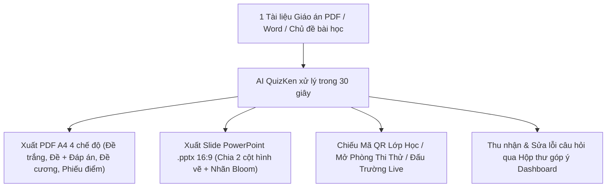

> **Tóm tắt nhanh (TL;DR):** Trung bình một giáo viên phổ thông phải làm việc thêm từ 12–15 giờ mỗi tuần ngoài giờ lên lớp chỉ để soạn đề kiểm tra, làm đáp án, thiết kế slide chữa bài và chấm phiếu giấy. Năm 2026, **Top 7 website AI trợ giảng hàng đầu** gồm **QuizKen**, **MagicSchool AI**, **Eduaide.Ai**, **Brisk Teaching**, **Twee**, **Diffit** và **QuestionWell** đã giúp tự động hóa tới 90% khối lượng công việc hậu cần này, trả lại thời gian nghỉ ngơi và sáng tạo sư phạm cho thầy cô.

---

# Top 7 Web AI Giúp Giáo Viên Tiết Kiệm 90% Thời Gian Soạn Đề & Slide

Theo báo cáo khảo sát khối lượng công việc của nhà giáo trong bối cảnh triển khai Chương trình GDPT 2018 và **Công văn 7991/BGDĐT-GDTrH**, áp lực lớn nhất đối với giáo viên hiện nay không nằm ở 45 phút đứng trên bục giảng, mà nằm ở **"khâu chuẩn bị đa định dạng"** trước và sau mỗi tiết học:
* Cùng một bài dạy nhưng phải chuẩn bị **1 file đề PDF trắng** để kiểm tra trên giấy.
* Phải lập **1 bảng đáp án và hướng dẫn giải chi tiết** để lưu hồ sơ tổ chuyên môn.
* Phải thiết kế **1 bộ slide PowerPoint (`.pptx`)** để chiếu chữa bài trên lớp.
* Phải tạo thêm **1 phòng trò chơi tương tác hoặc phòng thi thử trực tuyến** để học sinh ôn tập tại nhà.

Nếu làm thủ công trên 4 phần mềm rời rạc, thầy cô sẽ mất trọn cả ngày Chủ nhật chỉ cho một bài kiểm tra định kỳ. Dưới đây là **Top 7 website AI giúp giáo viên tự động hóa quy trình soạn đề và làm slide nhanh gấp 10 lần trong năm 2026**.

---

## Bảng So Sánh 7 Web AI Tiết Kiệm Thời Gian Cho Giáo Viên (2026)

| Nền tảng AI | Tạo đề trắc nghiệm từ PDF bài giảng | Xuất đồng thời cả PDF A4 lẫn Slide `.pptx` | Có Mã QR Máy Chiếu & Phòng Thi Thử | Tối ưu cho Chương trình Việt Nam | Chi phí |
| :--- | :--- | :--- | :--- | :--- | :--- |
| **1. QuizKen** | **Có (30 giây + Tự động mở đề)** | **Có (4 chế độ PDF + Slide PPTX 16:9)** | **Có (Classroom QR + Exam Mode + Live)** | **100% Tiếng Việt & STEM** | **Miễn phí 100%** |
| **2. MagicSchool AI** | Có sinh câu hỏi văn bản | Xuất Google Docs / Slides cơ bản | Không có phòng thi / QR | Đa ngôn ngữ (Gốc Mỹ) | Giới hạn ở bản Free |
| **3. Eduaide.Ai** | Có tạo học liệu & rubric | Xuất Word / Copy văn bản | Không | Hỗ trợ dịch đa ngôn ngữ | Giới hạn 15 lượt/tháng Free |
| **4. Brisk Teaching** | Tạo từ trang web / Google Docs | Xuất Google Forms / Slides | Không | Tốt trên Chrome | Freemium |
| **5. Twee (Tiếng Anh)** | Rất mạnh cho đề Tiếng Anh | Xuất PDF phiếu bài tập | Không | Chuyên biệt môn Tiếng Anh | Giới hạn lượt Free |
| **6. Almanack AI** | Tạo giáo án, đề & slide | Xuất PPTX / Google Docs | Không | Giao diện Tiếng Anh | Dùng thử miễn phí |
| **7. QuestionWell** | Tạo câu hỏi từ văn bản/YouTube | Xuất sang các nền tảng thứ 3 | Không trực tiếp tổ chức thi | Tiếng Anh | Freemium |

---

## Đánh Giá Chi Tiết Top 7 Web AI Giúp Giáo Viên Tiết Kiệm 90% Thời Gian

### 1. QuizKen — Quy trình "Soạn 1 Lần, Xuất 4 Định Dạng" dành riêng cho giáo viên Việt Nam

**QuizKen** đứng vị trí số 1 nhờ triết lý thiết kế **All-in-One Workflow (Luồng công việc khép kín)**: giáo viên chỉ cần cung cấp tài liệu bài giảng **đúng 1 lần duy nhất**, hệ thống sẽ tự động lo trọn gói toàn bộ các khâu xuất bản và tổ chức lớp học tiếp theo.

* **Bảng tính thời gian thực tế khi dùng QuizKen so với làm thủ công:**
  * **Khâu 1 (Biên soạn 30 câu hỏi + lời giải + phân loại Bloom):** Làm thủ công mất **120 phút** ➔ Dùng AI QuizKen mất **30 giây** (và tự động mở thẳng vào đề vừa tạo).
  * **Khâu 2 (Dàn trang đề in A4 + lập bảng đáp án + tạo đề cương lời giải):** Làm thủ công trên Word mất **45 phút** ➔ Dùng nút Split Button **PDF 4 chế độ** của QuizKen mất **3 giây**.
  * **Khâu 3 (Thiết kế bộ Slide PowerPoint 30 câu + chèn hình vẽ + bảng đáp án):** Làm thủ công mất **90 phút** ➔ Bấm nút **PPTX** trên QuizKen mất **5 giây**.
  * **Khâu 4 (Tổ chức kiểm tra trên lớp & sửa lỗi đề):** Thay vì gửi link dài dòng qua Zalo, giáo viên bấm **"QR Lớp học"** trên Dashboard để chiếu mã QR toàn màn hình cho học sinh quét vào **Phòng Thi Thử** (tự động đảo câu hỏi & đáp án A/B/C/D), và duyệt phản hồi của học sinh ngay trong **Hộp thư góp ý (`TeacherReportInboxDialog`)**.
* **Ưu điểm:** Tiết kiệm hơn **4 giờ làm việc** cho mỗi bài kiểm tra; hỗ trợ gắn Gemini API Key cá nhân (BYOK) cho giáo viên có nhu cầu tạo học liệu số lượng cực lớn.
* **Nhược điểm:** Chưa có công cụ tự động viết sáng kiến kinh nghiệm dài hàng chục trang (do tập trung chuyên sâu vào kiểm tra đánh giá, flashcard và tương tác lớp học).
* **Chi phí:** Hoàn toàn miễn phí.

👉 **Tiết kiệm ngay 10 giờ mỗi tuần:** [Bắt đầu soạn đề, xuất PDF A4 và Slide PPTX trên QuizKen](https://app.quizken.com).

---

### 2. MagicSchool AI — Trợ lý viết giáo án, rubric chấm điểm và email phụ huynh

**MagicSchool AI** là một trong những nền tảng AI giáo dục phổ biến nhất tại Mỹ với hàng chục mẫu công cụ văn bản.

* **Ưu điểm:**
  * Hỗ trợ giáo viên soạn nhanh khung kế hoạch bài dạy (Lesson Plan), bảng tiêu chí chấm điểm tự luận (Rubric) và thư trao đổi với phụ huynh học sinh.
* **Nhược điểm:**
  * Không có hệ thống Phòng Thi Thử chống gian lận, không có Đấu Trường Live nhiều người chơi hay bộ xuất PDF A4 4 chế độ kèm hình vẽ `VisualScene` như QuizKen.
* **Chi phí:** Có bản miễn phí giới hạn và gói MagicSchool Plus trả phí.

---

### 3. Eduaide.Ai — Không gian thiết kế hoạt động dạy học theo mô hình 5E

**Eduaide.Ai** tập trung giúp giáo viên lên ý tưởng các hoạt động thảo luận nhóm, trò chơi khởi động và câu hỏi tư duy theo mô hình dạy học 5E (*Engage, Explore, Explain, Elaborate, Evaluate*).

* **Ưu điểm:**
  * Gợi ý nhiều kịch bản tổ chức hoạt động nhóm sáng tạo cho các môn Khoa học và Xã hội.
* **Nhược điểm:**
  * Tài khoản miễn phí chỉ được tạo tối đa **15 tài nguyên mỗi tháng**; kết quả xuất ra chủ yếu là văn bản thô để giáo viên tự copy sang Word hoặc PowerPoint.
* **Chi phí:** Freemium (15 lượt/tháng miễn phí).

---

### 4. Brisk Teaching — Chấm nhận xét bài viết của học sinh ngay trên Google Docs

**Brisk Teaching** hoạt động dưới dạng nút nổi ngay bên trong trình duyệt Chrome khi giáo viên mở bài luận của học sinh trên Google Docs.

* **Ưu điểm:**
  * Tạo nhận xét phản hồi (Glow & Grow feedback) cho bài viết tập làm văn hoặc bài luận Tiếng Anh rất nhanh.
* **Nhược điểm:**
  * Bắt buộc phải làm việc hoàn toàn trên máy tính dùng Chrome và hệ sinh thái Google Drive.
* **Chi phí:** Miễn phí cơ bản / Gói Pro trả phí.

---

### 5. Twee — Công cụ AI chuyên biệt số 1 cho giáo viên Tiếng Anh

Đối với giáo viên bộ môn Tiếng Anh, **Twee** cung cấp bộ công cụ chuyên sâu để chế biến bài đọc, bài nghe và bài tập ngữ pháp theo khung CEFR (A1–C2).

* **Ưu điểm:**
  * Tạo đoạn hội thoại chứa danh sách từ vựng mục tiêu, trích xuất câu hỏi True/False/Not Given từ video YouTube tiếng Anh cực kỳ tự nhiên.
* **Nhược điểm:**
  * Chỉ dành riêng cho môn Tiếng Anh, không sử dụng được cho các môn Toán, Lý, Hóa, Sinh, Sử, Địa, GDCD bằng tiếng Việt. *(Lưu ý: Trên QuizKen ngoài trình tạo đề đa môn còn có sẵn **English Hub** luyện từ vựng CEFR A1–C2 và TOEIC hoàn toàn miễn phí).*
* **Chi phí:** Giới hạn số lượt chạy AI mỗi tháng ở bản Free.

---

### 6. Almanack AI — Tổ chức tài liệu giảng dạy theo khóa học

**Almanack AI** giúp giáo viên gom giáo án, phiếu bài tập và slide thuyết trình vào từng thư mục môn học.

* **Ưu điểm:**
  * Giao diện quản lý theo từng lớp học gọn gàng, có hỗ trợ xuất slide và phiếu bài tập.
* **Nhược điểm:**
  * Giao diện và khung chương trình mặc định theo chuẩn các bang của Mỹ/Canada, chưa tối ưu cho cấu trúc đề kiểm tra định kỳ theo Công văn 7991 của Việt Nam.
* **Chi phí:** Chỉ cho dùng thử miễn phí giới hạn, sau đó phải mua gói thuê bao.

---

### 7. QuestionWell — Trích xuất câu hỏi nhanh để đẩy sang các nền tảng thứ ba

**QuestionWell** đóng vai trò như một trạm trung chuyển giúp đọc văn bản và xuất file câu hỏi sang các định dạng bảng tính của Kahoot, Quizizz, Blooket.

* **Ưu điểm:**
  * Hữu ích cho giáo viên vẫn đang dùng nhiều nền tảng rời rạc và cần file Excel/CSV để nhập câu hỏi.
* **Nhược điểm:**
  * Phải tốn công xuất file từ QuestionWell rồi lại đăng nhập sang nền tảng khác để upload, trong khi trên QuizKen mọi tính năng từ Tạo đề AI ➔ Xuất PDF ➔ Xuất PPTX ➔ QR Lớp học ➔ Live Game ➔ Phòng Thi Thử đều nằm sẵn trên cùng một màn hình duy nhất.
* **Chi phí:** Freemium.

---

## Câu hỏi thường gặp (FAQ)

### 1.Làm sao để sau khi AI tạo đề xong trên QuizKen, tôi vào thẳng đề đó để xuất PDF và Slide mà không phải tìm kiếm lại?
Nhờ tính năng **Auto-Open (`useQuizGeneratorFlow`)** vừa được nâng cấp trên QuizKen, ngay giây phút AI hoàn tất tạo đề thi mới, trình duyệt sẽ **tự động chuyển thẳng thầy cô tới trang `/quiz/play/:quizId`** của chính đề đó. Tại đây, các nút **PDF (4 chế độ)**, **PPTX**, **Chia sẻ / QR Máy chiếu** đã nằm sẵn ngay trước mắt.

### 2. Nếu học sinh làm bài xong và phát hiện một câu hỏi có đáp án chưa chính xác thì tôi sửa ở đâu nhanh nhất?
Thầy cô không cần phải mở lại trình soạn thảo tìm từng câu. Học sinh chỉ cần bấm nút **"Báo lỗi câu này"** dưới câu hỏi đó. Sau đó, trên Dashboard mục **Đề đã tạo**, thầy cô nhấn nút **"Góp ý câu hỏi"** để mở hộp thoại `TeacherReportInboxDialog`, sửa lại đáp án hoặc lời giải và bấm **"Lưu & Sửa câu hỏi"** chỉ trong 3 giây!

### 3. Tôi có thể gắn Gemini API Key cá nhân vào QuizKen để tạo đề không giới hạn cho cả tổ bộ môn không?
Hoàn toàn được. QuizKen hỗ trợ tính năng **BYOK (Bring Your Own Key)** trong phần Cài đặt API Key, cho phép thầy cô gắn khóa Gemini API miễn phí lấy từ Google AI Studio để chủ động hạn mức tạo đề và tài liệu theo nhu cầu riêng.
