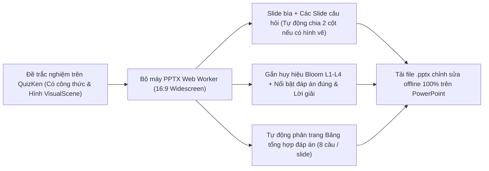

> **Tóm tắt nhanh (TL;DR):** Sau mỗi kỳ kiểm tra, giáo viên thường mất từ 2–3 tiếng để copy từng câu hỏi từ file đề sang Microsoft PowerPoint nhằm trình chiếu chữa bài trên lớp. Năm 2026, các **website chuyển đề trắc nghiệm sang slide PowerPoint (`.pptx`) tự động** như **QuizKen**, **ClassPoint AI**, **Gamma App**, **Canva**, **SlidesAI**, **Curipod** và **AhaSlides** đã giúp biến một bộ đề 40 câu kèm hình minh họa thành file `.pptx` tỉ lệ 16:9 chuẩn chỉnh chỉ trong 5 giây.

---

# Top 7 Web Chuyển Đề Trắc Nghiệm Sang Slide PowerPoint (PPTX) 2026

Trình chiếu đề thi lên màn hình máy chiếu hoặc tivi thông minh để chữa bài tập là hoạt động diễn ra hàng ngày tại các trường THCS, THPT và trung tâm luyện thi. Tuy nhiên, nếu chiếu trực tiếp file Word hoặc file PDF chữ nhỏ lên màn chiếu, học sinh ngồi ở các bàn cuối lớp rất khó theo dõi. Ngược lại, nếu giáo viên tự thiết kế bộ slide PowerPoint 40–50 câu hỏi bằng tay thì lại gặp 3 rào cản lớn:
1. **Tốn quá nhiều thời gian copy-paste:** Mỗi câu hỏi phải tạo 1 slide mới, dán đề bài, dán 4 đáp án A, B, C, D, tô màu đáp án đúng và thêm hộp lời giải.
2. **Vỡ công thức Toán/Lý/Hóa và thiếu hình vẽ:** Khi copy công thức LaTeX sang PowerPoint thường hiện nguyên mã `$...$` hoặc mất hình minh họa.
3. **Bảng tổng hợp đáp án cuối bài bị tràn slide:** Với đề thi từ 20–50 câu, nếu nhồi toàn bộ đáp án vào 1 slide tổng kết duy nhất thì chữ sẽ nhỏ li ti hoặc tràn ra ngoài khung 16:9.

Dưới đây là bảng xếp hạng **Top 7 website chuyển đề trắc nghiệm sang slide PowerPoint (`.pptx`) tốt nhất năm 2026**.

---

## Bảng So Sánh 7 Web Chuyển Đề Trắc Nghiệm Sang Slide PowerPoint (2026)

| Nền tảng | Tải file `.pptx` chuẩn về máy | Tự động chia 2 cột cho câu có hình vẽ | Làm sạch công thức Toán LaTeX | Phân trang bảng đáp án tổng kết | Chi phí |
| :--- | :--- | :--- | :--- | :--- | :--- |
| **1. QuizKen** | **Có (1-Click trực tiếp)** | **Có (Nhúng PNG `VisualScene`)** | **Có (`formatPdfText`)** | **Tự động 8 câu / slide** | **Miễn phí 100%** |
| **2. ClassPoint AI** | Hoạt động trong PowerPoint | Thủ công | Theo PowerPoint gốc | Không tự tạo bảng tổng kết | Miễn phí / Pro |
| **3. Gamma App** | Có xuất PPTX | Bố cục thẻ linh hoạt | Hạn chế công thức sâu | Không chuyên về đề thi | Giới hạn Credit Free |
| **4. Canva for Education** | Có tải PPTX | Kéo thả thủ công | Công thức cơ bản | Thủ công | Miễn phí cho Edu |
| **5. SlidesAI.io** | Xuất từ Google Slides | Cơ bản | Không hỗ trợ tốt LaTeX | Không | Giới hạn 3 bài/tháng |
| **6. Curipod** | Chủ yếu trình chiếu Web | Có hình AI minh họa | Cơ bản | Không | Miễn phí / School |
| **7. AhaSlides** | Nhập/Xuất PPTX giới hạn | Cơ bản | Hạn chế | Hiển thị bảng xếp hạng | Giới hạn số người Free |

---

## Đánh Giá Chi Tiết Top 7 Web Chuyển Đề Trắc Nghiệm Sang Slide PowerPoint

### 1. QuizKen — Xuất file `.pptx` 16:9 thông minh kèm hình vẽ `VisualScene` và nhãn Bloom

**QuizKen** là nền tảng duy nhất hiện nay trang bị bộ máy **`pptx.worker.ts`** chuyên biệt cho cấu trúc đề thi Việt Nam, cho phép chuyển đổi tức thì bất kỳ đề trắc nghiệm nào thành file `.pptx` hoàn chỉnh ngay trên trình duyệt.

* **5 nâng cấp đột phá của trình xuất PowerPoint trên QuizKen:**
  1. **Tự động nhận diện bố cục 1 cột hoặc 2 cột:** Với câu hỏi chữ thông thường, các phương án A, B, C, D được trải rộng toàn màn hình 16:9 với cỡ chữ lớn dễ đọc từ cuối lớp. Khi câu hỏi có hình minh họa **`VisualScene`** (hình học, đồ thị, mạch điện), slide tự động chuyển sang **bố cục 2 cột**: cột trái chứa đề bài và 4 phương án, cột phải đóng khung hình vẽ PNG độ phân giải cao.
  2. **Chuẩn hóa công thức Toán – Lý – Hóa (`formatPdfText`):** Tự động chuyển đổi mã LaTeX/KaTeX sang ký hiệu toán học Unicode sạch đẹp (`√`, `∫`, `⇒`, `≠`, `x²`, `H₂SO₄`) và loại bỏ triệt để lỗi lặp nhãn `A. A.` trên slide.
  3. **Huy hiệu mức độ nhận thức Bloom (`L1–L4`):** Góc trên mỗi slide câu hỏi tự động gắn badge màu sắc phân biệt câu *Nhận biết (L1)*, *Thông hiểu (L2)*, *Vận dụng (L3)* và *Vận dụng cao (L4)*.
  4. **Đánh dấu đáp án đúng & Hộp lời giải trên Slide:** Phương án đúng được tô nền xanh lục nổi bật kèm hộp giải thích chi tiết ở chân slide để giáo viên giảng giải trực quan.
  5. **Phân trang bảng tổng hợp đáp án thông minh:** Ở cuối bài thuyết trình, hệ thống tự động tạo các slide **"Tổng Hợp Kết Quả & Đáp Án"**, tự động ngắt mỗi slide tối đa **8 dòng câu hỏi** (`Trang 1/3`, `Trang 2/3`...) để bảng không bao giờ bị tràn khung.
* **Ưu điểm:** File tải về là file `.pptx` gốc 100%, thầy cô có thể mở bằng Microsoft PowerPoint, Google Slides hoặc Keynote để thêm hiệu ứng chuyển cảnh hoặc chỉnh sửa tùy ý khi không có mạng Internet.
* **Nhược điểm:** Hiệu ứng xuất hiện từng bước (animation click) mặc định để ở chế độ tĩnh để giáo viên chủ động tùy biến nếu cần.
* **Chi phí:** Hoàn toàn miễn phí.

👉 **Tải ngay Slide bài giảng của bạn:** [Tạo đề trắc nghiệm và xuất file PowerPoint PPTX trên QuizKen](https://app.quizken.com).

---

### 2. ClassPoint AI — Add-in biến slide PowerPoint có sẵn thành câu hỏi tương tác

**ClassPoint** là công cụ gắn trực tiếp vào thanh Ribbon của phần mềm Microsoft PowerPoint trên máy tính Windows.

* **Ưu điểm:**
  * Cho phép giáo viên dùng AI đọc nội dung slide bài giảng đang mở và sinh câu hỏi trắc nghiệm theo thang Bloom ngay trong PowerPoint.
  * Tích hợp bảng xếp hạng sao và thu thập câu trả lời trực tiếp của học sinh.
* **Nhược điểm:**
  * Yêu cầu cài đặt phần mềm lên máy tính Windows (hạn chế trên MacBook/Linux/Web); chiều chuyển đổi là từ *Slide bài giảng sang câu hỏi lẻ*, chứ không phải chuyển một *Đề thi 40 câu thành bộ Slide chữa đề chuẩn*.
* **Chi phí:** Bản miễn phí giới hạn 5 câu hỏi/file và tối đa 25 học sinh.

---

### 3. Gamma App — Công cụ AI thiết kế slide thuyết trình hiện đại từ văn bản

**Gamma** gây ấn tượng mạnh nhờ khả năng tạo bộ slide bài giảng đa phương tiện cực đẹp từ một đoạn dàn ý văn bản.

* **Ưu điểm:**
  * Bố cục thẻ (cards) hiện đại, tự động chọn bảng màu, icon và hình ảnh minh họa thẩm mỹ cao; hỗ trợ xuất ra file `.pptx` và `.pdf`.
* **Nhược điểm:**
  * Gamma được tối ưu cho bài thuyết trình lý thuyết (lecture slides) hơn là cấu trúc đề kiểm tra trắc nghiệm 4 phương án A/B/C/D kèm bảng đáp án cuối bài.
* **Chi phí:** Tặng 400 credits khi đăng ký mới; hết credits cần nâng cấp gói Plus/Pro.

---

### 4. Canva for Education — Kho mẫu slide trò chơi trắc nghiệm bắt mắt

**Canva** cung cấp hàng trăm mẫu slide kiểu *Ai là triệu phú*, *Rung chuông vàng* hoặc *Hái hoa dân chủ* cho giáo viên.

* **Ưu điểm:**
  * Đồ họa rực rỡ, hiệu ứng chuyển động mượt mà và cho phép tải xuống dưới định dạng Microsoft PowerPoint (`.pptx`).
* **Nhược điểm:**
  * Giáo viên phải tự tay dán từng câu hỏi và từng phương án A, B, C, D vào từng slide mẫu, rất mất thời gian nếu đề thi có từ 30–50 câu.
* **Chi phí:** Miễn phí cho giáo viên có email `.edu`.

---

### 5. SlidesAI.io — Tiện ích mở rộng tạo slide tự động trên Google Slides

**SlidesAI** hoạt động như một Add-on bên trong hệ sinh thái Google Workspace.

* **Ưu điểm:**
  * Tiện lợi cho các trường học sử dụng Google Slides làm công cụ soạn giảng chính; chuyển đổi nhanh văn bản ghi chú thành các slide tóm tắt.
* **Nhược điểm:**
  * Chưa có mẫu slide chuyên dụng cho đề thi trắc nghiệm Toán – Lý – Hóa; bản miễn phí chỉ cho phép tạo 3 bài thuyết trình mỗi tháng.
* **Chi phí:** Freemium (3 bài/tháng miễn phí).

---

### 6. Curipod — Tạo bài giảng tương tác kèm câu hỏi khảo sát bằng AI

**Curipod** giúp giáo viên nhập chủ đề bài học để sinh ra chuỗi slide kết hợp giữa lý thuyết, bình chọn (poll), vẽ hình và trắc nghiệm.

* **Ưu điểm:**
  * Khuyến khích học sinh tham gia thảo luận sôi nổi trên lớp qua thiết bị cá nhân.
* **Nhược điểm:**
  * Hoạt động chủ yếu trên trình duyệt web của Curipod, hạn chế khả năng xuất ra file `.pptx` độc lập để dạy offline tại các phòng học không có Wi-Fi ổn định.
* **Chi phí:** Miễn phí cơ bản / Gói trả phí theo trường.

---

### 7. AhaSlides — Nền tảng trình chiếu kết hợp đố vui thời gian thực

**AhaSlides** là công cụ trình chiếu tương tác rất phổ biến tại Việt Nam cho các buổi sinh hoạt lớp và ôn tập cuối tuần.

* **Ưu điểm:**
  * Có vòng quay may mắn, bảng xếp hạng điểm số trực tiếp và giao diện tiếng Việt thân thiện.
* **Nhược điểm:**
  * Bản miễn phí giới hạn số lượng người tham gia trực tiếp rất thấp; không chuyên về xuất file `.pptx` chữa đề thi 40–50 câu có hình vẽ toán học như QuizKen.
* **Chi phí:** Có gói miễn phí giới hạn và gói Edu trả phí.

---

## Quy Trình 15 Giây Xuất Đề Thi Ra Slide PowerPoint Trên QuizKen

1. Mở bất kỳ đề thi nào bạn vừa tạo hoặc chọn từ [Thư viện đề thi QuizKen](https://app.quizken.com/quiz/library).
2. Trên thanh công cụ phía trên đề thi, nhấn nút **PPTX (Xuất PowerPoint)**.
3. Hệ thống tự động kết xuất hình vẽ `VisualScene`, chuẩn hóa công thức Toán học, gắn nhãn Bloom `L1–L4` và tải ngay file `[Tên_Đề_Thi].pptx` về máy tính để thầy cô mở bằng PowerPoint trình chiếu ngay trên lớp!

---

## Câu hỏi thường gặp (FAQ)

### 1. File PowerPoint (.pptx) tải từ QuizKen về có chỉnh sửa được chữ và màu sắc không?
Hoàn toàn chỉnh sửa được 100%. File `.pptx` của QuizKen được tạo bằng các khối văn bản, bảng biểu và hình ảnh gốc của chuẩn OpenXML PowerPoint (chứ không phải chụp ảnh cả slide), nên thầy cô có thể sửa chữ, đổi font, thêm logo trường hoặc chèn hiệu ứng Animation tùy thích.

### 2. Nếu đề thi có 40 câu hỏi thì bảng tổng hợp đáp án ở cuối file PowerPoint có bị tràn chữ không?
Không. Bộ xuất PPTX mới của QuizKen tự động chia bảng tổng hợp đáp án thành các trang slide nối tiếp nhau với định mức **8 câu hỏi mỗi slide** (kèm tiêu đề đánh số `Trang 1/5`, `Trang 2/5`...), đảm bảo chữ luôn to, rõ ràng khi chiếu trên màn hình lớn.

### 3. Câu hỏi có hình vẽ đồ thị hoặc hình học sẽ hiển thị như thế nào trên slide PowerPoint?
Khi phát hiện câu hỏi có dữ liệu hình minh họa `VisualScene`, QuizKen tự động chuyển slide đó sang **layout 2 cột thông minh**: cột bên trái hiển thị nội dung câu hỏi và 4 đáp án, cột bên phải hiển thị khung hình vẽ sắc nét để học sinh vừa đọc đề vừa quan sát hình dễ dàng.
