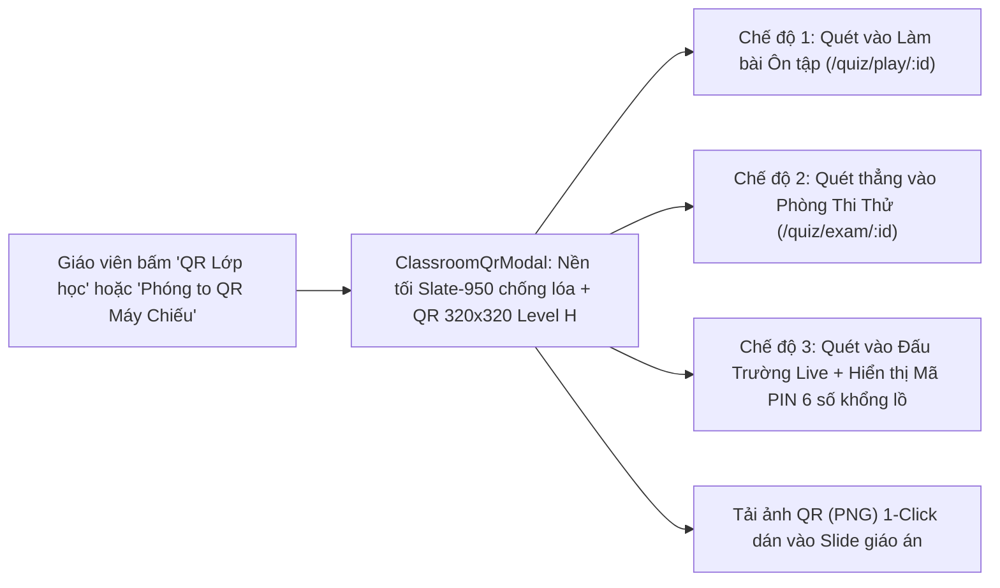

> **Tóm tắt nhanh (TL;DR):** Trong một lớp học 40–45 học sinh, nếu bắt cả lớp tự gõ một đường link dài ngoằng vào trình duyệt điện thoại sẽ mất ít nhất 5–10 phút đầu giờ vì học sinh gõ sai ký tự. Năm 2026, **Top 7 website tích hợp Chế độ Mã QR Máy Chiếu Lớp Học (Classroom Projector QR)** gồm **QuizKen**, **Mentimeter**, **Slido**, **AhaSlides**, **Kahoot!**, **Padlet** và **Wayground (Quizizz)** đã giúp giáo viên phóng to mã QR độ tương phản cao lên màn chiếu để cả lớp quét camera vào bài chỉ trong 2 giây.

---

# Top 7 Web Tạo Mã QR Chiếu Lên Bảng Cho Học Sinh Quét Vào Làm Bài 2026

Tại các phòng học phổ thông và giảng đường đại học hiện nay, khoảng cách từ màn hình máy chiếu (hoặc tivi trên bục giảng) xuống bàn cuối lớp thường dài từ **7 đến 12 mét**. Khi giáo viên sử dụng các hộp thoại chia sẻ thông thường có mã QR kích thước nhỏ (chỉ khoảng `150×150 pixel`), học sinh ngồi từ bàn thứ 4 trở xuống không thể nào dùng camera điện thoại bắt nét được mã QR, dẫn đến cảnh cả lớp phải đứng dậy chen chúc lên gần bục giảng để quét mã.

Một công cụ **Mã QR Máy Chiếu Lớp Học (Classroom Projector QR)** đạt chuẩn sư phạm năm 2026 phải đáp ứng 4 tiêu chí kỹ thuật:
1. **Kích thước QR cực lớn (`320×320 pixel` trở lên) & Mức sửa lỗi cao (`Level H - 30%`):** Đặt trên thẻ nền trắng tinh khiết bao quanh bởi giao diện nền tối (`Slate-950`) để chống lóa đèn neon phòng học, giúp điện thoại ở bàn cuối lớp zoom 2x là nhận diện được ngay.
2. **Chuyển đổi 1-Click giữa chế độ Ôn tập và Phòng Thi Thử:** Giáo viên có thể đổi mục tiêu của mã QR ngay trên màn chiếu mà không cần tắt hộp thoại.
3. **Hiển thị song song Mã PIN 6 số cỡ lớn (khi mở Đấu trường Live):** Dự phòng cho những học sinh dùng laptop hoặc điện thoại hỏng camera.
4. **Tải được ảnh QR định dạng PNG sắc nét:** Để giáo viên chèn sẵn vào giáo án PowerPoint hoặc in dán lên bảng thông báo lớp.

Dưới đây là đánh giá chi tiết **Top 7 website tạo và chiếu Mã QR lớp học tốt nhất năm 2026**.

---

## Bảng So Sánh 7 Web Chiếu Mã QR Lớp Học Cho Học Sinh Quét Làm Bài (2026)

| Nền tảng | Chế độ Phóng to QR Máy Chiếu chuyên dụng | Chuyển đổi 1-Click giữa QR Ôn tập & QR Phòng Thi Thử | Tải ảnh QR (`.png`) trực tiếp | Kèm Mã PIN 6 số cho Đấu Trường Live | Chi phí |
| :--- | :--- | :--- | :--- | :--- | :--- |
| **1. QuizKen (`ClassroomQrModal`)** | **Có (`320×320 Level H`, nền chống lóa)** | **Có (`Làm bài Ôn tập` ⇄ `Phòng Thi Thử`)** | **Có (1-Click tải PNG)** | **Có (Chữ số `6xl` vàng nổi bật)** | **Miễn phí 100%** |
| **2. Mentimeter** | Có phóng to QR trên slide | Không có Phòng Thi Thử riêng | Có tải QR | Có mã số Menti | Giới hạn 2 câu ở bản Free |
| **3. Slido** | Có QR cố định góc màn hình | Chủ yếu cho Hỏi đáp & Poll | Có tải QR | Có mã sự kiện | Giới hạn 3 poll ở bản Free |
| **4. AhaSlides** | Có phóng to QR sảnh chờ | Không có chế độ thi chống gian lận | Có | Có mã phòng | Giới hạn người chơi Free |
| **5. Kahoot!** | Có QR ở sảnh chờ Live Game | Không tạo QR trực tiếp cho bài thi nghiêm ngặt | Không tải PNG lẻ | Có Game PIN | Giới hạn người chơi Free |
| **6. Wayground (Quizizz)** | Có QR sảnh chờ & Paper Mode | Phải tạo 2 phiên giao bài riêng biệt | Có | Có Join Code | Giới hạn tính năng Pro |
| **7. Padlet** | Có QR chia sẻ bảng ghim | Không phải hệ thống thi trắc nghiệm | Có tải QR | Không | Giới hạn 3 bảng ở bản Free |

---

## Đánh Giá Chi Tiết Top 7 Web Chiếu Mã QR Lớp Học Cho Học Sinh

### 1. QuizKen — Hệ thống `ClassroomQrModal` chuyên dụng cho máy chiếu lớp học Việt Nam

Trong bản cập nhật **Hướng C (Bộ Công Cụ Lớp Học Cho Giáo Viên)** năm 2026, **QuizKen** ra mắt hộp thoại **`ClassroomQrModal.tsx`** được thiết kế riêng cho khoảng cách nhìn xa của phòng học phổ thông và giảng đường.

* **4 tính năng thực chiến dành cho giáo viên trên bục giảng:**
  1. **Mở 1-Click từ mọi nơi:** Giáo viên có thể bật màn hình QR Máy Chiếu ngay từ thanh công cụ **Đề đã tạo trên Dashboard** (nút `"QR Lớp học"`), từ hộp thoại **Chia sẻ đề (`ShareDialog`)** hoặc ngay tại **Sảnh chờ Đấu Trường Live (`HostActionCard`)**.
  2. **Thanh chuyển đổi chế độ tức thì (`Làm bài Ôn tập` ⇄ `Phòng Thi Thử`):** Ngay trên màn hình máy chiếu, nếu giáo viên muốn học sinh tự luyện có xem giải thích thì bấm tab **`Làm bài Ôn tập`** (`/quiz/play/:id`); nếu muốn kiểm tra 15 phút có đồng hồ đếm ngược, trộn câu hỏi và cảnh báo chuyển tab thì bấm ngay tab **`Phòng Thi Thử`** (`/quiz/exam/:id`). Mã QR trên màn chiếu sẽ tự động cập nhật trong 0,1 giây!
  3. **Kết hợp QR `320×320` + Mã PIN 6 số khổng lồ cho Live Game:** Khi mở từ phòng Host Live Game, màn hình tự động chia thành 2 cột: bên trái là Mã QR trắng sắc nét, bên phải là khung **MÃ PIN PHÒNG THI** chữ vàng cỡ lớn (`text-6xl font-mono`) để học sinh dùng máy tính cũng nhập mã vào ngay được.
  4. **Nút `"Tải ảnh QR (PNG)"`:** Cho phép tải ngay file ảnh `quizken-qr-[ten-de].png` chất lượng cao về máy tính để gửi vào nhóm Zalo phụ huynh/học sinh hoặc dán vào bài giảng PowerPoint.
* **Ưu điểm:** Miễn phí 100%, không giới hạn số lượng học sinh quét mã cùng lúc, không cần đăng ký gói trả phí để mở tính năng QR.
* **Nhược điểm:** Yêu cầu học sinh có thiết bị có kết nối mạng để mở đường dẫn sau khi quét mã.
* **Chi phí:** Hoàn toàn miễn phí.

👉 **Trải nghiệm ngay:** [Mở chế độ QR Máy Chiếu Lớp Học trên QuizKen](https://app.quizken.com).

---

### 2. Mentimeter — Trình chiếu QR Code thanh lịch cho hội thảo & giảng đường

**Mentimeter** là một trong những nền tảng đầu tiên phổ biến việc đặt mã QR lên slide thuyết trình.

* **Ưu điểm:**
  * Giao diện phóng to mã QR rất đẹp và rõ nét; khán giả quét mã vào bình chọn ngay mà không cần đăng nhập.
* **Nhược điểm:**
  * Bản miễn phí chỉ cho phép tạo tối đa 2 slide câu hỏi khảo sát hoặc 5 câu quiz, không thể dùng để tổ chức một bài kiểm tra 15 phút hay 45 phút đầy đủ cho lớp học.
* **Chi phí:** Giới hạn 2–5 câu ở bản Free; gói Pro trả phí theo tháng.

---

### 3. Slido — Công cụ QR chuyên cho phiên Hỏi & Đáp (Q&A) và Bình chọn

**Slido** (thuộc Cisco) thường được tích hợp vào các buổi giảng trực tuyến trên Webex, Zoom hoặc hội trường lớn.

* **Ưu điểm:**
  * Mã QR luôn hiển thị cố định ở góc màn hình trong suốt buổi thuyết trình để sinh viên gửi câu hỏi thắc mắc lên cho giảng viên.
* **Nhược điểm:**
  * Thiên về thu thập câu hỏi hội thảo (Q&A) và bình chọn ý kiến ngắn (Polls) hơn là hệ thống đề thi trắc nghiệm học thuật có công thức Toán – Lý – Hóa và lời giải chi tiết.
* **Chi phí:** Bản Basic miễn phí chỉ cho tối đa 3 polls mỗi sự kiện.

---

### 4. AhaSlides — Quét QR vào phòng đố vui và vòng quay may mắn

**AhaSlides** cung cấp mã QR tiện lợi ở đầu mỗi slide tương tác.

* **Ưu điểm:**
  * Học sinh quét QR vào nhanh, có thể đặt biệt danh và chọn avatar vui nhộn trước khi bước vào vòng đố vui.
* **Nhược điểm:**
  * Giới hạn số lượng người tham gia trực tiếp khá thấp ở gói miễn phí; không có tính năng chuyển mã QR sang chế độ **Phòng Thi Thử chống gian lận** như QuizKen.
* **Chi phí:** Freemium.

---

### 5. Kahoot! — Quét QR tại sảnh chờ Game Show

Trên **Kahoot!**, khi giáo viên mở sảnh chờ (Lobby), học sinh có thể bấm vào biểu tượng phóng to mã QR ở góc phải màn hình.

* **Ưu điểm:**
  * Tốc độ kết nối vào sảnh chờ game nhanh, âm nhạc sôi động.
* **Nhược điểm:**
  * Mã QR của Kahoot chỉ có hiệu lực tạm thời cho phiên live game đang mở lúc đó; giáo viên không thể tải một mã QR cố định của bộ đề về dán vào tờ đề cương hay chiếu cho học sinh vào làm bài tự luyện / thi thử bất cứ lúc nào như trên QuizKen.
* **Chi phí:** Trả phí cao cho các gói giáo viên mở rộng số lượng người chơi.

---

### 6. Wayground (Quizizz) — QR tham gia phòng thi & Chế độ Thẻ giấy QR (Paper Mode)

**Wayground** vừa hỗ trợ mã QR tham gia phòng trực tuyến vừa có chế độ *Paper Mode* dùng thẻ giấy in mã QR A, B, C, D.

* **Ưu điểm:**
  * Linh hoạt cho cả lớp học có thiết bị lẫn lớp học không có thiết bị.
* **Nhược điểm:**
  * Để đổi từ chế độ làm bài tập thông thường sang chế độ kiểm tra nghiêm ngặt (Test Mode), giáo viên phải thoát ra tạo lại một phiên giao bài mới với mã code mới, không thể chuyển đổi 1-click ngay trên cùng một cửa sổ QR Máy Chiếu như `ClassroomQrModal` của QuizKen.
* **Chi phí:** Giới hạn một số chế độ kiểm tra ở gói trả phí.

---

### 7. Padlet — Quét QR để nộp bài viết hoặc hình ảnh lên bảng chung

**Padlet** cho phép giáo viên xuất mã QR của một bức tường ảo (Wall) để học sinh quét và đăng sản phẩm nhóm.

* **Ưu điểm:**
  * Rất tốt cho hoạt động thu thập bài viết ngắn, tranh vẽ hoặc ý tưởng thảo luận nhóm.
* **Nhược điểm:**
  * Không phải nền tảng chấm điểm trắc nghiệm tự động hay phòng thi đếm ngược.
* **Chi phí:** Bản miễn phí giới hạn tối đa 3 bảng Padlet.

---

## Câu hỏi thường gặp (FAQ)

### 1. Vì sao Mã QR trong chế độ Máy Chiếu của QuizKen lại dùng mức sửa lỗi Level H?
Trong chuẩn mã vạch QR quốc tế, **Level H (High Error Correction)** là mức khôi phục dữ liệu cao nhất (cho phép đọc chính xác ngay cả khi tới 30% diện tích mã bị che khuất bởi logo ở tâm hoặc bị bóng đèn phòng học phản chiếu lên màn chiếu). Nhờ đó, camera điện thoại của học sinh ở cuối lớp có thể bắt nét tức thì mà không bị lỗi.

### 2. Khi tôi bấm chuyển từ "Làm bài Ôn tập" sang "Phòng Thi Thử" trên cửa sổ QR Máy Chiếu thì điều gì xảy ra?
Hàm `buildClassroomShareUrl` của QuizKen sẽ tự động chuyển đường dẫn đích bên trong Mã QR từ `/quiz/play/:quizId` sang `/quiz/exam/:quizId`. Học sinh quét mã sẽ được đưa thẳng vào **Sảnh Chuẩn Bị Thi Nghiêm Ngặt (`ExamEntry`)** có đồng hồ đếm ngược, trộn câu hỏi/đáp án và giám sát chuyển tab.

### 3. Tôi có thể tải ảnh Mã QR về để chèn vào slide PowerPoint soạn sẵn ở nhà không?
Có. Ngay góc dưới cửa sổ **Chế độ Máy Chiếu Lớp Học**, thầy cô chỉ cần nhấn nút **"Tải ảnh QR (PNG)"**. Hệ thống sẽ xuất ngay một file ảnh PNG độ phân giải cao chứa mã QR kèm logo ở tâm để thầy cô dán trực tiếp vào slide bài giảng của mình.
