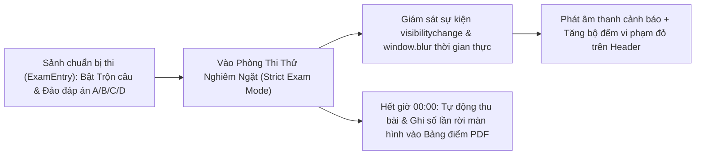

> **Tóm tắt nhanh (TL;DR):** Khi tổ chức thi thử hoặc kiểm tra trực tuyến trên trình duyệt, tình trạng học sinh mở tab mới để tra cứu Google, ChatGPT hoặc nhắn tin hỏi bài qua Zalo là nỗi lo lớn nhất của giáo viên. Năm 2026, **Top 7 website thi thử trắc nghiệm online có cảnh báo chuyển tab và giám sát rời màn hình** gồm **QuizKen (Strict Exam Mode)**, **Azota**, **Exam.net**, **Quilgo (Google Forms)**, **Safe Exam Browser**, **ClassMarker** và **Testportal** đã giúp đảm bảo tính công bằng và liêm chính học thuật mà không bắt buộc cài đặt phần mềm nặng nề.

---

# Top 7 Web Thi Thử Trắc Nghiệm Online Có Cảnh Báo Chuyển Tab 2026

Theo định hướng tăng cường liêm chính học thuật và ứng dụng công nghệ số trong kiểm tra đánh giá tại các trường phổ thông và đại học năm 2026, một nền tảng thi thử trực tuyến đáng tin cậy phải giải quyết được 3 lỗ hổng gian lận phổ biến nhất:
1. **Chuyển tab trình duyệt hoặc thu nhỏ cửa sổ (`Tab Switching / Window Blur`):** Học sinh chuyển sang tab tìm kiếm hoặc ứng dụng chat để tra đáp án.
2. **Nhìn bài và đọc đáp án theo số thứ tự (`1A, 2C, 3D`):** Khi hai học sinh ngồi cạnh nhau nhận được bộ câu hỏi và thứ tự đáp án giống hệt nhau.
3. **Làm quá thời gian quy định:** Hệ thống không tự động thu bài khi đồng hồ đếm ngược kết thúc.

Dưới đây là đánh giá chi tiết **Top 7 website thi thử trắc nghiệm online có tính năng cảnh báo chuyển tab và chống gian lận hiệu quả nhất năm 2026**.

---

## Bảng So Sánh 7 Web Thi Thử Trắc Nghiệm Có Giám Sát Chuyển Tab (2026)

| Nền tảng | Phát hiện chuyển Tab & Rời cửa sổ | Âm thanh cảnh báo & Ghi biên bản kết quả | Trộn câu hỏi & Đảo đáp án A/B/C/D | Cần cài đặt phần mềm riêng | Chi phí |
| :--- | :--- | :--- | :--- | :--- | :--- |
| **1. QuizKen (Exam Mode Pro)** | **Có (`visibilitychange` + `blur`)** | **Có (Còi cảnh báo + Ghi vào Scorecard & PDF)** | **Có (1-Click tại Sảnh vào thi)** | **Không (Chạy 100% trên Web)** | **Miễn phí 100%** |
| **2. Azota** | Có giám sát thoát màn hình | Có thống kê lượt thoát trên bảng điểm | Có trộn đề | Không | Miễn phí / VIP |
| **3. Exam.net** | Rất mạnh (Chế độ khóa cao) | Có báo trực tiếp cho giám thị | Có | Tùy mức độ bảo mật | Dùng thử 60 ngày / Trả phí |
| **4. Quilgo (Google Forms)** | Có theo dõi tab & chụp camera | Có trong báo cáo Quilgo | Hạn chế đảo đáp án có nhãn | Cần cài Add-on Google Forms | Giới hạn 50 bài ở bản Free |
| **5. Safe Exam Browser (SEB)** | Khóa cứng toàn bộ hệ điều hành | Không cho chuyển ứng dụng | Phụ thuộc Moodle/Canvas | Bắt buộc cài phần mềm `.exe/.dmg` | Miễn phí (Mã nguồn mở) |
| **6. Testportal** | Có tính năng Honest Respondent | Tự động kết thúc nếu quá số lần | Có trộn câu hỏi | Không | Giới hạn ở bản Free |
| **7. ClassMarker** | Cơ bản | Ghi nhận thời gian làm bài | Có trộn câu | Không | Trả phí cho giáo dục |

---

## Đánh Giá Chi Tiết Top 7 Web Thi Thử Trắc Nghiệm Có Cảnh Báo Chuyển Tab

### 1. QuizKen (`ExamEntry` & `ExamModePage`) — Phòng Thi Thử Nghiêm Ngặt Chuẩn Quốc Gia

Trong đợt nâng cấp toàn diện **Hướng A (Exam Mode Pro)** năm 2026, **QuizKen** đã biến đường dẫn `/quiz/exam/:quizId` thành một tổ hợp **Sảnh Chuẩn Bị Thi & Phòng Thi Thử Chuyên Nghiệp** hoạt động mượt mà trên mọi trình duyệt máy tính và điện thoại.

* **Cơ chế chống gian lận 4 lớp trên QuizKen:**
  1. **Sảnh chuẩn bị và phổ biến quy chế (`ExamEntry.tsx`):** Trước khi đồng hồ bắt đầu chạy, thí sinh được phổ biến rõ quy chế giám sát phòng thi, chọn mốc thời gian (`Tự động 1p/câu`, `15p`, `30p`, `45p`, `60p`, `90p`) và bật công tắc **Trộn ngẫu nhiên thứ tự câu hỏi** + **Trộn ngẫu nhiên đáp án A/B/C/D**.
  2. **Giám sát rời màn hình kép (`visibilitychange` & `window.blur`):** Ngay khi thí sinh chuyển sang tab khác, bấm `Alt + Tab`, mở cửa sổ nổi hoặc thoát ra màn hình chính điện thoại, hệ thống lập tức phát **âm thanh cảnh báo (`play("alert")`)**, bật thông báo đỏ *"Cảnh báo vi phạm phòng thi!"* và tăng bộ đếm vi phạm nhấp nháy ngay trên thanh Header cố định.
  3. **Khóa toàn bộ gợi ý & lời giải trong lúc thi:** Khác với chế độ Ôn tập, trong Phòng Thi Thử mọi lời giải thích và phản hồi đúng/sai từng câu đều bị khóa hoàn toàn cho tới khi thí sinh xác nhận nộp bài hoặc đồng hồ đếm ngược về `00:00`.
  4. **Ghi biên bản vi phạm vào Bảng điểm (`ExamScoreCard`):** Sau khi nộp bài, ô thống kê **"Rời màn hình: X lần"** được đóng khung màu đỏ nổi bật trên Bảng điểm và lưu vào lịch sử thi thử cá nhân (`examHistoryService`).
* **Ưu điểm:** Không bắt học sinh phải cài phần mềm khóa máy phức tạp dễ gây treo máy; giáo viên có thể chiếu thẳng **Mã QR Phòng Thi Thử** qua `ClassroomQrModal` cho cả lớp quét vào thi ngay.
* **Nhược điểm:** Không tự động bật webcam quay mặt học sinh để bảo vệ quyền riêng tư trên thiết bị cá nhân.
* **Chi phí:** Hoàn toàn miễn phí.

👉 **Trải nghiệm ngay:** [Bước vào Phòng Thi Thử Nghiêm Ngặt trên QuizKen](https://app.quizken.com).

---

### 2. Azota — Nền tảng giao bài kiểm tra có thống kê lượt thoát màn hình

**Azota** là công cụ quen thuộc tại nhiều trường phổ thông Việt Nam khi giáo viên cần giao bài kiểm tra trực tuyến từ nhà.

* **Ưu điểm:**
  * Trong bảng thống kê kết quả của giáo viên, Azota hiển thị rõ số lần học sinh chuyển tab và số lần thoát khỏi màn hình trình duyệt.
* **Nhược điểm:**
  * Học sinh tự luyện thi thử một mình ít có các tùy chọn tự cấu hình mốc thời gian linh hoạt (15/30/45/60/90 phút), bộ lọc câu gắn cờ `🚩` và xuất PDF bảng điểm kèm lời giải ngay tại sảnh như QuizKen.
* **Chi phí:** Miễn phí cơ bản / Gói VIP trả phí.

---

### 3. Exam.net — Hệ thống khảo thí trực tuyến chuyên nghiệp từ Thụy Điển

**Exam.net** được xây dựng chuyên biệt cho các kỳ thi chính thức tại các trường trung học và đại học châu Âu.

* **Ưu điểm:**
  * Khi học sinh rời khỏi cửa sổ làm bài, màn hình của học sinh đó sẽ lập tức bị khóa lại và yêu cầu học sinh nhập giải trình lý do để giám thị bấm mở khóa từ xa.
* **Nhược điểm:**
  * Chỉ cho phép dùng thử miễn phí trong 60 ngày, sau đó nhà trường phải mua gói bản quyền toàn trường với chi phí khá cao.
* **Chi phí:** Thu phí bản quyền theo trường học.

---

### 4. Quilgo (trước đây là Timify.me) — Tiện ích bổ sung chống gian lận cho Google Forms

Mặc định **Google Forms** không hề có đồng hồ đếm ngược hay cảnh báo chuyển tab. Để khắc phục, nhiều giáo viên cài thêm tiện ích **Quilgo**.

* **Ưu điểm:**
  * Bổ sung đồng hồ đếm ngược, theo dõi trạng thái chuyển tab (Screen tracking) và chụp ảnh webcam định kỳ cho bài thi Google Forms.
* **Nhược điểm:**
  * Phải cấu hình qua lại giữa hai nền tảng Google Forms và bảng điều khiển Quilgo; bản miễn phí chỉ cho phép tổ chức tối đa **50 lượt làm bài (tests)** cho toàn bộ tài khoản.
* **Chi phí:** Giới hạn 50 lượt bài làm miễn phí; sau đó phải mua gói trả phí.

---

### 5. Safe Exam Browser (SEB) — Trình duyệt khóa cứng máy tính cho Moodle & Canvas

**Safe Exam Browser** là phần mềm mã nguồn mở thường dùng trong các phòng máy tính của các trường đại học lớn.

* **Ưu điểm:**
  * Biến máy tính thành một trạm thi khép kín: vô hiệu hóa hoàn toàn phím `Alt + Tab`, phím Windows, chuột phải, chụp màn hình và chặn mở mọi trang web khác.
* **Nhược điểm:**
  * Bắt buộc từng học sinh phải tải và cài đặt phần mềm SEB lên máy tính cá nhân kèm file cấu hình `.seb` phức tạp; không dùng được thuận tiện trên điện thoại Android phổ thông của học sinh.
* **Chi phí:** Miễn phí (nhưng yêu cầu máy chủ LMS Moodle/Canvas).

---

### 6. Testportal — Nền tảng kiểm tra có chế độ "Honest Respondent"

**Testportal** tích hợp công nghệ *Honest Respondent* để phát hiện hành vi rời khỏi tab trình duyệt.

* **Ưu điểm:**
  * Cho phép người ra đề thiết lập ngưỡng cảnh báo: ví dụ nếu thí sinh rời tab quá 3 lần thì bài thi tự động bị thu lại.
* **Nhược điểm:**
  * Giao diện quản trị bằng tiếng Anh và giới hạn số lượng bài kiểm tra/báo cáo chi tiết ở gói miễn phí.
* **Chi phí:** Freemium (Gói Pro/Max thu phí theo tháng).

---

### 7. ClassMarker — Kiểm tra trực tuyến bảo mật bằng mật khẩu

**ClassMarker** hướng tới việc kiểm tra nội bộ nhân sự và lớp học nhỏ.

* **Ưu điểm:**
  * Hỗ trợ đặt mật khẩu phòng thi, giới hạn số lần làm lại và giới hạn thời gian làm bài nghiêm ngặt.
* **Nhược điểm:**
  * Thiếu các tính năng hỗ trợ học tập thông minh sau khi nộp bài như **Tự động lưu câu sai vào Sổ tay câu sai** hay xuất **Tài liệu ôn tập PDF** có hình vẽ `VisualScene` như QuizKen.
* **Chi phí:** Trả phí cho tài khoản nâng cao.

---

## Hướng Dẫn Mở Phòng Thi Thử Chống Gian Lận Trong 3 Bước Trên QuizKen

1. **Bước 1:** Tại trang **Dashboard ➔ Đề đã tạo**, thầy cô nhấn nút **"Phòng Thi thử"** (hoặc bấm **"QR Lớp học"** rồi chọn tab **"Phòng Thi Thử"** để chiếu mã QR lên bảng).
2. **Bước 2:** Tại **Sảnh Chuẩn Bị Thi (`ExamEntry`)**, chọn thời gian làm bài (`15 phút`, `30 phút`, `45 phút`, `60 phút`, `90 phút`) và bật công tắc **Trộn thứ tự câu hỏi** + **Trộn đáp án A/B/C/D**.
3. **Bước 3:** Nhấn **"Bắt đầu tính giờ"**. Hệ thống kích hoạt đồng hồ đếm ngược, giám sát chuyển tab và tự động chấm điểm kèm bộ lọc xem lại chi tiết ngay khi nộp bài!

---

## Câu hỏi thường gặp (FAQ)

### 1. Khi học sinh vô tình chạm nhầm chuyển tab trong Phòng Thi Thử của QuizKen thì bài thi có bị hủy ngay không?
Để tránh gây oan cho học sinh khi lỡ tay chạm vào thông báo hệ thống hoặc mất kết nối thoáng qua, QuizKen không xóa bài thi ngay lập tức mà phát **âm thanh cảnh báo tức thì**, hiển thị băng rôn đỏ nhắc nhở và **ghi nhận chính xác tổng số lần rời màn hình** vào Bảng điểm cuối cùng (`ExamScoreCard`) để giáo viên đối chiếu.

### 2. Giáo viên làm thế nào để gửi thẳng link Phòng Thi Thử cho học sinh thay vì link Ôn tập thông thường?
Rất đơn giản! Trong cả hộp thoại **Chia sẻ (`ShareDialog`)** lẫn **Chế độ QR Máy Chiếu (`ClassroomQrModal`)** trên QuizKen đều có thanh chuyển đổi 2 chế độ: **"Làm bài Ôn tập"** (`/quiz/play/:id`) và **"Phòng Thi Thử"** (`/quiz/exam/:id`). Khi chọn **"Phòng Thi Thử"**, cả đường link sao chép lẫn Mã QR đều trỏ thẳng vào sảnh thi nghiêm ngặt.

### 3. Sau khi nộp bài trong Phòng Thi Thử, học sinh có thể lưu các câu làm sai để ôn lại không?
Có. Ngay tại Sảnh chuẩn bị thi (`ExamEntry`), chế độ **"Tự động lưu câu sai vào Sổ tay câu sai"** được bật mặc định (hoặc học sinh có thể bấm nút *"Lưu tất cả câu sai vào Sổ tay"* trên màn hình kết quả) để toàn bộ các câu trả lời sai được chuyển thẳng vào **Sổ Tay Câu Sai (`Mistake Notebook`)** phục vụ ôn tập.
