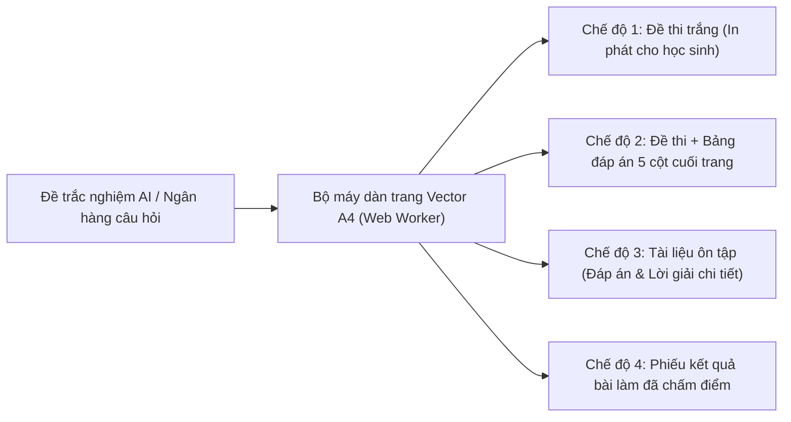

> **Tóm tắt nhanh (TL;DR):** Khi tổ chức kiểm tra trên giấy theo **Công văn 7991/BGDĐT-GDTrH** và Chương trình GDPT 2018, giáo viên thường mất hàng giờ căn chỉnh lề Word, sửa lỗi câu hỏi bị cắt đôi giữa hai trang A4 và tạo riêng bản đề trắng cho học sinh cùng bản đáp án cho giám thị. Năm 2026, các **web xuất đề thi trắc nghiệm ra PDF chuẩn khổ A4** thế hệ mới như **QuizKen**, **Azota**, **SmartTest** hay **Wayground (Quizizz)** đã tự động hóa toàn bộ khâu dàn trang, nhúng hình vẽ sắc nét và cung cấp tới 4 chế độ xuất file chuyên biệt chỉ trong 1 cú nhấp chuột.

---

# Top 7 Web Xuất Đề Thi Trắc Nghiệm Ra PDF Chuẩn Khổ A4 Đẹp Nhất 2026

Dù kiểm tra trực tuyến ngày càng phổ biến theo định hướng chuyển đổi số của **Quyết định 131/QĐ-TTg**, bài kiểm tra định kỳ trên giấy khổ A4 vẫn giữ vai trò cốt lõi tại hầu hết các trường THCS, THPT và trung tâm luyện thi tại Việt Nam. Tuy nhiên, việc biên soạn một đề thi 40–50 câu trên Microsoft Word rồi xuất sang PDF thủ công thường gây ra 4 phiền toái lớn:
* **Câu hỏi bị ngắt nửa chừng qua trang mới:** Đề bài nằm ở cuối trang 1 nhưng 4 đáp án A, B, C, D lại nhảy sang đầu trang 2, khiến học sinh dễ đọc nhầm.
* **Lãng phí giấy in:** Các đáp án ngắn (như số liệu Toán, công thức Hóa, từ vựng Tiếng Anh) nếu xếp dọc 4 dòng sẽ làm đề thi dài gấp đôi số trang cần thiết.
* **Phải lưu nhiều phiên bản file thủ công:** Giáo viên phải tự xóa đáp án để lưu 1 file phát cho học sinh, sau đó hoàn tác để lưu 1 file có bảng đáp án và lời giải phục vụ chấm bài.
* **Lỗi hiển thị ký hiệu Toán học và tiếng Việt có dấu:** Nhiều công cụ quốc tế làm vỡ dấu tiếng Việt hoặc biến ký hiệu `√`, `∫`, `⇒`, `∈` thành ô vuông khi xuất PDF.

Để giải quyết triệt để bài toán này, dưới đây là bảng xếp hạng **7 website xuất đề thi trắc nghiệm ra PDF chuẩn khổ A4 tốt nhất năm 2026**.

---

## Bảng So Sánh 7 Web Xuất Đề Thi Trắc Nghiệm Ra PDF Khổ A4 (2026)

| Nền tảng | Tùy chọn chế độ xuất PDF | Chống cắt ngang câu hỏi (`keepTogether`) | Dàn lưới 2x2 cho đáp án ngắn | Nhúng hình vẽ & công thức Toán | Chi phí |
| :--- | :--- | :--- | :--- | :--- | :--- |
| **1. QuizKen** | **4 chế độ chuyên biệt** | **Có (Tự động 100%)** | **Có (Tiết kiệm 35% giấy)** | **DejaVuSans Unicode + VisualScene PNG** | **Miễn phí 100%** |
| **2. Azota** | 2 chế độ (Đề + Đáp án) | Tốt (Qua file Word/PDF) | Phụ thuộc file Word gốc | Nhận diện tốt từ Word/PDF | Miễn phí / VIP |
| **3. SmartTest** | 2 chế độ (Word & PDF) | Khá | Có (Theo template Word) | Giữ nguyên MathType từ Word | Bản quyền trả phí |
| **4. Wayground (Quizizz)** | 2 chế độ (Worksheet) | Cơ bản | Không cố định | Hạn chế công thức phức tạp | Giới hạn ở bản Free |
| **5. Formative** | 1 chế độ (Print Quiz) | Cơ bản | Không | Hỗ trợ toán cơ bản | Trả phí gói Teacher |
| **6. Canva Docs / Quiz** | 1 chế độ (Thiết kế thủ công) | Thủ công | Thủ công | Kéo thả đồ họa đẹp | Miễn phí cho Edu |
| **7. Google Forms (In PDF)** | 1 chế độ (In trình duyệt) | Không (Hay cắt ngang câu) | Không (Tốn nhiều trang giấy) | Không hỗ trợ LaTeX gốc | Miễn phí |

---

## Đánh Giá Chi Tiết Top 7 Web Xuất Đề Thi Trắc Nghiệm Ra PDF Chuẩn A4

### 1. QuizKen — Hệ thống xuất PDF A4 4 chế độ thông minh chuẩn in ấn Việt Nam

**QuizKen** đứng đầu bảng xếp hạng năm 2026 nhờ kiến trúc xuất PDF vector chạy trực tiếp trên trình duyệt thông qua Web Worker, kết hợp bộ font **DejaVuSans Unicode** hỗ trợ trọn vẹn 100% tiếng Việt có dấu cùng toàn bộ tập ký hiệu Toán – Lý – Hóa – Sinh.

* **Tính năng nổi bật nhất (Nút Split Button 4 chế độ PDF):**
  1. **Đề thi trắng (In cho học sinh - `worksheet_no_key`):** Tự động đóng khung phần điền *Họ và tên, Lớp, Mã đề, Điểm số* ở đầu trang A4; ẩn toàn bộ đáp án đúng và lời giải để giáo viên in phát ngay tại phòng thi.
  2. **Đề thi + Bảng đáp án cuối trang (`worksheet_with_key`):** Giữ nguyên phần câu hỏi trắng cho học sinh làm bài, đồng thời bổ sung **Bảng đáp án tham chiếu (Reference Answer Key Grid) chia 5 cột** gọn gàng ở trang cuối cùng.
  3. **Tài liệu ôn tập (`study_guide`):** Đánh dấu nổi bật đáp án đúng kèm **Hộp giải thích chi tiết (Explanation Callout Box)** và huy hiệu phân loại mức độ nhận thức **Bloom L1–L4** ngay dưới từng câu hỏi.
  4. **Kết quả bài làm của tôi (`graded_review`):** Xuất biên bản chấm điểm cá nhân gồm Thẻ điểm tổng kết, thời gian hoàn thành, huy hiệu `[ĐÁP ÁN ĐÚNG]` màu xanh ngọc và `[BẠN CHỌN]` màu đỏ/xanh trực quan.
* **Ưu điểm vượt trội:**
  * Thuật toán **`keepTogether` thông minh**: Tự động tính toán chiều cao từng thẻ câu hỏi (bao gồm cả hình minh họa và hộp giải thích) để không bao giờ cắt đôi một câu hỏi giữa hai trang giấy.
  * **Lưới đáp án `2×2` tiết kiệm giấy:** Khi các phương án A, B, C, D ngắn gọn, hệ thống tự động dàn thành 2 cột × 2 hàng cân đối thay vì 4 dòng dọc, giúp tiết kiệm từ 30%–40% số trang in cho nhà trường.
  * Tự động kết xuất hình vẽ hình học, mạch điện, đồ thị hàm số (`VisualScene`) ở độ phân giải Retina sắc nét nhúng thẳng vào khung câu hỏi.
* **Nhược điểm:** Chưa hỗ trợ xuất trực tiếp sang định dạng `.docx` cũ của Word 2003 (nhưng đã có xuất PDF A4 và Slide PowerPoint `.pptx`).
* **Chi phí:** Hoàn toàn miễn phí.

👉 **Trải nghiệm ngay:** [Tạo đề thi AI và xuất file PDF A4 4 chế độ miễn phí trên QuizKen](https://app.quizken.com).

---

### 2. Azota — Nền tảng số hóa và trộn đề PDF quen thuộc với giáo viên Việt

**Azota** là cái tên rất phổ biến tại các trường phổ thông Việt Nam nhờ khả năng nhận diện đề thi từ file Word hoặc PDF sẵn có.

* **Ưu điểm:**
  * Giao diện tiếng Việt trực quan, hỗ trợ trộn nhiều mã đề từ một file gốc và xuất ra file in kèm phiếu tô trắc nghiệm.
  * Hỗ trợ tốt cấu trúc đề thi mới 3 phần (Nhiều lựa chọn, Đúng/Sai 4 ý, Trả lời ngắn) theo chương trình GDPT 2018.
* **Nhược điểm:**
  * Giáo viên cần chuẩn bị sẵn file đề đúng cấu trúc quy ước; chưa có chế độ xuất riêng "Tài liệu ôn tập (Study Guide)" đóng khung lời giải tự động bằng AI ngay từ câu lệnh chủ đề như QuizKen.
* **Chi phí:** Có bản miễn phí cơ bản và gói VIP trả phí theo năm.

---

### 3. SmartTest — Phần mềm quản lý ngân hàng câu hỏi và xuất đề theo ma trận

**SmartTest** hướng tới các tổ bộ môn muốn xây dựng ngân hàng câu hỏi cố định trên máy tính kết hợp lưu trữ đám mây.

* **Ưu điểm:**
  * Bảo toàn tốt định dạng công thức MathType khi nhập từ mẫu `.docx` chuẩn của phần mềm.
  * Hỗ trợ xuất kèm ma trận đề kiểm tra theo quy định của Bộ GD&ĐT.
* **Nhược điểm:**
  * Yêu cầu tuân thủ nghiêm ngặt bảng mã và mẫu file Word đầu vào; giao diện khá nhiều bước kỹ thuật đối với giáo viên mới làm quen.
* **Chi phí:** Thu phí bản quyền theo gói cá nhân hoặc nhà trường.

---

### 4. Wayground (tiền thân là Quizizz) — Chế độ Print Worksheet nhanh gọn

**Wayground (Quizizz)** cho phép giáo viên chuyển bất kỳ bộ câu hỏi trực tuyến nào thành bản in giấy thông qua tính năng *Print Worksheet*.

* **Ưu điểm:**
  * Kho đề cộng đồng lớn, có nút bật/tắt Answer Key ở cuối trang và tùy chọn cỡ chữ (S, M, L).
  * Tích hợp chế độ *Paper Mode* (học sinh giơ thẻ QR để giáo viên quét đáp án).
* **Nhược điểm:**
  * Bố cục trang in thiên về chuẩn giấy Letter của Mỹ hơn là khổ A4 tiêu chuẩn Việt Nam; đôi khi các công thức Toán/Hóa dài hoặc giải thích tiếng Việt bị xuống dòng thiếu tự nhiên.
* **Chi phí:** Miễn phí cơ bản; các tính năng AI nâng cao thuộc gói trả phí.

---

### 5. Formative — Công cụ xuất phiếu bài tập đa định dạng

**Formative** được nhiều trường quốc tế sử dụng để quản lý bài tập thường xuyên và xuất phiếu kiểm tra giấy khi cần thiết.

* **Ưu điểm:**
  * Hỗ trợ nhiều loại câu hỏi kết hợp giữa trắc nghiệm khách quan và khoảng trống tự luận trên cùng một tờ giấy.
* **Nhược điểm:**
  * Giao diện hoàn toàn bằng tiếng Anh; định dạng bản in PDF khá tốn giấy do khoảng trắng giữa các câu hỏi lớn.
* **Chi phí:** Giới hạn nhiều tính năng ở tài khoản miễn phí.

---

### 6. Canva for Education — Thiết kế phiếu bài tập đồ họa thủ công

Đối với giáo viên Tiểu học hoặc giáo viên muốn tự tay trang trí phiếu bài tập màu sắc, **Canva** là công cụ thiết kế đồ họa rất mạnh.

* **Ưu điểm:**
  * Hàng ngàn mẫu (templates) phiếu bài tập A4 bắt mắt, xuất PDF chất lượng in ấn (PDF Print CMYK).
* **Nhược điểm:**
  * Không phải hệ thống trắc nghiệm tự động: giáo viên phải tự copy-paste từng câu hỏi, không thể tự động sinh bảng đáp án cuối trang hay tự động chấm điểm.
* **Chi phí:** Miễn phí cho giáo viên xác minh email `.edu`.

---

### 7. Google Forms (Chức năng Print sang PDF của trình duyệt)

Nhiều thầy cô vẫn dùng cách mở Google Forms rồi nhấn `Ctrl + P` để lưu thành file PDF.

* **Ưu điểm:**
  * Miễn phí, quen thuộc, không cần tạo tài khoản mới.
* **Nhược điểm:**
  * Bản in từ Google Forms bê nguyên giao diện nút bấm web lên giấy, rất tốn trang A4 (một đề 40 câu có thể dài tới 15–18 trang giấy), thường xuyên cắt ngang câu hỏi ở mép trang và không có bảng đáp án tổng hợp cuối trang.
* **Chi phí:** Miễn phí.

---

## Quy Trình 30 Giây Tạo & Xuất Đề Thi PDF Chuẩn A4 Trên QuizKen

1. **Bước 1:** Truy cập [Thư viện đề thi QuizKen](https://app.quizken.com/quiz/library) hoặc dùng AI tạo đề mới từ file PDF/Word/Chủ đề bài học.
2. **Bước 2:** Nhấn vào mũi tên cạnh nút **PDF** (Split Button) trên thanh công cụ đề thi.
3. **Bước 3:** Chọn 1 trong 4 chế độ phù hợp với mục đích sử dụng:
   * Cần in phát cho cả lớp làm bài ➔ Chọn **Đề thi trắng (In cho học sinh)**.
   * Cần lưu hồ sơ chuyên môn & chấm nhanh ➔ Chọn **Đề thi + Bảng đáp án cuối trang**.
   * Cần phát tài liệu tự học có lời giải ➔ Chọn **Tài liệu ôn tập (Đáp án & lời giải)**.
   * Học sinh muốn lưu bài làm vừa thi xong ➔ Chọn **Kết quả bài làm của tôi**.

👉 **Bắt đầu ngay:** [Trải nghiệm xuất đề thi PDF A4 chuyên nghiệp trên QuizKen](https://www.quizken.com).

---

## Câu hỏi thường gặp (FAQ)

### 1. Xuất đề thi ra PDF trên QuizKen có bị lỗi font tiếng Việt hoặc lỗi công thức Toán không?
Không. QuizKen nhúng trực tiếp bộ font chuẩn quốc tế **DejaVuSans** và **DejaVuSans-Bold** cùng bộ xử lý `formatPdfText`, đảm bảo 100% dấu tiếng Việt và các ký hiệu Toán – Lý – Hóa (`√`, `∫`, `∑`, `Δ`, `⇒`, `≠`, `≤`, `≥`, chỉ số trên/dưới) hiển thị sắc nét trên mọi máy in.

### 2. Làm sao để in đề thi cho học sinh mà không bị lộ đáp án đúng?
Khi bấm vào menu cạnh nút **PDF**, thầy cô chỉ cần chọn chế độ **"Đề thi trắng (In cho học sinh)"**. Hệ thống sẽ tự động ẩn toàn bộ màu sắc đáp án, ẩn lời giải và ẩn bảng đáp án cuối trang, đồng thời thêm khung điền *Họ tên, Lớp, Mã đề, Điểm* ở đầu trang 1.

### 3. Hình vẽ hình học hoặc đồ thị trong câu hỏi có xuất hiện trong file PDF không?
Có. Toàn bộ hình minh họa `VisualScene` (hình học phẳng, hệ trục tọa độ, mạch điện, biểu đồ) đều được tự động chuyển đổi sang ảnh PNG độ phân giải cao và căn giữa trang trọng ngay bên trong thẻ câu hỏi trên trang A4.
