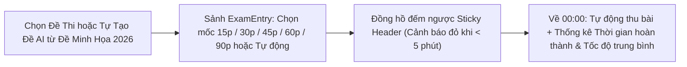

> **Tóm tắt nhanh (TL;DR):** Rất nhiều học sinh giải được toàn bộ câu khó khi ngồi làm thong thả ở nhà, nhưng khi bước vào phòng thi tốt nghiệp THPT thật lại bị "cháy giáo án" không kịp tô đáp án 10 câu cuối do thiếu kỹ năng kiểm soát áp lực thời gian. Năm 2026, **Top 7 website luyện thi thử THPT Quốc gia có đồng hồ đếm ngược thời gian thực** gồm **QuizKen**, **Hocmai**, **Moon.vn**, **Tuyensinh247**, **Study4**, **VietJack** và **VnDoc** sẽ giúp sĩ tử rèn bản lĩnh phân bổ thời gian chuẩn xác đến từng giây.

---

# Top 7 Website Luyện Thi Thử THPT Quốc Gia Có Đồng Hồ Đếm Ngược 2026

Kỳ thi tốt nghiệp THPT năm 2026 theo Chương trình GDPT 2018 đánh dấu sự thay đổi sâu sắc về áp lực thời gian: học sinh phải xử lý đồng thời nhiều dạng thức tư duy từ câu hỏi trắc nghiệm 4 lựa chọn, câu hỏi Đúng/Sai 4 mệnh đề cho tới câu hỏi trả lời ngắn trong khoảng thời gian cố định (**50 phút** đối với các môn Vật lý, Hóa học, Sinh học, Lịch sử, Địa lý, Tiếng Anh, KT&PL và **90 phút** đối với môn Toán).

Các chuyên gia khảo thí luôn nhấn mạnh quy tắc: **"Luyện đề mà không bấm đồng hồ đếm ngược thì chỉ mới là đọc đề chứ chưa phải là thi thử"**. Một phòng thi thử trực tuyến chuẩn mực cần giúp học sinh:
* Chủ động chọn được mốc thời gian phù hợp với mục tiêu luyện tập (*15 phút luyện sprint ngắn, 45–50 phút cho môn tổ hợp, hoặc 90 phút cho đề Toán toàn diện*).
* Có cảnh báo trực quan khi thời gian bước vào **5 phút cuối cùng** (giai đoạn rà soát các câu đã gắn cờ `🚩` và kiểm tra câu bỏ sót).
* Tự động thu bài và khóa chọn đáp án ngay khi đồng hồ điểm `00:00` để rèn phản xạ dứt khoát như trong phòng thi thật.

Dưới đây là đánh giá chi tiết **Top 7 website luyện thi thử THPT Quốc gia có đồng hồ đếm ngược tốt nhất năm 2026**.

---

## Bảng So Sánh 7 Website Luyện Thi Thử THPT Có Đồng Hồ Đếm Ngược (2026)

| Website | Tùy chỉnh linh hoạt mốc thời gian (15p–90p) | Tự động tạo đề thi thử mới bằng AI từ PDF | Cảnh báo đỏ 5 phút cuối & Tự động thu bài | Xuất PDF Bảng điểm & Đề cương sau khi thi | Chi phí |
| :--- | :--- | :--- | :--- | :--- | :--- |
| **1. QuizKen** | **Có (`Auto`, `15p`, `30p`, `45p`, `60p`, `90p`)** | **Có (Biến mọi file đề PDF thành phòng thi)** | **Có (`isUrgentTime < 300s` + Auto-Submit)** | **Có (4 chế độ PDF chuẩn A4)** | **Miễn phí 100%** |
| **2. Hocmai Phòng Thi Ảo** | Cố định theo từng đợt thi | Không (Chỉ làm đề có sẵn) | Có tự động nộp bài | Xem giải trên web | Miễn phí đợt chung / Khóa VIP |
| **3. Moon.vn** | Cố định theo ca thi | Không | Có đếm ngược chuẩn | Tải PDF yêu cầu mua khóa/sách | Thu phí theo ID khóa học |
| **4. Tuyensinh247** | Cố định theo đề | Không | Có đếm ngược | Giới hạn tải file ở tài khoản VIP | Freemium |
| **5. Study4** | Có tùy chọn bấm giờ theo phần | Không tự tạo đề Toán/Lý/Hóa | Có đồng hồ đếm ngược | Chủ yếu chuyên Tiếng Anh/IELTS | Miễn phí / Khóa trả phí |
| **6. VietJack Online** | Cố định theo bài kiểm tra | Không | Có đếm ngược cơ bản | Hạn chế xuất PDF bảng điểm | Xem miễn phí / Gói VIP |
| **7. VnDoc Trắc Nghiệm** | Chỉ một số đề có bấm giờ | Không | Cơ bản | Tải file Word trả phí | Freemium |

---

## Đánh Giá Chi Tiết Top 7 Website Luyện Thi Thử THPT Quốc Gia Có Đồng Hồ Đếm Ngược

### 1. QuizKen — Biến mọi đề thi PDF/Word thành Phòng Thi Thử Đếm Ngược chỉ trong 30 giây

Điểm vượt trội lớn nhất của **QuizKen** so với các trang luyện thi truyền thống là học sinh **không bị bó hẹp trong một vài đề mẫu cố định**: bạn có thể lấy bất kỳ đề thi thử của các Sở GD&ĐT, trường chuyên (file PDF/Word) tải lên để AI chuyển hóa thành phòng thi đếm ngược tương tác, hoặc chọn ngay hàng ngàn đề trong thư viện.

* **Hệ thống kiểm soát thời gian chuyên sâu trong Phòng Thi Thử QuizKen:**
  * **6 chế độ thời gian tại Sảnh vào thi (`ExamEntry.tsx`):** Trước khi bắt đầu, học sinh được chọn giữa **`Tự động (1 phút/câu)`** hoặc các mốc chuẩn **`15 phút`**, **`30 phút`**, **`45 phút`**, **`60 phút`** và **`90 phút`**. Ví dụ: nếu bạn muốn rèn tốc độ giải nhanh một đề 40 câu chỉ trong 30 phút thay vì 50 phút tiêu chuẩn, bạn chỉ cần bấm chọn nút `30 phút`!
  * **Đồng hồ Sticky Header & Cảnh báo khẩn cấp 5 phút cuối (`isUrgentTime`):** Đồng hồ `MM:SS` luôn ghim cố định ở thanh trên cùng màn hình. Khi thời gian còn lại dưới 5 phút (`< 300 giây`), khung đồng hồ tự động chuyển sang nền đỏ nhấp nháy để nhắc thí sinh ưu tiên hoàn thành các câu còn bỏ trống.
  * **Tự động thu bài chính xác ở giây `00:00`:** Khi hết giờ, hệ thống tự động dừng bài làm, chấm điểm tức thì, ghi nhận chính xác tổng thời gian đã sử dụng (`X phút Y giây`) vào thẻ kết quả và cập nhật **Kỷ lục thời gian nhanh nhất (`fastestTimeSeconds`)** của bạn trên đề đó.
  * **Bộ đếm ngược ngày thi (`ExamCountdownCard`) trên Dashboard:** Ngoài đồng hồ trong phòng thi, trên trang tổng quan cá nhân còn có thẻ đếm ngược số ngày còn lại tới kỳ thi tốt nghiệp THPT kèm gợi ý kế hoạch ôn câu sai mỗi ngày.
* **Ưu điểm:** Miễn phí 100%, tích hợp sẵn phím tắt bàn phím (`1–4`, `A–D`, `F`, `←/→`), trộn câu hỏi/đáp án và xuất PDF bảng điểm sau khi thi.
* **Nhược điểm:** Các kỳ thi đua top trực tiếp đông người sẽ diễn ra trong khu vực *Đấu Trường Live (`/game/lobby`)* tách biệt với *Phòng Thi Thử cá nhân (`/quiz/exam/:id`)*.
* **Chi phí:** Hoàn toàn miễn phí.

👉 **Bấm giờ thi thử ngay:** [Vào Phòng Thi Thử Đếm Ngược trên QuizKen](https://app.quizken.com).

---

### 2. Hocmai (Phòng luyện & Thi thử THPT) — Các đợt thi thử theo lịch cố định

**Hocmai** thường tổ chức các đợt thi thử trực tuyến quy mô lớn theo từng giai đoạn trong năm học cho học sinh lớp 12.

* **Ưu điểm:**
  * Đề thi được biên soạn bởi đội ngũ giáo viên có kinh nghiệm, có bảng xếp hạng điểm số giữa các thí sinh tham gia cùng đợt.
* **Nhược điểm:**
  * Nhiều đề thi chất lượng cao hoặc video chữa đề chi tiết chỉ mở cho học sinh đã đăng ký các khóa luyện thi trả phí (PEN/PRO); học sinh không thể tự tải file đề PDF của trường mình lên để biến thành phòng thi đếm ngược.
* **Chi phí:** Một số đợt mở miễn phí, ngân hàng đề chuyên sâu thuộc khóa trả phí.

---

### 3. Moon.vn — Hệ thống thi thử trực tuyến mạnh về khối Khoa học Tự nhiên

**Moon.vn** rất quen thuộc với học sinh ôn thi các môn Toán, Lý, Hóa, Sinh nhờ các buổi thi thử trực tuyến vào buổi tối.

* **Ưu điểm:**
  * Đề thi có tính phân loại cao, có đếm ngược thời gian nghiêm túc theo ca thi và lời giải chi tiết theo mã ID.
* **Nhược điểm:**
  * Để xem đầy đủ lời giải hoặc thi lại ngoài giờ mở ca miễn phí, học sinh thường phải mua sách gắn mã ID hoặc đăng ký khóa học trả phí.
* **Chi phí:** Thu phí theo sách ID hoặc khóa học.

---

### 4. Tuyensinh247 — Ngân hàng đề thi thử của các trường THPT trên cả nước

**Tuyensinh247** tổng hợp nhiều đề thi thử từ các trường THPT và Sở GD&ĐT dưới dạng bài làm trực tuyến có bấm giờ.

* **Ưu điểm:**
  * Cập nhật nhanh đề thi thử của các tỉnh thành theo từng học kỳ.
* **Nhược điểm:**
  * Không cho phép thí sinh tự điều chỉnh rút ngắn mốc thời gian đếm ngược hay bật/tắt đảo đáp án A/B/C/D theo nhu cầu luyện tập cá nhân; tải file PDF đề kèm lời giải yêu cầu nâng cấp tài khoản VIP.
* **Chi phí:** Freemium.

---

### 5. Study4 — Nền tảng bấm giờ luyện đề chuyên sâu cho môn Tiếng Anh

Đối với riêng môn Tiếng Anh (THPT Quốc gia, IELTS, TOEIC), **Study4** là một địa chỉ luyện đề trực tuyến rất chất lượng.

* **Ưu điểm:**
  * Cho phép chọn làm full test bấm giờ hoặc tách từng phần (Practice theo Section) với giao diện sạch sẽ, dễ theo dõi.
* **Nhược điểm:**
  * Tập trung chủ yếu vào ngoại ngữ (Tiếng Anh, IELTS, TOEIC), chưa hỗ trợ đầy đủ hệ thống công thức Toán – Lý – Hóa và hình vẽ `VisualScene` cho các môn Khoa học Tự nhiên như QuizKen.
* **Chi phí:** Kho đề cộng đồng miễn phí + Khóa học trả phí.

---

### 6. VietJack Online — Kho trắc nghiệm bám sát sách giáo khoa

**VietJack** cung cấp hệ thống bài trắc nghiệm ngắn theo từng bài học và đề kiểm tra học kỳ có đồng hồ bấm giờ cơ bản.

* **Ưu điểm:**
  * Phù hợp để ôn tập kiến thức nền tảng ngay sau khi học xong từng bài trên lớp.
* **Nhược điểm:**
  * Giao diện chứa khá nhiều quảng cáo dễ gây xao nhãng trong lúc đang bấm giờ làm bài thi thử nghiêm túc.
* **Chi phí:** Xem miễn phí trên web.

---

### 7. VnDoc Trắc Nghiệm — Nguồn đề kiểm tra đa cấp học

**VnDoc** có số lượng lớn đề kiểm tra từ Tiểu học, THCS đến THPT cho học sinh làm trực tiếp trên trang web.

* **Ưu điểm:**
  * Đa dạng môn học, bao phủ cả các môn Lịch sử, Địa lý, Giáo dục kinh tế & pháp luật.
* **Nhược điểm:**
  * Trải nghiệm phòng thi còn đơn giản, chưa có bảng điều hướng câu hỏi gắn cờ `🚩` chuyên nghiệp hay tính năng xuất PDF biên bản bài làm đã chấm điểm như QuizKen.
* **Chi phí:** Xem miễn phí, tải file Word/PDF có thu phí.

---

## Chiến Thuật Phân Bổ Thời Gian "3 Vòng" Trong Phòng Thi Thử Đếm Ngược

Khi luyện đề trong **Phòng Thi Thử (`ExamModePage`)** trên [QuizKen](https://app.quizken.com), hãy áp dụng chiến thuật 3 vòng để tối đa hóa điểm số:
* **Vòng 1 (50% thời gian đầu):** Giải quyết dứt điểm toàn bộ các câu mức độ *Nhận biết (`L1`)* và *Thông hiểu (`L2`)*. Câu nào đọc quá 30 giây chưa ra hướng giải, nhấn ngay phím **`F` (Đặt cờ 🚩)** và bấm `→` chuyển câu tiếp theo, tuyệt đối không sa lầy.
* **Vòng 2 (35% thời gian tiếp theo):** Mở **Bảng Câu Hỏi (`QuestionPalette`)** ở cột bên phải, bấm trực tiếp vào các ô có biểu tượng **🚩 màu vàng** để tập trung giải các câu *Vận dụng (`L3`, `L4`)*.
* **Vòng 3 (5 phút cuối khi đồng hồ báo đỏ):** Kiểm tra trên `QuestionPalette` đảm bảo không còn ô nào ở trạng thái *Chưa trả lời (`unanswered`)* trước khi bấm **Xác nhận nộp bài**.

---

## Câu hỏi thường gặp (FAQ)

### 1. Nếu tôi muốn luyện đề 45 phút nhưng đề gốc trên hệ thống mặc định là 60 phút thì có chỉnh lại được không?
Hoàn toàn được. Tại **Sảnh Chuẩn Bị Thi (`ExamEntry`)** trước khi vào bài trên QuizKen, bạn chỉ cần bấm chọn nút **`45 phút`** (hoặc `15 phút`, `30 phút`, `60 phút`, `90 phút`). Đồng hồ đếm ngược sẽ chạy chính xác theo mốc thời gian bạn vừa chọn.

### 2. Khi đang làm bài thi thử mà còn câu bỏ trống, nếu tôi bấm "Nộp bài" thì hệ thống có cảnh báo không?
Có. Khi bạn nhấn nút **"Nộp bài"**, hộp thoại xác nhận của QuizKen sẽ tự động đếm và cảnh báo rõ bằng chữ màu đỏ: *"Bạn còn X câu chưa trả lời. Bạn có chắc chắn muốn nộp bài?"* để bạn quay lại hoàn thành nốt tránh mất điểm đáng tiếc.

### 3. Làm sao biết tốc độ làm bài của tôi qua các lần thi thử có tiến bộ hay không?
Mỗi lần nộp bài thi thử trên QuizKen, hệ thống tự động lưu kết quả vào `examHistoryService`. Khi quay lại Sảnh chuẩn bị thi của đề đó, thẻ **"Kỷ lục cá nhân đề này"** sẽ hiển thị rõ **Số lần thi**, **Điểm cao nhất (`%`)**, **Điểm gần nhất** và **Thời gian hoàn thành nhanh nhất (`Xp Ys`)** để bạn theo dõi sự tiến bộ từng ngày.
