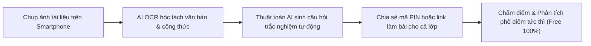

> **Tóm tắt nhanh (TL;DR):** Xu hướng học tập di động (Mobile Learning) năm 2026 bùng nổ mạnh mẽ khi cả học sinh và giáo viên đều ưu tiên thao tác ngay trên smartphone. Việc tìm kiếm một **app tạo trắc nghiệm trên điện thoại** tích hợp trí tuệ nhân tạo **AI hoàn toàn miễn phí (free)**, có khả năng nhận diện tài liệu qua camera hoặc file PDF và tự động sinh đề thi chuẩn GDPT 2018 là nhu cầu cấp thiết. Dưới đây là bảng xếp hạng 5 ứng dụng xuất sắc nhất.

---

## 1. Xu Hướng Tạo & Làm Bài Thi Trắc Nghiệm Trên Smartphone Năm 2026

Theo khảo sát về chuyển đổi số giáo dục theo định hướng **Quyết định 131/QĐ-TTg**, hơn 85% học sinh THPT tại Việt Nam sử dụng điện thoại thông minh làm thiết bị học tập phụ trợ hàng ngày. Các app tạo đề trắc nghiệm thế hệ cũ trên máy tính bộc lộ nhiều điểm hạn chế:
* Không tối ưu cho màn hình cảm ứng nhỏ gọn.
* Thiếu khả năng chụp ảnh đề bài trên giấy để số hóa tự động (OCR).
* Yêu cầu cài đặt phức tạp hoặc thu phí bản quyền định kỳ.

Sự xuất hiện của các ứng dụng **AI tạo trắc nghiệm miễn phí (free mobile apps)** đã thay đổi hoàn toàn cuộc chơi, cho phép thầy cô tạo đề thi 20 câu chỉ bằng cách chụp lại trang sách giáo khoa.

---

## 2. Tiêu Chí Chọn App Tạo Trắc Nghiệm Tốt Nhất Trên Điện Thoại

| Tiêu chí đánh giá | App thông thường cũ | App EdTech AI Hiện Đại (QuizKen Free) |
| :--- | :--- | :--- |
| **Tốc độ khởi tạo đề** | Phải gõ tay từng câu mất 30–60 phút | **30 giây** bằng cách upload file Word/PDF hoặc ảnh chụp |
| **Hỗ trợ công thức Toán/Lý/Hóa** | Thường bị lỗi font, vỡ ký hiệu đặc biệt | Hỗ trợ chuẩn **KaTeX** hiển thị sắc nét trên màn hình Retina |
| **Độ đa dạng định dạng** | Chỉ hỗ trợ trắc nghiệm 4 lựa chọn cổ điển | Đầy đủ 3 phần: 4 lựa chọn, Đúng/Sai 4 ý, Trả lời ngắn GDPT 2018 |
| **Chi phí sử dụng** | Bắt buộc mua gói Premium đắt đỏ | Cung cấp gói sử dụng **AI miễn phí (free)** hàng ngày |

---

## 3. Top 5 App Tạo Trắc Nghiệm Bằng AI Miễn Phí Tốt Nhất 2026

### 1. QuizKen Mobile Web App - Lựa chọn số 1 cho học sinh & giáo viên Việt Nam
* **Ưu điểm vượt trội:** Chạy mượt mà trên mọi trình duyệt mobile (iOS, Android) mà không cần tốn dung lượng tải từ App Store. Tích hợp AI tạo đề từ tài liệu tiếng Việt bám sát ma trận đề thi THPT 2026.
* **Tính năng độc quyền:** Phòng đấu đối kháng Multiplayer nhiều người chơi trực tiếp, Flashcard Spaced Repetition thông minh và trợ lý AI Tutor phản hồi Socratic.
* **Chi phí:** **Miễn phí trọn đời (Free 100%)** cho các tính năng học tập và kiểm tra cơ bản.

### 2. Google Forms Mobile
* **Ưu điểm:** Giao diện quen thuộc, đồng bộ dữ liệu nhanh với Google Sheets.
* **Nhược điểm:** Không tích hợp AI tự động sinh câu hỏi từ tài liệu; học sinh dễ dàng gian lận mở tab tra cứu.

### 3. Quizlet
* **Ưu điểm:** Kho thẻ từ vựng cộng đồng rộng lớn, giao diện đẹp.
* **Nhược điểm:** Tính năng AI Magic Notes bị giới hạn nghiêm ngặt ở bản trả phí (Quizlet Plus).

### 4. Kahoot! Mobile
* **Ưu điểm:** Âm nhạc và đồ họa trò chơi sôi động, phù hợp lứa tuổi thiếu nhi.
* **Nhược điểm:** Giới hạn số lượng người tham gia ở gói miễn phí (thường chỉ 10–20 người); không hỗ trợ công thức toán học chuyên sâu.

### 5. Socrative Teacher & Student
* **Ưu điểm:** Báo cáo chi tiết kết quả làm bài của từng học sinh.
* **Nhược điểm:** Giao diện tiếng Anh, khó khăn cho giáo viên không chuyên ngữ, thiếu tính năng sinh đề AI tự động.

👉 **Trải nghiệm ngay:** [Mở app tạo trắc nghiệm AI miễn phí QuizKen trên điện thoại](https://quizken.com) để biến smartphone thành phòng thi ảo thông minh!

---

## Câu hỏi thường gặp (FAQ)

### 1. Dùng QuizKen trên điện thoại có cần tải app về máy không?
Không cần. QuizKen hoạt động dưới dạng Progressive Web App (PWA), bạn chỉ cần mở trình duyệt Safari (iOS) hoặc Chrome (Android) và bấm "Thêm vào màn hình chính" là có thể dùng mượt mà như một ứng dụng native.

### 2. Giáo viên có thể trộn mã đề trực tiếp trên điện thoại không?
Có. Hệ thống AI của QuizKen cho phép đảo câu hỏi và đáp án tự động ngay trên điện thoại và xuất ra link làm bài trực tuyến cho học sinh chỉ với 1 chạm.

### 3. Học sinh nghèo hoặc vùng sâu vùng xa có được dùng miễn phí không?
Theo định hướng công bằng số của Bộ GD&ĐT, QuizKen cam kết duy trì gói tạo đề và luyện thi **AI miễn phí (free)** hàng ngày cho mọi người dùng Việt Nam.
