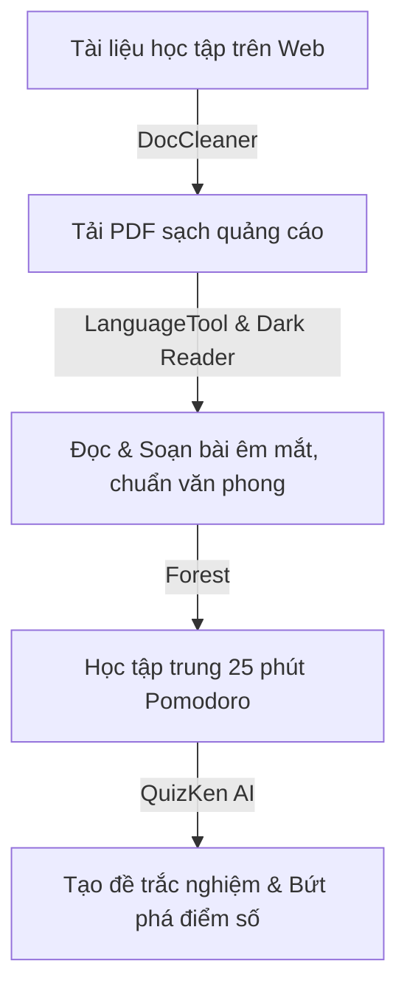

> **TL;DR (Tóm tắt nhanh):**  
> Để tối ưu hóa 300% hiệu suất học tập trong mùa thi cử và làm đồ án, sinh viên nên trang bị ngay 5 tiện ích mở rộng (Chrome Extensions) hàng đầu: **DocCleaner** (unblur & tải tài liệu Studocu/Scribd miễn phí), **LanguageTool** (kiểm tra ngữ pháp & chính tả tiếng Việt/Anh), **Dark Reader** (chế độ bảo vệ mắt khi cày đêm), **Forest** (tập trung học tập Pomodoro chống lướt mạng xã hội), và nền tảng ôn thi tương tác **QuizKen** (chuyển đổi mọi tài liệu thành đề thi trắc nghiệm AI trong 3 giây).

---

# Top 5 Chrome Extension Cứu Cánh Cho Sinh Viên Mùa Ôn Thi & Làm Đồ Án (2026)

Trình duyệt Google Chrome là "vũ khí" quen thuộc nhất của học sinh, sinh viên trong thời đại số. Tuy nhiên, nếu bạn chỉ dùng Chrome để lướt web đọc bài thụ động, bạn đang bỏ lỡ hàng loạt tiện ích mở rộng (Extensions) có khả năng tự động hóa và giải phóng sức lao động gấp nhiều lần.

Dưới đây là danh sách **5 tiện ích Chrome miễn phí và hữu ích nhất** được tuyển chọn kỹ lưỡng, giúp bạn tự tin vượt qua mọi mùa thi cử và hoàn thành đồ án tốt nghiệp với điểm số cao nhất.

---

## 1. DocCleaner – Tiện Ích Unblur & Tải Tài Liệu Studocu, Scribd 1-Click

* **Mục đích:** Mở khóa tài liệu học tập bị che mờ, chặn toàn bộ quảng cáo và xuất file PDF chuẩn HD.
* **Tác giả:** KhanhNKQ (Mã nguồn mở trên GitHub: [khanhnkq/DocCleaner](https://github.com/khanhnkq/DocCleaner)).
* **Lý do nên cài đặt:** Khi tìm kiếm bài tập, đề cương ôn thi hay tài liệu tham khảo trên Studocu và Scribd, bạn thường xuyên bị chặn đọc từ trang thứ 3. DocCleaner tự động trích xuất CloudFront signature, xóa các pop-up đòi tiền và cung cấp nút bấm **Download PDF** tải về toàn bộ tài liệu sạch sẽ, không lỗi trang trắng.

---

## 2. LanguageTool – Trợ Lý Sửa Lỗi Chính Tả & Văn Phong Chuyên Nghiệp

* **Mục đích:** Soát lỗi chính tả tiếng Việt và tiếng Anh khi viết tiểu luận, email gửi giảng viên và khóa luận.
* **Lý do nên cài đặt:** Khác với các công cụ kiểm tra thông thường chỉ hỗ trợ tiếng Anh, LanguageTool nhận diện tiếng Việt cực kỳ mượt mà. Tiện ích tự động gạch chân các lỗi sai dấu, dùng từ sai ngữ cảnh hoặc câu văn lủng củng ngay trong Google Docs hay khung soạn thảo văn bản.

---

## 3. Dark Reader – Chế Độ Nền Tối Bảo Vệ Thị Lực Khi "Cày Đêm"

* **Mục đích:** Đổi màu nền mọi trang web sang chế độ Dark Mode tương phản dịu nhẹ.
* **Lý do nên cài đặt:** Những đêm thức khuya ôn thi trước màn hình máy tính phát ra ánh sáng trắng chói lọi sẽ khiến mắt bạn cực kỳ mỏi và nhức đầu. Dark Reader tự động chuyển đổi bảng màu thông minh, giữ nguyên màu sắc hình ảnh gốc nhưng đảo nền trang web sang màu đen/xám than giúp bạn học tập bền bỉ mà không hại mắt.

---

## 4. Forest: Stay Focused – Quản Lý Thời Gian Pomodoro Chống "Lướt Tóp Tóp"

* **Mục đích:** Chặn các trang web gây xao nhãng (Facebook, TikTok, YouTube) để tập trung 100% vào việc học.
* **Lý do nên cài đặt:** Forest áp dụng phương pháp Pomodoro kết hợp trò chơi hóa (Gamification). Mỗi khi bạn bắt đầu học trong 25 - 30 phút, một cái cây ảo sẽ được trồng trên trình duyệt. Nếu bạn mất tập trung mở tab mạng xã hội, cái cây sẽ héo tàn. Cảm giác nuôi lớn cả một khu rừng xanh tốt sẽ thôi thúc bạn hoàn thành bài tập đúng hạn.

---

## 5. QuizKen – Nền Tảng Ôn Thi Thông Minh & Tạo Đề Trắc Nghiệm Bằng AI

* **Mục đích:** Biến mọi tệp tài liệu PDF, bài giảng online thành đề thi trắc nghiệm và flashcard ôn thi chủ động.
* **Website:** [app.quizken.com](https://app.quizken.com)
* **Lý do nên sử dụng:** Sau khi tải được tài liệu học tập từ DocCleaner hoặc thu thập đề cương môn học, bạn đừng chỉ ngồi đọc chay. Nạp tài liệu vào **QuizKen** để AI tự động:
  * Tạo 20 - 50 câu hỏi trắc nghiệm 4 lựa chọn sát đề thi thật.
  * Phân tích đáp án đúng/sai kèm lời giải thích cặn kẽ.
  * Tích hợp bộ thẻ Flashcard Spaced Repetition (thuật toán SM-2) giúp bạn ghi nhớ dài hạn mà tốn ít thời gian nhất.

---

## Bảng Tổng Kết Tính Năng Top 5 Tiện Ích

| Tiện ích | Điểm nổi bật nhất | Đối tượng phù hợp | Chi phí |
| :--- | :--- | :--- | :--- |
| **DocCleaner** | Unblur Studocu & Scribd, tải PDF HD | Sinh viên cần tài liệu ôn thi | Miễn phí 100% |
| **LanguageTool** | Soát lỗi ngữ pháp tiếng Việt & tiếng Anh | Sinh viên làm khóa luận, tiểu luận | Miễn phí |
| **Dark Reader** | Đổi mọi website sang Dark Mode dịu mắt | Sinh viên hay cày bài ban đêm | Miễn phí |
| **Forest** | Kỷ luật bản thân, chặn tab xao nhãng | Người hay mất tập trung | Miễn phí |
| **QuizKen** | Biến tài liệu PDF thành đề thi trắc nghiệm AI | Mọi học sinh, sinh viên mùa thi | Miễn phí |

---

## Câu hỏi thường gặp về các tiện ích Chrome cho sinh viên

### Cài đặt nhiều tiện ích mở rộng có làm trình duyệt Chrome bị chậm không?
Nếu bạn chỉ cài đặt từ 5 - 7 tiện ích cần thiết và tối ưu như danh sách trên, trình duyệt hoàn toàn mượt mà. Bạn có thể tắt tạm thời các tiện ích chưa dùng đến trong mục Quản lý tiện ích (`chrome://extensions/`) khi không có nhu cầu.

### Tiện ích DocCleaner cài đặt như thế nào?
Bạn chỉ cần tải file zip từ kho mã nguồn mở [khanhnkq/DocCleaner](https://github.com/khanhnkq/DocCleaner), giải nén và nạp vào Chrome thông qua tính năng `Load unpacked` trong chế độ Developer Mode.

### QuizKen có tính phí khi tạo đề thi từ file tài liệu không?
QuizKen cung cấp tính năng tạo đề thi trắc nghiệm và flashcard từ văn bản/tài liệu hoàn toàn miễn phí, hỗ trợ học sinh và sinh viên toàn quốc bứt phá kết quả học tập.
