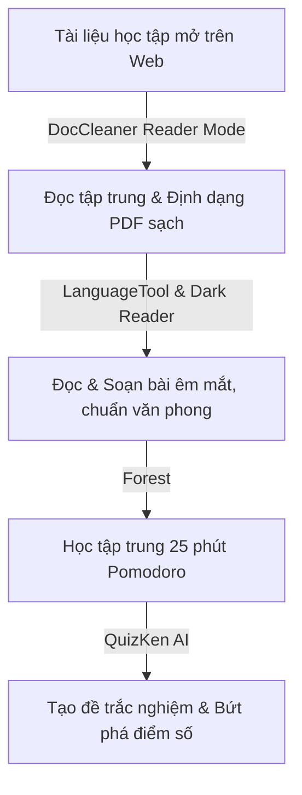

> **TL;DR (Tóm tắt nhanh):**  
> Để tối ưu hóa hiệu suất học tập trong mùa thi cử và làm đồ án, sinh viên nên trang bị ngay 5 tiện ích mở rộng (Chrome Extensions) hàng đầu: **[DocCleaner](https://chromewebstore.google.com/detail/doccleaner-better-studocu/fnhdoegoihnkgggnaiemommemdejhbkb?hl=vi)** (bật Reader Mode đọc tài liệu Studocu/Scribd sạch gọn & định dạng in A4), **LanguageTool** (kiểm tra ngữ pháp & chính tả tiếng Việt/Anh), **Dark Reader** (chế độ bảo vệ mắt khi học tối), **Forest** (tập trung học tập Pomodoro), và nền tảng ôn thi tương tác **[QuizKen](https://app.quizken.com)** (chuyển đổi giáo trình thành đề thi trắc nghiệm AI trong vài giây).

---

# Top 5 Chrome Extension Cứu Cánh Cho Sinh Viên Mùa Ôn Thi & Làm Đồ Án (2026)

Trình duyệt Google Chrome là công cụ quen thuộc nhất của học sinh, sinh viên trong thời đại số. Tuy nhiên, nếu bạn chỉ dùng Chrome với cài đặt mặc định, bạn đang bỏ lỡ hàng loạt tiện ích mở rộng (Extensions) hợp pháp giúp tăng khả năng tập trung và tiết kiệm hàng giờ làm việc mỗi tuần.

Dưới đây là danh sách **5 tiện ích Chrome miễn phí và hữu ích nhất** được tuyển chọn kỹ lưỡng, giúp bạn tự tin vượt qua mùa thi cử và hoàn thành đồ án tốt nghiệp với điểm số cao nhất.

---

## 1. DocCleaner – Tiện Ích Bật Reader Mode & Định Dạng In A4 Cho Studocu, Scribd

* **Mục đích:** Tối ưu không gian đọc tài liệu học tập công khai (Reader Mode), ẩn popup cookie/banner thừa và hỗ trợ định dạng trang in A4 sạch đẹp.
* **Cài đặt chính thức:** [DocCleaner trên Chrome Web Store](https://chromewebstore.google.com/detail/doccleaner-better-studocu/fnhdoegoihnkgggnaiemommemdejhbkb?hl=vi).
* **Lý do nên cài đặt:** Khi đọc đề cương hoặc bài giảng mở trên Studocu và Scribd, các hộp thoại cookie và khung giao diện xung quanh thường làm thu hẹp màn hình đọc. DocCleaner tự động bật **Reader Mode**, hỗ trợ **Smart Page Formatter** nạp mượt trang tài liệu dài và cung cấp nút **1-Click Print Format** để căn chuẩn trang in A4 qua hộp thoại `Save as PDF` của Chrome.

---

## 2. LanguageTool – Trợ Lý Sửa Lỗi Chính Tả & Văn Phong Chuyên Nghiệp

* **Mục đích:** Soát lỗi chính tả tiếng Việt và tiếng Anh khi viết tiểu luận, email gửi giảng viên và khóa luận.
* **Lý do nên cài đặt:** Khác với các công cụ kiểm tra thông thường chỉ hỗ trợ tiếng Anh, LanguageTool nhận diện tiếng Việt rất tốt. Tiện ích tự động gạch chân các lỗi sai dấu, dùng từ sai ngữ cảnh hoặc câu văn lủng củng ngay trong Google Docs hay khung soạn thảo văn bản.

---

## 3. Dark Reader – Chế Độ Nền Tối Bảo Vệ Thị Lực Khi Học Buổi Tối

* **Mục đích:** Đổi màu nền mọi trang web sang chế độ Dark Mode tương phản dịu nhẹ.
* **Lý do nên cài đặt:** Những buổi tối ôn thi trước màn hình máy tính phát ra ánh sáng trắng sẽ khiến mắt bạn nhanh mỏi. Dark Reader tự động chuyển đổi bảng màu thông minh, giữ nguyên hình ảnh gốc nhưng đảo nền trang web sang màu xám than dịu mắt.

---

## 4. Forest: Stay Focused – Quản Lý Thời Gian Pomodoro Chống Xao Nhãng

* **Mục đích:** Tạm khóa các trang mạng xã hội gây mất tập trung để tập trung 100% vào phiên học Pomodoro.
* **Lý do nên cài đặt:** Forest áp dụng phương pháp Pomodoro kết hợp trò chơi hóa (Gamification). Mỗi khi bạn bắt đầu học trong 25–30 phút, một cái cây ảo sẽ được trồng trên trình duyệt, tạo động lực giúp bạn duy trì kỷ luật tự học.

---

## 5. QuizKen – Nền Tảng Ôn Thi Thông Minh & Tạo Đề Trắc Nghiệm Bằng AI

* **Mục đích:** Biến mọi tệp giáo trình PDF/Word và ghi chú bài giảng của bạn thành đề thi trắc nghiệm và flashcard ôn thi chủ động.
* **Website:** [app.quizken.com](https://app.quizken.com)
* **Lý do nên sử dụng:** Sau khi đọc hiểu đề cương môn học, bạn đừng chỉ ngồi đọc thụ động. Nạp tài liệu của bạn vào **QuizKen** để AI tự động:
  * Tạo 20–50 câu hỏi trắc nghiệm khách quan sát đề thi thật.
  * Phân tích đáp án đúng/sai kèm lời giải thích cặn kẽ.
  * Tích hợp bộ thẻ Flashcard Spaced Repetition (thuật toán SM-2) giúp bạn ghi nhớ dài hạn.

---

## Bảng Tổng Kết Tính Năng Top 5 Tiện Ích

| Tiện ích | Điểm nổi bật nhất | Đối tượng phù hợp | Chi phí |
| :--- | :--- | :--- | :--- |
| **DocCleaner** | Reader Mode cho Studocu & Scribd, định dạng in A4 | Sinh viên đọc tài liệu ôn thi | Miễn phí 100% |
| **LanguageTool** | Soát lỗi ngữ pháp tiếng Việt & tiếng Anh | Sinh viên làm khóa luận, tiểu luận | Miễn phí |
| **Dark Reader** | Đổi mọi website sang Dark Mode dịu mắt | Sinh viên học bài buổi tối | Miễn phí |
| **Forest** | Kỷ luật bản thân, quản lý phiên Pomodoro | Người hay mất tập trung | Miễn phí |
| **QuizKen** | Biến giáo trình PDF/Word thành đề trắc nghiệm AI | Mọi học sinh, sinh viên mùa thi | Miễn phí |

---

## Câu hỏi thường gặp (FAQ)

### 1. Cài đặt nhiều tiện ích mở rộng có làm trình duyệt Chrome bị chậm không?
Nếu bạn chỉ cài đặt từ 5–7 tiện ích gọn nhẹ như danh sách trên, trình duyệt hoàn toàn mượt mà. Bạn cũng có thể sử dụng trực tiếp [58 Công Cụ Học Tập & Tiện Ích Web](/cong-cu) của QuizKen ngay trên trình duyệt mà không cần cài thêm tiện ích.

### 2. Tiện ích DocCleaner cài đặt như thế nào?
Bạn chỉ cần truy cập [DocCleaner - Better Studocu & Scribd Reader trên Chrome Web Store](https://chromewebstore.google.com/detail/doccleaner-better-studocu/fnhdoegoihnkgggnaiemommemdejhbkb?hl=vi) và nhấn **Thêm vào Chrome (Add to Chrome)** để cài đặt chỉ với 1 click.

### 3. QuizKen có gói miễn phí khi tạo đề thi từ file tài liệu không?
Có! QuizKen cung cấp gói trải nghiệm miễn phí giúp học sinh, sinh viên tải tài liệu lên để tạo đề thi trắc nghiệm và flashcard ôn tập nhanh chóng.
