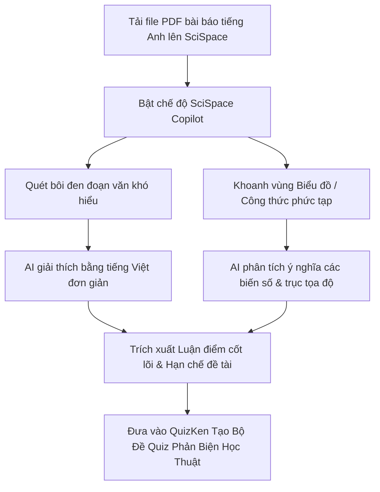

> **TL;DR (Tóm tắt nhanh):**  
> Đọc các bài báo khoa học (Research Papers) tiếng Anh chứa đầy thuật ngữ chuyên ngành và công thức toán học phức tạp là thử thách lớn đối với sinh viên làm nghiên cứu khoa học (NCKH) hay viết khóa luận. Thay vì dùng Google Dịch rời rạc, bạn nên sử dụng bộ đôi **công cụ AI đọc bài báo khoa học miễn phí** hàng đầu thế giới: **SciSpace Copilot** (`typeset.io` - giải thích chi tiết từng đoạn văn, bảng biểu và công thức) kết hợp **Consensus** (`consensus.app` - tổng hợp đồng thuận khoa học từ hơn 200 triệu bài báo). Sau khi nắm chắc luận điểm, hãy nạp các phát hiện nghiên cứu vào **QuizKen** để AI tự động tạo bài trắc nghiệm phản biện, giúp bạn tự tin bảo vệ đề tài đạt điểm A+!

---

# Top Công Cụ AI Đọc Hiểu & Phân Tích Bài Báo Khoa Học Tiếng Anh Miễn Phí (2026)

Trong kỷ nguyên học thuật hiện đại, một bài tiểu luận hoặc nghiên cứu khoa học (NCKH) xuất sắc không thể chỉ trích dẫn tài liệu từ sách giáo khoa cũ mà bắt buộc phải có các trích dẫn bài báo quốc tế (Journal Articles) từ các nhà xuất bản uy tín như Elsevier, Springer, IEEE hay Nature.

Tuy nhiên, hầu hết sinh viên đều gặp phải rào cản:
* Bài báo dài từ 15 đến 30 trang tiếng Anh học thuật với mật độ thuật ngữ dày đặc.
* Các biểu đồ thống kê, bảng phân tích hồi quy (Regression Analysis) và công thức ma trận rất khó hiểu.
* Tốn hàng giờ đọc hết bài báo mới phát hiện ra phương pháp của tác giả không phù hợp với đề tài của mình.

Năm 2026, các nền tảng AI học thuật chuyên dụng đã giải quyết triệt để vấn đề này. Dưới đây là đánh giá chi tiết về những **công cụ AI đọc bài báo khoa học miễn phí** tốt nhất hiện nay!

---

## 1. So Sánh Các Công Cụ AI Hỗ Trợ Nghiên Cứu Học Thuật 2026

| Nền tảng | Địa chỉ chính thức | Tính năng đột phá nhất | Mức độ hỗ trợ tiếng Việt | Gói miễn phí (Free Tier) |
| :--- | :--- | :--- | :--- | :--- |
| **SciSpace (Typeset)** | `typeset.io` | **Copilot giải thích đoạn văn, biểu đồ & công thức 1-click** | Rất tốt (Dịch và giải thích tiếng Việt) | Miễn phí không giới hạn đọc paper |
| **Consensus** | `consensus.app` | **Consensus Meter (Đo lường % đồng thuận khoa học)** | Tốt (Tìm kiếm câu hỏi tự nhiên) | 20 lượt tìm kiếm AI sâu/tháng |
| **Elicit** | `elicit.com` | **Tự động trích xuất bảng tổng quan tài liệu (Lit Review)** | Trung bình | Tặng 5,000 credits ban đầu |
| **ResearchRabbit** | `researchrabbit.ai` | **Vẽ sơ đồ mạng lưới trích dẫn (Spotify for Papers)** | Tiếng Anh | Miễn phí 100% vĩnh viễn |

---

## 2. SciSpace: Trợ Lý Đọc Sâu Từng Trang Paper Bằng Tiếng Việt

[SciSpace](https://typeset.io) là công cụ được cộng đồng nghiên cứu sinh và sinh viên yêu thích nhất nhờ tính năng tương tác trực tiếp trên giao diện file PDF:

### Các tính năng "cứu cánh" của SciSpace:
1. **Giải thích biểu đồ và công thức:** Bạn chỉ cần dùng chuột khoanh một vùng bảng biểu hoặc công thức toán học khó, SciSpace Copilot sẽ giải thích rõ từng trục tọa độ, ý nghĩa của giá trị p-value hay các biến số đại diện cho điều gì.
2. **Hỏi đáp theo ngữ cảnh bài báo:** Bạn có thể hỏi các câu ngắn như: *"Tác giả đã khảo sát bao nhiêu mẫu?", "Hạn chế lớn nhất của phương pháp này là gì?"* – AI sẽ trích dẫn câu trả lời kèm số trang cụ thể.
3. **Dịch thuật ngữ cảnh học thuật:** Khác với Google Dịch thường dịch thô từng chữ, SciSpace dịch giữ nguyên tính chuẩn xác của các thuật ngữ chuyên ngành Kinh tế, Y sinh hay Kỹ thuật.

---

## 3. Consensus: Tìm Kiếm Câu Trả Lời Dựa Trên Bằng Chứng Khoa Học

Trong khi SciSpace giúp bạn đọc sâu một bài báo cụ thể, **Consensus** (`consensus.app`) lại là công cụ giúp bạn tìm kiếm bức tranh toàn cảnh:

* **Công cụ tìm kiếm dựa trên 200 triệu bài báo:** Bạn gõ một câu hỏi nghiên cứu bằng ngôn ngữ tự nhiên (ví dụ: *"Does caffeine improve student memory?"* hoặc *"Tập thể dục buổi sáng có cải thiện khả năng tập trung?"*).
* **Consensus Meter (Thước đo đồng thuận):** AI sẽ quét hàng nghìn nghiên cứu và đưa ra kết luận trực quan: Ví dụ **78% bài báo đồng ý (Yes)**, **12% cho rằng không rõ ràng (Possibly)**, và **10% không đồng ý (No)**.
* **Tổng hợp trích dẫn tức thì:** Cung cấp ngay một đoạn tóm tắt tổng hợp (Synthesis) kèm link gốc từng bài báo có chỉ số trích dẫn cao, giúp bạn sao chép thẳng vào chương Tổng quan nghiên cứu (Literature Review).

---

## 4. ResearchRabbit: Khám Phá Toàn Bộ "Gia Phả" Của Một Chủ Đề

Được ví như "Spotify dành cho nghiên cứu học thuật", **ResearchRabbit** (`researchrabbit.ai`):
* Bạn chỉ cần nhập một bài báo gốc có ảnh hưởng lớn (Seed paper).
* Hệ thống sẽ vẽ ra một **sơ đồ mạng lưới tương tác (Interactive Network Graph)** hiển thị toàn bộ các bài báo trước đó mà tác giả đã trích dẫn, và các nghiên cứu mới hơn phát triển dựa trên bài báo đó.
* Giúp bạn không bao giờ bỏ sót các tác giả đầu ngành trong lĩnh vực mình đang viết luận văn.

---

## 5. Cầu Nối QuizKen: Rèn Luyện Phản Xạ Phản Biện Trước Hội Đồng

Đọc hiểu bài báo chỉ là bước thu nạp thông tin. Để đạt điểm Xuất sắc khi thuyết trình NCKH hoặc bảo vệ khóa luận, bạn phải chứng minh được mình **thực sự làm chủ các lý thuyết khoa học**:

1. **Trích xuất các phát hiện then chốt (Key Findings):** Sau khi dùng SciSpace và Consensus tóm tắt các bài báo quốc tế, hãy lưu các kết luận chính và phương pháp nghiên cứu thành một file tệp ngắn.
2. **Nạp vào [QuizKen](https://quizken.com):** Đưa nội dung vào tính năng **Tạo Đề Thi Trắc Nghiệm AI**.
3. **Thử thách bản thân với câu hỏi Đúng/Sai và Tình huống:** QuizKen sẽ tự động thiết kế các câu hỏi trắc nghiệm đào sâu vào các giả thuyết khoa học, giúp bạn phát hiện ra các lỗ hổng lý thuyết trước khi giảng viên đặt câu hỏi chất vấn.
4. **Chia sẻ cho nhóm nghiên cứu:** Tạo phòng thi đấu trắc nghiệm thời gian thực để các thành viên trong nhóm cùng ôn luyện, đảm bảo cả nhóm đều hiểu đồng nhất về đề tài.

Hãy kết hợp ngay bộ ba công cụ **SciSpace + Consensus + QuizKen** để biến việc nghiên cứu khoa học từ một áp lực nặng nề thành một trải nghiệm khám phá tri thức đầy hứng khởi!
