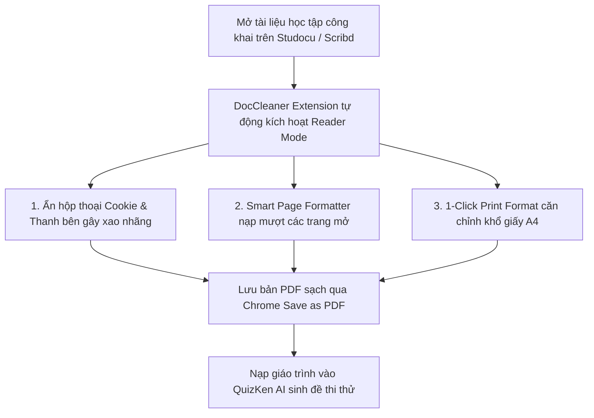

> **TL;DR (Tóm tắt nhanh):**  
> Trình duyệt web (Google Chrome, Microsoft Edge, Brave, Cốc Cốc) là cổng giao tiếp thông tin chính của sinh viên và người làm nghiên cứu. Để tránh bị xao nhãng bởi banner nổi, popup cookie và định dạng trang web lộn xộn khi đọc tài liệu học thuật trực tuyến, bộ 7 tiện ích mở rộng (Extensions) tuyển chọn năm 2026 – đứng đầu là **[DocCleaner - Better Studocu & Scribd Reader](https://chromewebstore.google.com/detail/doccleaner-better-studocu/fnhdoegoihnkgggnaiemommemdejhbkb?hl=vi)** trên Chrome Web Store – sẽ giúp bạn bật chế độ đọc tập trung (Reader Mode), căn chỉnh bố cục in A4 sạch đẹp và kết hợp ôn thi chủ động cùng **[QuizKen AI](https://app.quizken.com)**!

---

# Top 7 Extension Trình Duyệt Đọc & Quản Lý Tài Liệu Học Tập Miễn Phí (2026)

Khi bước vào mùa làm tiểu luận, nghiên cứu khóa luận hay ôn thi học kỳ, phần lớn thời gian của bạn là ngồi trước màn hình trình duyệt để tra cứu học liệu mở, bài báo khoa học và đề cương môn học.

Tuy nhiên, trải nghiệm đọc trên trình duyệt mặc định thường gặp các bất tiện:
* Giao diện các trang chia sẻ tài liệu trực tuyến chứa nhiều hộp thoại cookie, thanh điều hướng phụ và banner thông báo chiếm diện tích màn hình.
* Lưu trang web học thuật về máy để đọc ngoại tuyến thường bị vỡ bố cục hoặc lẫn thanh menu vào bản in PDF.
* Quản lý hàng chục nguồn trích dẫn APA/IEEE thủ công rất dễ sai sót.

Dưới đây là 7 tiện ích mở rộng hợp pháp, an toàn và hữu ích nhất năm 2026 giúp sinh viên tối ưu hóa không gian đọc và nghiên cứu trên trình duyệt.

---

## 1. DocCleaner – Tiện Ích Bật Reader Mode & Định Dạng Bản In A4 Cho Studocu, Scribd

* **Cài đặt chính thức:** [Chrome Web Store (1-Click)](https://chromewebstore.google.com/detail/doccleaner-better-studocu/fnhdoegoihnkgggnaiemommemdejhbkb?hl=vi).
* **Nền tảng hỗ trợ:** Google Chrome, Microsoft Edge, Brave, Cốc Cốc (chuẩn Manifest V3).

### Vì sao DocCleaner được sinh viên yêu thích?
1. **Chế độ đọc tập trung (Reader Mode):** Tự động ẩn các hộp thoại cookie và thanh điều hướng phụ ngay trong phiên duyệt web cục bộ để bạn tập trung 100% vào nội dung bài giảng.
2. **Hạn chế lỗi trang trắng khi cuộn:** Tính năng *Smart Page Formatter* hỗ trợ pre-render mượt mà các trang tài liệu mở, giúp cuộn trang và chuẩn bị bản in A4 không bị hụt trang.
3. **An toàn & Minh bạch 100%:** Tiện ích đã qua kiểm duyệt Chrome Web Store, chạy 100% Client-Side và không thu thập dữ liệu người dùng.

---

## 2. Top 6 Tiện Ích Hỗ Trợ Học Tập & Nghiên Cứu Đỉnh Cao Khác

| Tên Extension | Tính năng cốt lõi | Giá trị mang lại cho người học |
| :--- | :--- | :--- |
| **2. SingleFile** | Lưu toàn bộ trang web vào 1 file HTML duy nhất. | Lưu trữ bài viết khoa học ngoại tuyến (offline) chuẩn xác từng hình ảnh, không lo mất link tham khảo. |
| **3. Zotero Connector** | Tự động nhận diện bài báo khoa học, luận án. | Lưu tài liệu từ Google Scholar vào thư viện nghiên cứu chỉ với 1 click, tự động trích dẫn chuẩn APA 7th, Harvard, IEEE. |
| **4. Copyfish Free OCR** | Nhận diện chữ quang học (OCR) từ hình ảnh & video bài giảng. | Trích xuất nhanh ghi chú từ slide hình ảnh hoặc video bài giảng của giảng viên sang văn bản. |
| **5. Vimium** | Điều khiển trình duyệt bằng phím tắt bàn phím. | Bấm phím `F` để mở liên kết và chuyển tab nhanh mà không cần rời tay khỏi bàn phím. |
| **6. Dark Reader** | Đổi trang web sang chế độ nền tối (Dark Mode) dịu mắt. | Bảo vệ thị lực khi sinh viên đọc tài liệu học thuật dài vào buổi tối. |
| **7. QuizKen Web Ecosystem** | Nền tảng tạo đề trắc nghiệm AI & 58 công cụ học tập miễn phí. | Biến giáo trình PDF/Word thành đề thi thử 3 phần chuẩn GDPT 2018 và bộ thẻ Flashcard SM-2. |

---

## 3. Quy Trình Nghiên Cứu & Ôn Thi 4 Bước Khoa Học

1. **Bước 1 (Đọc tập trung):** Sử dụng **DocCleaner Reader Mode** để đọc hiểu nhanh các đề cương và bài giảng công khai mà không bị quảng cáo hay popup làm gián đoạn.
2. **Bước 2 (Lưu trữ & Trích dẫn):** Dùng **Zotero Connector** để gắn thẻ tài liệu tham khảo và quản lý danh mục trích dẫn chuẩn học thuật cho bài tiểu luận.
3. **Bước 3 (Chuyển đổi thành bài test):** Mở [https://app.quizken.com](https://app.quizken.com), nạp file giáo trình PDF/Word của bạn vào hệ thống.
4. **Bước 4 (Khảo thí & Luyện phản xạ):** QuizKen AI tự động sinh đề thi trắc nghiệm kèm lời giải chi tiết để bạn tự kiểm tra và lấp đầy lỗ hổng kiến thức.

---

## Câu hỏi thường gặp (FAQ)

### 1. Cài đặt các tiện ích trên có làm chậm trình duyệt không?
Không. Các tiện ích như DocCleaner, SingleFile hay Zotero Connector chỉ kích hoạt khi bạn mở trang tài liệu hoặc bấm vào biểu tượng tiện ích, tiêu tốn rất ít bộ nhớ RAM.

### 2. Ngoài extension trình duyệt, QuizKen có công cụ nào dùng ngay không cần cài đặt không?
Có! Bạn có thể truy cập trực tiếp **[58 Công Cụ Học Tập & Tiện Ích Miễn Phí](/cong-cu)** trên website QuizKen (tính điểm GPA, trộn đề Word, đếm từ, chạy thử Python, giải mã JWT/SHA-256...) hoạt động 100% trên trình duyệt mà không cần cài đặt bất kỳ phần mềm nào.
