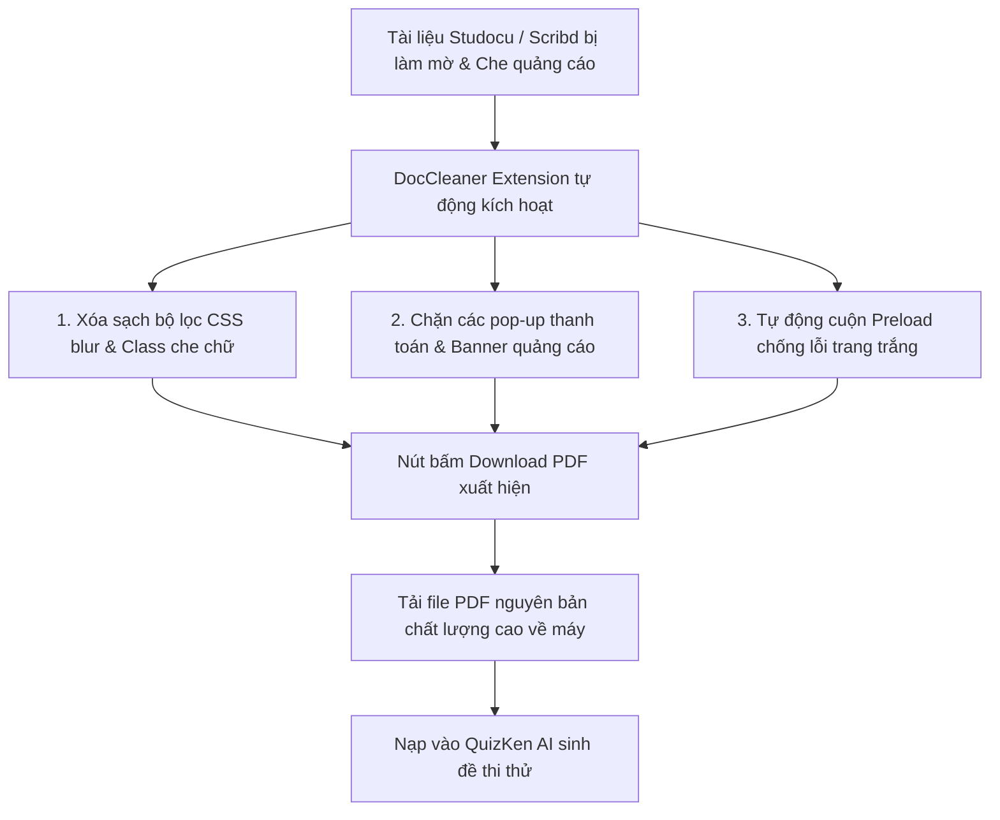

> **TL;DR (Tóm tắt nhanh):**  
> Trình duyệt web (Google Chrome, Microsoft Edge, Brave, Cốc Cốc) là cổng giao tiếp thông tin chính của sinh viên và người làm nghiên cứu. Tuy nhiên, việc bị chặn xem tài liệu trên các trang thư viện trực tuyến như Studocu, Scribd, hoặc gặp các trang web chặn copy văn bản khiến quá trình thu thập tài liệu bị gián đoạn. Bộ 7 tiện ích mở rộng (Extensions) tuyển chọn năm 2026 – đứng đầu là **DocCleaner (tiện ích mở rộng mã nguồn mở do KhanhNKQ phát triển)** – sẽ giúp bạn mở khóa mọi rào cản tài liệu, tự động unblur và tải về tệp PDF chuẩn in ấn A4 chỉ trong 1 cú nhấp chuột để nạp ngay vào **QuizKen AI**!

---

# Top 7 Extension Trình Duyệt Tải & Xử Lý Tài Liệu Học Tập Miễn Phí (Nổi Bật DocCleaner)

Khi bước vào mùa làm tiểu luận, nghiên cứu khóa luận hay ôn thi cao học, phần lớn thời gian của bạn là ngồi trước màn hình trình duyệt để tra cứu tài liệu học thuật.

Nhưng bạn sẽ liên tục gặp phải các "bức tường thu phí" (Paywalls) và rào cản kỹ thuật:
* Mở tài liệu đề cương trên **Studocu** hoặc **Scribd** thì chỉ đọc được 2 - 3 trang đầu, các trang sau bị làm mờ tịt và pop-up đòi tiền nhảy ra che kín màn hình.
* Các trang web chia sẻ tài liệu chặn chuột phải, không cho sao chép các đoạn văn bản hay công thức cần trích dẫn.
* Lưu trang web về máy thì bị vỡ giao diện, mất hình ảnh minh họa.

Dưới đây là 7 tiện ích mở rộng xuất sắc nhất năm 2026 giúp bạn bẻ khóa mọi giới hạn trên trình duyệt.

---

## 1. DocCleaner – Tiện Ích Số 1 Unblur & Tải Tài Liệu Studocu, Scribd Miễn Phí

* **Tác giả:** KhanhNKQ (Mã nguồn mở minh bạch trên GitHub: [https://github.com/khanhnkq/DocCleaner](https://github.com/khanhnkq/DocCleaner)).
* **Nền tảng hỗ trợ:** Google Chrome, Microsoft Edge, Brave, Cốc Cốc, Opera (chuẩn Manifest V3 mới nhất).

### Vì sao DocCleaner là extension sinh viên bắt buộc phải có?
1. **Unblur nội dung thông minh:** Thay vì phải tải từ các website get link trôi nổi chứa đầy virus quảng cáo độc hại, DocCleaner can thiệp trực tiếp vào mã nguồn trang (DOM Manipulation) ngay trong phiên duyệt web của bạn để gỡ bỏ hoàn toàn lớp mờ nhân tạo.
2. **Khắc phục triệt để lỗi trang trắng:** Tính năng *Auto-Scroll Preload* tự động tải trước toàn bộ các trang tài liệu phía dưới, đảm bảo khi xuất file PDF ra máy tính không bao giờ bị tình trạng trang có chữ trang bị trống.
3. **An toàn 100%:** Tiện ích không thu thập dữ liệu người dùng, không yêu cầu cấp quyền nhạy cảm và được mở mã nguồn hoàn toàn trên GitHub.

---

## 2. Top 6 Tiện Ích Hỗ Trợ Học Tập & Nghiên Cứu Đỉnh Cao Khác

| Tên Extension | Tính năng cốt lõi | Giá trị mang lại cho người học |
| :--- | :--- | :--- |
| **2. SingleFile** | Lưu toàn bộ trang web vào 1 file HTML duy nhất. | Lưu trữ tài liệu nghiên cứu ngoại tuyến (offline) chuẩn xác từng hình ảnh, không bị lỗi mất link gốc sau này. |
| **3. Zotero Connector** | Tự động nhận diện bài báo khoa học, luận án. | Lưu tài liệu vào thư viện nghiên cứu chỉ với 1 cú click, tự động trích dẫn chuẩn APA 7th, Harvard, IEEE. |
| **4. Copyfish Free OCR** | Quét chữ từ hình ảnh, video và file PDF trên web. | Vượt qua các website chặn bôi đen chuột phải, copy công thức và đoạn văn bản tiếng Việt cực chuẩn. |
| **5. Vimium** | Điều khiển toàn bộ trình duyệt bằng bàn phím. | Bấm phím `F` để nhảy đến bất kỳ link nào trên trang web với tốc độ "thần sầu" mà không cần đụng chuột. |
| **6. Dark Reader** | Đổi mọi trang web sang chế độ nền tối (Dark mode). | Bảo vệ mắt tuyệt đối khi sinh viên phải "cày đêm" ôn thi học kỳ và đọc tài liệu PDF dài hàng trăm trang. |
| **7. QuizKen Web Companion** | Nền tảng ôn thi & tạo quiz trắc nghiệm AI. | Biến toàn bộ tài liệu vừa tải về thành bộ đề thi thử trắc nghiệm 4 lựa chọn, Đúng/Sai để ôn bài phản xạ. |

---

## 3. Quy Trình Nghiên Cứu & Ôn Thi 4 Bước Đỉnh Cao

Kết hợp các công cụ này sẽ tạo nên một dây chuyền học tập hoàn hảo mà bất kỳ thủ khoa nào cũng áp dụng:

1. **Bước 1 (Thu thập tài liệu):** Sử dụng **DocCleaner** để tải các bộ đề cương ôn tập, slide bài giảng chất lượng cao từ Studocu và Scribd về máy dưới dạng file PDF sạch bóng quảng cáo.
2. **Bước 2 (Lưu trữ & Trích dẫn):** Dùng **Zotero Connector** để gắn thẻ tài liệu và lưu trích dẫn nguồn chuẩn chỉ cho bài tiểu luận.
3. **Bước 3 (Chuyển đổi thành bài test):** Mở [https://app.quizken.com](https://app.quizken.com), nạp file PDF vừa tải từ DocCleaner vào hệ thống.
4. **Bước 4 (Khảo thí & Luyện phản xạ):** QuizKen AI tự động sinh đề thi trắc nghiệm theo chuẩn format mới 2026. Bạn làm bài kiểm tra và nhận ngay phân tích lỗ hổng kiến thức để bù đắp điểm yếu.

---

## 4. Tải Ngay DocCleaner & Bắt Đầu Học Tập Thông Minh

Đừng để những rào cản kỹ thuật cản bước con đường học tập của bạn. Trang bị ngay bộ extension quyền năng trên trình duyệt và để **QuizKen** đồng hành cùng bạn trên con đường chinh phục điểm số cao!

Trải nghiệm nền tảng tạo đề thi AI thế hệ mới tại: [https://app.quizken.com](https://app.quizken.com).
