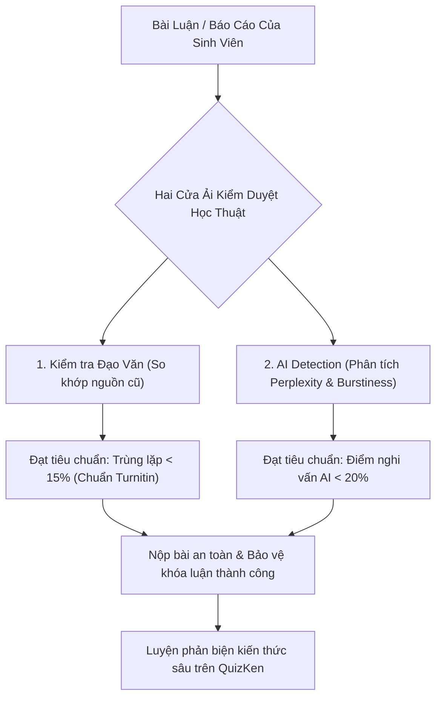

> **TL;DR (Tóm tắt nhanh):**  
> Trước khi nộp bài tiểu luận, báo cáo thực tập hay khóa luận tốt nghiệp lên cổng Turnitin của trường đại học, sinh viên nên tự rà soát trước bằng các **phần mềm kiểm tra đạo văn miễn phí 2026** và bộ công cụ quét AI Detection như **GPTZero** (`gptzero.me`), **ZeroGPT** (`zerogpt.com`) hoặc **Kiemtradaovan.vn**. Hiểu rõ cơ chế đo lường độ ngẫu nhiên từ ngữ (Perplexity) và độ biến thiên câu (Burstiness) sẽ giúp bạn viết bài tự nhiên, tránh bị "bắt nhầm" văn phong AI và đảm bảo 100% tiêu chuẩn liêm chính học thuật. Để củng cố độ hiểu sâu bài viết, hãy dùng **QuizKen** tạo bộ câu hỏi tự kiểm tra kiến thức trước khi bước vào buổi bảo vệ đề tài!

---

# Top Phần Mềm Kiểm Tra Đạo Văn & AI Detection Miễn Phí Cho Sinh Viên 2026

Từ năm học 2025 - 2026, hầu hết các trường đại học tại Việt Nam đã đồng loạt nâng cấp hệ thống kiểm duyệt học thuật. Bên cạnh chỉ số trùng lặp văn bản truyền thống (Similarity Index trên Turnitin thường yêu cầu dưới 15% - 20%), các trường còn kích hoạt thêm tính năng **AI Writing Detection (Phát hiện văn bản do AI tạo ra)**.

Điều này khiến nhiều sinh viên hoang mang:
* Ngay cả khi tự viết bằng năng lực bản thân, bài viết vẫn có nguy cơ bị thuật toán gán cờ "Dương tính giả" (False Positive) là do AI viết vì câu cú quá chỉn chu, khuôn mẫu.
* Không có tài khoản Turnitin giảng viên để tự kiểm tra trước ở nhà (hoặc phải mua qua các dịch vụ trung gian với rủi ro bị lộ đề tài và lưu vào kho dữ liệu Repository của trường).
* Không biết cách diễn đạt lại (Paraphrase) đúng quy chuẩn liêm chính học thuật.

Dưới đây là danh sách tổng hợp các **phần mềm kiểm tra đạo văn miễn phí 2026** và công cụ AI Detection uy tín nhất kèm giải pháp xử lý triệt để!

---

## 1. Phân Biệt: Đạo Văn Truyền Thống vs AI Detection

Rất nhiều sinh viên nhầm lẫn giữa hai khái niệm này:

1. **Kiểm tra đạo văn (Plagiarism Check):** So khớp từng chuỗi từ (String Matching) giữa bài viết của bạn với hàng tỷ trang web, luận văn và bài báo khoa học đã xuất bản. Nếu bạn sao chép nguyên văn trên 6 - 8 từ liên tiếp mà không đặt trong ngoặc kép hoặc không trích nguồn, hệ thống sẽ báo đỏ.
2. **AI Detection:** Không so khớp văn bản cũ mà phân tích **xác suất thống kê của từ ngữ**:
   * **Perplexity (Độ ngẫu nhiên):** AI thường chọn những từ có xác suất xuất hiện cao nhất và dễ đoán nhất. Văn phong con người có độ ngẫu nhiên cao hơn, giàu tính biểu cảm và bất ngờ hơn.
   * **Burstiness (Độ biến thiên cấu trúc câu):** Con người thường viết xen kẽ câu rất dài và câu rất ngắn. Ngược lại, văn bản do AI tạo ra thường có độ dài các câu rất đồng đều và cấu trúc ngữ pháp lặp lại theo khuôn mẫu.

---

## 2. Top Phần Mềm Kiểm Tra Đạo Văn & Quét AI Miễn Phí Tốt Nhất 2026

| Công cụ | Địa chỉ website | Khả năng quét Đạo văn | Khả năng quét AI | Mức độ hỗ trợ tiếng Việt |
| :--- | :--- | :--- | :--- | :--- |
| **GPTZero** | `gptzero.me` | Có (bản cập nhật mới) | **Đỉnh cao số 1 thế giới** | Rất tốt (chỉ rõ từng câu nghi vấn AI) |
| **ZeroGPT** | `zerogpt.com` | Quét cơ bản | Rất nhạy với các mô hình GPT/Claude | Khá tốt |
| **QuillBot Checker** | `quillbot.com` | Rất mạnh | Tích hợp AI Detector | Tốt |
| **Kiemtradaovan.vn** | `kiemtradaovan.vn` | **Chuyên sâu tiếng Việt** | Đang hoàn thiện | Tối ưu riêng cho văn bản tiếng Việt |
| **DupliChecker** | `duplichecker.com` | Tốt (1,000 từ/lần) | Có | Cơ bản |

---

## 3. Cách Khắc Phục Tình Trạng "Dương Tính Giả" (False Positive) Khi Dùng AI

Bộ Giáo dục & Đào tạo cũng như các hội đồng học thuật quốc tế năm 2026 đều ban hành hướng dẫn rõ ràng: **AI được phép sử dụng như một công cụ hỗ trợ tư duy, tìm kiếm tài liệu và gợi ý dàn ý, nhưng tuyệt đối nghiêm cấm việc để AI viết hộ toàn bộ (Ghostwriting)**.

Để bài viết của bạn an toàn 100% trước các công cụ kiểm duyệt:

1. **Ghi chép và lưu giữ lịch sử nháp (Version History):** Luôn soạn thảo bài luận trên Google Docs hoặc Word có bật tính năng *Lịch sử phiên bản*. Đây là bằng chứng đanh thép chứng minh bạn đã tự gõ, tự chỉnh sửa bài viết qua nhiều ngày nếu chẳng may bị AI Detector nghi ngờ oan.
2. **Đa dạng hóa độ dài câu (Tăng Burstiness tự nhiên):** Xen kẽ những câu phân tích học thuật dài với những câu kết luận ngắn gọn, súc tích. Đưa vào các ví dụ thực tế, số liệu khảo sát tại Việt Nam mà các mô hình AI ngôn ngữ lớn chưa từng được huấn luyện.
3. **Minh bạch việc ứng dụng AI:** Thêm một mục ngắn ở cuối bài: *"Tuyên bố sử dụng AI: Nhóm tác giả có sử dụng ChatGPT/DeepSeek trong việc hỗ trợ rà soát lỗi chính tả và tìm kiếm tài liệu tham khảo theo quy định liêm chính học thuật."*

---

## 4. Cầu Nối QuizKen: Nâng Cao Năng Lực Học Thật - Thi Thật

Cách tốt nhất để không bao giờ phải lo sợ các phần mềm kiểm tra đạo văn hay AI Detection chính là **thực sự làm chủ kiến thức bài học**:

1. **Hiểu sâu thay vì chép bài:** Khi bạn tự mình làm chủ lý thuyết, ngôn từ viết ra sẽ tự nhiên và mang đậm dấu ấn cá nhân của bạn.
2. **Kiểm tra năng lực trên [QuizKen](https://quizken.com):** Đưa toàn bộ tài liệu nghiên cứu của bạn vào QuizKen để hệ thống tạo ra đề thi trắc nghiệm khách quan đánh giá mức độ hiểu bài.
3. **Luyện tập phản xạ giải thích:** Trả lời các câu hỏi tình huống trên QuizKen giúp bạn rèn luyện khả năng diễn đạt lưu loát, tự tin trả lời phỏng vấn hoặc chất vấn của hội đồng chấm thi mà không sợ bất kỳ câu hỏi hóc búa nào.

Hãy sử dụng các phần mềm kiểm tra đạo văn thông minh và đồng hành cùng **QuizKen** để xây dựng hành trình học tập vững chắc, trung thực và đạt kết quả cao nhất!
