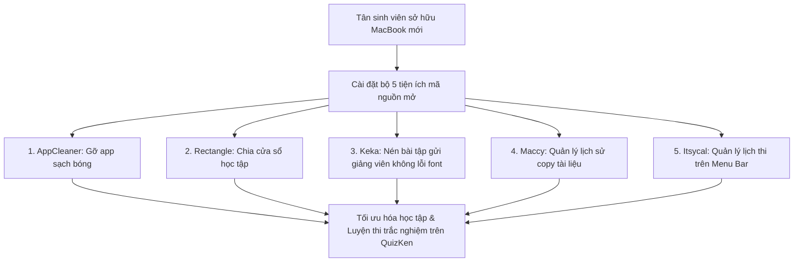

> **TL;DR (Tóm tắt nhanh):**  
> Chuyển từ Windows sang sử dụng MacBook thường khiến nhiều tân sinh viên bỡ ngỡ vì những thiếu hụt cố hữu của macOS: Không có phím tắt chia đôi cửa sổ, kéo app vào Thùng rác vẫn để lại hàng gigabyte file rác ẩn sâu trong ổ đĩa, giải nén file `.zip` gửi cho thầy cô dùng máy tính Windows thì bị lỗi font chữ tiếng Việt, và không có khay nhớ tạm Clipboard. Bộ 5 phần mềm mã nguồn mở miễn phí 100%: **AppCleaner, Rectangle, Keka, Maccy và Itsycal** sẽ giải quyết triệt để 100% các vấn đề trên!

---

# Top 5 Tiện Ích Miễn Phí Cho MacBook Tân Sinh Viên Bắt Buộc Phải Cài (2026)

Hệ điều hành macOS nổi tiếng với sự mượt mà, thời lượng pin ấn tượng và màn hình hiển thị sắc nét. Tuy nhiên, đối với học sinh, sinh viên và giáo viên Việt Nam, macOS mặc định vẫn có một số "điểm nghẽn" gây ức chế trong quá trình học tập và làm việc nhóm.

Rất nhiều bạn sinh viên vội vàng chi tiền mua các phần mềm trả phí đắt đỏ hoặc tải các bản "bẻ khóa" (crack) trôi nổi trên mạng khiến máy tính bị dính mã độc và nhanh tã pin.

Dưới đây là danh sách **5 phần mềm mã nguồn mở miễn phí vĩnh viễn** mà bất kỳ chiếc máy Mac nào cũng nên có.

---

## 1. Danh Sách 5 Bảo Bối Miễn Phí Cho Người Dùng Mac

| Tên phần mềm | Bản quyền | Vấn đề macOS giải quyết | Lý do sinh viên bắt buộc phải có |
| :--- | :---: | :--- | :--- |
| **AppCleaner** | Miễn phí 100% | Kéo app vào Thùng rác không xóa sạch cache và file cấu hình. | Quét sạch 100% các file rác ẩn sâu trong thư mục `~/Library/`, giải phóng dung lượng ổ cứng quý giá. |
| **Rectangle** | Mã nguồn mở | macOS không có phím tắt kéo bám cửa sổ sang 2 bên như Windows. | Dùng phím tắt chia màn hình thành nửa trái, nửa phải, chia 4 góc hoặc chia 3 ô cực kỳ mượt mà. |
| **Keka** | Mã nguồn mở | Trình giải nén Archive Utility mặc định của Mac hay làm lỗi font chữ tiếng Việt khi nén file gửi sang Windows. | Nén và giải nén mọi định dạng (`.zip`, `.7z`, `.rar`), hỗ trợ mật khẩu và chống lỗi bảng mã UTF-8. |
| **Maccy** | Mã nguồn mở | macOS mặc định không có lịch sử khay nhớ tạm Clipboard. | Lưu lại danh sách văn bản và hình ảnh đã copy, tìm kiếm và dán lại bằng phím tắt `Shift + Cmd + C`. |
| **Itsycal** | Miễn phí | Bấm vào đồng hồ trên thanh Menu Bar của Mac không hiện lịch tháng. | Hiện một cuốn lịch mini thanh lịch ngay trên thanh Menu Bar để sinh viên theo dõi lịch thi cử và deadline. |

---

## 2. Điểm Nhấn Chi Tiết: Keka & Rectangle

### Keka – Chấm dứt lỗi font tiếng Việt khi nộp bài cho giảng viên
Khi bạn nén một thư mục chứa các file Word có tên tiếng Việt có dấu (ví dụ: `Báo cáo môn Triết học.docx`) bằng công cụ mặc định của Mac, khi gửi qua email hoặc nộp lên LMS, giảng viên dùng máy Windows mở ra sẽ thấy tên file bị biến thành ký tự kỳ lạ (như `Báo cáo môn Triết...`).
* **Keka** giải quyết triệt để lỗi này nhờ tích hợp thuật toán chuẩn hóa bảng mã Unicode, giúp việc trao đổi bài tập giữa sinh viên dùng Mac và giảng viên dùng Windows luôn trơn tru.

### Rectangle – Chia màn hình đa nhiệm trong nửa nốt nhạc
Khi làm bài tập lớn, bạn cần:
* Nửa màn hình bên trái mở tài liệu PDF giáo trình.
* Nửa màn hình bên phải mở trang web làm bài kiểm tra [QuizKen](https://app.quizken.com).
* Chỉ cần nhấn tổ hợp phím **`Control + Option + Mũi tên trái / phải`**, hai cửa sổ sẽ lập tức chia đôi cân đối chuẩn xác mà không cần dùng chuột căn chỉnh.

---

## 3. Tối Đa Hóa Hiệu Quả Ôn Thi Cùng QuizKen Trên MacBook

Sau khi đã trang bị đầy đủ các tiện ích trên, bạn đã có một môi trường làm việc hoàn hảo. Đừng quên rằng việc học tập trên giảng đường đại học đòi hỏi phương pháp ghi nhớ chủ động (Active Recall).

Mỗi khi tải được một tài liệu đề cương hay bài tập về máy:
1. Mở [https://app.quizken.com](https://app.quizken.com) trên trình duyệt Safari hoặc Chrome.
2. Nạp tài liệu vào hệ thống để AI tự động phân tích và tạo bài thi trắc nghiệm tương tác.
3. Rèn luyện phản xạ chọn đáp án đúng để tự tin ẵm trọn điểm A trong kỳ thi sắp tới!

Bắt đầu trải nghiệm ngay tại: [https://app.quizken.com](https://app.quizken.com).
