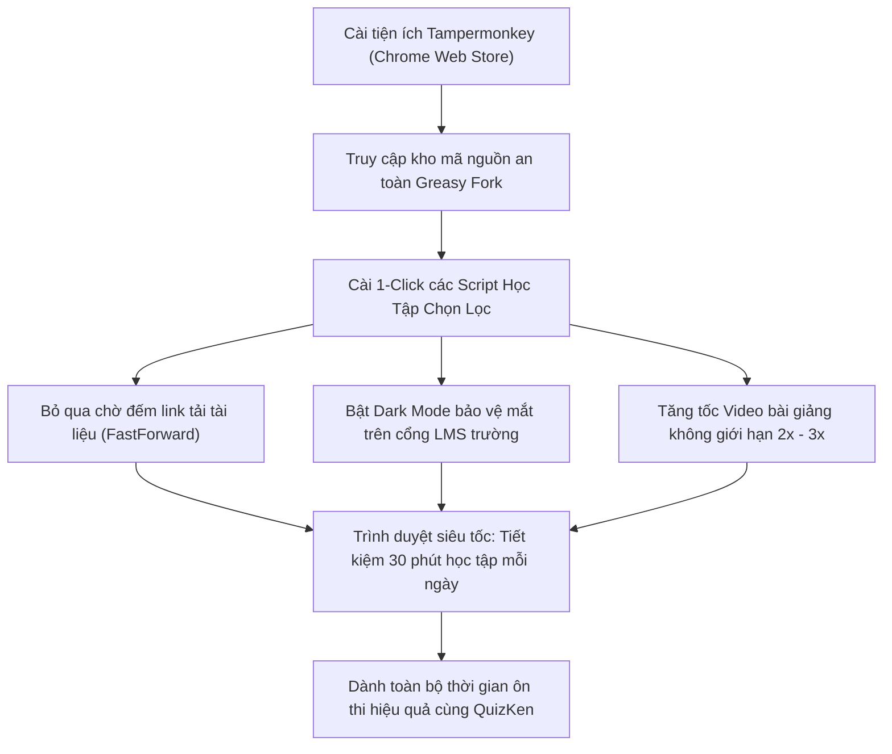

> **TL;DR (Tóm tắt nhanh):**  
> Việc cài đặt tiện ích mở rộng **Tampermonkey** kết hợp các kho **script Tampermonkey học tập miễn phí** trên cộng đồng Greasy Fork (`greasyfork.org`) giúp sinh viên tiết kiệm hàng chục phút mỗi ngày bằng cách: tự động bỏ qua các trang đếm ngược link tải tài liệu (bỏ qua chờ 30 - 60 giây), bật chế độ nền tối (Dark Mode) cho các trang web LMS cũ của trường đại học, và tùy chỉnh tốc độ phát video bài giảng lên 1.5x - 2.5x. Sau khi tối ưu hóa trình duyệt mượt mà, bạn sẽ có nhiều thời gian và năng lượng hơn để tập trung ôn luyện đề thi thực chiến trên **QuizKen**!

---

# Top Script Tampermonkey Hỗ Trợ Học Tập & Tải Tài Liệu Miễn Phí Cho Sinh Viên (2026)

Hầu hết sinh viên đại học đều cài các tiện ích mở rộng cơ bản như chặn quảng cáo. Tuy nhiên, ít ai biết đến "vũ khí bí mật" của các lập trình viên và sinh viên khối ngành công nghệ: **Userscript (Kịch bản người dùng) chạy trên Tampermonkey**.

Userscript là những đoạn mã JavaScript nhỏ chạy phía trình duyệt của bạn, giúp tự động can thiệp và cải tiến giao diện hoặc tính năng của bất kỳ trang web nào theo ý muốn. Thay vì phải chờ đợi các website trường học hay các trang chia sẻ tài liệu cập nhật tính năng mới, bạn có thể tự mình tối ưu hóa trải nghiệm lướt web chỉ với 1 cú click chuột.

Bài viết này từ **QuizKen** sẽ tổng hợp những bộ **script Tampermonkey học tập miễn phí** an toàn, hữu ích nhất trong năm 2026 dành riêng cho sinh viên!

---

## 1. Tampermonkey Là Gì & Cách Cài Đặt An Toàn 100%

[Tampermonkey](https://www.tampermonkey.net) là trình quản lý Userscript phổ biến nhất thế giới với hơn 10 triệu người dùng trên Chrome Web Store, Microsoft Edge Add-ons và Mozilla Firefox:

1. **Cài đặt Tampermonkey:** Truy cập Chrome Web Store, tìm kiếm tiện ích **Tampermonkey** và bấm **Thêm vào Chrome (Add to Chrome)**.
2. **Kho mã nguồn Greasy Fork:** Nơi lưu trữ hàng trăm nghìn kịch bản do cộng đồng đóng góp tại `https://greasyfork.org`.
3. **Cài script:** Khi vào trang script trên Greasy Fork, bạn chỉ cần bấm nút màu xanh **Cài đặt kịch bản này (Install this script)** > Tampermonkey sẽ hiện cửa sổ xác nhận > Bấm **Cài đặt**. Kịch bản sẽ tự động chạy ngầm mỗi khi bạn truy cập trang web tương ứng.

---

## 2. Top 5 Script Tampermonkey "Cứu Tinh" Của Sinh Viên Mùa Thi

### 1. Script Bỏ Qua Link Rút Gọn & Đếm Ngược Tải Tài Liệu
* **Nỗi ám ảnh:** Khi tìm tài liệu ôn thi trên mạng, bạn thường bị chuyển hướng qua các trang link rút gọn bắt chờ đếm ngược 30 giây đến 60 giây và bắt xem hàng tá quảng cáo phiền toái.
* **Giải pháp Userscript:** Kịch bản **FastForward (Bypass All Shortlinks)** tự động nhận diện đích đến của đường link, bỏ qua hoàn toàn bước đếm ngược và đưa bạn thẳng đến link tải file PDF (Google Drive, Fshare hoặc MediaFire) chỉ trong 0.5 giây!

### 2. Script Tự Động Bật Dark Mode Cho Cổng Học Tập Của Trường
* **Thực trạng:** Cổng thông tin đào tạo (LMS, Moodle, BlackBoard) của nhiều trường đại học tại Việt Nam vẫn giữ giao diện nền trắng chói mắt từ thập niên trước, khiến sinh viên rất nhanh mỏi mắt khi học đêm.
* **Giải pháp Userscript:** Kịch bản **Dark Reader (Userscript Edition)** tự động đảo màu nền sang tone đen huyền bí (Dark Mode) dịu mắt, đồng thời tối ưu độ tương phản của chữ viết mà không làm lỗi hình ảnh bài giảng.

### 3. Script HTML5 Video Controller (Tăng Tốc Bài Giảng Không Giới Hạn)
* **Thực trạng:** Trình phát video trên một số cổng trường chỉ cho phép xem ở tốc độ 1.0x, không có phím tua nhanh hoặc không có phím tắt tua 10 giây.
* **Giải pháp Userscript:** Kịch bản **HTML5 Video Controller** cho phép bạn dùng phím tắt trên bàn phím (`D` để tăng tốc độ lên 1.25x, 1.5x, 2.0x, thậm chí 3.0x; `S` để giảm tốc độ) trên MỌI trình phát video web, giúp bạn xem lại 1 tiết học 90 phút chỉ trong 45 phút!

### 4. Script Tự Động Giữ Đăng Nhập Cổng Trường (Keep Alive Session)
* **Thực trạng:** Khi đang ngồi làm bài hoặc đọc tài liệu trên web trường, nếu bạn không bấm chuột trong 15 phút, hệ thống sẽ tự động đăng xuất và bạn bị mất toàn bộ câu trả lời đang gõ dở.
* **Giải pháp Userscript:** Script này sẽ gửi tín hiệu giữ phiên (Ping heartbeat) ngầm mỗi 5 phút, đảm bảo bạn không bao giờ bị văng khỏi cổng đào tạo khi đang ôn thi.

---

## 3. Bảng Tổng Hợp & Đánh Giá Các Script Hữu Ích

| Tên Script | Mục đích sử dụng | Nguồn cài đặt an toàn | Mức độ tiết kiệm thời gian |
| :--- | :--- | :--- | :--- |
| **FastForward / Bypass Links** | Bỏ qua đếm ngược 60s tải file | `greasyfork.org` | **Rất cao (Tiết kiệm 5 - 10p/ngày)** |
| **HTML5 Video Speed Master** | Tùy biến tốc độ phát video 0.5x - 4x | `greasyfork.org` | **Cao (Rút ngắn 50% giờ xem bài giảng)** |
| **LMS Dark Mode Enhancer** | Bảo vệ mắt khi học khuya | `greasyfork.org` | Bảo vệ thị lực sinh viên |
| **Copy Protector Remover** | Gỡ bỏ chặn chuột phải và bôi đen | `greasyfork.org` | Nhanh chóng lấy trích dẫn |

---

## 4. Cảnh Báo An Toàn: 3 Nguyên Tắc Vàng Khi Dùng Userscript

> [!CAUTION]
> **Tuyệt đối tuân thủ các nguyên tắc an ninh mạng sau:**
> 1. **Chỉ cài đặt từ Greasy Fork:** Không bao giờ cài script từ các file lạ trôi nổi trên mạng xã hội hoặc nhóm chat.
> 2. **Kiểm tra đánh giá cộng đồng:** Chỉ cài những script có điểm đánh giá màu xanh (Good rating) và hàng chục nghìn lượt tải.
> 3. **Không dùng script "Auto-Quiz Hack":** Các script tự động trả lời bài thi trực tuyến thường vi phạm nghiêm trọng quy chế thi, dễ bị hệ thống giám sát của trường phát hiện và đình chỉ thi, đồng thời tiềm ẩn mã độc đánh cắp mật khẩu tài khoản sinh viên.

---

## 5. Cầu Nối QuizKen: Dành Thời Gian Tiết Kiệm Được Để Ôn Luyện Thực Chiến

Mục đích của việc sử dụng các thủ thuật công nghệ và script Tampermonkey là **loại bỏ các thao tác lãng phí thời gian vô nghĩa**, từ đó bạn có thêm thời gian chất lượng để rèn luyện tư duy:

1. **Tiết kiệm 30 phút mỗi ngày:** Thay vì chờ đếm ngược link hay mỏi mắt vì giao diện cũ, bạn giải quyết xong tài liệu trong tích tắc.
2. **Chuyển hóa tài liệu sang [QuizKen](https://quizken.com):** Kéo thả các file tài liệu đã tải về vào QuizKen để tạo đề thi trắc nghiệm AI.
3. **Chinh phục kiến thức:** Làm bài thi thử trên QuizKen với giao diện hiện đại, chế độ gamification thú vị và hệ thống thống kê điểm yếu chính xác.

Hãy trang bị cho trình duyệt của mình bộ công cụ Tampermonkey thông minh và kết hợp cùng **QuizKen** để trở thành sinh viên công nghệ năng suất nhất mùa thi 2026!
