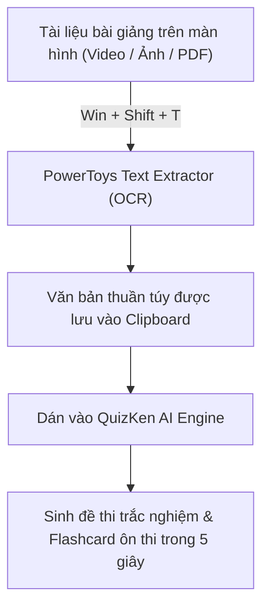

> **TL;DR (Tóm tắt nhanh):**  
> **Microsoft PowerToys** là bộ tiện ích mã nguồn mở chính chủ do Microsoft phát triển hoàn toàn miễn phí trên Windows 10 và 11. Đối với học sinh, sinh viên và giáo viên, PowerToys giải quyết triệt để những thao tác vụn vặt tốn thời gian: Phím tắt **`Win + Shift + T` (Text Extractor)** giúp copy chữ từ bất kỳ ảnh chụp bài giảng, video hay file PDF chống copy nào; **FancyZones** chia màn hình học tập khoa học; và **Peek (`Ctrl + Space`)** xem trước file tức thì. Kết hợp chữ trích xuất từ PowerToys nạp thẳng vào **QuizKen**, bạn có thể tạo bộ đề thi trắc nghiệm ôn tập chỉ trong 5 giây!

---

# Top 7 Tính Năng Microsoft PowerToys Biến Windows 11 Thành Cỗ Máy Học Tập

Nếu bạn đang sử dụng một chiếc laptop hoặc máy tính để bàn chạy hệ điều hành **Windows 11**, rất có thể bạn chỉ mới khai thác được khoảng 40% sức mạnh thực tế của máy.

Thay vì phải cài đặt hàng loạt phần mềm rác từ các nguồn không rõ nguồn gốc hoặc sử dụng các bản bẻ khóa tiềm ẩn mã độc, **Microsoft PowerToys** chính là giải pháp "tất cả trong một" an toàn 100%, không quảng cáo và có sẵn trên Microsoft Store hoặc GitHub.

Dưới đây là 7 tính năng "đắt giá" nhất của PowerToys mà bất kỳ bạn học sinh, sinh viên nào cũng nên kích hoạt ngay hôm nay.

---

## 1. Bảng Tổng Hợp 7 Tính Năng Quyền Năng Của Microsoft PowerToys

| Tính năng | Phím tắt mặc định | Ứng dụng thực tế cho học sinh & sinh viên |
| :--- | :---: | :--- |
| **Text Extractor** | `Win + Shift + T` | Quét và sao chép văn bản từ video bài giảng, hình ảnh giáo trình, file PDF bị khóa copy. |
| **FancyZones** | `Shift + Kéo chuột` | Chia màn hình máy tính thành 3 - 4 ô lưới khoa học để vừa tra cứu tài liệu vừa làm bài tập. |
| **PowerToys Run** | `Alt + Space` | Thanh tìm kiếm ứng dụng, tra từ điển, tính toán phép tính và chuyển đổi đơn vị siêu tốc. |
| **Peek** | `Ctrl + Space` | Nhấn để xem trước nội dung file Word, PDF, hình ảnh, mã nguồn mà không cần mở ứng dụng. |
| **Awake** | Nút chuyển trên Taskbar | Giữ cho máy tính luôn sáng màn hình, không bị chuyển sang chế độ Sleep khi tải file hay render video. |
| **Mouse Without Borders** | Tự động kết nối | Dùng chung 1 bàn phím và 1 chuột để điều khiển đồng thời cả 2 laptop Windows cạnh nhau. |
| **Color Picker** | `Win + Shift + C` | Chấm và lấy mã màu chuẩn xác trên màn hình để làm slide thuyết trình PowerPoint đẹp mắt. |

---

## 2. Chi Tiết 3 "Vũ Khí" Tối Ưu Năng Suất Học Tập

### 1. Text Extractor (`Win + Shift + T`) – Sao chép mọi chữ trên màn hình
Trước đây, khi giảng viên chiếu một slide chứa rất nhiều định nghĩa hoặc một video bài giảng trên YouTube, sinh viên thường phải ngồi gõ lại từng từ rất mất thời gian.
* Với Text Extractor: Bạn chỉ cần nhấn tổ hợp phím **`Win + Shift + T`**, dùng chuột kéo một khung chữ nhật quanh đoạn chữ bạn cần lấy.
* Ngay lập tức, công nghệ OCR tích hợp trong Windows sẽ nhận diện tiếng Việt có dấu với độ chuẩn xác tuyệt đối và lưu thẳng vào khay nhớ tạm (Clipboard).

### 2. FancyZones – Đa nhiệm chuyên nghiệp không giới hạn
Màn hình máy tính xách tay thường có kích thước từ 14 đến 15.6 inch. Việc chuyển qua chuyển lại giữa các cửa sổ ứng dụng (Alt + Tab liên tục) khiến não bộ bị phân mảnh sự tập trung.
* FancyZones cho phép bạn định sẵn các khung bố cục: Ví dụ 50% màn hình bên trái để file Word/Notion làm báo cáo, 25% phía trên bên phải mở bài thi trên [QuizKen](https://app.quizken.com), 25% phía dưới mở tài liệu tham khảo.
* Bạn chỉ cần giữ phím **Shift** và kéo thả cửa sổ vào vùng định sẵn, cửa sổ sẽ tự động bám khít hoàn hảo.

### 3. PowerToys Run (`Alt + Space`) – Khởi động mọi thứ trong 1 giây
Không cần phải bấm nút Start rồi cuộn tìm danh sách ứng dụng. Nhấn **`Alt + Space`**, một thanh tìm kiếm thanh lịch xuất hiện ở giữa màn hình:
* Gõ tên app để mở ngay lập tức.
* Gõ các phép tính như `= (450 * 1.5) / 100` để nhận kết quả toán học tức thì.
* Chuyển đổi đơn vị tiền tệ, đo lường hoặc tra mã màu HEX cực kỳ tiện lợi.

---

## 3. Hướng Dẫn Cài Đặt Microsoft PowerToys Miễn Phí 100%

1. **Cách 1 (Khuyên dùng):** Mở ứng dụng **Microsoft Store** trên Windows 11, tìm kiếm từ khóa `Microsoft PowerToys` và bấm **Install (Cài đặt)**.
2. **Cách 2:** Tải trực tiếp file cài đặt `.exe` từ kho lưu trữ GitHub chính thức của Microsoft: `github.com/microsoft/PowerToys`.
3. Sau khi cài đặt, bạn mở PowerToys lên và bật các tính năng bạn muốn sử dụng (phần mềm sẽ tự động khởi động cùng Windows một cách nhẹ nhàng).

---

## 4. Tối Đa Hóa Năng Suất Học Tập Cùng QuizKen

Sau khi dùng tính năng **Text Extractor** của PowerToys để trích xuất toàn bộ câu hỏi hoặc tóm tắt lý thuyết bài học, bước thông minh nhất bạn nên làm là:
1. Truy cập vào [https://app.quizken.com](https://app.quizken.com).
2. Dán nội dung vừa trích xuất vào khung **Tạo Đề Thi Bằng AI**.
3. Hệ thống sẽ ngay lập tức biến những đoạn văn bản khô khan thành bài kiểm tra trắc nghiệm tương tác giúp bạn ghi nhớ sâu kiến thức theo phương pháp Active Recall.

Trải nghiệm học tập và ôn thi thông minh ngay hôm nay tại: [https://app.quizken.com](https://app.quizken.com).
