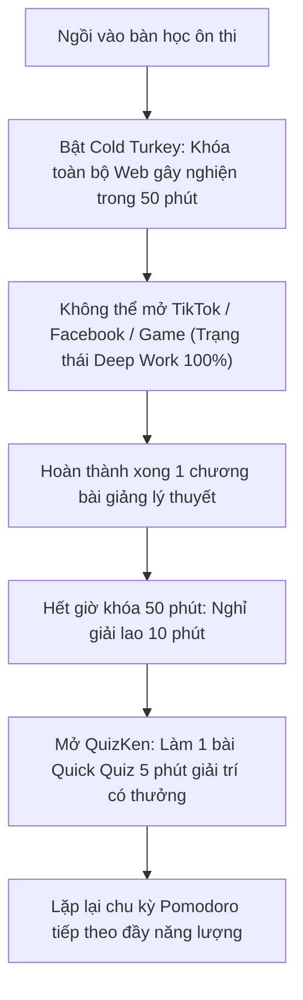

> **TL;DR (Tóm tắt nhanh):**  
> "Căn bệnh" xao nhãng do thông báo mạng xã hội (TikTok, Facebook, Instagram, YouTube Shorts) là lý do lớn nhất khiến học sinh, sinh viên ngồi vào bàn học 4 tiếng nhưng thực tế chỉ tập trung được 30 phút. Bằng cách sử dụng các **ứng dụng chặn web xao nhãng ôn thi miễn phí** mạnh mẽ nhất như **Cold Turkey Blocker** (`getcoldturkey.com` - khóa cứng trang web ở tầng hệ điều hành, không thể bẻ khóa hay gỡ cài đặt khi đang đếm giờ) kết hợp phương pháp Pomodoro của **Forest**, bạn sẽ bước vào trạng thái tập trung sâu (Deep Work). Trong 10 phút giải lao giữa các hiệp học, hãy mở **QuizKen** làm một ván quiz game ngắn để vừa nạp lại năng lượng vừa củng cố kiến thức!

---

# Top Ứng Dụng Chặn Web & Khóa Mạng Xã Hội Giúp Tập Trung Ôn Thi 2026

Bạn đã bao giờ trải qua cảm giác này:
* Vừa mở máy tính định tra cứu công thức giải bài tập thì một thông báo tin nhắn hiện lên, bạn bấm vào xem và rồi 2 tiếng sau nhận ra mình vẫn đang mải mê lướt TikTok hoặc xem video ngắn?
* Tự hứa *"chỉ nghỉ 5 phút thôi"* nhưng não bộ bị cuốn vào vòng lặp dopamine vô tận của mạng xã hội, đến khi nhìn đồng hồ thì đã nửa đêm mà đề cương vẫn chưa chạm vào trang nào?
* Thử dùng các extension chặn web thông thường nhưng chỉ cần 1 cú click chuột tắt extension là lại vào lướt web như cũ vì ý chí không thắng nổi sự cám dỗ?

Năm 2026, để chiến thắng các thuật toán giữ chân người dùng tinh vi của các mạng xã hội, bạn cần sử dụng các công cụ công nghệ mạnh mẽ hơn. Dưới đây là những **ứng dụng chặn web xao nhãng ôn thi miễn phí** uy tín nhất giúp bạn giành lại 100% sự tập trung mùa thi cử!

---

## 1. Cơ Chế "Khóa Tuyệt Đối" Của Cold Turkey Blocker

Hầu hết các tiện ích chặn web thông thường trên trình duyệt đều vô dụng khi sinh viên thèm lướt mạng, bởi vì bạn có thể dễ dàng vào mục quản lý Extensions để gỡ bỏ chúng chỉ trong 3 giây.

[Cold Turkey Blocker](https://getcoldturkey.com) là phần mềm duy nhất trên máy tính (Windows và macOS) làm được điều không tưởng:
* **Can thiệp ở tầng hệ điều hành:** Cold Turkey chỉnh sửa file cấu hình mạng của máy tính và chạy dưới dạng một dịch vụ Windows Service ngầm.
* **Tính năng Locked Timers (Khóa cứng không thể đảo ngược):** Khi bạn đã thiết lập khóa Facebook, TikTok, YouTube trong 2 tiếng: Bạn **KHÔNG THỂ** tắt phần mềm, không thể kết thúc tiến trình trong Task Manager, không thể đổi ngày giờ hệ thống và thậm chí **dù bạn có khởi động lại máy tính hay cố gỡ cài đặt phần mềm thì lệnh khóa vẫn tiếp tục duy trì** cho đến khi hết giờ đếm ngược!

---

## 2. Bảng So Sánh Các Ứng Dụng Hỗ Trợ Tập Trung Ôn Thi 2026

| Ứng dụng | Nền tảng hỗ trợ | Mức độ "nghiêm khắc" chống gian lận | Tính năng độc đáo | Chi phí sử dụng |
| :--- | :--- | :--- | :--- | :--- |
| **Cold Turkey Blocker** | Windows / macOS | **Tuyệt đối (10/10)** | Không thể tắt bằng Task Manager | **Miễn phí bản Standard vĩnh viễn** |
| **Forest App** | iOS / Android / Chrome | Khá nghiêm khắc (8/10) | Trồng cây ảo Pomodoro, cây chết nếu thoát app | Miễn phí trên Chrome & Android |
| **One Sec** | iOS / Android / Mac | Nhẹ nhàng (7/10) | Buộc bạn thở sâu 5 giây trước khi mở app | Miễn phí gói cơ bản |
| **Freedom** | Đồng bộ đa thiết bị | Nghiêm khắc (9/10) | Khóa đồng thời cả điện thoại và máy tính | Dùng thử miễn phí |

---

## 3. Quy Trình Thiết Lập Một "Pháo Đài Tập Trung" (Study Fortress)

Để đạt hiệu suất học tập cao nhất, hãy áp dụng quy trình 3 lớp bảo vệ sau:

### Lớp 1: Khóa máy tính với Cold Turkey Blocker
1. Tải bản miễn phí tại `https://getcoldturkey.com`.
2. Tạo danh sách chặn (Blocklist): Thêm các tên miền gây xao nhãng như `facebook.com`, `tiktok.com`, `youtube.com`, `reddit.com`.
3. Đặt hẹn giờ (Timer): Chọn chế độ Pomodoro (50 phút khóa web - 10 phút giải lao). Bật tùy chọn **Lock Timer** để ngăn bản thân đầu hàng trước cám dỗ.

### Lớp 2: Trồng cây Pomodoro trên điện thoại với Forest
1. Mở ứng dụng **Forest**, chọn phiên học 25 hoặc 50 phút.
2. Bấm bắt đầu: Một mầm cây nhỏ sẽ bắt đầu lớn lên. Nếu bạn thoát ứng dụng để lướt mạng xã hội, cái cây sẽ lập tức bị héo khô. Tâm lý không muốn làm chết cây sẽ giữ bạn ở lại với trang sách.

---

## 4. Cầu Nối QuizKen: Thư Giãn Bằng Dopamine Tích Cực Thay Vì Lướt Mạng

Trong 10 phút giải lao giữa các ca học Pomodoro, nhiều bạn lại mở điện thoại lướt mạng xã hội. Đây là sai lầm tai hại vì thông tin giật gân trên mạng sẽ làm cạn kiệt năng lượng chú ý của não bộ, khiến bạn uể oải khi bước vào hiệp học tiếp theo.

Thay vào đó, hãy giải trí bằng **Dopamine tích cực trên [QuizKen](https://quizken.com)**:
1. **Làm một ván Quick Quiz 5 phút:** Mở QuizKen trên trình duyệt và thử sức với bộ 10 câu đố nhanh của môn học bạn vừa ôn.
2. **Kích thích tinh thần chiến thắng:** Trả lời đúng liên tiếp, nghe âm thanh chúc mừng sống động và tích lũy chuỗi thành tích (Streak) trên QuizKen giúp giải phóng dopamine tự nhiên, giúp tinh thần sảng khoái và tự tin.
3. **Sẵn sàng cho hiệp học tiếp theo:** Sau khi hoàn thành bài quiz ngắn, bạn vừa được giải trí vừa củng cố xong một phần kiến thức mà không bị mất tập trung như khi lướt TikTok.

Hãy cài đặt ngay bộ công cụ hỗ trợ tập trung và kết hợp cùng nền tảng **QuizKen** để biến mùa thi cử thành khoảng thời gian bứt phá ngoạn mục nhất của bạn!
