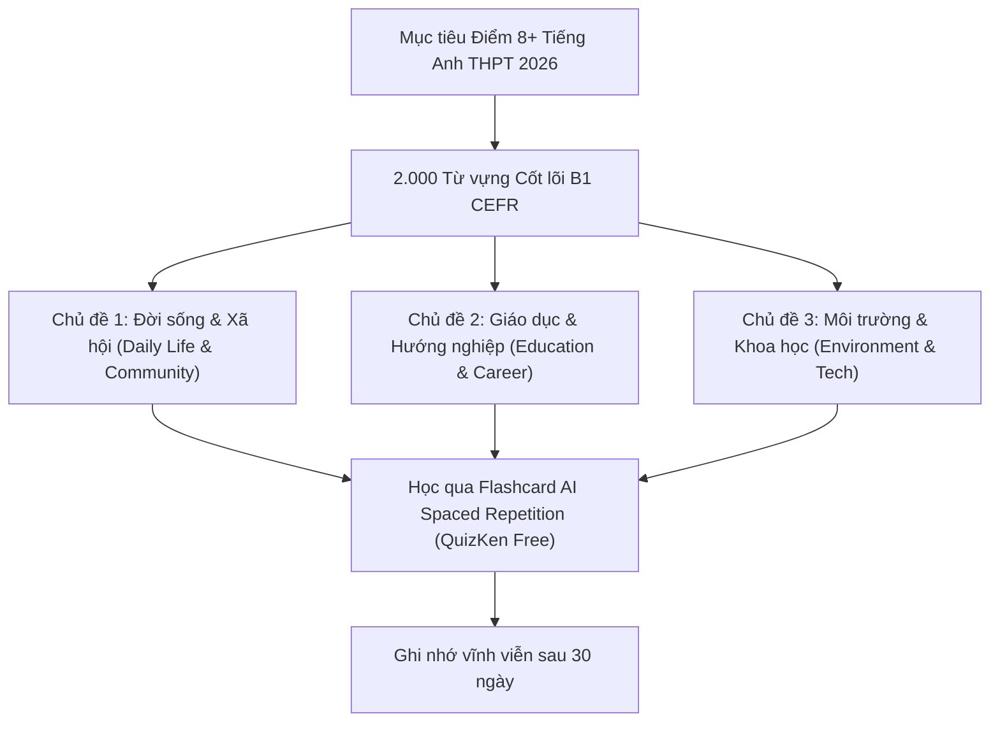

> **Tóm tắt nhanh (TL;DR):** Theo quy chế thi tốt nghiệp THPT và định hướng tuyển sinh đại học năm 2026, trình độ tiếng Anh tương đương **Bậc 3 (B1)** trong Khung năng lực ngoại ngữ 6 bậc dùng cho Việt Nam (VSTEP / CEFR) là ngưỡng tối thiểu để học sinh đạt điểm 8+ môn Ngoại ngữ hoặc được quy đổi điểm xét tuyển. Bài viết cung cấp danh mục **2.000 từ vựng tiếng Anh B1** trọng tâm kèm giải pháp ôn luyện qua **Flashcard AI Spaced Repetition hoàn toàn miễn phí (free)**.

---

## 1. Vì Sao 2.000 Từ Vựng B1 Là "Xương Sống" Của Kỳ Thi THPT 2026?

Đề thi môn Tiếng Anh tốt nghiệp THPT theo Chương trình GDPT 2018 tập trung đánh giá năng lực đọc hiểu văn bản thực tế, giao tiếp xã hội và tư duy ngôn ngữ. Trong đó:
* **70% ngữ liệu đề thi** (bao gồm các bài đọc điền từ, bài đọc hiểu 5 câu và bài đọc hiểu 7 câu) sử dụng vốn từ nằm trong phổ **B1 (Intermediate)**.
* Học sinh chỉ cần nắm chắc 2.000 từ vựng B1 là đã có thể tự tin đạt từ 7.0 đến 8.5 điểm môn Tiếng Anh mà không bị bỡ ngỡ trước các dạng bài phân hóa.

---

## 2. Danh Mục 5 Chủ Đề Từ Vựng B1 Xuất Hiện Nhiều Nhất Trong Đề Thi

| Chủ đề trọng tâm | Số lượng từ | Các từ vựng tiêu biểu thường gặp | Bẫy từ đồng nghĩa (Paraphrasing) |
| :--- | :--- | :--- | :--- |
| **Môi trường & Biến đổi khí hậu** | ~400 từ | *pollution, renewable, conserve, habitat, sustainable, catastrophic* | *damage $\rightarrow$ deteriorate / devastate* |
| **Giáo dục & Nghề nghiệp tương lai** | ~450 từ | *curriculum, qualification, prospective, apprentice, ambition* | *job $\rightarrow$ occupation / profession* |
| **Công nghệ & Trí tuệ Nhân tạo** | ~350 từ | *artificial, algorithm, automate, digitalize, device, breakthrough* | *modern $\rightarrow$ cutting-edge / innovative* |
| **Sức khỏe & Phong cách sống** | ~400 từ | *nutrition, sedentary, epidemic, psychological, therapy, hygiene* | *healthy $\rightarrow$ wholesome / beneficial* |
| **Văn hóa, Du lịch & Toàn cầu hóa** | ~400 từ | *heritage, indigenous, preserve, cultural diversity, immigration* | *traditional $\rightarrow$ conventional / historic* |

---

## 3. Cách Thuộc Lòng 2.000 Từ B1 Trong 40 Ngày Bằng AI Miễn Phí (Free)

Học thuộc 2.000 từ vựng bằng cách chép phạt ra vở là phương pháp cực kỳ lãng phí thời gian và dễ nản lòng. Thay vào đó, nền tảng **QuizKen AI** cung cấp giải pháp học tập dựa trên khoa học não bộ:

### Bước 1: Chia nhỏ mục tiêu 50 từ/ngày
Mỗi ngày QuizKen sẽ gửi cho bạn một bộ 50 từ vựng theo chủ đề. Từng từ đều có đầy đủ phiên âm quốc tế IPA, định nghĩa tiếng Việt, các từ đồng nghĩa/trái nghĩa và câu ví dụ trích từ đề thi thật.

### Bước 2: Kích hoạt thuật toán lặp lại ngắt quãng (SM-2)
Khi bạn lật thẻ Flashcard trên điện thoại, hệ thống sẽ ghi nhận:
* Từ nào bạn bấm "Đã thuộc" sẽ được nhắc lại sau 3 ngày, 7 ngày, 21 ngày.
* Từ nào bạn bấm "Chưa nhớ" sẽ xuất hiện lại ngay trong buổi học hôm đó.

### Bước 3: Luyện tập trắc nghiệm ngữ cảnh
Sau khi học xong 50 từ, hệ thống AI sẽ tự động sinh ra một bài quiz 15 câu để bạn vận dụng từ vựng vào câu văn hoàn chỉnh, giúp biến từ vựng thụ động (Passive) thành từ vựng chủ động (Active).

👉 **Tải trọn bộ từ vựng:** [Học 2.000 từ vựng tiếng Anh B1 CEFR miễn phí cùng QuizKen](https://quizken.com) ngay hôm nay!

---

## Câu hỏi thường gặp (FAQ)

### 1. Học hết 2.000 từ vựng B1 có đủ để thi đại học khối D1 hay A1 không?
2.000 từ vựng B1 là nền tảng vững chắc nhất chiếm 70-80% dung lượng đề thi. Để đạt điểm 9.5 – 10 tuyệt đối, bạn nên bổ sung thêm khoảng 500 từ vựng cấp độ B2 và các thành ngữ (Idioms) nâng cao trên QuizKen.

### 2. Có thể tải danh sách từ vựng B1 ra file PDF để in học không?
Có. QuizKen hỗ trợ tính năng xuất toàn bộ danh mục từ vựng, ví dụ minh họa và bài tập trắc nghiệm ra file PDF chất lượng cao hoàn toàn **miễn phí (free)** để bạn in ra giấy học bất cứ lúc nào.

### 3. Người mất gốc học bộ từ vựng này có bị quá sức không?
Nếu bạn mất gốc, hãy bắt đầu với 500 từ vựng cấp độ A1–A2 trên chuyên mục [Các Cấp Độ Từ Vựng Tiếng Anh](/blog/tu-vung-tieng-anh-theo-cap-do-cefr) trước khi bước vào bộ 2.000 từ B1 này.
