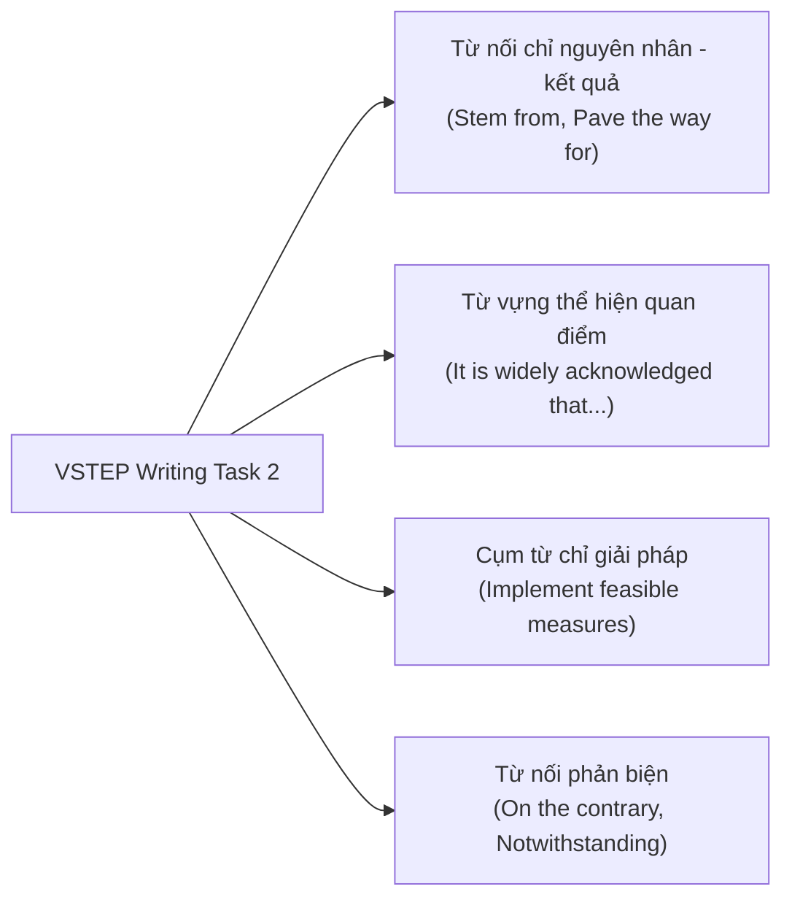

> **TL;DR (Tóm tắt nhanh):**  
> Trong bài thi đánh giá năng lực tiếng Anh theo Khung 6 bậc (VSTEP), kỹ năng **Writing (Thời gian: 60 phút)** gồm 2 phần: Task 1 (Viết thư/email tương tác 120 từ - chiếm 1/3 số điểm) và Task 2 (Viết bài luận nghị luận xã hội 250 từ - chiếm 2/3 số điểm). Để bứt phá từ bậc B1 lên B2, thí sinh bắt buộc phải sử dụng các từ vựng học thuật (Academic Vocabulary) và cụm từ cố định (Collocations) tự nhiên thay vì dịch từng từ từ tiếng Việt (Word-by-word). Bộ thẻ **QuizKen Flashcard AI** tích hợp thuật toán Spaced Repetition SM-2 giúp bạn thuộc làu hơn 300 cụm từ vựng cốt lõi chỉ sau 7 ngày!

---

# Trọn Bộ Từ Vựng VSTEP Writing B1-B2 & Cách Học Bằng Flashcard AI

Kỳ thi **VSTEP (Vietnamese Standardized Test of English Proficiency)** ngày càng trở nên quan trọng đối với sinh viên chuẩn bị ra trường, học viên cao học, nghiên cứu sinh cũng như giáo viên tiếng Anh trên khắp cả nước.

Tuy nhiên, phần lớn thí sinh bị kẹt lại ở điểm số dưới chuẩn B2 là do bài viết Writing Task 1 và Task 2 mắc các lỗi:
* Lặp từ vựng cơ bản quá nhiều (như: *good, bad, important, I think, very...*).
* Dùng sai giới từ và kết hợp từ (Collocations không chuẩn bản ngữ).
* Không có các từ nối luận điểm học thuật (Cohesive Devices) để tạo tính mạch lạc cho đoạn văn.

Dưới đây là bộ từ vựng tuyển chọn chuẩn format khảo thí VSTEP 2026 cùng phương pháp học phản xạ tự nhiên.

---

## 1. Từ Vựng & Cụm Từ "Ăn Điểm" VSTEP Writing Task 1 (Viết Thư)

Task 1 yêu cầu viết một bức thư (Thư cảm ơn, Thư phàn nàn, Thư xin lỗi, Thư yêu cầu thông tin hoặc Thư mời bạn bè):

| Mục đích viết thư | Cụm từ thông thường (A2 - B1 thấp) | Cụm từ nâng cấp chuẩn B1+ / B2 | Ví dụ áp dụng |
| :--- | :--- | :--- | :--- |
| **Mở đầu thư trang trọng** | I am writing to tell you... | *I am writing to express my dissatisfaction regarding...* / *I am writing with reference to...* | *I am writing to express my sincere gratitude for your hospitality.* |
| **Bày tỏ sự phàn nàn** | I am very angry about... | *I feel compelled to register my complaint about...* | *I feel compelled to register my complaint about the substandard service.* |
| **Đưa ra đề xuất / yêu cầu** | You must fix this soon. | *I would appreciate it if you could look into this matter promptly.* | *I would be grateful if you could arrange a replacement at your earliest convenience.* |
| **Lời kết thư trang trọng** | Bye and write to me soon. | *I look forward to hearing from you at your earliest convenience.* | *Thank you for your time and consideration.* |

---

## 2. Từ Vựng & Cấu Trúc Nâng Cao Cho VSTEP Writing Task 2 (Viết Luận)

Task 2 là một bài luận 250 từ về các chủ đề giáo dục, công nghệ, môi trường, y tế hoặc lối sống giới trẻ.

### Bảng Collocations học thuật chủ đề "Công nghệ & Giáo dục":
* **Play a pivotal / indispensable role in:** Đóng vai trò then chốt trong...  
  *(Ví dụ: Artificial intelligence plays a pivotal role in personalizing student learning experiences.)*
* **A double-edged sword:** Con dao hai lưỡi  
  *(Ví dụ: Excessive smartphone usage can be a double-edged sword for teenagers.)*
* **Implement stringent measures:** Áp dụng các biện pháp nghiêm ngặt  
  *(Ví dụ: Authorities should implement stringent measures to curb cyberbullying.)*
* **Bridge the knowledge gap:** Thu hẹp khoảng cách kiến thức  
  *(Ví dụ: EdTech platforms help bridge the knowledge gap for underprivileged learners.)*
* **Have a detrimental effect on:** Có tác động tiêu cực lên...  
  *(Ví dụ: Sedentary lifestyle exerts a detrimental effect on adolescents' well-being.)*

---

## 3. Cách Thuộc Lòng Bộ Từ Vựng Trong 7 Ngày Bằng QuizKen Flashcard

Học từ vựng bằng cách chép danh sách dài dằng dặc vào vở là nguyên nhân hàng đầu khiến bạn "học trước quên sau". Với **QuizKen**:

1. **Bộ thẻ Spaced Repetition thông minh:** QuizKen tự động chia từ vựng thành các cấp độ. Những từ bạn hay quên sẽ xuất hiện với tần suất dày đặc hơn, trong khi những từ bạn đã nhớ vững sẽ được giãn cách lặp lại sau vài ngày.
2. **Ngữ cảnh ví dụ hai chiều:** Mỗi flashcard đều có phát âm chuẩn bản ngữ, phiên âm quốc tế IPA, ví dụ câu thực tế trong đề thi VSTEP và bài tập điền từ trực tiếp.
3. **Thử thách Quiz tốc độ cao:** Bạn có thể tự kiểm tra khả năng nhớ từ vựng qua các minigame trắc nghiệm hoặc đấu trường Multiplayer với bạn bè cùng phòng ôn thi.

---

## 4. Tải Và Luyện Bộ Thẻ VSTEP Miễn Phí

Toàn bộ kho flashcard từ vựng VSTEP B1-B2 đã được số hóa hoàn toàn và sẵn sàng cho bạn luyện tập ngay trên điện thoại hoặc máy tính.

Truy cập và bắt đầu học ngay hôm nay tại: [https://app.quizken.com](https://app.quizken.com).
