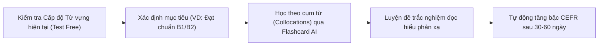

> **Tóm tắt nhanh (TL;DR):** Hiểu rõ **các cấp độ từ vựng tiếng Anh** theo khung tham chiếu châu Âu (CEFR) và khung 6 bậc Việt Nam (VSTEP) là chìa khóa để định hình lộ trình học tập khoa học. Bài viết này tổng hợp chi tiết số lượng từ vựng cần thiết cho từng **cấp độ từ vựng tiếng Anh** từ cơ bản (A1) đến thành thạo (C2), kèm công cụ làm bài test chẩn đoán trình độ bằng **AI hoàn toàn miễn phí (free)**.

---

## 1. Khung CEFR Là Gì? Vì Sao Cần Phân Biệt Các Cấp Độ Từ Vựng Tiếng Anh?

**CEFR** (Common European Framework of Reference for Languages) hay Khung tham chiếu trình độ ngôn ngữ chung Châu Âu là tiêu chuẩn toàn cầu được sử dụng để đánh giá năng lực ngoại ngữ. Tại Việt Nam, Bộ GD&ĐT đã cụ thể hóa khung này thành **Khung năng lực ngoại ngữ 6 bậc dùng cho Việt Nam (VSTEP)** theo Thông tư 01/2014/TT-BGDĐT.

Việc xác định chính xác **mức độ từ vựng tiếng Anh** hiện tại của bạn mang lại 3 lợi ích vượt trội:
1. **Tránh học lan man:** Không lãng phí thời gian học những từ vựng quá khó (C1, C2) khi nền tảng cơ bản (A2, B1) chưa vững.
2. **Chuẩn hóa mục tiêu thi cử:** Biết rõ mình cần bao nhiêu từ vựng để đạt điểm chuẩn đầu ra tốt nghiệp THPT, VSTEP B1, TOEIC 650 hay IELTS 6.5.
3. **Ứng dụng phương pháp Spaced Repetition hiệu quả:** Tối ưu hóa chu kỳ lặp lại ngắt quãng theo từng cấp độ từ vựng.

---

## 2. Bảng Phân Loại Chi Tiết 6 Cấp Độ Từ Vựng Tiếng Anh (Từ A1 Đến C2)

Khung CEFR phân chia người học thành 3 nhóm lớn tương ứng với 6 **cấp độ từ vựng tiếng Anh**:

| Cấp độ CEFR | Khung VSTEP Việt Nam | Số lượng từ vựng cần thiết | Khả năng ứng dụng thực tế | Ví dụ từ vựng đặc trưng |
| :--- | :--- | :--- | :--- | :--- |
| **A1 (Sơ cấp)** | Bậc 1 | **500 – 700 từ** | Giao tiếp nhu cầu cơ bản: chào hỏi, giới thiệu, mua sắm | *apple, house, school, happy, cheap* |
| **A2 (Cận trung cấp)** | Bậc 2 | **1.000 – 1.500 từ** | Trao đổi thông tin thường nhật: gia đình, công việc, thời tiết | *describe, journey, modern, prepare* |
| **B1 (Trung cấp)** | Bậc 3 | **2.000 – 3.000 từ** | Đủ điều kiện tốt nghiệp THPT & đại học; diễn đạt ý kiến cá nhân | *evaluate, challenge, flexible, massive* |
| **B2 (Trên trung cấp)** | Bậc 4 | **4.000 – 5.000 từ** | Tự tin làm việc văn phòng đa quốc gia; đọc hiểu văn bản phức tạp | *sustainable, predominant, accommodate* |
| **C1 (Cao cấp)** | Bậc 5 | **7.000 – 8.000 từ** | Viết luận báo cáo chuyên sâu, nghiên cứu khoa học học thuật | *exacerbate, paradigm, ubiquitous, advocate* |
| **C2 (Thành thạo)** | Bậc 6 | **10.000+ từ** | Năng lực tương đương người bản xứ; diễn đạt tinh tế, sắc sảo | *serendipity, esoteric, ephemeral, idiosyncratic* |

---

## 3. Cách Tự Kiểm Tra Mức Độ Từ Vựng Tiếng Anh Bằng AI Miễn Phí (Free)

Thay vì phải làm những bài thi giấy dài hàng tiếng đồng hồ, bạn có thể kiểm tra nhanh **cấp độ từ vựng tiếng Anh** của mình bằng công nghệ AI của QuizKen:

1. **Làm bài Test chẩn đoán trình độ 5 phút:** Hệ thống AI tự động đưa ra các câu hỏi trắc nghiệm ngữ cảnh ngắn từ A1 đến C1 để định vị chính xác vốn từ vựng hiện có của bạn.
2. **Nhận biểu đồ Radar phân tích:** QuizKen sẽ chỉ ra tỉ lệ từ vựng bạn nắm vững ở từng thang bậc và đề xuất danh sách các từ bạn đang bị nhầm lẫn.
3. **Học từ vựng qua Flashcard Spaced Repetition Free:** Mỗi ngày hệ thống sẽ nhắc nhở bạn ôn tập đúng các từ vựng thuộc cấp độ mục tiêu thông qua thuật toán lặp lại thông minh.

👉 **Khám phá thêm:** Đọc ngay bài viết [Kho Flashcard AI Ôn Từ Vựng VSTEP B1 B2 Miễn Phí](/blog/kho-flashcard-ai-tu-vung-vstep-b1-b2-mien-phi) để bắt đầu lộ trình học bài bản!

---

## 4. Lộ Trình 3 Bước Nâng Cấp Vốn Từ Vựng Nhanh Chóng

* **Bước 1: Không học từ riêng lẻ:** Luôn học từ vựng trong câu hoàn chỉnh để nắm vững ngữ cảnh sử dụng (Collocations).
* **Bước 2: Gợi nhớ chủ động (Active Recall):** Khi nhìn thấy từ tiếng Anh trên Flashcard, hãy cố gắng tự nhớ lại nghĩa tiếng Việt và đặt 1 câu ví dụ trước khi lật thẻ.
* **Bước 3: Luyện tập tương tác thường xuyên:** Tham gia phòng thi đấu trắc nghiệm trực tuyến cùng bạn bè trên QuizKen để kích thích phản xạ từ vựng dưới áp lực thời gian.

👉 **Trải nghiệm ngay:** [Học và kiểm tra các cấp độ từ vựng tiếng Anh miễn phí trên QuizKen](https://quizken.com) ngay hôm nay!

---

## Câu hỏi thường gặp (FAQ)

### 1. Người mất gốc tiếng Anh nên bắt đầu học từ cấp độ từ vựng nào?
Người mất gốc nên bắt đầu xây dựng lại 500 từ vựng cốt lõi cấp độ A1 và 1.000 từ cấp độ A2 trước khi chuyển sang học các từ vựng học thuật B1.

### 2. Cần đạt cấp độ từ vựng tiếng Anh nào để được miễn thi tốt nghiệp THPT?
Học sinh cần đạt trình độ tương đương B1 (VSTEP Bậc 3, IELTS 4.0 - 4.5 trở lên) theo quy chế tuyển sinh của Bộ GD&ĐT để được quy đổi điểm 10 môn Ngoại ngữ.

### 3. Học từ vựng trên QuizKen có mất phí không?
Hoàn toàn **miễn phí (free)**. Bạn có thể tự do học các bộ flashcard từ vựng từ A1 đến C2 và làm bài kiểm tra trắc nghiệm AI mỗi ngày.
