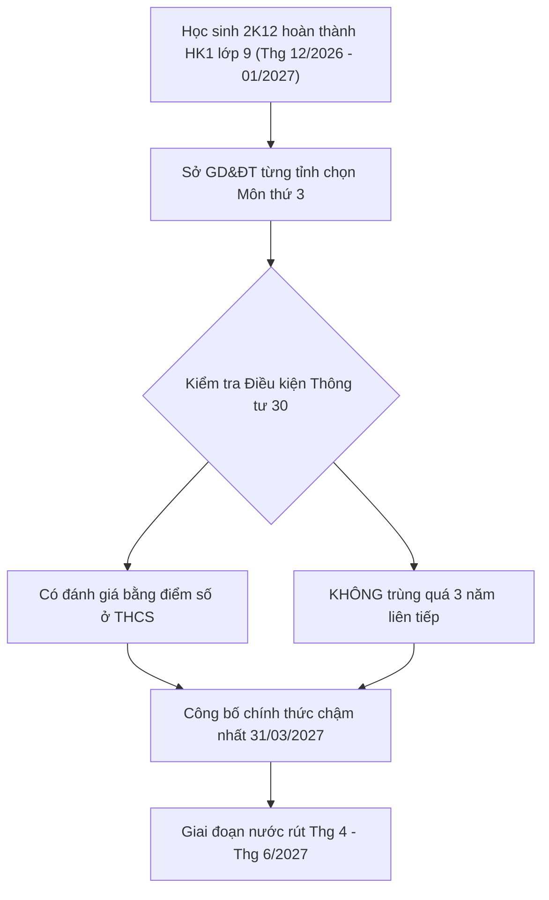

> **Tóm tắt nhanh (TL;DR):** Căn cứ **Thông tư 30/2024/TT-BGDĐT**, kỳ thi tuyển sinh vào lớp 10 THPT công lập năm **2027** (thế hệ học sinh 2K12) giữ ổn định 3 môn/bài thi bắt buộc gồm **Toán**, **Ngữ văn** và **01 môn thi (hoặc bài thi tổ hợp) thứ ba** do Giám đốc Sở GD&ĐT từng tỉnh/thành phố lựa chọn. Quy tắc quan trọng nhất cần nhớ: địa phương **không được chọn trùng một môn thi thứ ba quá 03 năm liên tiếp** và phải công bố chậm nhất vào **ngày 31/03/2027**.

---

# Tuyển Sinh Lớp 10 Năm 2027 Theo Thông Tư 30: Phụ Huynh & Học Sinh 2K12 Cần Biết Gì?

Mỗi khi bước vào giai đoạn cuối học kỳ I lớp 9 (tháng 11–12 hằng năm), câu hỏi khiến hàng trăm nghìn phụ huynh và học sinh lớp 9 tìm kiếm nhiều nhất luôn là: **"Năm nay tỉnh mình thi vào lớp 10 môn thứ 3 là môn gì?"**. Để chấm dứt tình trạng chờ đợi bị động hoặc học tủ chỉ 3 môn Toán–Văn–Anh từ đầu năm, Bộ GD&ĐT đã quy chuẩn hóa toàn bộ quy trình này trong **Thông tư 30/2024/TT-BGDĐT**.

## 1. Cấu Trúc 3 Môn Thi & Thời Gian Làm Bài Chuẩn Thông Tư 30

Nếu địa phương áp dụng phương thức thi tuyển vào lớp 10 THPT công lập năm 2027, thí sinh sẽ thực hiện **03 môn thi/bài thi**:

| Môn thi / Bài thi | Thời gian làm bài quy định | Điểm đáng chú ý |
| :--- | :--- | :--- |
| **Ngữ văn** | `120 phút` | Thi theo ngữ liệu ngoài sách giáo khoa (chuẩn GDPT 2018), đánh giá năng lực đọc hiểu và viết nghị luận. |
| **Toán** | `90 phút` hoặc `120 phút` | Tăng các bài toán thực tế, xác suất thống kê THCS và hình học trực quan. |
| **Môn thi / Bài thi thứ 3** | `60 phút` hoặc `90 phút` *(Bài tổ hợp: `90`–`120 phút`)* | Phải là môn học có đánh giá bằng điểm số trong chương trình THCS (Ngoại ngữ, KHTN, Lịch sử & Địa lý, GDCD...). |

---

## 2. Hai Quy Tắc Vàng Về "Môn Thi Thứ 3" Phụ Huynh Không Thể Bỏ Qua

### Quy tắc 1: Môn thứ 3 do từng tỉnh tự chọn, không trùng quá 3 năm liên tiếp
Khác với kỳ thi tốt nghiệp THPT dùng chung đề toàn quốc, môn thi thứ 3 vào lớp 10 **do Giám đốc Sở GD&ĐT từng địa phương quyết định**. Tuy nhiên, Thông tư 30 đặt ra chốt chặn chống học tủ: **một môn học không được chọn làm môn thi thứ 3 quá 3 năm liên tiếp**.
* *Hệ quả thực tế cho năm 2027:* Nếu một tỉnh đã chọn Tiếng Anh trong 3 năm liên tiếp trước đó, sang kỳ thi 2027–2028 hoặc 2028–2029 địa phương đó buộc phải xoay sang môn khác (như Khoa học tự nhiên, Lịch sử – Địa lý hoặc bài thi tổ hợp) tùy theo mốc bắt đầu tính chu kỳ của Sở GD&ĐT tỉnh bạn.

### Quy tắc 2: Thời hạn công bố "Sau HK1 và chậm nhất ngày 31/03 hằng năm"
Sở GD&ĐT các tỉnh/thành không công bố môn thứ 3 ngay từ tháng 9 đầu năm học nhằm tránh học sinh lớp 9 bỏ bê các môn còn lại trong suốt học kỳ I. Theo quy định, thời điểm công bố rơi vào **sau khi kết thúc học kỳ I và muộn nhất là ngày 31/03/2027**. Dù vậy, nhiều địa phương có xu hướng công bố sớm ngay trong **tháng 1–2/2027** để thầy trò chủ động ôn tập.

---

## 3. Cách Tính Điểm Xét Tuyển Lớp 10 & Chiến Lược Ôn Tập HK1 Lớp 9

Bên cạnh việc theo dõi thông báo của Sở GD&ĐT, học sinh 2K12 cần nắm rõ cách tính điểm xét tuyển lớp 10 tại địa phương mình (ví dụ Hà Nội và TP.HCM tính tổng 3 môn hệ số 1 trên thang 30, trong khi nhiều tỉnh nhân hệ số 2 cho Toán/Văn hoặc cộng điểm ưu tiên theo quy chế mới).

Bạn có thể thử mô phỏng ngay điểm mục tiêu theo từng kịch bản hệ số tại công cụ [Tính điểm thi vào lớp 10 (Hà Nội, TP.HCM & Toàn quốc)](/cong-cu/tinh-diem-thi-vao-lop-10), đồng thời kiểm tra điểm tổng kết học kỳ I bằng [Tính điểm trung bình môn Thông tư 22](/cong-cu/tinh-diem-trung-binh-mon-thong-tu-22).

**Chiến lược an toàn cho giai đoạn cuối tháng 11 – tháng 12/2026:**
1. **Dồn 70% thời gian giữ vững nền Toán – Văn:** Đây là 2 môn chắc chắn thi 100%. Luyện ngay các chuyên đề cốt lõi tại [Đề thi Toán vào lớp 10](/de-thi/vao-10/toan-vao-10) và [Hub Tuyển sinh lớp 10](/de-thi/vao-10).
2. **Không buông lỏng Tiếng Anh, KHTN và Sử–Địa trong HK1:** Giữ mức điểm kiểm tra cuối kỳ từ `8.0+` ở các môn này giúp bạn không bị "sốc" nếu địa phương bất ngờ chọn Khoa học tự nhiên hoặc Lịch sử & Địa lý làm môn thứ 3.
3. **Dùng AI biến đề cương trường thành trắc nghiệm:** Nạp tài liệu ôn tập cuối kỳ I của trường THCS lên [QuizKen](https://app.quizken.com) để làm bài kiểm tra thử 15 phút mỗi tối.

---

## Câu hỏi thường gặp (FAQ)

### 1. Khi nào biết chính xác môn thi thứ 3 vào lớp 10 năm 2027?
Theo Thông tư 30/2024/TT-BGDĐT, Sở GD&ĐT các tỉnh/thành phố phải công bố môn thi hoặc bài thi thứ 3 sau khi kết thúc học kỳ I và **không muộn hơn ngày 31/03/2027**.

### 2. Năm 2027 Hà Nội và TP.HCM có chắc chắn thi Tiếng Anh là môn thứ 3 không?
Chưa thể khẳng định trước khi Sở GD&ĐT Hà Nội và Sở GD&ĐT TP.HCM ra thông báo chính thức đầu năm 2027. Cả hai thành phố đều phải tuân thủ quy định không chọn trùng quá 3 năm liên tiếp tính từ thời điểm Thông tư 30 có hiệu lực.

### 3. Nếu địa phương chọn "Bài thi tổ hợp" làm môn thứ 3 thì thi trong bao lâu?
Theo quy định tại Thông tư 30, thời gian làm bài đối với môn thi thứ 3 đơn lẻ là `60 phút` hoặc `90 phút`, còn nếu là bài thi tổ hợp nhiều môn thì thời gian làm bài là `90 phút` hoặc `120 phút`.

### 4. Cách tính điểm xét tuyển lớp 10 hệ công lập và hệ chuyên khác nhau thế nào?
Hệ công lập thông thường tính tổng điểm 3 môn thi (có thể nhân hệ số tùy địa phương) cộng điểm ưu tiên/khuyến khích (nếu có). Hệ trường chuyên tính tổng 3 môn điều kiện cộng điểm môn chuyên nhân hệ số 2. Bạn có thể tính nhanh cả hai chế độ tại [Công cụ tính điểm thi vào lớp 10](/cong-cu/tinh-diem-thi-vao-lop-10).
