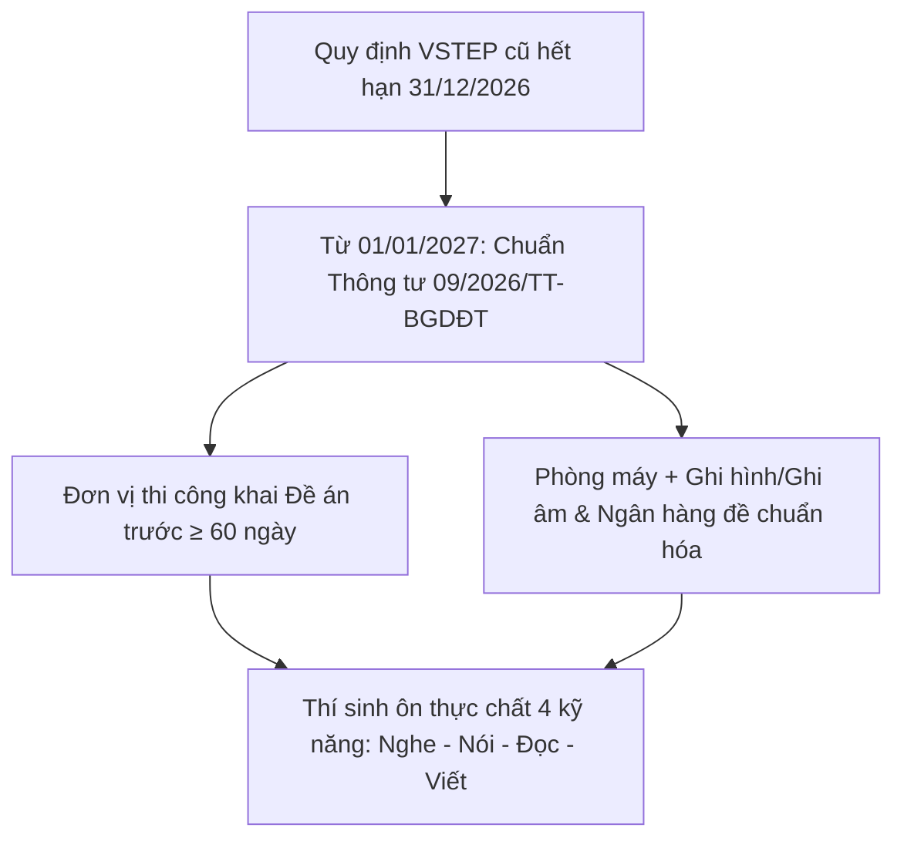

> **Tóm tắt nhanh (TL;DR):** Căn cứ **Thông tư số 09/2026/TT-BGDĐT** (ban hành ngày 26/02/2026) quy định về tổ chức thi đánh giá năng lực ngoại ngữ theo Khung 6 bậc dùng cho Việt Nam (**VSTEP**), mốc **31/12/2026** là thời điểm khép lại giai đoạn chuyển tiếp theo quy định cũ. Bước sang **01/01/2027**, toàn bộ các trường đại học và trung tâm khảo thí được cấp phép tổ chức thi VSTEP bắt buộc vận hành theo tiêu chuẩn nghiêm ngặt về phòng máy, thiết bị ghi âm/ghi hình, ngân hàng đề chống học tủ và phải công khai Đề án tổ chức thi tối thiểu **60 ngày** trước ngày thi.

---

# Bước Ngoặt VSTEP Từ 01/01/2027: Sinh Viên & Thí Sinh Cần Chuẩn Bị Gì Trước Mốc 31/12?

Với hàng trăm nghìn sinh viên cần chuẩn đầu ra B1/B2 để xét tốt nghiệp đại học, cũng như học viên cao học, nghiên cứu sinh và viên chức cần thăng hạng, **VSTEP** là chứng chỉ ngoại ngữ nội địa quan trọng nhất hiện nay. Tuy nhiên, bước sang năm 2027, việc "đợi gần ngày thi mới tìm mẹo học tủ" sẽ không còn hiệu quả dưới tác động của **Thông tư 09/2026/TT-BGDĐT**.

## 1. Những Thay Đổi Cốt Lõi Của Thông Tư 09/2026 Áp Dụng Triệt Để Từ 2027

| Hạng mục quản lý | Yêu cầu theo Thông tư 09/2026/TT-BGDĐT | Tác động trực tiếp tới thí sinh |
| :--- | :--- | :--- |
| **Hạ tầng phòng thi máy tính** | Chuẩn hóa hệ thống máy tính, mạng nội bộ, tai nghe và camera ghi âm/ghi hình toàn bộ ca thi (đặc biệt phần Nói). | Chấm dứt hoàn toàn sự chênh lệch chất lượng âm thanh/máy móc giữa các hội đồng thi địa phương. |
| **Ngân hàng câu hỏi thi** | Phải đủ lớn, được thẩm định và bảo mật tuyệt đối theo chuẩn Bộ GD&ĐT. | Các bộ "đề tủ", "bộ đề rò rỉ" trôi nổi trên mạng mất tác dụng vì đề trộn ngẫu nhiên từ ngân hàng chuẩn hóa. |
| **Minh bạch Đề án tổ chức thi** | Đơn vị tổ chức phải gửi Đề án về Cục Quản lý Chất lượng và **công khai trên cổng thông tin tối thiểu 60 ngày** trước ngày thi. | Thí sinh dễ dàng tra cứu đơn vị hợp pháp, tránh bị lừa đảo bởi các trung tâm "bao đậu" trái phép. |
| **Giá trị chứng chỉ** | Thuộc hệ thống giáo dục quốc dân, đồng bộ tra cứu xác thực trực tuyến. | Đảm bảo uy tín khi nộp hồ sơ tốt nghiệp đại học, thạc sĩ, thi công chức. |

---

## 2. Nhắc Nhanh Cách Tính Điểm & Ngưỡng Đậu B1, B2, C1 VSTEP

Bài thi VSTEP bậc 3–5 vẫn đánh giá đủ **4 kỹ năng** (Nghe, Nói, Đọc, Viết), mỗi kỹ năng chấm trên thang `0–10`. Điểm tổng kết là trung bình cộng 4 kỹ năng và **làm tròn đến `0,5` điểm**:
* **Bậc 3 (B1):** Từ `4.0` đến `5.5` điểm *(ví dụ điểm trung bình `3.75` sẽ làm tròn thành `4.0` — đạt B1)*.
* **Bậc 4 (B2):** Từ `6.0` đến `8.0` điểm *(ví dụ trung bình `5.75` làm tròn thành `6.0` — đạt B2)*.
* **Bậc 5 (C1):** Từ `8.5` đến `10.0` điểm *(trung bình `8.25` làm tròn thành `8.5` — đạt C1)*.

Bạn có thể thử nhập điểm ước lượng 4 kỹ năng và mô phỏng *"Thiếu bao nhiêu điểm kỹ năng yếu để kéo lên B1/B2?"* ngay tại công cụ [Tính & Quy đổi điểm thi VSTEP B1, B2, C1](/cong-cu/tinh-diem-thi-vstep-b1-b2-c1).

---

## 3. Lộ Trình Luyện Thi VSTEP Thực Chất Đón Chuẩn Mới 2027

Thay vì học vẹt văn mẫu dễ bị trùng ý và đánh rớt khi chấm chéo nghiêm ngặt, thí sinh thi trong giai đoạn cuối 2026 – 2027 nên áp dụng quy trình 3 bước:
1. **Thi thử làm quen cấu trúc chuẩn:** Làm ngay bộ đề luyện tập tương tác tại [Đề thi thử VSTEP B1–B2](/de-thi/chung-chi/vstep-b1-b2) hoặc nạp tài liệu đọc hiểu PDF lên [QuizKen](https://app.quizken.com) để AI tạo đề trắc nghiệm B1–B2 có giải thích đáp án tiếng Việt.
2. **Kiểm tra độ dài & ngữ pháp bài Viết (Writing):** VSTEP Writing yêu cầu viết đúng chuẩn độ dài (Letter/Email ≥ 120 từ và Essay ≥ 250 từ). Dùng ngay [Công cụ đếm từ bài luận VSTEP & IELTS](/cong-cu/dem-tu-bai-luan-ielts-ngu-van) để căn chuẩn số từ và tránh lỗi lặp từ vựng.
3. **Củng cố động từ bất quy tắc & phát âm phần Nói:** Ôn nhanh phát âm UK/US qua [Tra cứu động từ bất quy tắc & Phiên âm IPA](/cong-cu/tra-cuu-dong-tu-bat-quy-tac-phat-am-ipa).

---

## Câu hỏi thường gặp (FAQ)

### 1. Thông tư 09/2026/TT-BGDĐT có thay đổi cấu trúc đề thi 4 kỹ năng VSTEP không?
Cấu trúc đánh giá 4 kỹ năng Nghe – Nói – Đọc – Viết bậc 3–5 vẫn giữ nguyên theo định dạng VSTEP chuẩn, nhưng ngân hàng câu hỏi, quy trình coi thi, giám sát phòng máy và thẩm định đơn vị tổ chức được siết chặt triệt để từ năm 2027.

### 2. Làm sao biết trường nào được cấp phép tổ chức thi VSTEP hợp lệ năm 2027?
Theo Thông tư 09/2026, đơn vị đủ điều kiện phải gửi Đề án về Bộ GD&ĐT và công khai trên website chính thức ít nhất 60 ngày trước ngày thi. Thí sinh chỉ nên đăng ký trực tiếp qua cổng thông tin của các trường đại học nằm trong danh sách được Bộ công bố.

### 3. Thi VSTEP cần tối thiểu mấy điểm mỗi kỹ năng? Không có điểm liệt đúng không?
Hiện tại VSTEP tính điểm trung bình cộng 4 kỹ năng rồi làm tròn đến `0.5` (ví dụ `4.0` là đạt B1, `6.0` là đạt B2), không quy định mức điểm liệt riêng cho từng kỹ năng trừ khi cơ quan tiếp nhận chứng chỉ của bạn có yêu cầu phụ riêng.

### 4. Nên thi VSTEP trước ngày 31/12/2026 hay đợi sang năm 2027?
Nếu bạn đã chuẩn bị sẵn kiến thức và cần chứng chỉ gấp cho đợt xét tốt nghiệp đầu năm 2027, việc thi các đợt cuối tháng 11–12/2026 giúp bạn chủ động tiến độ hơn, tránh tình trạng đầu năm 2027 một số hội đồng thi tạm điều chỉnh lịch để hoàn tất rà soát hạ tầng theo chuẩn mới.
