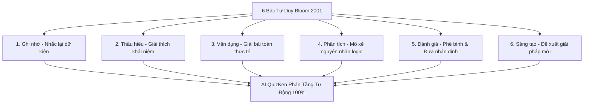

> **Tóm tắt nhanh (TL;DR):** Thang phân loại mục tiêu giáo dục của Benjamin Bloom được **Lorin Anderson & David Krathwohl (2001)** sửa đổi thành 6 cấp độ tư duy động từ: *Ghi nhớ (Remembering), Thấu hiểu (Understanding), Vận dụng (Applying), Phân tích (Analyzing), Đánh giá (Evaluating) và Sáng tạo (Creating)*. Việc biên soạn câu hỏi phân hóa chuẩn xác theo 6 bậc này thường mất hàng tuần làm việc của hội đồng chuyên môn. Với **QuizKen AI**, giáo viên có thể tự động tạo ngân hàng hàng trăm câu hỏi trắc nghiệm đa tầng bậc chỉ trong 3 bước.

---

## 1. 6 Cấp Độ Tư Duy Trong Thang Đo Bloom Sửa Đổi (Anderson & Krathwohl 2001)

Khác với thang Bloom 1956 sử dụng danh từ, bản sửa đổi năm 2001 của Anderson & Krathwohl sử dụng các động từ hành động để mô tả chính xác quá trình nhận thức của học sinh:

1. **Remembering (Ghi nhớ):** Nhận biết, liệt kê, nhắc lại các định nghĩa, mốc thời gian, công thức.
2. **Understanding (Thấu hiểu):** Giải thích ý nghĩa, tóm tắt, so sánh, phân loại các khái niệm.
3. **Applying (Vận dụng):** Sử dụng kiến thức đã học để giải quyết một tình huống hoặc bài toán cụ thể.
4. **Analyzing (Phân tích):** Bóc tách cấu trúc, phân biệt nguyên nhân - kết quả, chỉ ra mối liên hệ logic.
5. **Evaluating (Đánh giá):** Phê bình, đưa ra nhận định, bảo vệ quan điểm dựa trên các tiêu chí chuẩn mực.
6. **Creating (Sáng tạo):** Thiết kế, lập kế hoạch, tổng hợp thông tin để đề xuất giải pháp mới.

---

## 2. Bảng Ma Trận Động Từ Hành Động & Dạng Câu Hỏi Tương Ứng

| Cấp độ Bloom 2001 | Động từ chỉ thị mẫu (*Action Verbs*) | Mẫu câu hỏi trắc nghiệm chuẩn hóa |
| :--- | :--- | :--- |
| **1. Ghi nhớ** | Liệt kê, Gọi tên, Nhận dạng, Nhắc lại | *Đơn vị đo lường của cường độ dòng điện là gì?* |
| **2. Thấu hiểu** | Diễn giải, Phân loại, Tóm tắt, So sánh | *Hiện tượng khúc xạ ánh sáng khác với phản xạ ánh sáng ở điểm nào?* |
| **3. Vận dụng** | Tính toán, Áp dụng, Giải quyết, Sử dụng | *Cho mạch điện như sơ đồ hình 1, hãy tính hiệu điện thế giữa hai đầu điện trở R2.* |
| **4. Phân tích** | Phân biệt, Đối chiếu, Suy luận, Mổ xẻ | *Dựa vào đồ thị biến thiên nhiệt độ, nguyên nhân nào dẫn đến sự sụt giảm ở giai đoạn B?* |
| **5. Đánh giá** | Thẩm định, Phê bình, Lựa chọn tối ưu | *Phương án xử lý rác thải nào sau đây là tối ưu nhất xét trên cả góc độ chi phí và môi trường?* |
| **6. Sáng tạo** | Đề xuất, Thiết kế, Tích hợp, Xây dựng | *Để cải tiến hiệu suất của mô hình cánh quạt gió trong điều kiện gió yếu, giải pháp nào khả thi nhất?* |

---

## 3. Quy Trình 3 Bước Xây Dựng Ngân Hàng Đề Thi Bằng QuizKen AI

### Bước 1: Tải lên tài liệu chương bài học
Dán giáo án hoặc tài liệu chuyên đề vào [QuizKen AI Soạn Đề](https://quizken.com).

### Bước 2: Chọn phân bổ tỉ lệ các bậc Bloom
Giáo viên kéo thanh trượt để chỉ định tỉ lệ mong muốn (ví dụ: *30% Nhớ/Hiểu, 40% Vận dụng/Phân tích, 30% Đánh giá/Sáng tạo*).

### Bước 3: AI sinh ngân hàng câu hỏi đa dạng
Hệ thống AI xử lý ngữ nghĩa và trả về:
- Danh sách câu hỏi kèm nhãn cấp độ Bloom cụ thể.
- Bảng giải thích cơ sở lý luận của từng đáp án.
- Khả năng xuất đề trắc nghiệm giấy hoặc tổ chức thi trực tuyến ngay lập tức.

---

## 4. Lợi Ích Dành Cho Giáo Viên & Tổ Chuyên Môn

1. **Khách quan hóa việc đánh giá:** Tránh tình trạng đề thi quá thiên về câu hỏi học thuộc lòng hoặc quá đánh đố học sinh.
2. **Tiết kiệm 90% công sức:** Không cần phải họp tổ bộ môn nhiều ngày để cân đo từng câu hỏi.
3. **Phù hợp đổi mới chương trình:** Bám sát tuyệt đối định hướng đánh giá năng lực của Bộ Giáo dục và Đào tạo.

👉 **Nâng tầm chất lượng đề thi:** Xây dựng ngay ngân hàng câu hỏi chuẩn Bloom với [QuizKen Exam Creator](https://quizken.com) hoàn toàn miễn phí!

---

## 5. Câu Hỏi Thường Gặp (FAQ)

### Trắc nghiệm khách quan có kiểm tra được bậc Đánh giá và Sáng tạo không?
Có thể. Bằng cách thiết kế các câu hỏi tình huống thực tế phức tạp (*Case study questions*) đòi hỏi học sinh phải so sánh các phương án giải quyết và chọn ra giải pháp tối ưu nhất, trắc nghiệm vẫn đo lường rất tốt bậc Đánh giá và Sáng tạo.

### Có thể tải ngân hàng câu hỏi về máy tính dưới dạng Word/Excel không?
Hoàn toàn được. QuizKen hỗ trợ xuất dữ liệu ra file Word (`.docx`), Excel (`.xlsx`) hoặc PDF với đầy đủ bảng phân loại cấp độ Bloom.
