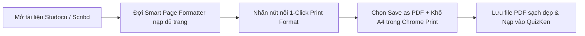

> **TL;DR (Tóm tắt nhanh):**  
> Để **xuất PDF Studocu chuẩn A4** không dính thanh menu web hay bị cắt chữ, bạn chỉ cần cài miễn phí (free) **DocCleaner** trên Chrome Web Store, nhấn vào nút nổi **1-Click Print Format** để tiện ích chuẩn hóa bố cục trang, sau đó chọn **Save as PDF** trong hộp thoại in của Chrome. File PDF sạch đẹp này có thể dùng để in ấn hoặc tải thẳng lên **[QuizKen](https://app.quizken.com)** tạo quiz AI!

---

# Hướng Dẫn Xuất PDF Studocu & Scribd Chuẩn A4 Bằng Nút 1-Click Print Format

Rất nhiều sinh viên có thói quen lưu đề cương về máy để đánh dấu (highlight) trên iPad hoặc mang ra tiệm photo in thành tập ôn thi. Tuy nhiên, nếu bạn nhấn `Ctrl + P` ngay trên trình duyệt mà chưa xử lý bố cục trang web, file PDF xuất ra thường bị lệch lề, dính thanh tiêu đề lặp lại hoặc bị chia nửa trang rất khó đọc.

Tính năng **1-Click Print Format** của **[DocCleaner - Better Studocu & Scribd Reader](https://chromewebstore.google.com/detail/doccleaner-better-studocu/fnhdoegoihnkgggnaiemommemdejhbkb?hl=vi)** được thiết kế để giải quyết chính xác vấn đề này bằng quy trình hoàn toàn cục bộ, tận dụng trực tiếp trình xuất PDF chuẩn xác của Google Chrome.

---

## 1. Quy Trình 5 Bước Xuất PDF Chuẩn Khổ A4 Với DocCleaner

### Bước 1: Mở tài liệu và kiểm tra trạng thái trang
Mở đường dẫn tài liệu bạn cần trên `studocu.com`, `studocu.vn` hoặc `scribd.com` (đảm bảo đã cài DocCleaner từ Chrome Web Store). Đợi vài giây để **Smart Page Formatter** nạp mượt mà các trang tài liệu.

### Bước 2: Nhấn nút nổi 1-Click Print Format
Ở góc màn hình, nhấn vào nút thao tác nổi (**floating action button**) của DocCleaner. Ngay lập tức, tiện ích sẽ:
* Ẩn toàn bộ thanh công cụ web, banner quảng cáo và nút bấm phụ không liên quan đến nội dung tài liệu.
* Căn chỉnh lại từng trang tài liệu theo khung in ấn liên tục.
* Tự động mở hộp thoại in gốc (*Print Dialog*) của trình duyệt.

### Bước 3: Thiết lập thông số xuất PDF chuẩn A4
Trong hộp thoại in của Chrome/Edge, hãy kiểm tra nhanh các mục sau để có bản PDF đẹp nhất:

| Thiết lập Chrome Print | Giá trị khuyên dùng | Tác dụng |
| :--- | :--- | :--- |
| **Máy in (Destination)** | **Lưu dưới dạng PDF (Save as PDF)** | Xuất thành file `.pdf` lưu trực tiếp trên máy |
| **Khổ giấy (Paper size)** | **A4** | Chuẩn khổ giấy in ấn phổ biến tại Việt Nam |
| **Lề (Margins)** | **Mặc định (Default)** hoặc **Không có (None)** | Chọn *Không có* nếu tài liệu gốc đã có lề sẵn |
| **Tỷ lệ (Scale)** | **Mặc định (Default)** | Giữ đúng tỷ lệ chữ và hình ảnh |
| **Đồ họa nền (Background graphics)** | **Bật (Checked)** | Giữ nguyên màu nền, khung bảng và sơ đồ minh họa |

### Bước 4: Xem trước (Print Preview) và nhấn Lưu
Cuộn nhẹ thanh xem trước bên trái hộp thoại in để chắc chắn toàn bộ trang từ đầu đến cuối đều hiển thị sắc nét, không bị cắt lề, rồi nhấn **Lưu (Save)** và đặt tên file theo môn học.

---

## 2. Mẹo Tối Ưu Cho Slide Bài Giảng Và Giáo Trình Dài

* **Với Slide bài giảng ngang (16:9):** Tại mục **Bố cục (Layout)**, hãy chuyển sang **Ngang (Landscape)** thay vì Dọc (Portrait) để slide hiển thị to hết cỡ, không bị dư khoảng trắng trên dưới.
* **Khi muốn in tiết kiệm giấy:** Tại mục **Số trang trên mỗi tờ (Pages per sheet)**, bạn có thể chọn `2` hoặc `4` trang/mặt khi xuất PDF trước khi mang đi in.
* **Không cần phần mềm bên thứ ba:** Vì dùng trực tiếp engine tạo PDF của Chromium, file xuất ra giữ được lớp văn bản (selectable text) ở các trang dạng chữ/HTML để bạn dễ tìm kiếm (`Ctrl + F`) hoặc copy ghi chú.

---

## 3. Đưa File PDF Chuẩn Đẹp Lên QuizKen Để Ôn Luyện Gấp Đôi Hiệu Quả

Khi đã có file PDF sạch sẽ trên máy, bạn đã sẵn sàng chuyển sang bước luyện tập thông minh với **[QuizKen](https://app.quizken.com)**:

1. **Trích xuất đề thi tự động:** Tải file PDF vừa xuất lên tính năng **Tạo đề từ PDF của QuizKen**. AI sẽ đọc toàn bộ tài liệu sạch không dính rác quảng cáo, từ đó sinh câu hỏi trắc nghiệm chuẩn xác hơn hẳn.
2. **Tạo bộ Flashcard ôn nhanh:** Chuyển hóa các khái niệm, định luật hoặc từ vựng trong file PDF thành thẻ ghi nhớ lặp lại ngắt quãng (Spaced Repetition).
3. **Theo dõi tiến độ:** Biết chính xác mình đã nắm vững bao nhiêu phần trăm nội dung tài liệu trước khi bước vào phòng thi.

---

## 4. Câu Hỏi Thường Gặp (FAQ)

### 1. Vì sao file PDF tôi xuất bị mất màu khung bảng hoặc tô đậm?
Hãy mở mục **Cài đặt khác (More settings)** trong hộp thoại in của Chrome và tích chọn ô **Đồ họa nền (Background graphics)** trước khi bấm Lưu.

### 2. Nút 1-Click Print Format có hoạt động khi mất kết nối mạng sau khi đã tải trang xong không?
Có. Một khi trang tài liệu đã được tải và pre-render đầy đủ trên trình duyệt, thao tác chuẩn hóa bố cục và xuất PDF qua Chrome diễn ra 100% cục bộ trên máy tính của bạn.

### 3. Tính năng xuất PDF này có giới hạn số trang hay đóng watermark không?
Không. DocCleaner hoàn toàn miễn phí và không bao giờ chèn watermark quảng cáo vào file PDF của bạn.

---

**Trải nghiệm ngay:** [Cài đặt DocCleaner trên Chrome Web Store](https://chromewebstore.google.com/detail/doccleaner-better-studocu/fnhdoegoihnkgggnaiemommemdejhbkb?hl=vi) và tải tài liệu của bạn lên **[QuizKen](https://app.quizken.com)** để bắt đầu ôn thi ngay hôm nay!
